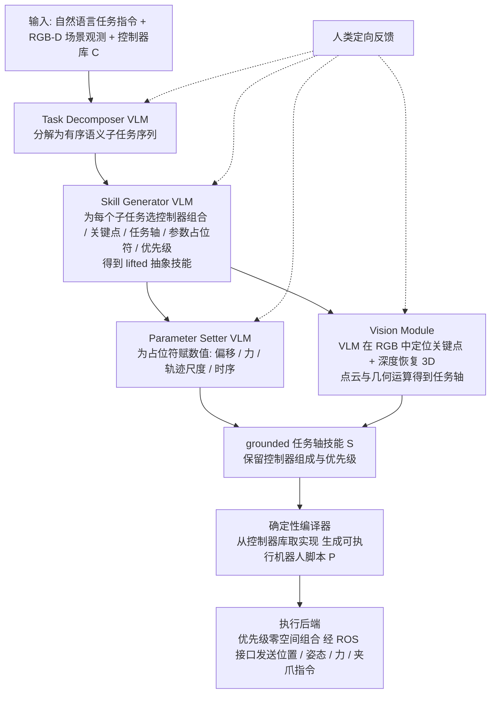

# GTA-2（arXiv:2609.09808）

**GTA-2**（[GTA-2: A Multi-VLM Framework for Synthesizing Robot Manipulation Skills via Grounded Task Axes](https://arxiv.org/abs/2609.09808)）来自 [具身智能小站 11 篇盘点](../../sources/blogs/wechat_embodied_station_11_papers_vlm_manipulation_2026-09-10.md)。四 VLM 分工任务拆解/技能生成/控制器参数/RGB-D grounding，确定性编译器输出 ROS 程序；零样本技能合成。

## 一句话定义

**无需任务演示或策略微调的技能合成框架（固定技能库 vs 端到端折中）。**

## 英文缩写速查

| 缩写 | 英文全称 | 简要说明 |
|------|----------|----------|
| IL | Imitation Learning | 从专家示范学习策略 |
| VLM | Vision-Language Model | 视觉-语言多模态模型 |
| WM | World Model | 预测未来观测或表征的动力学模型 |
| RL | Reinforcement Learning | 强化学习 |
| CEM | Cross-Entropy Method | 采样优化动作/轨迹的规划器 |
| DoF | Degrees of Freedom | 自由度 |

## 为什么重要

- 纳入本期 **VLM 控制 / 世界模型 / 灵巧操作 / 规划 / 评测** 主线之一。
- 开源状态：**待发布**（步骤 2.5 核查，2026-09-10）。
- 与 [11 篇技术地图](../overview/vlm-manipulation-11-papers-technology-map.md) 中同类工作可横向对照。

## 流程总览

图依据：论文 §III-A 至 §III-E / Fig. 2（Overview of GTA-2）。

## 核心机制

| 项 | 内容 |
|----|------|
| **arXiv** | [2609.09808](https://arxiv.org/abs/2609.09808) |
| **项目页** | https://gta2-project.github.io/ |
| **代码** | 待发布 |
| **开源** | **待发布** |
| **文内指标** | 无需任务演示或策略微调的技能合成框架（固定技能库 vs 端到端折中）。 |

## 源码运行时序图

**不适用**（项目页已上线；截至入库日未见可运行代码仓链接。）。

## 实验与评测

| 项 | 文内口径 |
|----|----------|
| 设定 | **无需任务演示、无需策略微调** 的零样本技能合成 |
| 分工 | 四个 VLM 分别负责 **任务拆解 / 技能生成 / 控制器参数 / RGB-D grounding** |
| 产物 | 确定性 **编译器** 输出可执行 **ROS 程序** |
| 定位 | 固定技能库与端到端策略之间的折中 |

- **读法：** 本页为清单摘要，上表取自 [公众号盘点](../../sources/blogs/wechat_embodied_station_11_papers_vlm_manipulation_2026-09-10.md) 与项目页；任务集、成功率与失败归因以 **原文 PDF** 为准（[参考来源](#参考来源)）。
- **该看哪一栏：** 这类工作的可比量不只是成功率，还有 **合成成功率**（能否编出可跑程序）与 **VLM 调用成本**；只报终点成功率会掩盖前一环的失败。

## 与其他工作对比

| 对照路线 | 差异 |
|----------|------|
| 端到端 [VLA](../methods/vla.md) | 需演示数据与策略微调；GTA-2 **不训策略**，靠 VLM 合成 + 编译器落地。 |
| 固定技能库 / 行为树查表 | 覆盖面受限于预写技能；GTA-2 在 **grounded task axes** 上合成新技能，代价是合成本身可能失败。 |
| [Show-Harness](./paper-show-harness.md) | 同为「VLM 直接驱动机器人」，但那边是 **单 agent 出离散微动作**（在线闭环）；GTA-2 是 **多 VLM 分工离线编译出 ROS 程序**（先编后跑）。 |
| LLM 直接生成代码的规划工作 | 常把语言模型输出直接当程序；GTA-2 在 VLM 与执行之间插了 **确定性编译器**，把不可控的自由文本收敛到可执行结构。 |
| 单 VLM 全包 | 让一个模型同时做拆解、参数与 grounding；本文按四类子问题分工，便于逐环定位失败。 |

## 结论

**GTA-2 值得按「待发布」边界阅读：先核对仓库是否可跑，再引用文内成功率数字。**

1. 索引来源为公众号导读，实验细节以 arXiv PDF 为准。
2. 开源结论：**待发布** — 项目页已上线；截至入库日未见可运行代码仓链接。。
3. 选型时对照 [11 篇地图](../overview/vlm-manipulation-11-papers-technology-map.md) 中相邻节点，避免重复造页。

## 关联页面

- [VLM 与操作 11 篇技术地图](../overview/vlm-manipulation-11-papers-technology-map.md)
- [模仿学习 (Imitation Learning)](../methods/imitation-learning.md)
- [Generative World Models](../methods/generative-world-models.md)
- [Manipulation](../tasks/manipulation.md)

## 参考来源

- [gta-2_arxiv_2609_09808.md](../../sources/papers/gta-2_arxiv_2609_09808.md)
- [wechat 11篇盘点](../../sources/blogs/wechat_embodied_station_11_papers_vlm_manipulation_2026-09-10.md)
- [arXiv:2609.09808](https://arxiv.org/abs/2609.09808)
- [arXiv PDF](https://arxiv.org/pdf/2609.09808)：已通读方法部分（实验与附录以略读为准）：§I 引言、§III 方法（任务轴技能表示、lifted 技能合成、场景落地、脚本编译与执行、人类定向修正）

## 推荐继续阅读

- [arXiv PDF](https://arxiv.org/pdf/2609.09808)
- [项目页](https://gta2-project.github.io/)

