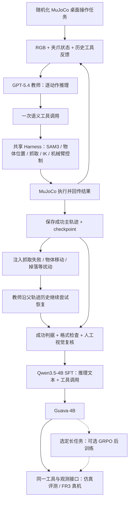
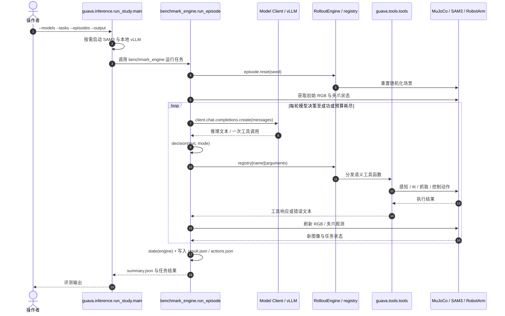

# Guava：机器人操作 Harness 中的前沿 VLM 蒸馏
**Guava: Distilling Frontier VLMs into a Compact Agent through a Robotic Manipulation Harness**

## 一句话定义

**Guava** 用一个统一的、每次只执行一步语义工具的机器人操作 Harness，让云端 GPT-5.4 教师在仿真中生成含失败恢复的推理/动作轨迹，再将这些能力蒸馏至本地 **Qwen3.5-4B（Guava-4B）**，在共享工具接口上运行桌面操作任务。

## 英文缩写速查

| 缩写 | 英文全称 | 简要说明 |
|---|---|---|
| VLM | Vision-Language Model | 根据 RGB、操作历史与文字工具反馈做决定的模型 |
| SFT | Supervised Fine-Tuning | 用 GPT-5.4 的多轮推理/工具调用轨迹训练 Guava-4B |
| GRPO | Group Relative Policy Optimization | 少数长时程任务附加的在线强化学习后训练方法 |
| IK | Inverse Kinematics | Harness 将语义操作转成机械臂运动所需的逆运动学 |
| API | Application Programming Interface | 云端教师与本地学生共享的工具调用和执行反馈接口 |
| SAM3 | Segment Anything Model 3 | 官方开源仿真 Harness 所用的视觉分割依赖 |
| Sim2Real | Simulation to Real | 仿真数据训练后，在真实 FR3 操作臂上评估 |

## 核心信息

| 项目 | 核实内容 |
|---|---|
| 论文 | [arXiv:2606.18363v3](https://arxiv.org/html/2606.18363v3)（本页按 v3） |
| 项目 / 代码 | [官方主页](https://guava-harness.github.io/) · [hdacnw/guava-release](https://github.com/hdacnw/guava-release) |
| Teacher / Student | GPT-5.4 → Qwen3.5-4B（Guava-4B） |
| 训练轨迹 | 2,268 条：1,554 主轨迹 + 714 扰动恢复分支 |
| 仿真 / 真机 | MuJoCo 桌面操作 / Franka Research 3 |
| 公开资产 | 仿真 Harness、采集/恢复/评测与 SFT/GRPO 脚本、[4B 权重](https://huggingface.co/AIcell/guava-v13b-qwen3.5-4b)、[SFT 轨迹](https://huggingface.co/datasets/AIcell/Guava-4B-SFT-data) |
| 开放条件 | SAM3 等第三方 checkpoint 有额外获取条件；仓库根目录未见顶层 LICENSE，勿假设商用授权 |

## 为什么重要

- **把模型性能与工具接口拆开看。** 操作成功率不仅来自模型参数大小，还取决于是否有物体指向的抓取/对齐原语、可用夹爪状态，以及执行失败后的再观测。
- **将昂贵的交互决策蒸馏到本地。** 不是将 GPT 输出变成电机电流或逐关节力矩，而是保留高层规划/纠错，由快控制器与视觉模块完成物理动作。
- **恢复轨迹更值得收集。** 对未见任务，加入分支恢复数据使论文报告成功率从 77.1% 提升至 90.8%；是对失败处理的实验证据，而非泛化到所有未知环境的保证。

## 流程总览（依据论文 v3 方法与数据管线）

图中主轨迹和分叉恢复都来自教师与工具的闭环交互；真机使用共享的高层调用接口，底层运动并非由 VLM 以高频直接控制。

## 核心原理

### 1. 逐动作规划与共享语义工具

每个回合的逻辑是：观察 RGB、夹爪位姿/状态与之前工具反馈 → VLM 生成一次动作调用 → Harness 执行 → 取得新反馈并决定下一步。工具包含 get_position、get_position_and_size、grasp、align、move、rotate、release 等，具体动作受机器人几何、感知和控制模块约束。

### 2. 在仿真中收集可修复失败

GPT-5.4 在随机化 MuJoCo 场景执行任务，保存中间状态与工具历史。从已保存状态人为注入 grasp_failure、object_moved_align、drop_during_transport 等偏差，教师继续规划直到成功或终止。按轨迹有效性、环境结果和视觉审核筛选，再组合正常与分叉轨迹。公开 SFT 数据的 **2,268 条是轨迹数**，不是 2,268 个独立初始环境。

### 3. SFT 为主体，GRPO 为可选附加

学生网络使用 Qwen3.5-4B 基座学习教师推理/工具调用格式；主要仿真/真机表格报告的是蒸馏模型。论文还在 Shell Game 与 Red Objects in Basket 上实验 GRPO 后训练，不能把这两个任务的 RL 增益解释成全部基准或真机结果。

## 源码运行时序图（已核对官方入口与函数）

数据采集的另一条真实入口为 collect_release.main → collection.runner.run_collection → collection.trial.run_trial → collection.rollout.continue_rollout / execute_observe；collect_branches.main 从 checkpoint 恢复并生成扰动分支。上述图刻画**评测运行链**，不把训练数据采集与评测的两种入口混成一条虚构的函数调用。

## 实验与评测

| 评估设置 | GPT-5.4 | 原始 Qwen3.5-4B | Guava-4B |
|---|---:|---:|---:|
| MuJoCo：15 任务 × 30 次 | 90.4% | 22.2% | **87.1%** |
| 真机：9 任务 × 10 次 | 93.3% | 28.9% | **90.0%** |
| LIBERO-PRO：初始位置扰动（0–1） | 0.45 | 0.06 | **0.41** |
| LIBERO-PRO：任务指令扰动（0–1） | 0.44 | 0.03 | **0.41** |

- **恢复数据消融：** Guava-4B 未见 8 个仿真任务有恢复数据 90.8%，去掉后 77.1%；全部 15 任务分别 87.1% 与 79.3%。已见任务为 82.9% vs 81.9%。
- **工具接口消融：** 完整 Harness 的教师/原始 4B 为 88.6%/22.9%，仅 RGB 为 56.2%/3.8%；使用 7 任务 × 15 次，不与主表 15×30 直接混算。
- **选定 GRPO 任务：** Shell Game 63.3% → 90.0%，Red Objects in Basket 80.0% → 86.7%；各 30 次。
- **本地模型调用延迟：** 单 RTX 5090 上 Guava-4B 0.587s/请求，GPT-5.4 API 为 4.168s，缩短约 **7.10×**；生成 token/episode 2,389 → 795。**不表示完整机器人回合加速 7.10×**，也不代表 0.587s 可作实时力矩周期。

## 结论

**Guava 表明，固定操作 Harness、收集教师的失败恢复分支，再蒸馏模型工具调用，可以让本地 4B 机器人 agent 在作者设定的桌面操作评测中接近前沿云端教师。**

1. 首先检查**感知/工具/反馈协议**，不要只比较模型大小与 VLM 能力。
2. 数据必须含**失败恢复与重新观测**，仅示教成功路径对未见任务不够。
3. 优先复现仿真 15 任务 × 30 次及 held-out 划分，再谈 Sim2Real。
4. 单次模型请求延迟、整段行动时间和低层控制频率要分别测。
5. 将 GRPO 的少数长任务结果与主要 SFT/真实机器人结果分开报告。

## 与其他工作对比

| 工作 | 核心区别 |
|---|---|
| [AgenticRoboRL](./paper-agentic-roborl.md) | 两者都对机器人 planner 做教师数据/后训练；Guava 更突出**固定语义工具 Harness、仿真恢复分支与 4B 蒸馏/真机** |
| [LLM 机器人控制接口](../concepts/llm-robotics-control-interfaces.md) | Guava 是其中“语义工具控制”路线：慢模型做逐动作选择，不直接输出实时力矩 |
| [VLA](../methods/vla.md) | 常规端到端 VLA 倾向输出低层动作或 action chunks；Guava 输出语义工具调用并由专门执行器落地 |

## 工程实践

1. 克隆 [官方仓库](https://github.com/hdacnw/guava-release)，按 README 初始化 robosuite、SAM3 子模块，配置 Linux x86-64、Python 3.11、CUDA 与分别隔离的 eval / sam3 / serve 环境；SAM3 模型需自行获取使用权限。
2. 先用命令行入口 `python -m guava.inference.run_study --provider local --models AIcell/guava-v13b-qwen3.5-4b --tasks can_in_bin --episodes 1 --output runs/guava-check --dry-run` 预览配置，不发 API 请求、不运行实验。
3. 教师数据走 collect_release → collect_branches → filter_trajectories → convert_to_native；训练走 run_sft_full.sh（选定任务可继续 run_grpo_full.sh）。
4. 跑仿真时固定任务、seed、max turns、相机、grasp 模式、模型 revision，分别统计 task success、工具无效输出、恢复次数、模型 token/调用耗时及实际墙钟总耗时。
5. 接真机前保留底层控制与安全约束、动作区域白名单、碰撞检测和人工急停。**静态源码审阅不等于已跑通模型或真机**。

## 局限与风险

- **平台/场景窄：** 以桌面任务与 Franka 操作臂为主，不能据此证明人形全身操作、灵巧手在手内调整或密集接触任务性能。
- **外部工具依赖：** SAM3 分割、物体坐标估计、IK 和语义技能的可靠性都是成功前提；视觉遮挡、抓取失败、动态物体会累积误差。
- **延迟并非消失：** 0.587 秒是平均模型调用，不含整套物理运动/感知/等待。
- **数据/结果口径：** 2,268 轨迹与 15 个评测任务不同；未见任务是在指定划分内未见，不等于跨本体、跨所有环境泛化。
- **代码可得性不等于整体再现：** 发布仿真 Harness、权重与训练工具，真机装备与 SAM3 权重有外部条件；根目录未发现 LICENSE，商业使用应先询问权利人并核对第三方许可。
- **和同名工作区分：** 不是人体重建论文 PEAR 使用的 GUAVA 像素神经渲染器。

## 关联页面

- [LLM 机器人控制接口](../concepts/llm-robotics-control-interfaces.md) — 语义工具调用在直接控制/程序/策略控制中所处层次
- [Manipulation：机器人操作](../tasks/manipulation.md) — 桌面操作任务与执行器能力前提
- [VLA 方法](../methods/vla.md) — 动作输出范式对照
- [AgenticRoboRL](./paper-agentic-roborl.md) — 固定机器人 Harness 之上的 SFT 与后训练对照
- [ASPIRE：自主程序技能](../methods/aspire.md) — 程序/工具层的闭环失败修复路线

## 参考来源

- [arXiv:2606.18363v3 论文正文/附录精读](../../sources/papers/guava_arxiv_2606_18363.md)
- [作者项目主页与开放状态](../../sources/sites/guava-harness-project.md)
- [官方仓库评测/采集/训练源码核验](../../sources/repos/guava-release.md)

## 推荐继续阅读

- [官方论文 HTML v3](https://arxiv.org/html/2606.18363v3)
- [Guava 官方项目页](https://guava-harness.github.io/)
- [Guava GitHub 源码和运行步骤](https://github.com/hdacnw/guava-release)
- [Guava-4B 模型](https://huggingface.co/AIcell/guava-v13b-qwen3.5-4b) · [SFT 数据](https://huggingface.co/datasets/AIcell/Guava-4B-SFT-data)
