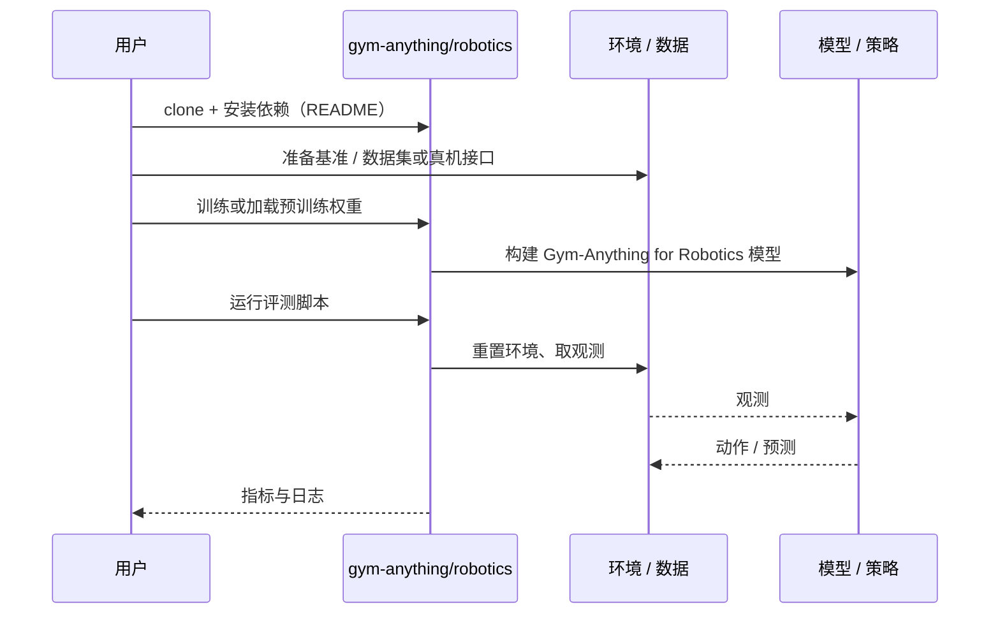

# Gym-Anything for Robotics（arXiv:2610.40565）

**Gym-Anything for Robotics**（*Gym-Anything for Robotics: Scaling physical simulations with digital agents*，[arXiv:2610.40565](https://arxiv.org/abs/2610.40565)，[项目页](https://gym-anything.github.io/robotics/)，[代码](https://github.com/gym-anything/robotics)）来自 [具身智能小站 2026-11-03 盘点](../../sources/blogs/wechat_embodied_station_49_papers_sacq_action_aware_quantization_2026-11-03.md)，属「评测、数据与基准」组。

## 一句话定义

**Gym-Anything 以创建与审查循环生成多行业机器人仿真任务，并研究如何通过交互经验提升智能体表现。**

## 英文缩写速查

| 缩写 | 英文全称 | 简要说明 |
|------|----------|----------|
| Gym-Anything for Robotics | Gym-Anything for Robotics: Scaling physical simulations with digital agents | 本文方法 / 基准的简称 |

## 为什么重要

- 让代码智能体构建物理仿真。仿真覆盖扩大仍需独立核验物理有效性。
- 开源结论：**已开源**（步骤 2.5，2026-11-03）。仓库可达（git ls-remote）。项目页 HTTP 200。
- 同期同组工作见 [动作感知量化、失败定位与可验证自主：具身智能小站 11-03 期 49 篇阅读坐标](../overview/embodied-station-2026-11-03-49-papers-technology-map.md)。

## 核心机制

| 项 | 内容 |
|----|------|
| **arXiv** | [2610.40565](https://arxiv.org/abs/2610.40565) |
| **开源** | **已开源** |
| **要点** | Gym-Anything 以创建与审查循环生成多行业机器人仿真任务，并研究如何通过交互经验提升智能体表现。 |
| **文内指标** | 公众号转述：仿真覆盖扩大仍需独立核验物理有效性。 |

## 源码运行时序图

以下为按仓库入口（`gym-anything/robotics`）推断的通用运行链路；入库日仅核实仓库可达，未逐文件阅读，具体脚本名以 README 为准。

## 实验与评测

- 公众号转述：仿真覆盖扩大仍需独立核验物理有效性。
- **读法：** 本页为索引级摘要，依据公众号转述的官方摘要与仓库信息整理；逐项数字与 baseline 以原文 PDF 为准。

## 与其他工作对比

- 横向索引见 [动作感知量化、失败定位与可验证自主：具身智能小站 11-03 期 49 篇阅读坐标](../overview/embodied-station-2026-11-03-49-papers-technology-map.md)；同 arXiv 不重复造页。

## 结论

**让代码智能体构建物理仿真：仿真覆盖扩大仍需独立核验物理有效性。**

1. 开源边界：**已开源** — 仓库可达（git ls-remote）。项目页 HTTP 200。
2. 核心机制：Gym-Anything 以创建与审查循环生成多行业机器人仿真任务，并研究如何通过交互经验提升智能体表现。
3. 复现与选型前核对任务协议、硬件与基准口径，勿直接横比公众号摘录数字。

## 关联页面

- [simulation-evaluation-infrastructure](../concepts/simulation-evaluation-infrastructure.md)
- [vla](../methods/vla.md)
- [manipulation](../tasks/manipulation.md)
- [embodied-station-2026-11-03-49-papers-technology-map](../overview/embodied-station-2026-11-03-49-papers-technology-map.md)
- [具身大模型评测基准选型闭环](../queries/embodied-eval-benchmark-selection-loop.md) — 本页可归入其 ④ sim↔real 评测 gap 校准层的上游：代码智能体批量生成的仿真任务扩大了覆盖面，但须独立核验物理有效性，防止把「仿真可复现 / 任务多」误当真机代表性。

## 参考来源

- [gym_anything_for_robotics_arxiv_2610_40565.md](../../sources/papers/gym_anything_for_robotics_arxiv_2610_40565.md)
- [wechat_embodied_station_49_papers_sacq_action_aware_quantization_2026-11-03.md](../../sources/blogs/wechat_embodied_station_49_papers_sacq_action_aware_quantization_2026-11-03.md)
- [arXiv:2610.40565](https://arxiv.org/abs/2610.40565)

## 推荐继续阅读

- [arXiv PDF](https://arxiv.org/pdf/2610.40565)
- [项目页](https://gym-anything.github.io/robotics/)
- [https://github.com/gym-anything/robotics](https://github.com/gym-anything/robotics)
