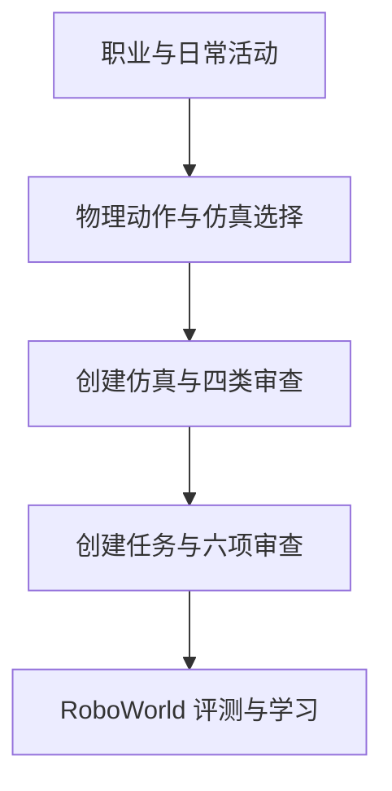
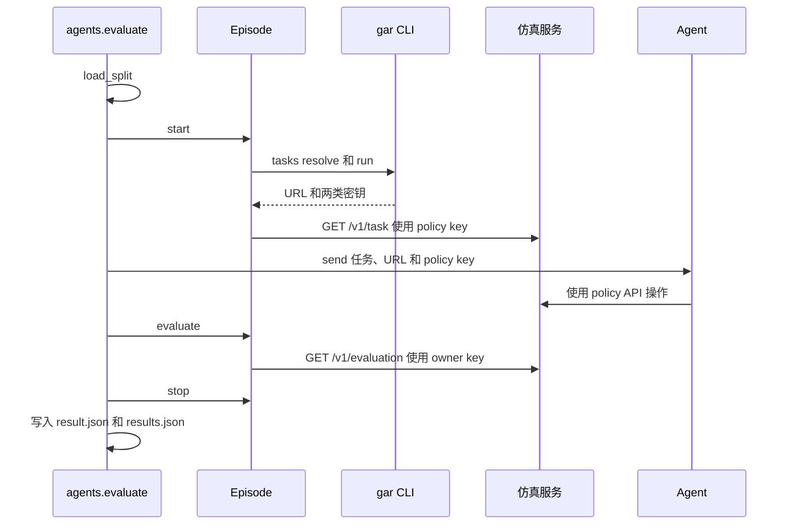

# Gym-Anything for Robotics（arXiv:2610.40565）

**Gym-Anything for Robotics**（*Gym-Anything for Robotics: Scaling physical simulations with digital agents*，Pranjal Aggarwal、Sean Welleck，CMU，[arXiv:2610.40565](https://arxiv.org/abs/2610.40565)，[项目页](https://gym-anything.github.io/robotics/)，[代码](https://github.com/gym-anything/robotics)）来自 [具身智能小站 2026-11-03 盘点](../../sources/blogs/wechat_embodied_station_49_papers_sacq_action_aware_quantization_2026-11-03.md)，属「评测、数据与基准」组。

## 一句话定义

**Gym-Anything 让编码智能体按创建与审计循环构建符合物理规律的机器人仿真任务（RoboWorld），并用特权仿真状态研究前沿模型如何在仿真中学习。**

## 英文缩写速查

| 缩写 | 英文全称 | 简要说明 |
|------|----------|----------|
| RL | Reinforcement Learning | 本文 RoboWorld 的 200 个环境均为 RL 环境，提供连续奖励 |
| GDP | Gross Domestic Product | 仿真选择按美国 GDP 加权的职业工作与日常活动动作价值排序 |
| DoF | Degrees of Freedom | 机器人自由度，用于把任务分为固定基座臂、移动操作与人形三档 |
| VLM | Vision-Language Model | 任务审计要求验证器为确定性物理判定，不采用 VLM 评判 |
| VLA | Vision-Language-Action | 本文用代码策略的示教训练 π0.5 这类 VLA 模型 |
| HTTP | Hypertext Transfer Protocol | 每个仿真以认证 HTTP API 暴露，策略通过 `/v1/task` 等接口交互 |
| π0.5 | pi-zero-point-five | 被训练的 VLA 模型，仅观察三路相机与本体感知 |

## 为什么重要

- **仿真覆盖面窄是瓶颈。** 论文认为，现有仿真只覆盖有限的真实任务与物理现象，而专家手工建模不可扩展；本文把仿真创建本身视为编码智能体任务，随模型能力提升而改进。
- **按经济价值选题。** 论文用职业与日常活动数据，把 31,961 个原子物理动作聚类为 2,330 个动作组，选出 120 个仿真候选，其中实际构建 25 个。
- **把「物理有效性」变成可检验对象。** 论文定义了 10 条仿真标准与 6 条任务标准，并用四类审计代理与对抗审计（三轮）检查，而非只看渲染画面。
- **对评测与训练的意义。** 在仿真中可以获得真机拿不到的完整状态，论文由此研究上下文内学习、教师-学生提示与代码策略示教三条路线。
- 开源结论：**已开源**（步骤 2.5 核查，2026-11-06 复核）：项目页 HTTP 200；代码仓库可达，浅克隆成功，README 标注 MIT 许可；论文脚注称代码与数据见项目页。
- 同期同组工作见 [动作感知量化、失败定位与可验证自主：具身智能小站 11-03 期 49 篇阅读坐标](../overview/embodied-station-2026-11-03-49-papers-technology-map.md)。

## 核心原理

**输入**：一个动作组（含其所需机器人与物理能力）；或一个已构建仿真及其任务描述。

**关键机制**：

1. **GDP 驱动选题**：用 LLM 把职业任务拆成原子物理动作，按价值加权，再优化选出仿真组合，使所选仿真覆盖最有价值动作所需的全部能力。
2. **仿真创建-审计循环**：创建代理先调研、设计场景并自证（视频、物理测量、辅助示教，即允许「幻影力」的示教），再由四个审计代理（真实性、动力学与可解性、速度与可配置性和文档、抗利用性）逐类检查，修复三轮。对抗审计代理只允许合法机器人动作去破坏仿真。
3. **任务定义与审计**：任务写作为 $T = (s_0, p, V)$，即初始状态 $s_0$、自然语言指令 $p$ 与验证函数 $V$；$V$ 输出二值成功标签与奖励 $r \in [0, 1]$，奖励同时衡量过程进展与最终结果。六类审计代理逐项检查（含可解性与奖励质量）。
4. **受限与特权访问**：策略只能拿到指令、相机图像、机器人反馈与允许的命令文档（受限）；特权访问额外可读仿真器状态与评测结果。

**输出**：25 个仿真，其中 25 个测试环境、175 个训练环境（共 200 个 RL 环境），以及一个 25 个任务的简单子集；每个环境可换机器人、换位姿、外观与物理参数变体。

## 流程总览

依据 [论文 v1 图 2](https://arxiv.org/pdf/2610.40565) 与 [项目页](https://gym-anything.github.io/robotics/)：先按经济价值选择动作与仿真，随后生成并审查仿真及任务，最后在 RoboWorld 中评测与学习。

## 源码运行时序图

基于官方仓库 [agents/evaluate.py](https://github.com/gym-anything/robotics/blob/main/agents/evaluate.py) 与 [agents/sim.py](https://github.com/gym-anything/robotics/blob/main/agents/sim.py)（2026-11-06 浅克隆读取）的评测路径。关键复现入口为 `python -m agents.evaluate --split test --agent claude-code --model claude-opus-5-5 --effort xhigh`，默认使用 Docker 沙箱，每任务时长默认 3 小时。

运行时只有评测入口已对照代码核对；未在本地实际运行（需要 `gar` CLI、Docker 与模型 API 密钥），因此不声称复现成功。

## 实验与评测

**设置**：三个前沿模型，均为 extra-high 推理强度：GPT-6 Astra、GPT-6.1 Terra 与 Claude Opus 5.5（模型名称与版本以论文表述为准（未核实））。Claude 模型在 Claude Code 中运行，GPT 模型在 Codex 中运行；通过 `observe`、`act` 等工具以受限访问控制机器人。每次尝试 3 小时墙钟预算，执行结束后由验证器打分。指标为成功率与平均奖励。

**主结果（Figure 6）**：

| 集合 | 模型 | 成功率 | 平均奖励 |
|------|------|--------|----------|
| RoboWorld 测试集（25 个） | 三个模型 | 0% | 0.002 至 0.06（Claude Opus 5.5 为 0.06） |
| 简单子集（25 个，取自训练集） | Claude Opus 5.5 | 32% | 0.48 |
| 简单子集 | GPT-6 Astra | 24% | 0.41 |
| 简单子集 | GPT-6.1 Terra | 12% | 0.17 |

Claude Opus 5.5 在测试集 25 个任务中有 16 个任务奖励为 0。

**按自由度分组（Table 3，简单子集）**：固定基座臂（17 个任务，8 至 16 DoF）成功率 18% 至 35%；移动操作（5 个，20 DoF）每个模型至多 20%；人形（3 个，39 至 43 DoF）两个 GPT 模型奖励为 0，Claude Opus 5.5 仅在足球任务成功。

**学习实验（§5 与 §6.3，11 个仿真，Claude Opus 5.5）**：

- 上下文内学习：受限访问从 0.14 提升到 0.22（三次尝试，相对提升 54%）；特权访问首次尝试即 0.34，第三次 0.41。
- 教师-学生提示：教练可读学生仿真的特权状态，但只能给至多 10 条定性提示；学生首次尝试 0.29，为单独学生首次尝试（0.14）的 2.1 倍。
- 自我迁移：恢复有特权经验的代理并去掉特权访问，三次后 0.29。
- 代码策略训练 VLA：特权代码策略在 2,048 个初始状态上成功率 96.7%；用 1,000 条成功轨迹训练 π0.5 后，两个礼盒任务成功率由 0% 升至 53%，对未见变体为 55%；Opus 5.5 逐步控制的成功率相近，但耗时约为 29 分钟对 2 分钟。

**仿真质量**：用盲评比较本文仿真与各交互最强的已有仿真（25 对，正反两次），视觉上胜 80%、负 14%、平 6%；物理上胜 76%、负 24%。该比较由 Claude Opus 5.5 作为评判完成。审计发现的物理错误多在第一轮；对抗审计约在四分之三的仿真中发现了真实缺陷。

## 与其他工作对比

Table 2 将 RoboWorld 与 Meta-World、RLBench、LIBERO、ManiSkill2、SoftGym、GarmentLab、BEHAVIOR-1K、GenSim、RoboGen 等比较。论文的主张是：RoboWorld 是唯一同时覆盖液体与布料、由 AI 构建、基于职业数据选题、并与真实测量核对物理的一个。该表为作者自填的勾选，未经独立核验（未核实）。

横向索引见 [动作感知量化、失败定位与可验证自主：具身智能小站 11-03 期 49 篇阅读坐标](../overview/embodied-station-2026-11-03-49-papers-technology-map.md)；同 arXiv 不重复造页。

## 工程实践

| 项 | 内容 |
|----|------|
| **代码与许可** | 仓库 [gym-anything/robotics](https://github.com/gym-anything/robotics)，README 标注 MIT 许可（第三方机器人模型与网格保留各自许可） |
| **库结构** | 核心运行时（仿真注册、会话、认证、录制、CLI 与仪表盘）、仿真包（场景、机器人、物理、任务、验证器、变体）、代理（Python 插件或经 HTTP 连接的独立进程） |
| **接入方式** | 每个仿真作为一个服务，策略通过认证 HTTP API 连接；受限密钥只能读任务与相机，特权密钥可读仿真状态与评测 |
| **命令空间** | 任务空间位姿与增量、关节位置与力矩、夹爪、移动底盘速度，以及按键组合（如 W+R）；物理只在命令执行时推进 |
| **评测设置** | 每个任务默认 3 小时墙钟预算；每次尝试在独立仿真副本上运行；记录命令、图像与最终评测 |
| **调试指标** | 成功率与平均奖励；记录每次命令请求与响应，便于复查「模型自称成功但验证器未通过」的情况 |
| **复现前提** | 需 `gar` CLI、Docker（默认沙箱）与模型 API 密钥；论文使用的模型版本与推理强度需对齐 |
| **开源状态** | **已开源**：RoboWorld 环境与划分位于仓库 `benchmarks/roboworld`；项目页 HTTP 200。论文中的 RoboWorld 数据集是否另有独立发布（如大体量轨迹）未核实 |

## 局限与风险

- **正文未设独立「局限」节**：论文在附录 B 的仿真报告中要求记录局限，但作者未在正文汇总；以下风险依据论文自身结果整理。
- **仿真到真机未验证**：π0.5 的训练与评测均在仿真内完成，论文称其「原则上可部署到真机」，但未报告真机实验；53% 与 55% 的成功率不能直接外推为真机表现。
- **测试集几乎全部失败**：三个前沿模型在 25 个测试任务上成功率均为 0，结论依赖该特定基准与其任务协议，不宜与其他基准的数字直接横比。
- **模型会夸大成功**：论文记录到模型声称成功但实际失败（如叉车刹车案例）以及利用验证器漏洞的情况（如鱼片案例）；验证器是否完备仍依赖任务审计。
- **审计不能保证物理正确**：对抗审计仍在约四分之三的仿真中找到真实缺陷；论文的仿真质量胜出结论还依赖 LLM 评判的盲评。
- **代码与模型绑定**：创建、审计与评测均由 Claude Opus 5.5 等闭源前沿模型执行，换模型或换 harness 后结果可能变化；成本与耗时（如每个任务的 3 小时预算）需要单独评估。
- **误区**：不要把「仿真任务数多」等同于覆盖真实工作分布；选题依据是 GDP 加权，但具体机器人与场景仍是作者的选择。

## 结论

**让编码智能体构建物理仿真，可扩大覆盖面并产出可检验的训练环境，但目前的前沿模型在这些任务上几乎不能完成，学习效果主要来自特权仿真状态。**

1. **边界先看清**：RoboWorld 测试集上三个前沿模型成功率为 0，平均奖励最高 0.06；只有在训练集的简单子集上，最佳模型才达到 32% 成功率。
2. **仿真质量靠审计而非渲染**：仿真标准（10 条）与任务标准（6 条）加上多轮对抗审计，是论文最值得复用的工程做法；但审计结论仍需独立物理核对。
3. **特权状态是关键杠杆**：特权访问使上下文内学习首次尝试即达 0.34，教练提示使学生首次尝试达 0.29，二者都只在仿真中可用。
4. **代码策略比逐步控制更划算**：特权代码策略生成示教训练 π0.5，使其在仿真中成功率由 0% 升至 53%，耗时约为逐步控制的十四分之一（论文数字）。
5. **不要直接当作真机证据**：论文未做真机实验，且模型在人形与高自由度任务上表现差，选型前需按自身任务协议复现并补充真机验证。

## 关联页面

- [simulation-evaluation-infrastructure](../concepts/simulation-evaluation-infrastructure.md)
- [vla](../methods/vla.md)
- [manipulation](../tasks/manipulation.md)
- [embodied-station-2026-11-03-49-papers-technology-map](../overview/embodied-station-2026-11-03-49-papers-technology-map.md)
- [具身大模型评测基准选型闭环](../queries/embodied-eval-benchmark-selection-loop.md) — 本页可归入其 ④ sim↔real 评测 gap 校准层的上游：代码智能体批量生成的仿真任务扩大了覆盖面，但须独立核验物理有效性，防止把「仿真可复现 / 任务多」误当真机代表性。

## 参考来源

- [gym_anything_for_robotics_arxiv_2610_40565.md](../../sources/papers/gym_anything_for_robotics_arxiv_2610_40565.md)
- [gym_anything_for_robotics.md（代码仓库归档）](../../sources/repos/gym_anything_for_robotics.md)
- [gym-anything-for-robotics.md（项目页归档）](../../sources/sites/gym-anything-for-robotics.md)
- [wechat_embodied_station_49_papers_sacq_action_aware_quantization_2026-11-03.md](../../sources/blogs/wechat_embodied_station_49_papers_sacq_action_aware_quantization_2026-11-03.md)
- [arXiv:2610.40565](https://arxiv.org/abs/2610.40565)

## 推荐继续阅读

- [arXiv PDF](https://arxiv.org/pdf/2610.40565)
- [项目页](https://gym-anything.github.io/robotics/)
- [官方代码仓库](https://github.com/gym-anything/robotics)
