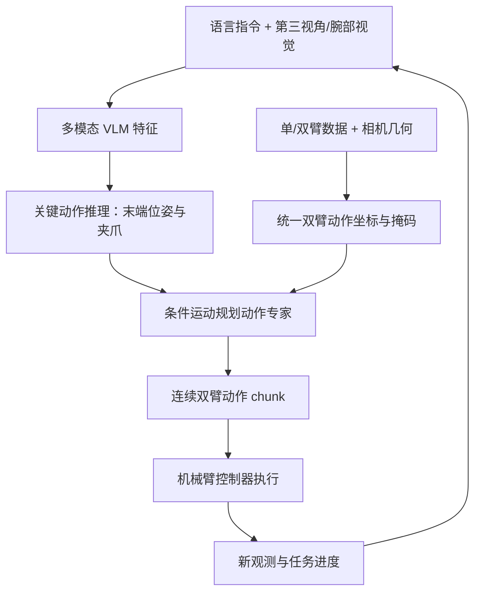

# H-VLA：关键动作推理与运动规划统一动作空间

**H-VLA: Hierarchical Vision-Language-Action Model with Key-Action Reasoning and Motion Planning in a Unified Action Space**（[arXiv:2609.22895](https://arxiv.org/abs/2609.22895)）。

## 一句话定义

H-VLA 先通过多模态推理得到关键末端动作，再用条件运动规划网络将关键目标转为连续动作块；通过统一双臂相机坐标系对齐不同机器人数据。

## 英文缩写速查

| 缩写 | 英文全称 | 简要说明 |
|---|---|---|
| VLA | Vision-Language-Action | 视觉–语言–动作策略 |
| VLM | Vision-Language Model | 语义推理与场景理解骨干 |
| 6D | Six-Dimensional Pose | 末端三维位置及姿态 |
| OOD | Out-of-Distribution | 训练分布外物体/视角/场景 |
| EE | End Effector | 关键动作在末端空间表示 |

## 为什么重要

- 将**去哪儿做关键操作**和**如何连续移动到该处**分开，是从视觉语言语义到机器人轨迹接口的一种可解释分层。
- 与纯单臂数据训练的 VLA 不同，它统一单/双臂动作表示，并使用腕部相机条件，使跨机器人预训练更可控。
- 可针对关键动作误差、坐标系标定误差、运动规划误差分别诊断，不应只看最终成功率。

## 核心机制

1. **关键动作层**：VLM 将指令、全局及腕部视觉映射为含末端位姿和夹爪状态的关键动作，强调抓取/交接等语义转换点。
2. **规划动作层**：条件动作专家根据关键动作与当前视觉状态生成连续低层动作 chunk，形成分层而非单头离散动作输出。
3. **统一空间**：将单/双臂状态和动作转换到相机参考系下的双臂 14 维接口，单臂数据用掩码/对齐规则处理，避免直接混用不同世界/基座坐标。
4. **训练**：分阶段融合多来源数据与关键动作训练，再进行连续运动规划目标优化；论文在 SimplerEnv、Agilex 双臂任务评估。

## 流程总览

## 实验与评测

| 协议 | 作者报告 | 注意边界 |
|---|---|---|
| SimplerEnv Google Robot visual matching | 91% | 特定仿真任务与评估设定 |
| SimplerEnv Google Robot visual aggregation | 84% | 不是和上一行完全相同的数据划分 |
| SimplerEnv WidowX visual matching | 81% | 不可跨本体直接取平均 |
| Agilex 双臂 PickBottles / HandOver / LiftPot | 覆盖 ID 与 OOD 物体/场景/位姿 | 对比需对齐示范数量、标定与相机输入 |

## 源码运行时序图

**不适用**：本次核对 arXiv v1 HTML 与论文资源链接后，未发现作者提供的可运行官方训练/推理仓库，不能把概念流程图伪装为源码时序。

## 工程实践

1. 为每台机器人校准第三视角、左右腕相机到基座/末端的外参，再把关键动作转换为执行空间。
2. 分别记录关键目标位姿误差、规划轨迹误差、碰撞/IK 失败率、动作块执行延迟以及最终成功率。
3. 以真实分布外物体、相机扰动和双臂交接验证统一动作空间的收益，不仅复现单臂 benchmark。

## 局限与风险

- 关键动作标注多由抓取/夹爪事件驱动时，对插入、擦拭等连续接触任务可能遗漏关键物理阶段。
- 三维坐标与手眼标定误差会累积传递给规划器，论文对极端标定漂移的覆盖有限。
- 未见可运行官方代码，工程实现需自行构建数据预处理、关键动作监督与低层动作专家。

## 与其他工作对比

| 方法 | 主要差别 |
|---|---|
| [Co-VLA](./paper-co-vla.md) | 强调双臂动作协同的共享/残差结构与执行时修正，而非高层关键动作规划 |
| [RoboICL](./paper-roboicl.md) | 冻结模型利用示范上下文做动作决策；H-VLA 通过训练的多级动作模块形成策略 |

## 结论

**H-VLA 的工程价值是把语义关键动作和连续运动规划拆成可诊断的两层，但关键目标的几何准确性是效果前提。**

1. 做复杂操作先评估关键动作识别，不要只提升低层轨迹采样分辨率。
2. 跨本体混训必须定义同一动作坐标、动作维度和掩码规则。
3. 将相机标定误差写入测试矩阵，否则“关键动作正确”也可能导致执行失败。
4. SimplerEnv 各协议与真机 OOD 分项应分表报告，不能混成通用成功率。

## 关联页面

- [VLA](../methods/vla.md)、[Manipulation](../tasks/manipulation.md)
- [双臂操作](../tasks/bimanual-manipulation.md)
- [Co-VLA](./paper-co-vla.md) 与 [RoboICL](./paper-roboicl.md)
- [VLA 纵深路线](../../roadmap/depth-vla.md)

## 参考来源

- [论文 v1 精读归档](../../sources/papers/h_vla_arxiv_2609_22895.md)
- [arXiv HTML 原文](https://arxiv.org/html/2609.22895v1)

## 推荐继续阅读

- [原始论文 PDF](https://arxiv.org/pdf/2609.22895)
- [VLA 技术纵深](../../roadmap/depth-vla.md)
