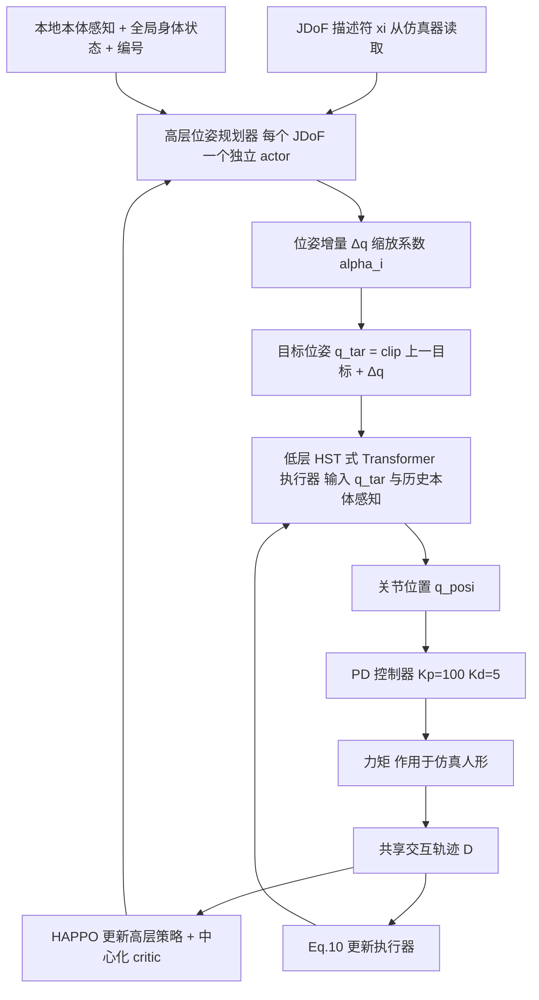

# H²MARL：面向人形机器人控制的分层异构多智能体强化学习

**H²MARL**（*Hierarchical Heterogeneous Multi-agent Reinforcement Learning for Humanoid Robot Control*，[arXiv:2611.06523](https://arxiv.org/abs/2611.06523)，湖北大学 / 伍斯特理工学院 / 中国科学院自动化研究所，v1 于 2026-11-04）。原文归档见 [sources/papers](../../sources/papers/h2marl-humanoid-control_arxiv_2611_06523.md)。

## 一句话定义

**把每个力矩驱动的关节自由度（JDoF）当作带物理描述符的异构智能体，用 HAPPO 训练高层位姿增量规划器，再与低层 Transformer 关节执行器共用同一条轨迹闭环联合优化。**

## 英文缩写速查

| 缩写 | 英文全称 | 简要说明 |
|------|----------|----------|
| H²MARL | Hierarchical Heterogeneous MARL | 本文方法 |
| MARL | Multi-Agent Reinforcement Learning | 多智能体强化学习 |
| JDoF | Joint Degree of Freedom | 关节自由度，本文的智能体粒度（一个力矩驱动的自由度） |
| WBC | Whole-Body Control | 全身控制 |
| HAPPO | Heterogeneous-Agent PPO | 异构智能体 PPO，各智能体独立 actor、不共享参数，中心化 critic |
| MAPPO / HATD3 | Multi-Agent PPO / Heterogeneous-Agent TD3 | 对比基线 |
| CTDE | Centralized Training, Decentralized Execution | 中心化训练、分散执行 |
| CPECO | Closed-loop Policy-Executor Co-Optimization | 闭环策略-执行器联合优化（本文机制） |
| HST | 论文写作 Human State Transformer，引自 HumanPlus [3] | 低层时序执行器的骨干（缩写全称见下文「局限」） |
| PD | Proportional-Derivative | 位置到力矩的比例微分控制，Kp=100，Kd=5 |
| FS / TS / GS / MS | Foot Slip / Torso Stability / Gait Symmetry / Motion Smoothness | 表 I 的四个评测指标 |
| VE / CoT / MJ / CAM | Velocity Error / Cost of Transport / Motion Jerk / Centroidal Angular Momentum | 表 II–IV 的指标，另含 TS |

## 为什么重要

- **问题（I 引言）：** 单智能体 RL 难以协调高自由度关节；已有 MARL 把肢体或关节视为同构智能体，忽视髋关节（大力矩重载）与肘关节（高灵敏轻载）的物理差异；分层方法常把高层规划与低层执行分开训练，出现协调不足和动作僵硬。
- **作者的答案：** 智能体粒度细到单个力矩自由度并显式喂入物理描述符（III）；高层输出位姿增量而非绝对位姿（IV-A）；两层共用轨迹迭代优化而非冻结低层（IV-C）。
- **对 wiki 的价值：** 提供一个「智能体粒度」与「分层是否联合训练」的可对比实验（表 II、III），可与 [MARL](../methods/marl.md)、[分层强化学习](../methods/hierarchical-reinforcement-learning.md) 页互相参照。注意其实验仅限仿真标准 Humanoid-v2。

## 核心机制

要点（均出自论文第 III–IV 节）：

| 环节 | 论文做法 | 出处 |
|------|----------|------|
| 智能体划分 | 每个力矩驱动的 JDoF 一个智能体；描述符 ξ_i = [关节类型, 驱动轴, 力矩上限, 运动范围, 运动学位置, 惯量相关属性]，由仿真器读取 | III，式 2 |
| 策略分解 | π_Θ = ∏ π_θi(a_i \| o_i, ξ_i)；独立 actor 不共享参数，中心化 critic（CTDE） | III，式 3 |
| 高层输出 | 增量 Δq = α_i·tanh(μ+η⊙ε)；α_i = α·τ_max·(q_max−q_min)·d_i/m_i，α=0.001；目标位姿累加并裁剪到关节限位 | IV-A，式 6–8 |
| 低层执行器 | 以 HST 为骨干，输入目标位姿与历史本体感知，输出关节位置；损失含跟踪、平滑、力矩三项，权重 1.0 / 0.1 / 0.001 | IV-B，式 9–10 |
| 联合优化 | 每轮收集共享轨迹；更新高层（HAPPO）；固定高层更新执行器；更新中心化 critic | IV-C，算法 1 |

**与周报说法的差异（核对结论）：** 周报称「使不同关节共享经验又保留动力学差异」。论文里各 JDoF 的 actor 明确**不共享参数**（III，沿用 HAPPO），差异来自描述符和独立 actor；被「共享」的是高层与执行器共用的同一条交互轨迹（IV-C）。周报称「高层姿态规划器 + 低层执行器联合训练」与论文一致，但低层执行器按式 10 以监督式损失更新，并非另一个 RL 智能体（算法 1 第 12 行）。

## 实验与结果

设置（V-A）：MuJoCo 与 Isaac Gym 的 Humanoid-v2 行走；10 个关节、17 个驱动力矩均作智能体；s_t ∈ R^376；训练 10M 步；RTX 4090；基线 HAPPO、MAPPO、HATD3，沿用 HAPPO 配置。

**表 I（MuJoCo，V-B）**

| 方法 | FS↓ | TS↓ | GS↑ | MS↓ |
|------|-----|-----|-----|-----|
| HAPPO | 0.9827 | 0.5091 | 0.000150 | 7.3819 |
| MAPPO | 0.5790 | 0.3873 | 0.000905 | **0.2329** |
| HATD3 | 0.8220 | 0.4739 | 0.000050 | 2.3818 |
| H²MARL | **0.5367** | **0.2516** | **0.001039** | 0.3514 |

相对 MAPPO，FS / TS / GS 改善 7.3% / 35.0% / 14.8%（我复算与正文一致）；MS 不如 MAPPO，作者归因于 JDoF 级异构带来更频繁的关节调整。

**表 II（Isaac Gym 机制消融，V-C1）**

| 方法 | VE↓ | CoT↓ | MJ↓ | CAM↓ | TS↓ |
|------|-----|------|-----|------|-----|
| H²MARL | 0.4807 | 1.5213 | 0.7448 | 1.0324 | 0.0140 |
| w/o HA | 1.0360 | 5.8804 | 2.9680 | 3.8187 | 0.0417 |
| w/o CPECO | 0.9908 | 11.9586 | 6.4986 | 6.0132 | 0.0106 |
| w/o Rew | 1.0580 | 14.2529 | 2.6578 | 12.9126 | 0.1691 |
| w/o All (HAPPO) | 1.3667 | 14.7716 | 19.5962 | 9.0912 | 0.0333 |

**表 III（智能体粒度，V-C2）：** JDoF 级相对肢体级使 VE / CoT / MJ / CAM / TS 分别降低 71.4% / 79.3% / 88.3% / 26.7% / 71.7%（复算一致）；BP 级 CAM（0.5330）低于 JDoF 级（1.0324），作者承认 BP 级在 CAM 上最优。

**表 IV（奖励项，V-C3）：** 去掉防滑项使 VE / CoT / MJ / CAM / TS 增加 100.4% / 595.9% / 972.5% / 550.8% / 87.9%，去掉交替项增加 66.0% / 503.4% / 974.1% / 422.0% / 25.7%（均为论文正文值，表内数据复算一致）。

**表 V（单步推理耗时，V-D）：** 高层均值 8.332 ms（HAPPO 7.677、MAPPO 5.005、HATD3 7.592）、低层 0.927 ms，合计 9.259 ms，论文称频率超过 100 Hz。

## 工程实践

- **复现要点（来自论文）：** 描述符取自仿真器读数；α=0.001；PD 增益 Kp=100、Kd=5；执行器损失权重 1.0 / 0.1 / 0.001；奖励中 λ_slip=0.01、λ_alt=0.05，其余系数「统一设置、无需调参」（V-A）；10M 步，单卡 4090。
- **奖励设计：** 在 HAPPO 任务 / 跟踪 / 稳定奖励之外加了防滑与左右交替两项，并有力矩和平滑正则（式 12），详见 [奖励设计](../concepts/reward-design.md)。表 IV 显示这两项对指标影响很大，也意味着不能把全部增益都归于智能体分解（作者用 w/o HA 与 w/o CPECO 另行拆分）。
- **开源状态：** 论文未给出代码或项目页链接（核查日 2026-11-09，仅通读论文，未检索其他渠道）；复现需自行实现。
- **部署：** 论文没有真机或 sim2real 实验；相关议题见 [Sim2Real](../concepts/sim2real.md)。

## 局限与未验证之处

**论文自己承认的：**

- 平滑度略逊于 MAPPO（表 I，MS 0.3514 对 0.2329），作者归因于更频繁的关节级调整（V-B）。
- w/o CPECO 的 TS 反而最低，作者说明那是以整体运动质量为代价（V-C1）；BP 级 CAM 最低（V-C2）。
- 结论段没有单独的局限或未来工作小节（VI）。

**我看到的未验证之处（核对者判断）：**

- 仅仿真：只有 Humanoid-v2（MuJoCo / Isaac Gym）行走，无真机、无 sim2real、无复杂地形或全身操作，「人形机器人控制」的泛化范围仅限该基准。
- 未见种子数、置信区间或显著性检验，表内差异是否稳健未知（推测：单次汇报）。
- 评测里 Humanoid-v2 的关节数很少（10 关节 17 力矩），与真实人形的高 DoF 规模有距离；描述符里的惯量等项在该标准模型上如何取值，论文未展开。
- 表 I 在 MuJoCo、表 II–IV 在 Isaac Gym，同名方法的数值不能跨表比较；「w/o All」与「HAPPO」在表 II 被等同，但表 IV 的「w/o Both」与表 II 的「w/o Rew」数值相同，说明命名略乱。
- 缩写不一致：正文把 HST 写作 Human State Transformer，但引用的 [3] HumanPlus 中该模块一般称 Humanoid Shadowing Transformer（推测，未回查 HumanPlus 原文；详见 [HumanPlus 页](./paper-loco-manip-161-012-humanplus.md)）。
- 各项奖励和指标（TS、GS、MS）的具体计算式在正文中未给出，只引用了其他文献。

## 关联页面

- [多智能体强化学习（MARL）](../methods/marl.md)
- [分层强化学习](../methods/hierarchical-reinforcement-learning.md)
- [PPO](../methods/ppo.md)
- [全身控制（WBC）](../concepts/whole-body-control.md)
- [全身协调](../concepts/whole-body-coordination.md)
- [奖励设计](../concepts/reward-design.md)
- [Sim2Real](../concepts/sim2real.md)
- [人形运动控制](../tasks/humanoid-locomotion.md)
- [MARGOS：可复现 MARL 工具](./paper-margos-reproducible-marl-argos.md)
- [HumanPlus](./paper-loco-manip-161-012-humanplus.md)

## 参考来源

- [h2marl-humanoid-control_arxiv_2611_06523.md](../../sources/papers/h2marl-humanoid-control_arxiv_2611_06523.md)（论文通读归档）
- [arXiv:2611.06523](https://arxiv.org/abs/2611.06523)
- 周报说法来源：具身运控lab 周报（二手资料，仅作线索，已与论文逐条核对）

## 继续阅读

- [arXiv PDF](https://arxiv.org/pdf/2611.06523)
- [多智能体强化学习（MARL）](../methods/marl.md)
- [HAPPO 原文：Trust Region Policy Optimisation in MARL（NeurIPS 2022，论文参考文献 [24]）](https://arxiv.org/abs/2109.11251)
