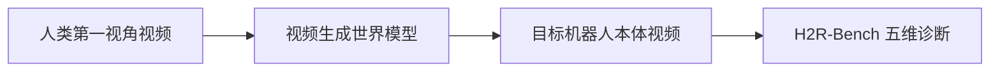
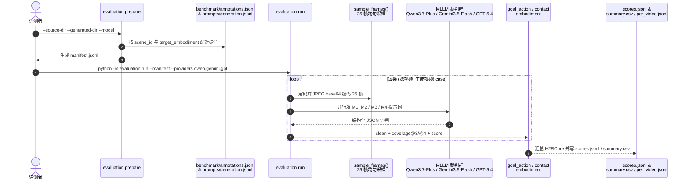

# H2R-Bench：世界模型先要过「人到机器人」这一关

**H2R-Bench**（*Benchmarking Human-to-Robot Manipulation Video Generation in World Models*；[arXiv:2608.13049](https://arxiv.org/abs/2608.13049)，[项目页](https://rongdingyi.github.io/H2R-Bench/)，[仓库](https://github.com/Rongdingyi/H2R-Bench)）把「人类示范视频能否变成机器人训练素材」拆成 **可诊断的五维基准**，而不是只看 FVD。

## 一句话定义

**世界模型帮机器人学操作之前，得先证明它能把人手视频翻译成目标本体的功能接触与动作事件。**

## 英文缩写速查

| 缩写 | 英文全称 | 简要说明 |
|------|----------|----------|
| H2R | Human-to-Robot | 人类示范 → 机器人本体视频 |
| WM | World Model | 本文语境为操作视频生成模型 |
| FVD | Fréchet Video Distance | 常见视频质量指标；本文额外五维诊断 |
| CE | Cross-Embodiment | 人手与机器人末端执行器形态差 |
| SR | Success Rate | 部分子任务的成功/达成率（依维度定义） |

## 为什么重要

- **数据瓶颈在 human demo，不在 robot demo：** 第一视角人视频多，但直接当 robot 监督会混入手形与接触模式。
- **单指标会骗：** 画面清晰 ≠ 本体正确 ≠ 功能接触合理；五维把失败模式分开。
- **横评规模可读：** 11 个视频生成模型 × 6 类操作 × 2 种机器人本体，便于选型而非追 SOTA 数字。

## 核心信息

| 项 | 内容 |
|----|------|
| **出处** | arXiv:2608.13049（2026-08） |
| **任务** | 给定人类操作视频 + 目标机器人本体，生成对应机器人操作视频 |
| **评测轴** | 目标状态、动作事件、功能接触、本体正确性、视频质量 |
| **开源（2026-11-21 复核）** | **已开源基准标注与 MLLM 评测代码**：[`Rongdingyi/H2R-Bench@d41cecb`](https://github.com/Rongdingyi/H2R-Bench) 含 120 场景 `annotations.jsonl`、240 条 `generation.jsonl`、`evaluation/`（`prepare.py` / `run.py` 等）；源/生成视频需自备，M1–M4 默认调用 Qwen/Gemini/GPT OpenAI 兼容 API |

## 核心原理

### 流程总览

| 维度 | 诊断什么 |
|------|----------|
| 目标状态 | 操作后场景/物体是否到位 |
| 动作事件 | 关键 manipulation 事件是否出现 |
| 功能接触 | 接触是否服务任务而非幻觉 |
| 本体正确性 | 手/夹爪/臂是否符合目标机器人 |
| 视频质量 | 时序一致与视觉保真 |

## 源码运行时序图

对齐 [`Rongdingyi/H2R-Bench@d41cecb`](https://github.com/Rongdingyi/H2R-Bench) 现已发布的 `benchmark/`、`prompts/` 与 `evaluation/`（`prepare.py`、`run.py`、`goal_action.py`、`contact.py`、`embodiment.py`、`aggregate.py`）：

## 工程实践

| 项 | 建议 |
|----|------|
| 依赖与环境 | Python 3.10+，`pip install -r requirements.txt`；运行前设 `H2R_{QWEN,GEMINI,GPT}_{API_KEY,BASE_URL}`，可用 `--dry-run` 先校验 manifest 与提示词 |
| 读榜 | 分开看 `mechanical_arm`（夹爪）与 `dexterous_hand`（灵巧手），不要只看 M5 视频质量 |
| 对照 | 与 [Ego2Robot](./paper-ego2robot.md) 的数据管线问题不同：本文评 **生成**，不是采集 |

## 实验与评测

从 120 个 EgoDex 测试片段 × 2 本体 = **240** 条测试例横评 11 个生成模型：

| 发现轴 | 验证数字（arXiv:2608.13049 & README） |
|--------|----------------------------------------|
| **人工相关性** | 3-MLLM 加权裁判与人工标注 Pearson $r=0.930$、Spearman $\rho=0.883$ |
| **梯队榜首（H2RCore）** | **Seedance 2.0**（Gripper **77.3** / Hand **84.6**）、**Wan2.7**（76.5 / 83.1）、**Kling-V3**（74.5 / 81.7）显著领先帧条件模型（如 Veo 3.1：49.6 / 57.0，Wan2.2：32.4 / 33.7） |
| **指标解耦** | **M5 视频质量**与 H2RCore 仅弱相关（Spearman $\rho=0.14$）——「画质好」几乎不能预测「本体与接触对」 |

## 结论

**H2R-Bench 把跨本体操作视频生成从审美问题变成工程验收问题。**

1. **五维分开报** — 否则 FVD 会掩盖本体错。
2. **生成≠可用数据** — 功能接触与动作事件是硬门槛。
3. **基准与代码已开源（需 API 裁判）** — 可用 `evaluation.prepare` 与 `evaluation.run` 复现五维打分，但依赖自备视频与三个 MLLM API 端点。
4. **与 Ego2Robot 互补** — 一个评生成 faithful，一个扩数据规模。

## 局限与风险

- GitHub 仓库已开放 `annotations.jsonl` 与 MLLM 评测脚本，但运行 M1–M4 强依赖商业 MLLM API（Qwen / Gemini / GPT）与本地 EgoDex 源视频准备。
- 仅覆盖 2 种机器人本体与 6 类操作，外推需谨慎。
- 生成视频质量高仍可能本体/接触全错。

## 与其他工作对比

相对 [Ego2Robot](./paper-ego2robot.md)：Ego2Robot 扩 **真实 scale 数据**，H2R-Bench 评 **生成 faithful**。相对 generic video metrics：本文五维诊断更贴近 robot 训练可用性。

## 关联页面

- [世界模型与真实执行 10 篇技术地图](../overview/world-model-exec-10-papers-technology-map.md)
- [生成式世界模型](../methods/generative-world-models.md)
- [World Action Models](../concepts/world-action-models.md)
- [跨本体迁移策略](../queries/cross-embodiment-transfer-strategy.md)
- [具身大模型评测基准选型闭环](../queries/embodied-eval-benchmark-selection-loop.md) — ② 世界模型预测保真度评测层的跨本体切面
- [Ego2Robot](./paper-ego2robot.md)

## 参考来源

- [H2R-Bench 论文摘录](../../sources/papers/h2r_bench_arxiv_2608_13049.md)
- [项目页归档](../../sources/sites/h2r-bench.md)
- [仓库归档](../../sources/repos/h2r-bench.md)
- [具身智能小站 10 篇盘点（2026-08-19）](../../sources/blogs/wechat_embodied_station_world_model_exec_10_papers_2026-08-19.md)

## 推荐继续阅读

- [H2R-Bench 项目页](https://rongdingyi.github.io/H2R-Bench/)
- [arXiv:2608.13049](https://arxiv.org/abs/2608.13049)
