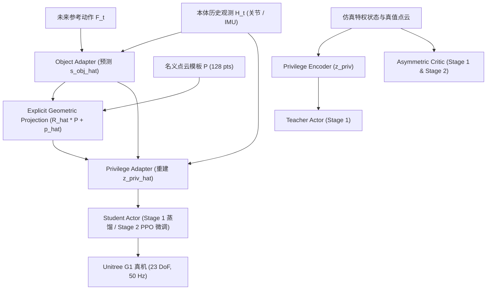
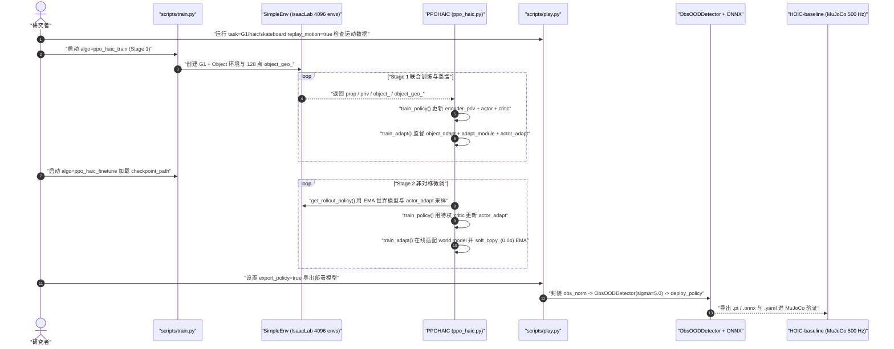

# HAIC

**HAIC**（*Humanoid Agile Object Interaction Control via Dynamics-Aware World Model*，RSS 2026 / `arXiv:2602.11758v2`）由清华大学、香港科技大学（广州）、ETH Zurich 与小米机器人实验室提出，解决的是 **欠驱动物体（underactuated objects）** 交互控制：滑板、手推车、多物体串联以及斜坡/楼梯地形搬运中，物体具有独立动力学、非完整约束且易造成机载视觉遮挡。HAIC 用动力学感知世界模型仅从本体历史与参考动作估计物体相对位姿及高阶状态，并显式投影到静态几何点云先验上重建特权潜变量，配合非对称微调实现无外部状态估计器的真机部署。

## 一句话定义

HAIC 通过动力学感知世界模型（Object Adapter 预测物体运动与高阶动力学 + 显式点云几何投影 + Privilege Adapter 重建特权表征）与非对称微调训练，使仅依赖本体观测的人形策略能够完成滑板、推拉车、装车串联与复合地形搬运等欠驱动交互任务。

## 英文缩写速查

| 缩写 | 英文全称 | 简要说明 |
|------|----------|----------|
| HAIC | Humanoid Agile Object Interaction Control | 本文面向欠驱动物体的全身交互控制框架 |
| HOI | Humanoid-Object Interaction | 人形机器人与物体/场景耦合交互任务 |
| POMDP | Partially Observable Markov Decision Process | 部署期物体状态不可直接观测的决策建模 |
| EMA | Exponential Moving Average | `PPOHAIC` 中用于稳定微调推理的滑动平均权重 |
| Sim2Sim | Simulation to Simulation | Isaac Sim 策略导出至 MuJoCo 交叉验证 |
| RSS | Robotics: Science and Systems | HAIC 论文发表顶会（2026） |

## 为什么重要

- **打破「末端刚性附属物」假设**：滑板与带脚轮推车存在独立惯性与非完整约束，不能当作末端执行器刚性拖动；忽略高阶耦合会导致滑板下板或推车倾覆。
- **物理后果预测替代像素生成**：世界模型不合成未来图像，而是预测物体相对位姿、线/角速度与加速度，并通过刚体变换作用到标准点云先验 \(\mathcal{P}\)，给出空间接地的碰撞边界与几何占据。
- **无需外部真值即可在遮挡盲区工作**：真机部署仅需机载关节/IMU 历史、参考运动与静态模板点云，不依赖动捕或机载视觉跟踪物体。
- **非对称微调缓解蒸馏分布偏移**：第二阶段 Student 在自身探索分布上继续同步更新 World Model 与 Actor，Critic 保留特权真值监督，解决纯 BC 蒸馏遭遇未见状态的崩溃问题。

## 流程总览

## 核心原理

### 1. POMDP 建模与特权/可部署信息切分
在仿真训练期，全状态包含本体观测 \(s_t^{prop}\)、未来参考轨迹 \(s_t^{ref}\)、物体状态 \(s_t^{obj}\)、静态物体几何点云模板 \(\mathcal{P} \in \mathbb{R}^{N\times 3}\)（默认 `128` 点）以及额外特权状态 \(s_t^{priv}\)。部署期传感器无法直接获得真实 \(s_t^{obj}\) 与 \(s_t^{priv}\)，因此学生策略仅读取本体历史 \(H_t\)、未来参考动作步窗 \(F_t\)、上一时刻动作 \(a_{t-1}\) 与模板 \(\mathcal{P}\)。

### 2. Dynamics-Aware World Model 三级结构
1. **Object Adapter (`object_adapt`)**：以历史本体、参考指令与上一预测状态为条件，预测物体相对机器人根坐标系的姿态与高阶物理量 \(\hat{s}_t^{obj} = (\hat{p}_t, \hat{R}_t, \hat{v}_t^{lin}, \hat{v}_t^{ang}, \hat{a}_t^{lin}, \hat{a}_t^{ang})\)。代码层在部分复杂任务 YAML（如 `box_slopestair.yaml`）中显式启用 `object_com_vel_b` 与 `object_com_acc_b` 作为监督真值，而在部分任务（如 `skateboard.yaml`）中通过配置切换观测组合。
2. **Explicit Geometric Projection (`TransformObject`)**：利用预测（训练阶段为真值）的 \(\hat{p}_t, \hat{R}_t\) 将静态点云模板刚体变换到机器人根坐标系：\(\mathcal{P}_t^{dyn} = \hat{R}_t \cdot \mathcal{P} + \hat{p}_t\)。该步将抽象向量显式落地到三维几何占据，支持多物体同时独立投影（如箱体+推车、箱体+坡梯）。
3. **Privilege Adapter (`adapt_module`)**：融合 \((\hat{s}_t^{obj}, \mathcal{P}_t^{dyn}, s_t^{prop}, s_t^{ref})\)，输出与 Teacher 侧 Privilege Encoder 对齐的潜特征 \(\hat{z}_t^{priv}\)。

### 3. 两阶段训练与非对称微调（`PPOHAIC`）
- **Stage 1（`ppo_haic_train`）**：联合训练 Teacher Actor / Privilege Encoder / Critic，同时用真值监督训练 `object_adapt`、`adapt_module` 与 `actor_adapt` 残差蒸馏。
- **Stage 2（`ppo_haic_finetune`）**：以 `object_adapt_ema` 和 `adapt_ema`（更新系数 `0.04`）驱动 `actor_adapt` 采样，Critic 继续读取特权真值执行非对称 PPO 更新，同时在学生自身分布上在线微调 World Model，消除 Teacher-Student 协变量偏移。

## 实验与评测

基于 `arXiv:2602.11758v2` 报告的 Unitree G1 真机对比与消融实验（对比无几何投影/无动力学世界模型的本体跟踪基线 `HDMI*`）：

| 任务类别 | 子任务 | `HDMI*` 成功率 | `HAIC` 成功率 | 关键跟踪与能力结论（原文 Table I–IV / §IV） |
|----------|--------|----------------|---------------|---------------------------------------------|
| **欠驱动交互** | Skateboarding | Glide `20%` / Comp. `0%` | Glide **`100%`** / Comp. **`60%`** | `E_mpbpe` 由 `132.1±35.7` 降至 `81.5±15.4` |
| **欠驱动交互** | Pull Cart | `40%` | **`100%`** | `E_mpbpe` 由 `118.0±5.8` 降至 `76.2±6.8` |
| **欠驱动交互** | Push Cart | `0%` | **`100%`** | `E_mpbpe` 由 `136.2±23.3` 降至 `82.0±6.3`；基线推车倾覆失效 |
| **顺序串联** | Pull Cart w/ Box | `0%` | **`40%`** | 先抱箱装车再拉车；`HDMI*` 未完成前置任务 |
| **顺序串联** | Push Cart w/ Box | `0%` | **`100%`** | 单策略完成装车与推车模式切换 |
| **多地形搬运** | Flat / Stair / Slope | 均 `100%` | 均 **`100%`** | 搬箱过单地形二者均可完成，HAIC 关节/基座误差更低 |
| **多地形搬运** | Stair + Slope | `0%` | **`100%`** | 组合地形下基线状态漂移崩溃；HAIC `E_mpbpe = 60.6±13.4` |
| **日常家具拓展** | 推桌 / 拉杆箱 / 转椅 | — | **`100%`** | Fig. 9 展示对未见轴向偏航自由度椅子的迁移能力 |

- **泛化与消融补充（§IV.D.1, Table V–VII）：** 在固定标准点云模板 \(\mathcal{P}\) 下，策略在训练箱体范围 `(0.1–0.2 m, 1–2 kg)` 之外零样本泛化至 `0.25 m, 3 kg` 重箱；`Pull Cart` 对比 RMA 取得更高成功率（`100%` vs `70%`）；消融证明仅靠 `Proprio` 或只做位姿预测的 `Vec-Pose` 无法稳定完成滑板收脚下板与低漂移推拉车，需同时具备高阶动力学预测与显式几何投影。
- **注（项目页补充记录）：** 早期项目页视频演示归档曾记录 `拉车 0–20 kg`、`推车 0–70 kg` 与 `0°/30°/45°` 地形旋转展示；此处正文以 `arXiv:2602.11758v2` 论文公开定量表与文字为准。

## 与其他工作对比

| 维度 | HAIC | 末端刚性跟踪（HDMI 类） | 视觉/动捕状态估计管线 | 纯本体 RMA 类蒸馏 |
|------|------|-------------------------|------------------------|--------------------|
| **对象假设** | 欠驱动、非完整、多物体串联 | 刚性或完全受驱对象 | 依赖传感器可观测状态 | 环境/动力学隐式向量 |
| **世界模型形式** | 物体位姿/速度/加速度 + 显式点云投影 | 无显式物体高阶预测 | 需外部点云/视觉位姿 | 隐式历史编码，无几何投影 |
| **视觉遮挡鲁棒性** | 强（仅用本体历史与先验模板） | 遮挡时退化 | 遮挡/光照失真时易断轨 | 强，但缺乏显式三维占据约束 |
| **Student 分布适应** | 第二阶段非对称 PPO + World Model EMA 微调 | 常规蒸馏或单阶段 RL | 控制与感知各自独立 | 仅适配编码器（无联合策略微调） |

## 结论

**HAIC 证明在人形欠驱动物体交互中，把「世界模型」设计为可部署本体驱动的物体高阶动力学预测加显式点云几何投影，比单纯预测图像或隐式编码更能抗视觉遮挡与多步漂移。**

- **高阶物理量与几何缺一不可**：仅预测位姿的 `Vec-Pose` 难以应付滑板下板等强瞬态阶段，只有同时估计速度/加速度并投影到几何模板，才能兼顾稳定性与轨迹贴合度。
- **两阶段非对称微调是落地关键**：`ppo_haic_train` 解决冷启动效率，`ppo_haic_finetune` 则利用特权 Critic 持续校准 Student 探索分布上的世界模型与策略。
- **可部署与开源成熟度高**：控制 23-DoF G1 仅需 `50 Hz` 策略与 `0.17 ms` 机载推理耗时，代码、11 套任务 YAML 与 `HOIC-baseline` MuJoCo Sim2Sim 已公开。
- **能力边界仍在训练先验内**：物体均需静态标准点云 \(\mathcal{P}\) 作为语义先验，目前聚焦刚体/铰接轮式欠驱动对象，尚未覆盖柔性体或无模板任意新物体。

## 源码运行时序图

基于官方仓库 `LeCAR-Lab/HAIC`（`ldt29/HAIC`）中的 `scripts/train.py`、`scripts/play.py`、`active_adaptation/learning/ppo/ppo_haic.py` 与 `scripts/helpers.py` 核对：

## 工程实践

- **仿真与训练环境**：依赖 Python 3.11、IsaacSim 5.1.0 与 IsaacLab 2.3.2；`hdmi-base.yaml` 默认配置 `num_envs=4096`、`step_dt=0.02`（`50 Hz`）、`isaac_physics_dt=0.005`（`200 Hz`）、`mujoco_physics_dt=0.002`（`500 Hz`），单卡 RTX 4090 单任务训练约 `8h`。
- **关键任务配置与物理随机化**：`cfg/task/G1/haic/` 已公开 11 套任务 YAML（含 `skateboard`、`pull_cart`、`push_cart`、`pull_cart_box`、`push_cart_box`、`push_wheelchair`、`move_mybox` 与 4 种搬箱地形）；例如 `skateboard.yaml` 对轮组摩擦、阻尼与板体缩放 `[0.8, 1.1]` 做域随机化，Action 延迟随机 `2–6` 步。
- **部署安全机制**：`scripts/play.py` 导出的策略外层封装了 `ObsOODDetector`（默认阈值 `sigma=5.0`），可在本体观测大幅越界时给出保护信号；Sim2Sim 验证需配合官方对接仓库 `Cybercal/HOIC-baseline`。
- **真机硬件配置**：Unitree G1 启用 23 个受控关节（冻结 6 个腕关节），真机 PD 频率 `500 Hz`，总计算耗时 `0.17 ms`（不足 `20 ms` 控制周期的 1%）。

## 常见误区与局限

- **误区：把 HAIC 当成纯无先验（geometry-free）黑箱模型**：HAIC 强依赖离线静态点云模板 \(\mathcal{P}\) 作为几何锚点；若真实物体拓扑结构或尺寸比例严重偏离模板（远超训练尺度随机化范围），显式几何投影提供的碰撞边界就会失真。
- **误区：认为无需真值也能跳过特权训练**：虽然真机部署只吃本体历史，但训练期极度依赖仿真中的真实物体状态、高阶导数以及非对称 Critic 特权观测；缺乏高精度物体-地面接触仿真仍会导致策略学偏。
- **已知局限**：`Pull Cart w/ Box` 等长程顺序串联任务真机成功率为 `40%`，显著低于单阶段推/拉车（`100%`），长程模式切换时的累计误差仍是瓶颈；同时代码仓库文档对资产下载与完整上手说明仍有部分待完善项，且当前对象集合集中于刚体箱体与轮式/滑板载具，尚未涵盖可变形物体与双手精细工具操作。

## 关联页面

- [HAIC 方法页](../methods/haic.md)
- [Model-Based RL](../methods/model-based-rl.md)
- [Privileged Training（特权信息训练）](../concepts/privileged-training.md)
- [Sim2Real](../concepts/sim2real.md)
- [Loco-Manip 接触分类 05：VLA 与世界模型调用](../overview/loco-manip-contact-category-05-vla-world-models.md)
- [人形 RL 身体系统栈](../overview/humanoid-rl-motion-control-body-system-stack.md)
- [OpenHLM](./paper-loco-manip-161-154-openhlm.md)

## 参考来源

- [haic_arxiv_2602_11758_reading.md](../../sources/papers/haic_arxiv_2602_11758_reading.md) — `arXiv:2602.11758v2` 原文全文通读归档
- [ldt29_haic.md](../../sources/repos/ldt29_haic.md) — 官方代码 `ldt29/HAIC` 源码与配置核查归档
- [humanoid_rl_stack_38_haic_humanoid_agile_object_interaction_control_v.md](../../sources/papers/humanoid_rl_stack_38_haic_humanoid_agile_object_interaction_control_v.md) — 42 篇长文索引与项目页核查
- [humanoid_rl_stack_42_catalog.md](../../sources/papers/humanoid_rl_stack_42_catalog.md)
- [wechat_embodied_ai_lab_humanoid_rl_motion_survey.md](../../sources/blogs/wechat_embodied_ai_lab_humanoid_rl_motion_survey.md)
- [wechat_embodied_ai_lab_loco_manip_contact_survey.md](../../sources/blogs/wechat_embodied_ai_lab_loco_manip_contact_survey.md)
- [wechat_embodied_ai_lab_wam_motion_control_five_paths.md](../../sources/blogs/wechat_embodied_ai_lab_wam_motion_control_five_paths.md)

## 推荐继续阅读

- [HAIC 论文 arXiv:2602.11758](https://arxiv.org/abs/2602.11758)
- [HAIC 官方项目页](https://haic-humanoid.github.io/)
- [HAIC 官方训练仓库 (ldt29/HAIC)](https://github.com/ldt29/HAIC)
- [HOIC-baseline MuJoCo Sim2Sim](https://github.com/Cybercal/HOIC-baseline)
