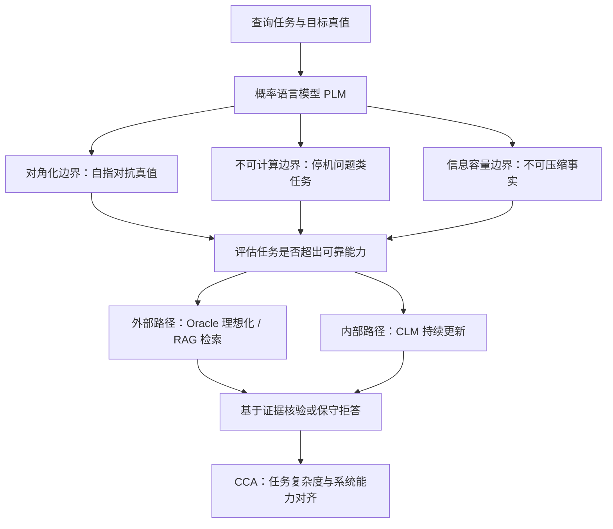

# Hallucination as a Computational Boundary：幻觉作为计算边界——必然性层级与预言机逃逸

## 一句话定义

**Hallucination as a Computational Boundary**（AAAI 2026，arXiv:2508.07334）把语言模型幻觉放到**可计算性、自指与信息容量**的统一框架中，提出理想 Oracle（外部知识）与 Continual Learning（内部更新）两类应对思路，并以 CCA 讨论安全部署时的能力边界。

## 英文缩写速查

| 缩写 | 英文全称 | 简要说明 |
|---|---|---|
| PLM | Probabilistic Language Model | 论文用概率图灵机刻画的语言模型 |
| RAG | Retrieval-Augmented Generation | 检索增强生成；论文把外部检索理想化为 Oracle |
| CLM | Continual Learning Machine | 随学习事件更新模型的序列 |
| CCA | Computational Class Alignment | 任务复杂度和系统能力边界对齐的安全原则 |
| KL | Kullback–Leibler Divergence | 用来测量预测分布与目标分布的差异 |
| HNE | Hierarchical Nash Equilibrium | 双时间尺度记忆博弈的均衡概念 |
| LoRA | Low-Rank Adaptation | 实验中用于持续微调的参数高效方法 |

## 为什么重要

- **认识幻觉边界：** 将“模型答错了”分为针对模型的对角化反例、不可判定任务和高复杂度事实记忆不足，而非只用温度、提示词解释所有错误。
- **系统层设计：** 在知识密集或高风险应用中，可选择 [检索增强生成 RAG](../concepts/retrieval-augmented-generation.md)、更新模型知识、检验来源或拒答；这些措施各自有成本和局限。
- **机器人应用：** 对机器人高层任务规划/语言决策可作为可靠性分析视角，但论文**没有**机器人实验，也不构成运动控制或物理安全的证明。

## 核心信息

| 项 | 内容 |
|---|---|
| 论文 | [arXiv:2508.07334v2](https://arxiv.org/abs/2508.07334)；[AAAI 2026 正式发表](https://doi.org/10.1609/aaai.v40i40.40657)，40(40):33675–33682 |
| 作者 | Xi Wang、Quan Shi、Zenghui Ding、Jianqing Gao、Xianjun Yang |
| 机构 | 中国科学院合肥物质科学研究院、中国科学技术大学、常州大学、科大讯飞研究院 |
| 模型与方法 | PLM/概率图灵机，Oracle、双层 Markov game，Mistral-7B + FAISS + LoRA |
| 输出 | 三层边界及两种增强路线的形式化阐述；RAG、CLM、RAG-CL 实验结果与 CCA 原则 |
| 开源状态 | 原文与会议记录未提供官方项目/可运行代码地址；截至 2026-11-23 未确认训练及评测代码公开 |

## 核心原理

### 两种幻觉定义（§2.1）

给定输入 s、模型输出分布 P_h(y|s)：

- **Straying Hallucination：** 对关系型真值集合 f_R(s)，统计错误输出的概率质量，即 `H_Stray = sum_{y not in f_R(s)} P_h(y|s)`。
- **Distortion Hallucination：** 对概率型真值分布 f_P，取 `H_Distort = KL(P_fP(.|s) || P_h(.|s))`。两者分别反映“越出可接受答案集合”和“预测分布偏离目标”。

### 三层必然性边界（§2）

| 边界 | 原文形式化路径 | 需注意的任务假设 |
|---|---|---|
| 对角化（Theorem 2.4） | 枚举概率模型后构造反对角真值，刻意排除每个模型的最高概率输出 | 是对抗式构造，不说明普通分布上所有模型都必然高频出错 |
| 不可计算（Theorem 2.5） | 用停机问题作为不可计算真值；若总能足够准确识别，就能推出停机判定器的矛盾 | 应区分全域正确性与有限任务上的经验正确率；拒答可改变系统风险 |
| 信息论（Lemma 2.6） | 往真值函数注入不可压缩字符串，使固定信息容量的模型无法表示 | 建立在高复杂度、对抗式真值构造上，非一般业务任务准确率界 |

### 两条应对路径（§3–4）

1. **理想外部 Oracle（Theorem 3.1）：** 先让 O(s) 定义真值，再由增强系统查询 O(s) 并原样返回，所以在**该特定构造**上 H_Stray=0。作者以 RAG 类比，但实际检索器/文档库无法保证像理想 Oracle 一样全知且无错。
2. **自适应持续学习（§3.2–3.3）：** 快速的海马式 episodic 记忆子博弈 G_H（Plasticity / Consolidator）与慢速皮层泛化 G_C（Generalizer / Exception Handler）通过整合协议链接。复查外部事实并用 LoRA 内化是实验中的可操作近似，并非证明更新参数就具有更强可计算类。
3. **摊销成本（Theorem 3.3）：** 重复查询 N 次时，`Cost_RAG=N*(C_infer+C_query)`，`Cost_CLM=N*C_infer+C_update`；当 `N > C_update/C_query` 才在该成本模型中可省重复检索费，前提是更新准确、事实可复用且没有其它成本。

## 流程总览

这张图整理的是**论文的论证与系统设计分支**，不是作者发布的运行时代码管线；三种理论边界不会在实际推理时自动被逐个检测。

## 实验与评测

论文 §5 使用 **Mistral-7B** 作为基座，**FAISS** 做检索，**LoRA** 做增量更新；在虚构科学事实语料上评测 1,000 次查询，作者报告（Table 2）：

| 方案 | 准确率 | TriviaQA 遗忘率 | 15% 检索噪声下鲁棒性 |
|---|---:|---:|---:|
| Pure RAG | 约 98.6% | 0% | 76.5% |
| Pure CLM | 约 81.0% | 12.4% | 不适用 |
| RAG-CL（混合） | 约 96.5% | 1.1% | 92.3% |

- **精度—鲁棒性权衡：** 混合方案的名义准确率 **96.5% 低于 98.6%** 的纯 RAG，但作者报告噪声鲁棒性更高（92.3% vs 76.5%）。
- **摊销交叉点：** Figure 6 报告约 **287 次查询**达到成本比较交叉点；依赖论文特定 GPU/检索/更新成本，不是通用阈值。
- **机制分析：** Figure 5 报告知识内化后，生成答案时对检索上下文的注意力下降。该相关性观察不能单独证明因果性或形成正确“内部信念”。
- **证据等级：** 上述均为作者报告，未独立复现实验、未找到可验证的公开运行入口，不应作为生产系统可靠性承诺。

## 结论

**这篇论文有价值的是把幻觉风险提升到“任务、计算能力、工具与知识”的系统层评估；其理想 Oracle 论证不能被解释成真实 RAG 能消灭幻觉。**

1. 先区分**事实缺失/信息不足**与**逻辑上不可判定**，不要用增大推理预算混为一谈。
2. 需要准确实时知识时优先检索并做**来源核验**；RAG 提升 grounding，但错误检索与错误生成仍存在。
3. 对高频、稳定知识可评估增量内化收益，并同时测**遗忘、更新失败、检索噪声**和回滚能力。
4. 实验仅显示特定语料和 Mistral-7B 配置上的取舍；287 次交叉点和 96.5% 精度不能直接外推。
5. 对机器人高层 AI，采用 CCA 作为**能力与验证清单**，保持独立的控制安全约束和必要时拒答。

## 与其他工作对比

- **[RAG 概念页](../concepts/retrieval-augmented-generation.md)：** RAG 讲真实检索/生成管线与 Recall@k、faithfulness；本论文的 Oracle 是理想数学抽象，不能替代这些评测。
- **[LLM 机器人控制接口](../concepts/llm-robotics-control-interfaces.md)：** 真实物理系统的控制抽象和实时延迟仍决定可用性；论文讨论的是计算边界和语言事实验证。
- **[LLM Wiki](../concepts/llm-wiki-karpathy.md)：** 强制来源与交叉编译有助于减少知识维护过程的无依据生成，但仍需要事实核验。

## 工程实践

| 阶段 | 推荐检查项 |
|---|---|
| 输入与任务分层 | 区分常规 QA、已知外部事实、不可判定问题与高风险控制指令 |
| 检索增强 | 记录检索命中率、证据时间戳、来源可信度、答案 faithfulness |
| 持续学习 | 设定更新触发条件，固定回归集测遗忘与参数污染，监控更新总成本 |
| 在线决策 | 不确定就升级工具核验或拒答；不把模型置信度当作可靠性证明 |
| 机器人系统 | 高层规划与低层安全控制解耦；保留独立安全检查/执行前验证 |

## 源码运行时序图

**不适用。** 论文没有提供可核对的官方可运行代码仓库或 README 入口；§5 仅描述 Mistral-7B、FAISS、LoRA 的实验组件，因此不能杜撰训练或推理函数调用时序。

## 局限与风险

- **对角化证明的输出空间问题：** Theorem 2.4 设 Y 为所有输出字符串，但使用 `P(y*) >= 1/|Y|` 推出统一正 ε。Y 若无限，此界不足以支撑文中的固定 ε；至少需要说明有限输出域或另行论证。
- **Oracle 结论存在理想化：** Theorem 3.1 的真值被定义成 O(s)，系统读取同一 O(s) 就正确；这是存在性构造，不意味着互联网检索实现不可计算真值 Oracle。
- **复杂度与容量不能画等号：** CLM 的参数更新不自动提升可计算性等级，也不保证固定架构或固定参数预算的 Kolmogorov 容量增长；“内部 Oracle”是类比。
- **成本模型简化：** 未纳入在线反馈错误、训练成本变化、知识过期和核验负担；持续学习可能因灾难性遗忘而不划算。
- **可复现性不足：** 未确认官方代码/数据发布和多随机种子结果；混合方法在论文报告的名义准确率略低于纯 RAG。
- **适用边界：** 没有机器人部署/安全控制测试；不能把 CCA 的部署建议误读为已有形式化安全认证。

## 关联页面

- [RAG：检索增强生成](../concepts/retrieval-augmented-generation.md)
- [LLM 机器人控制接口](../concepts/llm-robotics-control-interfaces.md)
- [Karpathy LLM Wiki 知识组织](../concepts/llm-wiki-karpathy.md)

## 参考来源

- [本论文全文核对归档](../../sources/papers/hallucination_computational_boundary_arxiv_2508_07334.md)
- [arXiv v2 HTML 全文](https://arxiv.org/html/2508.07334)
- [AAAI 2026 正式出版记录](https://ojs.aaai.org/index.php/AAAI/article/view/40657)

## 推荐继续阅读

- [Lewis et al. 2020：Retrieval-Augmented Generation for Knowledge-Intensive NLP Tasks](https://arxiv.org/abs/2005.11401)
- [Xu、Jain、Kankanhalli 2024（本论文引述的幻觉不可避免性先行研究）](https://arxiv.org/abs/2401.11817)
