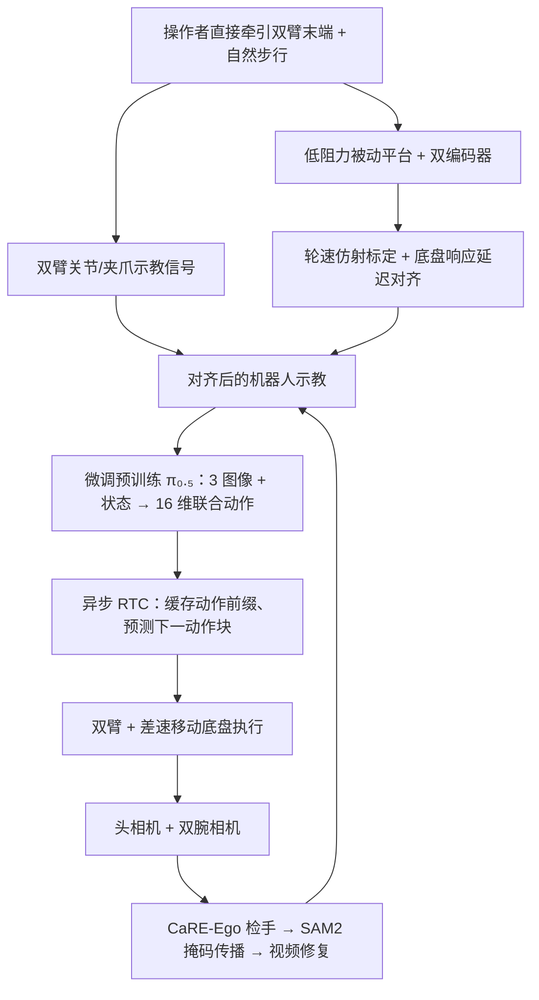
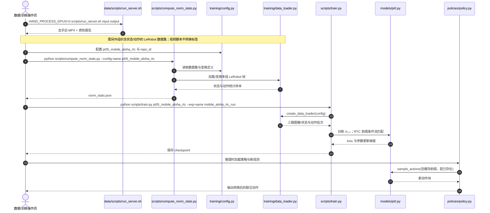

# HALO: Human-Aligned Data Collection for WhoLe-body MObile Manipulation｜HALO：人机对齐的全身移动操作示教

## 一句话定义

**HALO** 是香港科技大学（HKUST）与蚂蚁灵波科技（Robbyant）提出的全身移动操作示教系统：以机器人双臂末端直接牵引、操作者自然步行和低阻力被动平台获得示教数据，再将视觉与底盘动作对齐至自主部署分布。论文为 **arXiv:2611.16439v1（2026-11-12）**，作者为 Shuai Yang、Fangyi Xu（共同一作）、Yishu Shen、Kecheng Zheng、Yinghao Xu（通讯作者）。

## 英文缩写速查

| 缩写 | 英文全称 | 简要说明 |
|---|---|---|
| HALO | Human-Aligned Data Collection for WhoLe-body MObile Manipulation | 人机对齐全身移动操作示教 |
| VLA | Vision-Language-Action | 视觉语言动作策略；本文微调预训练 π₀.₅ |
| RTC | Real-Time Chunking | 异步动作块推理与前缀条件衔接 |
| EEF | End-Effector | 末端执行器动作空间 |
| BC | Behavior Cloning | 由示范轨迹学习动作策略 |

## 为什么重要

以 Mobile ALOHA 为代表的主从方案将人的视角、手部与机器人执行末端分开，并由移动平台限制操作者走动；VR 方案则在精细接触与力反馈方面存在差距。HALO 将双臂直接牵引和自然走动集成到同一采集流程，**但并非“采完即部署”**：拍摄时手部会进入机器人图像，且被动平台动力学与电驱底盘不同，必须同时对齐视觉和控制信号（论文 §1、§3）。

## 核心信息

| 项目 | 论文及源码核对 |
|---|---|
| 作者 / 机构 | Shuai Yang、Fangyi Xu、Yishu Shen、Kecheng Zheng、Yinghao Xu；香港科技大学（HKUST）、蚂蚁灵波科技（Robbyant） |
| 论文 / 项目 | [arXiv:2611.16439v1](https://arxiv.org/html/2611.16439v1) · [官方项目页](https://robbyant-research.github.io/Lingbot-ALOHA/) |
| 官方代码 | [Lingbot-ALOHA](https://github.com/robbyant-research/Lingbot-ALOHA)，已公开 OpenPI/RTC 策略代码与视频去手流程，**不附带数据、预训练权重及训练完成 checkpoint** |
| 部署硬件 | 2 × 6-DoF 机械臂，头部 1 路 + 双腕 2 路相机；AgileX Tracer AGV 2 差速底盘（示教时移除） |
| 任务 | Push Chair、Disassemble Lego、Zip-Tie Fastening、六阶段长程箱体搬运 |
| 策略 | π₀.₅ 全参数微调，3 路图像 + 关节与底盘运动状态，双臂/夹爪 + 底盘速度联合动作 |

## 核心原理

### 1. 操作接口：末端直接牵引，而非主从臂映射

操作者直接触碰与牵引机器人末端，获得更接近机器人相机视角的视觉反馈与实际接触力；重新设计夹爪，取消 ALOHA 式手柄/剪刀机构，末端长度由 **242 mm 缩至 105 mm**，论文报告俯仰可用角度增加约 **40°**（§3.1）。这减少了额外末端重定向环节，但采集时人的手会遮挡相机。

### 2. 移动接口：被动平台保留差速底盘的非完整约束

采集时拆掉电动底盘，采用被动轮和沿驱动轮轴线的两只定向轮，使操作者自然走动即可隐式带动采集平台；其运动空间仍满足部署底盘的非完整约束。论文报告推动水平力：部署平台 **47.3 N**、Mobile ALOHA **13.0 N**、HALO 采集平台 **2.3 N**（§3.2）。这些是文中装置测试值，不能推及其他机器人底盘。

### 3. 部署对齐：人手图像 + 底盘控制双通道处理

- **视觉分布差**：CaRE-Ego 在关键帧检测左右手，SAM2 前后传播掩码，处理跨段重叠后由 DiffuEraser 修补；官方代码的默认配置另外采用 ProPainter 先验。清除示教者手部并非去除机器人夹爪。
- **动力学与时间差**：两个编码器得到采集平台左右轮速度 `u_L,u_R`；用成对平台测量与部署底盘命令拟合仿射映射，并估计底盘响应延迟进行时间对齐。直接预测底盘速度 `v, \omega`，避免积分成绝对位姿导致误差积累（§3.3）。

```math
\begin{bmatrix}v\\\omega\end{bmatrix}
=
\begin{bmatrix}k_{vL}&k_{vR}\\k_{\omega L}&k_{\omega R}\end{bmatrix}
\begin{bmatrix}u_L\\u_R\end{bmatrix}
+
\begin{bmatrix}d_v\\d_\omega\end{bmatrix}
```

### 4. 策略与实时执行

使用预训练 π₀.₅ 微调，输入 **1 路头相机 + 2 路腕相机**、双臂关节/夹爪状态及底盘速度历史。输出 **16 维动作**：左臂 6 关节 + 夹爪 1、右臂 6 关节 + 夹爪 1、底盘 `v` 与 `\omega` 各 1。论文默认全参数训练 **5,000 steps**，AdamW、学习率 `5 \times 10^{-5}`、全局 batch 128，预测 horizon **25 帧**（附录 B）；从 VLM 初始化的消融实验训练 **10,000 steps**，不能与预训练设置直接混作同一预算。

RTC 在上一动作块执行时异步推断下一块，把已承诺的动作前缀作为条件，降低同步推断停顿导致的底盘过冲；前缀训练与推理均在官方 JAX π₀.₅ 路径实现（论文 §3.4、官方 README）。

### 流程总览



图中闭环表达部署时机器人相机持续观测，**不表示训练中真实底盘与采集平台同时存在**。

## 源码运行时序图

基于官方仓库 `data/README.md`、`scripts/compute_norm_stats.py`、`scripts/train.py`、`src/openpi/training/{config,data_loader}.py`、`src/openpi/policies/{aloha_policy,policy}.py`、`src/openpi/models/pi0.py` 的静态核对：



**真实开源边界**：此时序图只展示官方公开代码的静态调用链，未实测 GPU 训练、实时控制或真机部署；官方仓库提供的是策略实现及去手工具，不包含可直接运行的完整 HALO 示教硬件控制、标定、数据/权重交付闭环。

## 实验与评测

### 同一操作者、同任务、同时间预算：示教阶段（论文 §4.1）

| 指标 | HALO | Mobile ALOHA | VR |
|---|---:|---:|---:|
| Push Chair：成功示范平均时长 | **11 s** | 32 s | 30 s |
| Push Chair：示范成功率 | **100%** | 100% | 25% |
| Disassemble Lego：成功示范平均时长 | **23 s** | 64 s | 37 s |
| Disassemble Lego：示范成功率 | **100%** | 80% | 20% |

每任务采集总预算为 **1 h**（含重置）。11/32、23/64 对应约 **2.9×/2.8×**，这是**有效示范采集速度**的比较，不是训练推理速度或机器人部署吞吐。

### 真机策略阶段（论文 §4.2–4.4）

| 任务 | HALO 数据训练后的策略成功率 | 试次 / 限制 |
|---|---:|---|
| Push Chair | **85%** | 异步 RTC，执行 horizon 8，去手图像 |
| Disassemble Lego | **75%** | 30/40 |
| Zip-Tie Fastening | **30%** | 3/10，成功时平均 41 s；Mobile ALOHA/VR 数据均为 0% |
| 六阶段长程移动搬运 | **73.3%** | 11/15，取箱→装载→举箱→运输→放置→返回 |

**不能把以上 4 个成功率视作统一 benchmark 平均分**：任务、试次数和难度不同；论文也未展示跨大样本操作者、长周期工厂部署或商业可靠性。

### 消融：是什么真正影响成功率

| 对照（任务） | 设置 | 成功率 |
|---|---|---|
| 视觉去手（Push Chair） | 原始手可见 → 去手图像 | **55% → 85%**（+30 pp） |
| 推理模式（Push Chair） | Sync / horizon 8，25 | **0% / 35%** |
| 推理模式（Push Chair） | Async / horizon 4，6，8，10 | **75% / 75% / 85% / 70%** |
| 动作空间（Lego；VLM 初始化） | EEF → Joint | **12.5% → 7.5%** |
| 动作空间（Lego；预训练 VLA） | EEF → Joint | **47.5% → 75%** |

读法：**动作空间优劣依赖预训练与控制接口**，不能笼统称关节动作永远优于 EEF；异步动作块也需在响应性与时间一致性之间折中。

## 工程实践

1. **复现实验前**：确认 3 路视频键、双臂状态与动作、`action.base` 的单位、顺序、帧率一致；每组 LeRobot 数据集须一致 schema。官方提供 `MultiVLADataset`，它按帧数混合多数据集，**不会**自动重采样到共同频率。
2. **去手处理**：`data/` 单独 Python 3.12/CUDA 环境，默认 CaRE-Ego → SAM2.1 → ProPainter 先验 → DiffuEraser；输出仍是视频，必须另行形成带动作与状态的数据集。默认权重约 13.6 GB；质量报告不能替代逐帧核对。注意 ProPainter 相关非商用授权边界。
3. **标准化与训练**：配置数据路径和 π₀.₅ 初始化参数后，先跑 `python scripts/compute_norm_stats.py --config-name pi05_mobile_aloha_rtc`，再 `python scripts/train.py pi05_mobile_aloha_rtc --exp-name mobile_aloha_rtc_run`。多数据源共用统计量，不是各自归一化。
4. **RTC 检查**：核验 `rtc_max_delay`（训练前缀）、`rtc_prefix_len`（推理缓存前缀）、`rtc_exec_steps`（执行帧数）与 `action_horizon`；代码在 JAX π₀.₅ 实现，不应擅称 PyTorch 等价。
5. **真机部署**：独立测量底盘速度标定与动作—状态延迟，确保关节接口与底盘 `v/\omega` 在相同控制时间基准上执行；成功率还须做多操作者、跨场景与失败恢复压力测试。

## 结论

**HALO 的贡献主要是让采集的人体动作更自然、数据更接近目标机器人部署条件，非提出新的 VLA 骨干。**

1. 采集设备需同时评估操作者视角、直接力反馈与自然移动自由度，而非只比较设备价格。
2. 尽量在机械上保留底盘非完整约束，减少后续人体轨迹到机器人动作的重定向误差。
3. 去手修复与底盘动作/延迟对齐均是训练分布的一部分：视觉消融提升 **30 pp** 不能被忽略。
4. 对延迟敏感的移动操作应对比 Sync 与 RTC，并报告实际控制执行 horizon，而非仅推理帧率。
5. 解读 73.3% 时保留 **11/15** 小样本与特定六阶段任务限定，距离长时无人值守仍需验证。

## 与其他工作对比

- **对比 Mobile ALOHA 与 VR 遥操作的采集效率及平台推力（§3.2、§4.1）：** HALO 被动采集平台水平推动力仅 **2.3 N**（Mobile ALOHA 为 13.0 N、电驱部署底盘 47.3 N）。在同操作者每任务 1 小时预算下，HALO 有效示范采集速度达 Mobile ALOHA 的 **2.9×**（Push Chair 11 s vs 32 s，均 100% 示范成功）和 **2.8×**（Disassemble Lego 23 s vs 64 s，示范成功率 100% vs 80%）；VR 遥操作因缺少直接力反馈与视角遮挡，在两项任务的示范成功率仅 25% 和 20%（平均 30 s / 37 s）。
- **对比同骨干下游策略在精细接触任务上的表现（Table 2）：** 用相同预训练 [π₀.₅](./paper-pi05-open-world-vla.md) 流程微调后，HALO 数据在精细束线带任务 Zip-Tie Fastening 取得 **30%（3/10）** 成功率，而分别采用 Mobile ALOHA 与 VR 遥操作采集数据训练的策略均为 **0%**；在推理模式与动作空间对比中，异步 RTC（85%）远优于同步执行（0%–35%），且关节 vs 末端动作空间优劣随预训练底座变化（Tables 3–4）。

## 局限与风险

- 采集底盘与真实差速驱动底盘存在动力学及延迟差，需独立标定；被动采集平台不等价于其他底盘的动态行为。
- 去手修补可能引入虚构纹理、时序瑕疵；需要针对接触区域作主观和量化复核。
- 官方仓库只公开代码，**没有随仓库提供示范数据、预训练权重、HALO 实机完整硬件标定/采集执行链**；部分步骤需要自建。
- 论文单操作者示教对比 + 小样本真机任务不足以支持跨人群、跨工业工况普适结论；没有生产级节拍/良率等验证。

## 关联页面

- [2026-11-16 具身研究论文阅读地图](../overview/embodied-frontier-29-papers-2026-11-16.md)
- [ActionCodec2：流式动作编解码](./paper-actioncodec2-streaming-action-tokenizer.md)
- [遥操作纵深路线 Stage 5](../../roadmap/depth-teleoperation.md)
- [具身数据纵深路线 Stage 1](../../roadmap/depth-embodied-data.md)
- [Loco-Manipulation 纵深路线 Stage 2](../../roadmap/depth-loco-manipulation.md)

## 参考来源

- [论文原文核对归档（含附录）](../../sources/papers/halo-2611-16439.md)
- [官方项目核对归档](../../sources/sites/halo-2611-16439.md)
- [官方源码与运行入口核对归档](../../sources/repos/halo-2611-16439.md)

## 推荐继续阅读

- [arXiv HTML v1：全文与附录](https://arxiv.org/html/2611.16439v1)
- [HALO 官方项目主页](https://robbyant-research.github.io/Lingbot-ALOHA/)
- [官方源代码（OpenPI/RTC 与去手视频流程）](https://github.com/robbyant-research/Lingbot-ALOHA)
