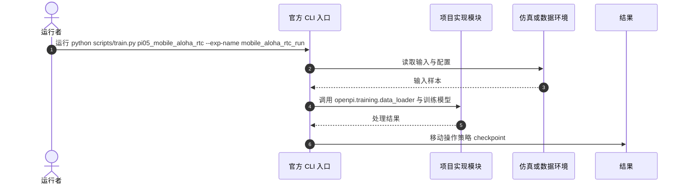

# HALO: Human-Aligned Data Collection for Whole-body Mobile Manipulation｜HALO：人机对齐的全身移动操作示教

## 一句话定义

**HALO：人机对齐的全身移动操作示教**：通过直接牵引双臂末端与低阻力移动平台减少示教与真实操作的视角及运动差异。

## 英文缩写速查

| 缩写 | 英文全称 | 简要说明 |
|---|---|---|
| ALOHA | A Low-cost Open-source Hardware System for Bimanual Teleoperation | 双臂遥操作系统 |
| RTC | Real-Time Chunking | 实时动作块衔接 |
| VLA | Vision-Language-Action | 视觉语言动作模型 |

## 为什么重要

通过直接牵引双臂末端与低阻力移动平台减少示教与真实操作的视角及运动差异。 本项目的机制、指标和开放边界需要分开理解，不能把单个结果推广到所有机器人平台。

## 核心信息

| 项 | 一手来源 |
|---|---|
| 论文 | [arXiv:2611.16439v1](https://arxiv.org/abs/2611.16439) |
| 项目 | [官方项目](https://robbyant-research.github.io/Lingbot-ALOHA/) |
| 代码 | [官方仓库](https://github.com/robbyant-research/Lingbot-ALOHA)；开放范围见源码归档 |

## 核心原理

操作者抓住改造后的紧凑末端直接引导机器人，低阻力平台随人体自然移动；对画面中人手做分割与修复，校准底盘运动响应及时间对齐，再将双臂和底盘动作送入统一策略训练。

### 流程总览

该图表示论文机制的主要数据或控制方向，不表示已经运行作者模型。

## 源码运行时序图

已核对 [官方代码归档](../../sources/repos/halo-2611-16439.md) 的 README 与公开运行入口（仅说明所发布组件，不代表实机复现）：

## 工程实践

1. 核实数据许可、训练/测试切分、时序观测和动作坐标系，建立与原文一致的对照协议。
2. 参照[官方源码归档](../../sources/repos/halo-2611-16439.md)核实入口、依赖及模型数据权限。
3. 分别统计训练预算、模拟指标、真机成功率与执行延迟，记录失败模式和软硬件约束。

## 实验与评测

Push Chair 示教采集相对 Mobile ALOHA 快 2.9 倍、拆 Lego 2.8 倍；作者报告六阶段长程任务 73.3% 真机成功率。

## 结论

**通过直接牵引双臂末端与低阻力移动平台减少示教与真实操作的视角及运动差异。**

1. 对照同数据与同测评协议，不混淆不同平台/样本统计口径。
2. 在复现前单列训练数据、预训练、控制接口和硬件依赖。
3. 验证边界是研究结论的必要组成，不能由示例直接推出可量产部署。

## 局限与风险

采集时与部署时的移动底盘存在动态差异，需额外对齐；公开仓库含 OpenPI/RTC 训练适配，数据及部分权重未直接随代码发布。

## 关联页面

- [2026-11-16 具身研究论文阅读地图](../overview/embodied-frontier-29-papers-2026-11-16.md)
- [ActionCodec2：流式动作编解码](./paper-actioncodec2-streaming-action-tokenizer.md)

## 参考来源

- [论文原文核对归档](../../sources/papers/halo-2611-16439.md)
- [项目核查归档](../../sources/sites/halo-2611-16439.md)
- [源代码归档](../../sources/repos/halo-2611-16439.md)

## 推荐继续阅读

- [arXiv HTML v1](https://arxiv.org/html/2611.16439v1)
- [官方代码](https://github.com/robbyant-research/Lingbot-ALOHA)
