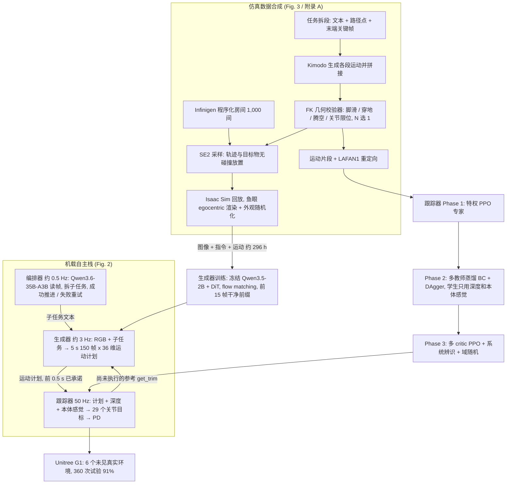
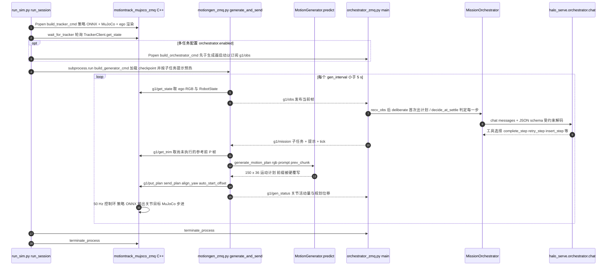
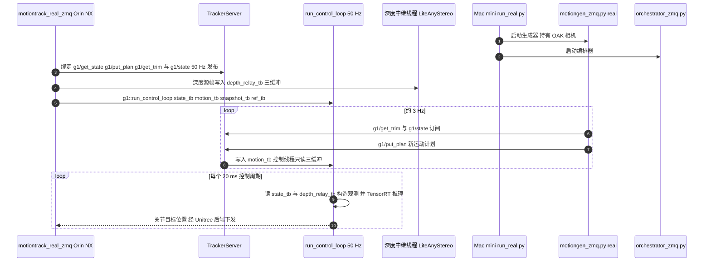
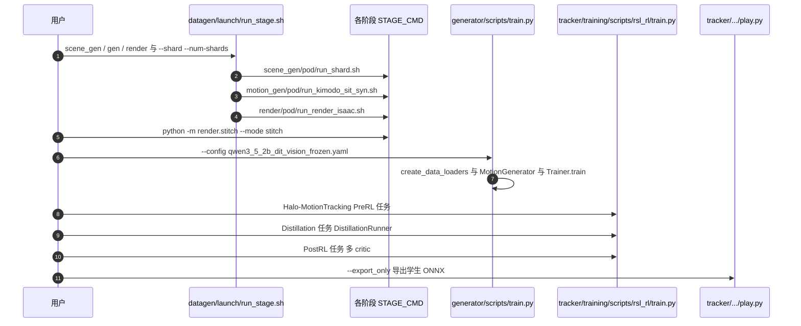

# HALO：Perceptive Humanoid Motion from Simulation

**HALO**（Humanoid Autonomy, Learned in simulation, running Onboard；[arXiv:2611.06908](https://arxiv.org/abs/2611.06908)，[项目页](https://apple-aiml-research.github.io/ml-halo/)，[GitHub](https://github.com/apple-aiml-research/ml-halo)）是 Apple 的人形机器人自主系统：不用遥操作、不用动捕穿戴设备，数据全部在仿真里按算力批量合成，部署时 Unitree G1 完全在机载算力上运行。本页依据 arXiv v1 全文（20 页，含附录 A–G）、项目页与官方仓库提交 `35d8334`（静态阅读）整理。

## 一句话定义

**HALO 是「仿真合成视觉-语言-运动数据 → 训练运动生成器（VLM 编码 + DiT 解码，5 s 全身运动计划）与带深度的运动跟踪器（三阶段 RL）→ VLM 编排器串联技能」的三层机载人形自主栈；在 1,000 个程序生成住宅里训练，零样本迁移到 6 个未见过的真实环境。**

> **同名区分（库内共有 4 个 HALO 相关节点，互不是同一篇）**
> - **本页**：Perceptive Humanoid Motion from Simulation，`2611.06908`，Apple，Unitree G1 感知式全身运动。
> - [HALO：Closing Sim-to-Real Gap for Heavy-loaded Humanoid](./paper-notebook-halo-closing-sim-to-real-gap-for-heavy-loaded-hu.md)，`2603.15084`，重载人形 sim-to-real（库内为待深读占位页）。
> - [HALOMI：Humanoid Loco-Manipulation](./paper-halomi-humanoid-loco-manipulation.md)，`2606.18772`，无机器人 UMI 数据 + 主动感知的 loco-manipulation。
> - [HALO-WA](./paper-rcl-2607-04265-halo-wa-hybrid-attention-latent-guided-online-re.md)，`2607.04265`，World-Action 模型的混合注意力在线 RL（仓库 YeanRoot/HALO-WA）。
>
> 四者仅名称相近，作者、任务与代码仓库均不同；arXiv ID 为各自的唯一键。

## 英文缩写速查

| 缩写 | 英文全称 | 简要说明 |
|------|----------|----------|
| HALO | Humanoid Autonomy, Learned in simulation, running Onboard | 本文系统名（论文 §I） |
| VLM | Vision-Language Model | 视觉语言模型；本文有两处：冻结的 Qwen3.5-2B（生成器编码器）与 Qwen3.6-35B-A3B（编排器） |
| DiT | Diffusion Transformer | 扩散 Transformer，生成器的解码器（8 块、宽 512） |
| Kimodo | Kinematic Motion Diffusion model | NVIDIA 的运动扩散模型，本文用来生成人形运动（论文引用 arXiv:2603.15546）；库内见 [kimodo](./kimodo.md) |
| Infinigen | Infinigen Indoors | Princeton 的程序化室内场景生成器；库内见 [infinigen](./infinigen.md) |
| RTC | Real-Time Chunking | 实时分块；本文对比「推理时引导」与「训练时前缀条件」两种做法 |
| PPO | Proximal Policy Optimization | 近端策略优化；跟踪器 Phase 1 / Phase 3 使用 |
| DAgger | Dataset Aggregation | 数据集聚合式模仿；跟踪器 Phase 2 蒸馏使用 |
| IMU | Inertial Measurement Unit | 惯性测量单元 |
| PD | Proportional-Derivative controller | 关节位置 PD 控制器；跟踪器输出目标关节位置 |
| FK | Forward Kinematics | 正运动学；数据过滤的几何校验器基于 FK |
| MLX | Apple MLX | Apple 芯片上的数组框架；编排器与生成器在 Mac mini 上用它推理 |

## 为什么重要

- **瞄准的是数据瓶颈**：论文称「像素 + 自由语言 → 关节指令」需要成对监督，遥操作或穿戴采集「每 1 小时数据至少耗 1 小时人力」（摘要）；HALO 把数据量与人力脱钩，只受算力约束（作者表述）。
- **感知两次进入系统**：语义层（指令指哪个物体）由 VLM 编码与编排器处理；物理层（座椅实际在哪、重心怎么落）由带深度的跟踪器处理（§I）。
- **评测口径较严**：论文表 I 强调评测环境「未扫描、未重建、训练期未见」，并按「环境数」而不是仅按试验次数报告；真机 360 次 = 6 项技能 × 6 个环境 × 每项每环境 10 次（§IV-C）。
- **工程完整度高**：官方仓库把数据生成、生成器训练、跟踪器三阶段训练、C++ 实时部署、编排器与 ZeroMQ 中间件一起开源（见下文「开源核查」），但**不含权重与数据**。

## 核心方法 / 机制

HALO 是三层栈（论文 Fig. 2、§III）：

| 层 | 频率 | 硬件 | 作用 |
|----|------|------|------|
| 编排器（Orchestrator） | 约 0.5 Hz，约每 2 s 一次 | Mac mini M4 Pro（64 GB）上本地 Qwen3.6-35B-A3B（4-bit，MLX），可选云端大模型 | 把自由语言拆成「技能 + 目标物」的子任务序列；成功则推进，失败则重试 |
| 运动生成器（Generator） | 约 3 Hz | 同一 Mac mini（MLX） | 输入 224×224 egocentric RGB + 子任务文本，输出 5 s、30 Hz、每帧 36 维（29 关节角 + 3 维骨盆平移 + 4 维骨盆四元数，均相对时刻 t 的骨盆系）的运动计划 |
| 运动跟踪器（Tracker） | 50 Hz | G1 自带 Jetson Orin NX（C++ PREEMPT_RT 进程，TensorRT） | 结合机载深度与本体感觉，输出 29 个目标关节位置，由 PD 控制器执行 |

### 1) 合成数据管线（§III-A，附录 A）

1. **运动生成**：每个任务拆成若干「段」，每段 = 文本提示 + 可选路径点 + 末端关键帧；例如「sit on the armchair」= walk forward → turn around → sit on chair。用 Kimodo（CFG 权重 2.0，同时作用于文本与约束）生成每段，再拼接成连续轨迹。
2. **几何校验**：Kimodo 是纯运动学模型，会出现脚滑、穿地、腾空与跳变；因此每段生成 N 个候选，用 FK 几何校验器打分（脚滑、穿地、腾空相、关节限位等）取最优。SIT 用 33 项检查（23 项为硬检查，通过需无硬检查失败且加权分 ≥ 0.75）；CRAWL / CROUCH 用 21 项、通过分 0.65、20 选 1。
3. **场景编排**：Infinigen 程序化生成房间（客厅 45% / 办公室 30% / 卧室 25%，边长 3.5–9.5 m，20–80 件家具）；论文生成 1,200 间、1,178 间成功，其中 1,000 间训练、178 间留出，仿真评测用其中 100 间留出房间；DOOR 需要门洞，用 966 个双房间 / 多房间场景。运动在 10 cm 占据栅格、24 个朝向上搜索首个无碰撞的 SE(2) 变换，骨盆距障碍至少 0.35 m。
4. **egocentric 渲染**：与 OAK-1W 标定一致的鱼眼相机（1280×800、128°×81°、下俯 25°），在 Isaac Sim 5.1（PUSH 在 MuJoCo）里回放运动；为避开逐帧路径追踪，把全局光照烘焙成每物体自发光纹理（每房间中位数 38.5 分钟），再做曝光 / 对比度 / 色调 / 运动模糊 / 传感器噪声等外观随机化。
5. **语料规模**（附录 A Table IV）：6 个技能数据集，共 **162,698 个 episode、296.3 h**（正文取整为「300 小时」），SIT 25,349 / GO-TO 50,000 / DOOR 29,207 / CRAWL 19,066 / CROUCH 19,369 / PUSH 19,707；整个语料只有 10 条固定指令（GO-TO 每个目标物一条）。合成耗时：§IV-A 称 48 小时、250 张 H100，无人工介入。

### 2) 运动生成器（§III-B，附录 B）

- **编码器**：冻结的 Qwen3.5-2B，取最后一层隐状态的 64 个图像 token 与全部文本 token（≤ 96），各过一个小投影（Linear-LayerNorm-GELU）降到 512 维，加可学习位置嵌入后作为条件序列。
- **解码器**：8 块、宽 512、8 头的 DiT（FFN 2048、dropout 0.1），自注意力作用于 150 个帧 token，交叉注意力读条件序列，AdaLN 注入流时间；末层线性零初始化；可训练参数共 49.3M。
- **训练**：flow matching，流时间 s ~ Beta(1.5, 1)；AdamW、lr 1e-3 余弦到 1e-5、batch 5,120（80 × 64 GPU）、50 epoch、31.0M 样本、64 张 B200。
- **异步生成与训练时前缀条件**（本文关键设计）：生成器与跟踪器异步运行，新计划在 T+d 才就绪，需要平滑接上机器人届时的状态。作者不做推理时 RTC 引导，而是把「机器人已承诺执行」的前 P = 15 帧（0.5 s）作为干净 token 直接送入，只对后 H − P = 135 帧去噪，损失只覆盖这 135 帧；推理时每步 Euler 迭代后再覆写前缀，共 15 步。

### 3) 运动跟踪器（§III-C，附录 C）

三阶段（Isaac Lab）：
1. **Phase 1 特权专家**：每个技能族一个 PPO 专家（平地运动 / 障碍穿越、物体操作 PUSH、物体交互 SIT）；观察特权状态、未来 10 帧参考与局部高度图；奖励含 6 个高斯核的运动跟踪项，物体技能再加手—物体距离门控的物体位置 / 姿态 / 掉落项；另用 LAFAN1 重定向到 G1 的片段。
2. **Phase 2 多教师蒸馏**：把专家蒸成只用机载输入（运动计划、深度、本体感觉、IMU）的学生；每个仿真实例按技能路由到对应专家，混合 BC 与 DAgger（20% 教师驱动 / 80% 学生驱动）；网络 = 1D CNN（30 步历史）+ 2D CNN（48×84 深度）+ SimBa 残差 MLP。
3. **Phase 3 多 critic 微调**：共享 actor，每技能一个独立 critic（由 Phase 1 critic 初始化），优势按技能单独标准化，避免高量级回报主导梯度。

**sim-to-real 细节**（附录 C、G）：沿用 OmniXtreme 的做法，按电机转子惯量解析推导 PD 增益（ωn = 10 Hz、ζ = 2.0）、按力矩上限缩放动作；对真机 G1（含 Mac mini 机壳共 37.56 kg）做开环轨迹系统辨识；随机动作延迟（Phase 3 为 15–40 ms）；对膝关节负机械功率（再生制动）加惩罚；深度加丢点 / 斑点 / 延迟 / 相机安装偏差；地面接触刚度 1.3–6.5 kN/m 以覆盖地毯。真机深度不用 D435i 自带匹配器，而是关闭红外点阵、取左右红外原图送 LiteAnyStereo（7.6M 参数，TensorRT FP16）估计，下采样为 48×84。

### 4) 编排器（§III-D，附录 D）

输入 = 操作员请求 + 最新 egocentric 帧；先产出最多 8 步的子任务计划（固定 JSON schema，11 个可选子任务：go to chair / go to box / go to human / follow / sit / crouch under / crawl through / sidewalk / push box / stand / hold，附录 Table X），运行中每个决策点从 6 个工具里选一个：`complete_step`、`finish_mission`、`retry_step`、`insert_step`、`set_plan`、`ask_operator`。

## 流程总览

下图依据论文 Fig. 2（机载栈）与 Fig. 3（数据与训练管线）绘制。

## 实验与评测

**设置**（§IV）：训练语料 300 h（精确 296.3 h）/ 1,000 房间；仿真评测在 MuJoCo 里跑完整部署栈（规划延迟计入），单任务在 100 个留出房间 × 每任务每环境 10 次（6,000 次仿真）；真机 6 个环境 × 6 项技能 × 10 次（360 次）。单任务成功 = 完成任务且不摔倒、不卡住；摔倒判据为骨盆倾角 > 60° 或骨盆高度 < 0.30 m 持续 ≥ 1 s（附录 F）。

### Table II：留出环境任务成功率（%）

| 类别 | 任务 | 仿真 | 真机 |
|------|------|------|------|
| 单任务 | GO-TO | 98 | 92 |
| 单任务 | SIT | 84 | 85 |
| 单任务 | DOOR | 91 | 93 |
| 单任务 | CROUCH | 95 | 100 |
| 单任务 | CRAWL | 84 | 90 |
| 单任务 | PUSH | 93 | 88 |
| 单任务 | **均值** | **91** | **91** |
| 多任务 | DOOR→GO-TO | 71 | 100 |
| 多任务 | CROUCH→SIT | 73 | 60 |
| 多任务 | CROUCH→GO-TO→PUSH | 64 | 50 |
| 多任务 | **均值** | **69** | **70** |

多任务评测在 50 个仿真环境与 1 个真实环境（每条链每环境 10 次，故真机多任务每条链只有 10 次试验，统计功效有限，此为我据 Table II 标题与 §IV-D 的推算）。

### Table III：阶段式消融（SIT，100 个留出仿真环境 × 10 次）

| 阶段 | 配置 | 成功率 (%) | Δ |
|------|------|-----------|---|
| 训练场景数 | **1,000** | 84 | — |
| | 100 | 81 | −3 |
| | 10 | 64 | −20 |
| | 1 | 43 | −41 |
| 实时分块 | **训练时条件** | 84 | — |
| | 推理时（引导梯度） | 66 | −18 |
| | 无 | 24 | −60 |
| 生成器解码器 | **Flow matching** | 84 | — |
| | 回归 | 19 | −65 |
| 跟踪器 | **含深度** | 84 | — |
| | 无深度 | 74 | −10 |

### Table I：与同类无遥操作系统对比（作者表述，论文 §I）

| 项 | ZeroWBC [20] | VLK [15] | GRAIL [18] | TANGO [11] | HALO |
|----|------|------|------|------|------|
| 自由语言 | 是 | 否 | 否 | 是 | 是 |
| 物体交互 | 是 | 是 | 是 | 否 | 是 |
| 多步任务 | 否 | 否 | 否 | 否 | 是 |
| 感知式跟踪器 | 否 | 否 | 部分 | 否 | 是 |
| 训练环境数 | n/a | 2 | 2 | 578 | 1,000 |
| 留出环境 | 部分 | 否 | 部分 | 是 | 是 |
| 真机试验 / 环境数 | 300 / – | 120 / 2 | 100 / – | 45 / 3 | 360 / 6 |

### 机载延迟（附录 E，Table IX，Mac mini M4 Pro）

| 阶段 | 延迟 |
|------|------|
| 运动生成器（单独，仅模型推理） | 约 152 ms |
| 运动生成器（与编排器一次转移决策共用 GPU） | 约 155 ms |
| 编排器一次转移决策（单独，固定前缀已缓存） | 约 0.72 s |
| 编排器一次转移决策（与生成器共用 GPU） | 约 1.46 s |

附录 E 称两者共用一个单线程 GPU 调度器：运动计划优先（333 ms 截止），可在层间暂停编排器调用，编排器至少保留 60% 的 GPU 时间。

### 附录 G 的经验性观察（作者未系统消融，原文明说）

- **冻结 vs 微调 VLM**：微调编码器后响应更灵敏、动作更平滑，尤其是跟随行人；但训练数据里只有一种人体模型时，微调后的模型只认得与之相似的人，用 Hunyuan3D 生成多种人体模型重渲染后恢复泛化。微调模型还会走捷径（画面里有椅子就默认「坐」而忽略指令），作者用 30% 样本把图像换成黑帧来修正。最终采用冻结编码器。
- **系统辨识**：真机电机只给出指令刚度的 78–90%，端到端环路延迟 25–30 ms；辨识把留出机器人运动的关节跟踪误差从 26.9% 降到 10.1%（降幅 62%）。
- **地毯**：只在刚性地面训练的策略在厚地毯上会把脚陷入 1–2 cm 误判为倾斜扰动而持续挪脚；加入接触刚度 / 阻尼随机化与站立脚滑惩罚后可在厚地毯上安静站立。
- **动作平滑**：跨检查点看，原始仿真回报与真机稳定性弱相关，而动作变化率惩罚强相关；缺少该惩罚与 15–40 ms 随机延迟时，踝与腕会出现可闻振动。

## 结论

**HALO 的价值在于证明「全合成视觉-语言-运动数据 + 带深度的 RL 跟踪器」这一条无人工数据采集的路线，能在未见过的真实房间里把单任务成功率做到约 91%；但新增技能仍要人工写提示与关键帧，长链任务的成功率明显低于单任务。**

- 场景多样性是最关键的数据维度：训练房间数 1 → 100 把 SIT 仿真成功率从 43% 提到 81%，再到 1,000 仅多 3 个百分点（Table III）。
- 前缀条件的训练方式比推理时引导高 18 个百分点（66% → 84%），且去掉任何连续性机制会跌到 24%（Table III）；做异步重规划的系统值得优先照搬这一点。
- 深度对 SIT 单项有 10 个百分点收益（74% → 84%，Table III），但该消融只在 SIT 与仿真里做过，不能外推到其它技能。
- 链式任务成功率低于各子任务成功率之积（DOOR→GO-TO 仿真 71%，对比单任务乘积约 89%），原因是上一步结束姿态使下一目标移出视野（§IV-D）；真机链式试验各只有 10 次，数字波动大。
- 部署读法：真机栈需要 Jetson Orin NX + Mac mini M4 Pro（64 GB）+ OAK-1W + D435i 的组合，直接复现门槛较高（附录 E）。

## 局限

**原文自述**（§V）：
1. 流水线去掉了数据采集环节的人，但没去掉任务设计的人：新增一项物理任务仍需人工写提示并设计运动序列的关键帧，技能库只能随人的设计速度增长。
2. 传感以视觉为主、无直接接触感知；物体离开视野或被遮挡后策略没有「它还在」的信号，接触密集任务会退化；作者提出可加触觉。
3. 生成器与跟踪器之间的接口很窄：跟踪器只跟随运动学计划而不知计划的目的，可考虑传达意图中的未来世界状态。
4. 编排层相对简单，技能库扩大后需要更 agentic 的系统。

**我的核对与补充**：
- **多任务真机样本量小**：按 Table II 标题推算，真机多任务每条链仅 10 次试验（推测，论文未给出分条试验数）。
- **消融只覆盖 SIT 单任务且仅仿真**（Table III 标题）。
- **「91%」的口径**：是 6 项单任务成功率的算术平均（仿真 91、真机 91），不是 360 次的加权混合，但因每项都是 60 次试验，二者数值一致；多任务真机均值为 70%，并非 91%。
- **数据量口径**：摘要 / 正文「300 小时」为取整，附录 Table IV 实际 296.3 h、162,698 个 episode。
- **官方仓库只给出 SIT 的数据管线**：仓库 `system/README.md` 明说 `datagen/` 只产出 `sit_on_chair` 的训练数据，其余技能需要仓库外的数据（见「开源核查」），因此论文全部 6 项技能的结果无法仅凭仓库复现。
- **附录个别笔误**：附录 E 把 OAK-1W 的分辨率写作 1280×80（应为 1280×800，正文 §IV-B 为 1280×800）。
- **论文版本**：本页依据 v1（2026-11-04）；核对时 arXiv 摘要页只有 v1。

## 开源核查（2026-11-06）

| 项 | 状态 | 核查方式 |
|----|------|----------|
| 项目页 | HTTP 200；页内 Paper 按钮标「Soon」，Code 按钮仍写 `Coming soon`（页面静态文本） | `curl` 取 HTML |
| 代码 | **已公开**：`github.com/apple-aiml-research/ml-halo`，`main` 提交 `35d8334`（2026-11-04） | `git ls-remote` 可达，`git clone --depth 1` 只读阅读 |
| 数据 | **不随仓库发布**；`datagen/` 可自行生成，且只含 SIT | 仓库 README / system README |
| 权重 | **不随仓库发布**（生成器 checkpoint、跟踪器 ONNX 均需自训） | `system/README.md`「Models」、`generator/README.md` |
| 许可 | `LICENSE` 为 Apple 自定义条款（授予使用、复制、修改、再分发的个人非独占许可，要求保留声明并免责），**不是** MIT / Apache；README 内仍留有 `TODO(release): license` 与 authors 的注释；第三方（G1 描述、Kimodo、Infinigen、Qwen3.5 等）按 `ACKNOWLEDGEMENTS` 各自保留许可 | 阅读 `LICENSE`、`ACKNOWLEDGEMENTS`、README |

项目页与仓库状态不同步（页面写 Coming soon，但仓库已可公开克隆），以仓库实际可达为准。

## 源码运行时序图

**静态阅读、未运行**：以下依据官方仓库提交 `35d8334` 阅读 `system/halo_system/scripts/run_sim.py`、`nodes/motiongen_zmq.py`、`nodes/orchestrator_zmq.py`、`lib/zmq_helper.py`、`lib/inference.py`、`generator/models/motion_generator.py`、`generator/training/trainer.py`、`orchestrator/halo_orchestrator/orchestrator.py`、`system/cpp/transport/tracker_server.hpp`、`system/cpp/nodes/motiontrack_real_zmq.cpp` 以及各 README；未运行任何仓库代码。

### 闭环仿真（`run_sim.py --task_config <task>.yaml --web`）

要点：`single_task/` 配置不起编排器，生成器用固定提示（可在 Linux + CUDA 下跑）；`multi_task/door_then_sit.yaml` 才启用编排器，其模型走 `halo_serve` 的 MLX 后端，仅支持 Apple 芯片、至少 32 GB 内存（`system/README.md`）。生成器加载的 `qwen3_5_2b_dit_vision_frozen.yaml` 里 `inpaint_prev_chunk: true`、`prev_chunk_frames: 15`、`num_inference_steps: 15`，与论文一致；`generate_motion_plan` 对「非前缀训练」的旧检查点还保留 `predict_rtc`（beta = 5）的推理时引导分支。

### 真机路径（`run_real.py` + `motiontrack_real_zmq`）

要点：Python / C++ 两侧共用 `halo_comm`（ZeroMQ + protobuf 的轻量中间件，订阅端只保留最新消息，`system/comm/README.md`）；protobuf 序列化在服务线程里，控制线程只碰三缓冲与原子量（`tracker_server.hpp` 头注释）。遥控器 **Start → A → B** 启动、**Select** 急停（`system/README.md`）。

### 数据与训练入口（仅列入口，细节见各子目录 README）

要点：`Trainer._train_epoch` 先采样流时间并加噪，再调用 `_apply_prev_chunk_inpainting` 把前 P 帧换成干净值、该位置流时间置 1 并从损失里屏蔽，对应论文式 (2)。

## 与相关工作对比

| 维度 | HALO（本页） | [VLK](./paper-vlk-synthetic-loco-manipulation.md) | [GRAIL](./paper-grail.md) | [TANGO](./paper-tango-vla.md) | [ZeroWBC](./paper-notebook-zerowbc.md) |
|------|------|------|------|------|------|
| 训练环境来源 | Infinigen 程序生成 1,000 间 | 已扫描重建的房间 | 地形多样，物体交互限于模板 | 578 个环境 | 人类 egocentric 视频 |
| 感知式低层控制 | 是（深度） | 否 | 部分 | 否 | 否 |
| 多步编排 | 是（VLM 编排器） | 否 | 否 | 否 | 否 |
| 真机未见环境 | 6 个 | 2 个（均为训练用房间） | 未报告数量 | 3 个 | 未报告数量 |

（以上取自论文表 I 与相关工作一节，为作者表述。）

- **与 [Kimodo](./kimodo.md) 的关系**：HALO 把 Kimodo 当作运动数据引擎，并加上「FK 校验 + N 选 1」，而不是直接把 Kimodo 输出喂给跟踪器。
- **与 [Real-Time Chunking](./paper-real-time-chunking.md) / [训练时 RTC](./paper-training-time-real-time-chunking.md)**：HALO 采用训练时前缀条件（论文引用 Black 等 arXiv:2512.05964），并在 Table III 里与推理时 RTC 做了直接对比。
- **与 [OmniXtreme](./paper-hrl-stack-16-omnixtreme.md)**：跟踪器的 PD 增益推导、动作缩放与膝关节再生制动惩罚沿用其做法。
- **与 [BeyondMimic](../methods/beyondmimic.md)**：运动跟踪奖励（骨盆 + 14 个链接的高斯核）与 PD 增益的系统辨识思路参考了 BeyondMimic（论文标注 Following BeyondMimic [53]）。
- **与 [ResMimic](./paper-resmimic.md) / [MaskedMimic](./paper-bfm-17-maskedmimic.md)**：物体交互奖励用「手—物体距离门控」，引自这两项工作。
- **与 [LeVERB](./paper-bfm-36-leverb.md)、[VisualMimic](./paper-notebook-visualmimic.md)**：同属「高层语言 / 视觉 + 低层全身控制」的分层路线，接口分别是潜在词表、稀疏关键点；HALO 的接口是完整的全身运动学轨迹。
- **与 [HumanoidMimicGen](./paper-humanoidmimicgen.md)**：同为用仿真批量生成人形数据；HALO 的数据带 egocentric 图像与语言，并服务于运动规划器而非直接模仿操作。
- **与 [FetchMan](./paper-fetchman.md)**：FetchMan 生成 150,000 个场景但只针对单一 reach-and-pick 任务（论文相关工作一节）。

## 关联页面

- [kimodo](./kimodo.md)
- [infinigen](./infinigen.md)
- [unitree-g1](./unitree-g1.md)
- [isaac-lab](./isaac-lab.md)
- [lafan1-dataset](./lafan1-dataset.md)
- [paper-vlk-synthetic-loco-manipulation](./paper-vlk-synthetic-loco-manipulation.md)
- [paper-grail](./paper-grail.md)
- [paper-tango-vla](./paper-tango-vla.md)
- [paper-notebook-zerowbc](./paper-notebook-zerowbc.md)
- [paper-fetchman](./paper-fetchman.md)
- [paper-real-time-chunking](./paper-real-time-chunking.md)
- [paper-training-time-real-time-chunking](./paper-training-time-real-time-chunking.md)
- [paper-ross-dagger](./paper-ross-dagger.md)
- [beyondmimic](../methods/beyondmimic.md)
- [motion-retargeting-gmr](../methods/motion-retargeting-gmr.md)
- [flow-matching-embodied-policy](../concepts/flow-matching-embodied-policy.md)
- [loco-manipulation](../tasks/loco-manipulation.md)
- [humanoid-locomotion](../tasks/humanoid-locomotion.md)
- [mujoco-vs-isaac-lab](../comparisons/mujoco-vs-isaac-lab.md)
- 同名不同篇：[paper-notebook-halo-closing-sim-to-real-gap-for-heavy-loaded-hu](./paper-notebook-halo-closing-sim-to-real-gap-for-heavy-loaded-hu.md)、[paper-halomi-humanoid-loco-manipulation](./paper-halomi-humanoid-loco-manipulation.md)、[paper-rcl-2607-04265-halo-wa-hybrid-attention-latent-guided-online-re](./paper-rcl-2607-04265-halo-wa-hybrid-attention-latent-guided-online-re.md)

## 参考来源

- [halo_perceptive_humanoid_motion_sim_arxiv_2611_06908.md](../../sources/papers/halo_perceptive_humanoid_motion_sim_arxiv_2611_06908.md)：论文归档
- [halo-perceptive-humanoid-motion-sim（项目页）](../../sources/sites/halo-perceptive-humanoid-motion-sim.md)
- [halo-perceptive-humanoid-motion-sim（仓库）](../../sources/repos/halo-perceptive-humanoid-motion-sim.md)
- [七项机器人资料：初步核验与待完成工作（草稿登记）](../../sources/papers/2026-11-06-seven-robotics-intake-draft.md)
- [arXiv:2611.06908](https://arxiv.org/abs/2611.06908) 与 [PDF](https://arxiv.org/pdf/2611.06908)：已通读正文 §I–V、附录 A–G 与全部表（Table I–X）
- [项目页](https://apple-aiml-research.github.io/ml-halo/)、[GitHub 仓库](https://github.com/apple-aiml-research/ml-halo)

## 推荐继续阅读

- 论文引用的 Kimodo（arXiv:2603.15546）与训练时 RTC（arXiv:2512.05964）
- 同期的 VLK（arXiv:2606.30645）、GRAIL（arXiv:2606.05160）、TANGO、ZeroWBC（arXiv:2603.09170）：对照不同的「合成数据 → 人形全身控制」路线
- 仓库 `tracker/training/README.md`、`tracker/deploy_cpp/docs/depth.md`：三阶段训练与深度链路的实现细节
