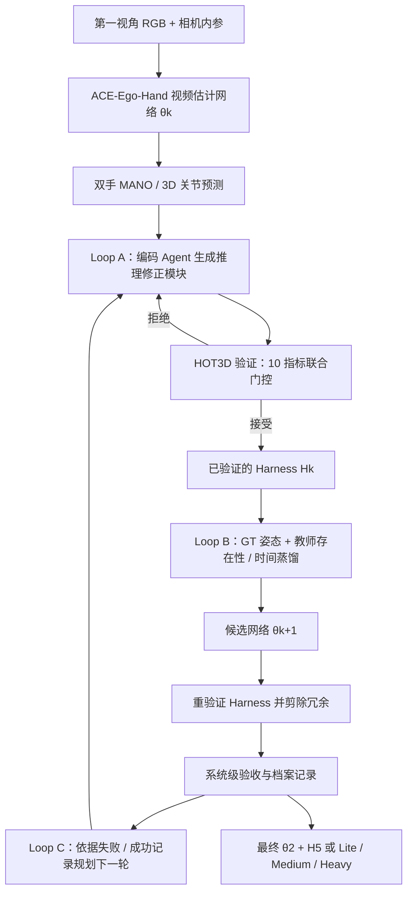
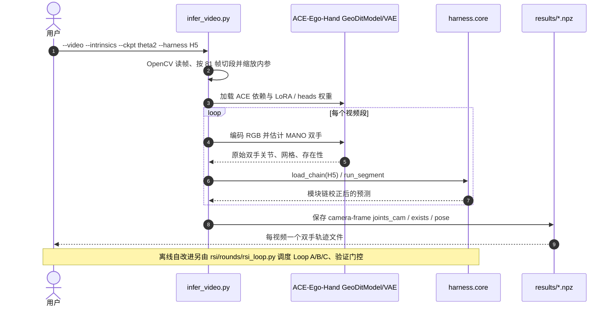

# HandRSI：递归自我改进优化第一视角 3D 手部姿态估计

**HandRSI: Recursive Self-Improvement for Hand Pose Estimation（通过递归自我改进优化手部姿态估计）**，Zhekai Wang 等，arXiv:2611.22164v1，2026-11-17，Technical Report。[论文](https://arxiv.org/html/2611.22164v1) · [代码](https://github.com/GinKenneth/Hand_RSI) · [权重](https://huggingface.co/HandRSI/HandRSI)。

## 一句话定义

**HandRSI 把“视频手部姿态网络 + 可执行推理 Harness”当作联合优化对象：编码 Agent 搜索推理修正模块，固定多指标验收门控，再把可靠修正选择性蒸馏回网络，逐轮重新检验两者的适配。**

## 英文缩写速查

| 缩写 | 英文全称 | 简要说明 |
|---|---|---|
| RSI | Recursive Self-Improvement | 有外部验证约束的多轮自改进 |
| HPE | Hand Pose Estimation | 双手 3D 关节 / MANO 姿态估计 |
| GT | Ground Truth | 人工标注或数据集真值，负责姿态监督 |
| MPJPE | Mean Per Joint Position Error | 平均 3D 关节位置误差；文中 MPJPE-p 为带缺失惩罚口径 |
| KD | Knowledge Distillation | 从改进后的推理链向网络蒸馏存在性与时序信息 |
| MANO | Model with Articulated and Non-rigid defOrmations | 参数化手部网格与关节 |
| FPS | Frames Per Second | 端到端推理吞吐量 |

## 为什么重要

- **第一视角难例：** 遮挡、出画边缘、双手交互和指尖抖动令单独微调或后处理难以统一优化。
- **研发方法可借鉴：** 将 Agent 写出的代码视为可回滚 Harness，不直接修改评估器，使用同一多指标门控区分网络与后处理的贡献。
- **具身数据价值：** 摄像头中的双手关节轨迹可接入示范数据标注与视觉动作估计，但本文**没有验证机器人真机策略性能**。

## 核心信息

| 项 | 核实结果 |
|---|---|
| **机构** | 灵生机器人（LivSyn Robotics）、华南理工大学、悉尼科技大学、北京科技大学、清华大学 |
| **骨干** | ACE-Ego-Hand 的第一视角视频 MANO 双手估计；K-given（须提供相机内参） |
| **数据** | HOT3D、ARCTIC 的 train/dev/val 参与循环；HOI4D 仅 zero-shot；测试拆分为 sealed |
| **改进对象** | 推理 Harness 模块链（Loop A）与估计网络 LoRA / heads（Loop B）；Loop C 调整下一轮研究建议 |
| **开放程度** | 官方仓库可获取代码/评估器/Harness 与结果；HF 已公开 θ1/θ2 权重及各轮 Harness |
| **许可** | 仓库代码 MIT；HF 权重 CC BY-NC 4.0；MANO、ACE-Ego-Hand 等依赖需逐项检查 |

## 核心原理

1. **Loop A：** 八个编码 Agent 在 dev 数据和缓存网络输出上增改确定性推理模块；验证侧综合 10 项指标决定是否接受。HOT3D 是实际主门控锚，ARCTIC 用作报告与遗忘检查。
2. **Loop B：** 以 3D GT 监督关节/姿态，以被接受 Harness 的教师输出来监督无标注帧的手部存在性及时间一致性；不盲目把教师的 3D 姿态替代已有 GT。使用 LoRA（rank 32）与预测 heads 微调。
3. **重验证：** 网络更新后，逐模块消融判断 Harness 是否变成冗余或有害；随后还需系统级验收。第 3–5 轮蒸馏网络未通过门控，故最终仍用 θ2。
4. **Loop C：** 基于接受/拒绝记录及 dev 诊断提出下一轮研究方向，**不能自行修改冻结的评估器或门控**；部分流程决策仍需人工批准。
5. **部署分层：** 在速度—精度前沿上做超体积选择，输出 Lite/Medium/Heavy 子链，而非只发布一个最精确的慢速配置。

**门控细节：** 10 指标的相对改变量按 ±5% 截断后求均值，以按序列配对 bootstrap 的 90% 置信下界检验增益；单项显著下降超过 2% 或绝对下降超过 5% 会触发拒绝。具体阈值和早期例外见原文 §3.1 与 §4.5。

## 流程总览

## 源码运行时序图

依据官方 `infer_video.py`、`rsi/rounds/rsi_loop.py`、`ace_eval/README.md` 和 README 的公开入口；区分离线 RSI 训练与最终部署推理：

## 工程实践

1. 按 [官方仓库](https://github.com/GinKenneth/Hand_RSI) README 安装 ACE-Ego-Hand（包括 VideoX-Fun、Wan2.2-Fun-5B-Control 和 K-given checkpoint）及本仓依赖；MANO 模型需要独立处理许可证。
2. 从 [Hugging Face](https://huggingface.co/HandRSI/HandRSI) 获取 `theta2` 与 Harness；最终完整系统为 `theta2 + rsi/harness/trees/H5`，不是 `theta5` 权重。
3. 最小运行：`python infer_video.py --video clip.mp4 --intrinsics fx,fy,cx,cy --ckpt checkpoints/handrsi/theta2 --harness rsi/harness/trees/H5 --out results/clip`。输出为相机系 `.npz`：左右手 21 关节 `joints_cam`、`exists`、MANO 网格/姿态等。
4. 速度优先换 `--harness rsi/harness/trees/Lite`；部分模块需要 WiLoR 权重，缺失时的精度不可等同论文报告。训练完整 RSI 还需要 root 沙箱、Agent API 与多卡 GPU，不能与普通推理命令混为一谈。

## 实验与评测

| 指标 / 配置 | ACE-Ego-Hand K-given | HandRSI 最终 |
|---|---:|---:|
| HOT3D MPJPE-p（mm，越低越好） | 12.97 | **8.37** |
| HOT3D Jitter（越低越好） | 2.82 | **1.34** |
| ARCTIC MPJPE-p（mm） | 15.58 | **13.85** |
| ARCTIC Jitter | 2.58 | **1.45** |
| HOI4D zero-shot MPJPE-p（mm） | 23.45 | **22.77** |
| HOI4D zero-shot EPE2D-p（px） | **15.60** | 18.61 |

**吞吐（RTX PRO 5000；端到端含网络）：** 网络 θ2 单独 42.7 FPS；Lite 41.1 FPS（20 模块）、Medium 34.0 FPS（28 模块）、Heavy 20.7 FPS（29 模块）；完整 H5* 16.2 FPS（39 模块）。论文单独报告五轮进步和公平重跑基线，但上述速度不代表在其他 GPU 上可直接复现。

## 与其他工作对比

| 对照 | 区别 |
|---|---|
| [WiLoR](../methods/wilor.md) | 单帧检测与 3D 重建器；HandRSI 从视频网络出发且 Harness 可调用 WiLoR 图像证据 |
| [Macrodata Egocentric Hand-Action](../methods/macrodata-egocentric-hand-action.md) | RGB → 世界系手部动作的几何重建/数据管线；HandRSI 输出相机系 MANO 轨迹，不自动生成机器人动作 |
| [Hand Visibility Detector](./paper-hand-visibility-detector.md) | 逐关节可见性估计用于观测门控；HandRSI 联合优化存在性、3D、2D 与时序十指标 |
| [RSI 纵深路线](../../roadmap/depth-rsi.md) | 为 Harness 进化 + 权重更新 + 固定测试锚提供具身感知案例；不能直接证明开放式 RSI 或递归加速 |

## 结论

**HandRSI 的可靠增益来自“外部指标门控的 Harness 进化 + 只蒸馏教师更可靠的信号 + 每次更新重验证”，而非无约束自我训练。**

1. 复现先对齐**相机内参、数据拆分、10 项指标与 ACE-Ego-Hand 的评估口径**，不能只报 MPJPE。
2. 最终网络是 **θ2**；第 3–5 轮主要靠更新 Harness，比较时分开评估“网络单独”和“网络 + Harness”。
3. 选择部署层级时同时看 FPS 与 Jitter；完整 H5* 精度最高，但吞吐低于 Lite/Medium/Heavy。
4. HOI4D 存在 2D/检测退化，不能把 HOT3D/ARCTIC 优势笼统推广成全部数据集全面提升。
5. 代码 MIT 与权重 CC BY-NC **分属不同许可**；商业机器人产品应用前逐项核对训练权重和第三方依赖。

## 局限与风险

- **验证边界：** 优化门控主要基于 HOT3D；ARCTIC 不阻塞。论文披露第 1 轮曾人工放行超出 5% 上限的 FAcc 退化，且前两轮有三次基于测试结果的人工流程决策；不能把 sealed test 解释为开发全过程完全未参考。
- **跨域与机器人落地：** HOI4D 在 3D 与平滑上改善，但 FAcc/2D 对齐下降；本文没有以机器人真机模仿学习成功率验证下游价值。
- **复现成本：** ACE-Ego-Hand 视频骨干、MANO、WiLoR、多个模型资产和 8 卡级 RSI 循环；推理可能落在单 GPU，但速度受硬件与模块配置影响。
- **许可：** 权重 CC BY-NC 4.0 不等同代码 MIT 许可证；商业用途不应仅凭代码仓开放判断。

## 关联页面

- [WiLoR：手部检测与重建](../methods/wilor.md)
- [自动化标注流水线](../methods/auto-labeling-pipelines.md)
- [Macrodata Egocentric Hand-Action](../methods/macrodata-egocentric-hand-action.md)
- [手部可见性估计器](./paper-hand-visibility-detector.md)
- [灵巧操作任务](../tasks/manipulation.md)
- [递归自我改进 RSI 纵深](../../roadmap/depth-rsi.md)

## 参考来源

- [论文全文阅读归档](../../sources/papers/handrsi_arxiv_2611_22164.md)
- [代码与运行入口归档](../../sources/repos/handrsi.md)
- [HF 模型卡与许可归档](../../sources/models/handrsi-hf-checkpoints.md)
- [arXiv HTML v1](https://arxiv.org/html/2611.22164v1) · [官方代码](https://github.com/GinKenneth/Hand_RSI) · [权重](https://huggingface.co/HandRSI/HandRSI)

## 推荐继续阅读

- [ACE-Ego-Hand（基线代码）](https://github.com/ggxxii/ACE-Ego-Hand)
- [HandRSI 官方运行 README](https://github.com/GinKenneth/Hand_RSI#readme)
- [HOT3D 官方数据集](https://facebookresearch.github.io/hot3d/)
