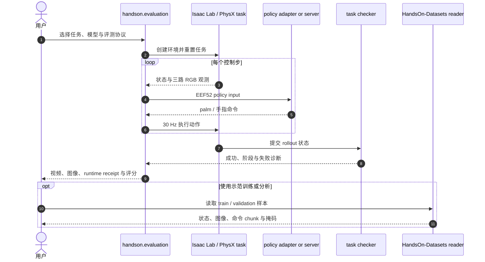

# HandsOn：面向泛化灵巧操作的大规模仿真基准

**HandsOn**（*A Large-Scale Simulation Benchmark for Generalizable Dexterous Manipulation*，[arXiv:2610.26765](https://arxiv.org/abs/2610.26765)，[项目页](https://llltttwww.github.io/HandsOn-website/)）是清华大学、北京邮电大学、NatureWill 与北京大学提出的仿真平台和跨具身灵巧操作 benchmark。它把多种机械臂与灵巧手、可组合任务、人工示范及闭环评测放在统一协议下，重点观察策略能否跨资产、关系、技能组合与可变形物体泛化。

## 英文缩写速查

| 缩写 | 英文全称 | 简要说明 |
|------|----------|----------|
| HandsOn | HandsOn benchmark | 本文的平台、示范数据与灵巧操作评测套件 |
| Core-50 | Core evaluation suite | 50 项提供示范并评测执行表现的任务 |
| Transfer-16 | Transfer evaluation suite | 16 项目标任务无示范的迁移、组合与可变形操作评测 |
| EEF52 | End-Effector Feature 52 | 左右手各 26 维的 palm 位姿与手指目标接口 |
| SR | Success Rate | 任务成功率；按闭环任务检查器统计，不是动作误差 |

## 为什么重要

- **把任务内学习与迁移评测分开。** Core-50 有训练示范和执行测试；Transfer-16 不提供目标任务示范，覆盖资产/关系变化、技能组合及可变形操作。比较数字时应先确认属于哪套任务与训练协议。
- **基准强调执行结果。** 项目以模拟器和 task checker 判断成功，并记录阶段进展与失败类型；动作预测误差本身不说明任务闭环完成。
- **暴露接触丰富任务的现实难点。** 官方分析指出，建立有效接触、协调多指/双手、按顺序完成组合任务并维持已达成目标，仍会造成显著失败。
- **数据、代码和分数的开放边界不同。** 环境和评测入口已开源，PhysX 示范数据已公开，Newton 数据待发布；论文策略 checkpoint 未随仓库提供。

## 核心信息

| 项 | 内容 |
|----|------|
| **机构** | 清华大学、北京邮电大学、NatureWill、北京大学 |
| **平台** | 5 种机械臂、6 种灵巧手、约 200 个刚体 / 关节 / 可变形资产 |
| **任务** | 66 项：Core-50 50 项；Transfer-16 16 项 |
| **数据** | 18,000 条示范；15,178 train / 2,822 validation；30 Hz、三路 RGB |
| **训练集** | PhysX 仿真采集，ROKAE AR5-5_08 + Wuji Hand 1；Newton 后端数据待发布 |
| **代码** | [官方仓库](https://github.com/TsinghuaC3I/HandsOn)，MIT；带评测入口、任务与多类策略适配器 |
| **权重** | 论文 checkpoint 未随仓库分发 |
| **依赖** | 默认 PhysX 环境：Python 3.11、Isaac Sim 5.1.0.0、Isaac Lab v2.3.2；Newton evaluator 为独立环境且任务范围较小 |

## 任务与数据协议

HandsOn 用两套任务测试不同能力：

| 套件 | 任务数 | 示范 | 主要考察 |
|------|--------|------|----------|
| Core-50 | 50 | 有示范 | 功能工具使用、数值/空间 grounding、关节物体操作、抓放与双手协调 |
| Transfer-16 | 16 | 无目标任务示范 | 资产与关系迁移、技能组合、可变形物体操作 |

Hugging Face 发布的 PhysX 数据包含 18,000 条 episode、6,053,555 帧，30 Hz 采集，并提供三个同步 RGB 视角。每帧的观测状态与命令动作各为 52 维；左右手分别占 26 维，含 palm 位置、旋转和 20 个手指关节值。动作是绝对 world-palm command，应按官方读取器的归一化、掩码与仿真接口解释。

训练/验证划分以 collection session 隔离，训练统计只从训练 split 计算。语言 prompt split 与 episode split 独立；做未见措辞评测时需显式使用 unseen prompt split。完整数据约 111 GB，先确认磁盘空间与数据卡中列出的许可和读取说明。

## 评测结果

官方项目页与仓库 README 报告：八个多任务 checkpoint 中，Core-50 最佳 task-macro success 为 **29.1%**；推、关节操作和抓取放置等基础组表现高于工具使用与精密装配。GPT-6 使用 RGB、测量状态和 `move_eef` palm/手指控制接口，在没有 HandsOn 示范或 benchmark 微调的条件下，Core-50 达 **5.2%（26/500）**，Transfer-16 达 **1.9%（3/160）**。

这些结果使用不同的执行预算和评测设置：训练策略与 GPT-6 结果不可直接视为同预算排行榜。Transfer-16 的 checkpoint 成功率和有序阶段进展也应分开读；详见论文和仓库协议。

## 结论

**HandsOn 提供了一套公开、跨具身且以闭环执行为核心的灵巧操作研究基准；结果显示多任务策略在基础操作之外仍难可靠完成精细接触、组合和迁移任务。**

1. 做基准对比时先注明 Core-50 或 Transfer-16，以及是否使用目标任务示范。
2. 用模拟器 task checker 的成功率和阶段诊断评价执行，不能用离线动作误差替代。
3. 复用数据前遵守 52 维状态/动作、左右手顺序、绝对 palm 命令、拆分和 prompt split 约定。
4. 公开数据当前是 PhysX 版；不要把 Newton 后端数据写成已发布。
5. 复现论文 checkpoint 分数还需要对应权重；仓库本身不包含该 checkpoint。
6. 将定性真机 rollout 作为 sim-to-real 证据参考，不等同于大规模真机 benchmark。

## 与其他工作对比

| 基准 | 主要范围 | 与 HandsOn 的区别 |
|------|----------|------------------|
| [DexVerse](./paper-dexverse.md) | Isaac Lab 上 100 项模块化灵巧操作任务、3 臂 × 6 手、VR 遥操作示范 | 同为仿真跨具身灵巧操作 benchmark；HandsOn 额外拆出无目标示范的 Transfer-16，专测迁移、技能组合与可变形操作 |
| [DexBench](./dexbench.md) | 工业灵巧操作开放规格，配可采购实物与难度诊断 | 以真实物体规格和能力包络为中心；HandsOn 以仿真闭环 task checker 评分并公开 PhysX 示范数据 |
| [具身评测基准选型闭环](../queries/embodied-eval-benchmark-selection-loop.md) | MLLM、世界模型与策略层评测谱系 | HandsOn 属策略任务成功率评测层，分数不代表上游感知或真机部署能力 |

## 源码运行时序图

仓库提供统一评测入口和模型适配接口。示范数据为可选项：它可经 dataset reader 用于训练或离线分析；闭环评测则由任务环境产生观测，策略返回动作，模拟器与任务检查器完成 rollout 评分。

复现入口：先按 README 配置 Isaac Sim / Isaac Lab 环境，再使用 `python -m handson.evaluation --list` 查看任务；数据训练路径和模型服务器需按各自指南另行安装。策略权重不包含在仓库中。

## 工程实践

| 环节 | 建议 |
|------|------|
| 选任务 | 先区分 Core-50 与 Transfer-16；后者没有目标任务示范 |
| 读动作 | 按数据卡理解 52 维绝对 palm 命令，不当作关节速度 |
| 做评测 | 遵循发布的每任务执行预算、语言与 reset 协议；用 simulator checkers 判定闭环成功 |
| 配环境 | PhysX 默认版本要求与 Newton 分开，勿混用 Python / Isaac Sim 环境 |
| 复现论文 | 公开代码与数据仍不含论文 checkpoints；需取得对应权重并核对训练配方 |
| 用数据 | 数据约 111 GB；读入前确认磁盘空间、归一化统计和 split 约定 |

## 局限与风险

- 主要 benchmark 为仿真评测。论文项目页展示了定性真机 rollout，但不足以估计大规模真实部署可靠性。
- 训练策略成功率仍低；任务宏平均分会掩盖工具使用、精密装配、复合动作等任务族之间的差异。
- checkpoint 未公开会影响逐结果复现；论文公开了协议和环境，不代表每条结果都能仅凭仓库和数据直接重跑。
- 数据和仓库采用 MIT 许可，但仓库 NOTICE 指出第三方任务设计和资产保留各自授权条件。
- Newton evaluator 当前只覆盖部分任务，Newton 后端示范数据仍待发布。

## 关联页面

- [Manipulation](../tasks/manipulation.md) — 操作任务总览与相关 benchmark 导航
- [DexVerse](./paper-dexverse.md) — Isaac Lab 上的多任务、多具身仿真灵巧操作 benchmark
- [DexBench](./dexbench.md) — 真实物体工业灵巧操作规格与任务诊断体系
- [模仿学习](../methods/imitation-learning.md) — 从示范学习操作策略
- [接触丰富操作](../concepts/contact-rich-manipulation.md) — 接触建立、力控制与维持目标的核心问题
- [Isaac Sim](./isaac-sim.md) — 默认仿真运行环境
- [具身大模型评测基准选型闭环](../queries/embodied-eval-benchmark-selection-loop.md) — 本页属其策略任务成功率评测层：仿真闭环灵巧操作 benchmark

## 参考来源

- [论文摘录与元数据](../../sources/papers/handson_arxiv_2610_26765.md)
- [官方项目页与开源状态](../../sources/sites/handson-project-page.md)
- [官方代码仓库核查](../../sources/repos/handson.md)
- [数据卡与拆分协议](../../sources/datasets/handson_datasets.md)

## 推荐继续阅读

- [arXiv:2610.26765](https://arxiv.org/abs/2610.26765)
- [HandsOn 项目页](https://llltttwww.github.io/HandsOn-website/)
- [官方代码与评测 README](https://github.com/TsinghuaC3I/HandsOn)
- [Hugging Face 数据卡](https://huggingface.co/datasets/Cyan666/HandsOn-Datasets)
