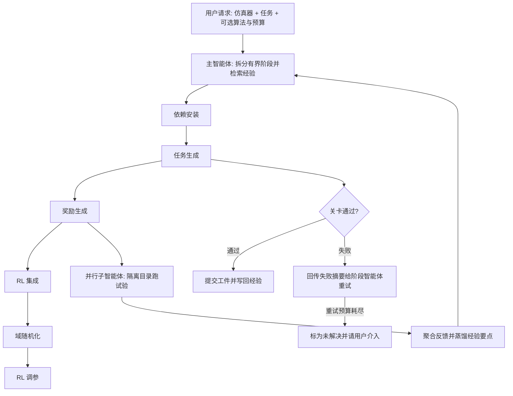

# HARBOR：面向智能体式机器人强化学习的 harness 框架（arXiv:2606.08610）

**HARBOR**（*HARBOR: A Harness Framework for Agentic Robot Reinforcement Learning*，[arXiv:2606.08610](https://arxiv.org/abs/2606.08610) v1，2026-06-07，TU Darmstadt 等）。本页依据论文全文（见 [来源归档](../../sources/papers/harbor_arxiv_2606_08610.md)）撰写；CoRL 2026 阅读清单（Glen Berseth 博客）把它列入 P0 档，清单排序来自作者个人兴趣打分，不是论文质量评价。

## 一句话定义

给定仿真器代码库和任务描述，用 LLM 编码智能体按「依赖安装、任务生成、奖励生成、RL 集成、域随机化、RL 调参」分阶段执行，每阶段靠标准命令产出持久工件、过可执行关卡才推进，并把试验经验沉淀复用，从而自动化仿真里的机器人 RL 工程流程（第 1、3 节）。

## 英文缩写速查

| 缩写 | 英文全称 | 简要说明 |
|------|----------|----------|
| RL | Reinforcement Learning | 强化学习 |
| MDP | Markov Decision Process | 马尔可夫决策过程，论文用 (S, A, P, r, ρ0, γ, T) 七元组（第 2 节） |
| harness | agent harness | 包在 LLM 智能体外的结构化执行环境：工具、工件、反馈、验证（第 2 节） |
| CCDE | Centralized Control, Decentralized Execution | 集中控制、分散执行：主智能体调度，子智能体隔离并行跑试验（第 4.3 节、附录 D.5） |
| DR | Domain Randomization | 域随机化 |
| S.R. | Success Rate | 消融表里指 10 次重复运行中成功的次数（Tab. 3） |
| Ctx | context tax | 跨轮次重复读取的缓存 token 量，用作携带上下文成本的代理指标（第 4.3 节） |
| AUC0:N | Area Under Curve up to N | 训练曲线到训练终点的面积，衡量样本效率（附录 D.4） |
| PPO / SAC / TD3 | Proximal Policy Optimization 等 | 论文调参实验涉及的三种算法（第 4.2 节） |

## 为什么重要

- 论文的出发点（第 1 节）：机器人 RL 的瓶颈越来越不在算法本身，而在周边工程流水线，新环境常要数天到数周手工搭建任务、调奖励、校准随机化、调超参。已有自动化多针对孤立环节（奖励合成、自动域随机化、AutoRL 调参）。
- 作者主张（第 2 节）：MDP 给出相对稳定的接口，rollout 视频、奖励曲线、训练曲线能提供可执行反馈，所以机器人 RL 适合做 harness 工程。这是作者的论证，不是被实验单独验证过的结论。
- 对读者：若想知道「LLM 智能体做整条 RL 流水线」靠什么机制保证可靠，本文把关卡、工件、隔离并行、经验记忆四件事拆开做了消融（第 4.3 节）。

## 核心原理与流程总览

H_RL = (H_A, C, M, G, K)：智能体 H_A 是上下文隔离的子进程，处理有界阶段；命令 C 是可复现操作（如 rl-sweep、tune-reward）；可变工件 M 把工作流状态外化为可检查文件；关卡 G 是可执行检查（导入、rollout、渲染等）；知识 K 含模板、参考、脚本、人类启发式与历史经验（第 2 节）。

要点（第 3 节、附录 C）：

- **关卡**：例如任务生成阶段对 delta 末端位姿控制器，检查随机动作产生的目标位姿命令与实际位姿是否一致；奖励阶段检查奖励有限且各项之和等于环境奖励；渲染阶段检查是否产出有效视频（附录 C.3、C.4、C.6）。论文明确说这些检查不证明语义正确。
- **并行调参与经验**：主智能体保存调参历史，子智能体在隔离试验目录运行，完整视频与日志不进主上下文；每轮把有效奖励项、不稳定参数区间、常见失败模式蒸馏成要点，按仿真器、任务、算法标签检索（第 3 节）。
- **插件形态**：命令、工件、关卡用结构化自然语言写成，用户可审阅、修改、从最近通过关卡的状态恢复（第 3 节）。
- **sim-to-real 部分**（第 4.1 节）：用户提供真实轨迹，系统辨识搜索仿真物理参数，并按人类反馈调整域随机化范围。

## 工程实践

- **实验规模**（第 4 节）：6 个基准（IsaacLab、Bi-DexHands、ManiSkill、Genesis、MJLab、Loco-MuJoCo）；仿真每任务 5 个随机种子、每种子 4096 次 rollout 评估；真机每策略 10 次试验。
- **端到端结果**（第 4.1 节 Tab. 2）：仿真成功率 IsaacLab 四任务 0.885 至 1.0；ManiSkill 0.648 至 1.0；Genesis 0.781 至 0.970；MJLab 为 0.221、0.122、1.0、0.0。真机成功率（10 次）：IsaacLab 策略为 0.5、0.6、0.8、0.9，MJLab 策略仅 0.1、0.0、0.2、0.0。stack-cube 为三方块堆叠，比标准两方块更长程。
- **奖励基线**（第 4.1 节）：Eureka 在 stack-cube 与 insert-drawer 仿真成功率为 0.0 与 0.0，REvolve 为 0.0 与 0.363；lift-box、dex-grasp 上两基线与 HARBOR 差距很小（Tab. 2、附录 D.3 自述这两任务奖励结构直接）。作者归因于 rollout 行为反馈与预置人类启发式。
- **经验复用**（第 4.1 节）：在最难的 stack-cube 上，重新设计奖励的墙钟时间从 4 小时降到 30 分钟（8 倍）。
- **调参**（第 4.2 节）：默认 PPO 配置来自 IsaacLab，SAC 与 TD3 默认来自 PQL；入选配置训练时长至多为默认的 2 倍；12 个任务设置中 11 个持平或更优（Fig. 4）。附录 D.4 报告 IsaacLab 平均 AUC0:N 提升 1.3K%、Loco-MuJoCo 238%、Bi-DexHands 12.3%（作者自述，逐格表未核）。
- **消融**（第 4.3 节 Tab. 3）：ManiSkill Push-Cube，Opus 4.7 骨干，每配置重复 10 次。完整 HARBOR 48/50、44.1 分钟、估计 $70.90；Vanilla 29/50、185.62 分钟、$182.15；去掉 CCDE 46/50 但迭代密集阶段更慢（约 6.3 倍），去掉关卡出现一次「报告成功但渲染路径静默失效」，去掉经验则奖励生成降到 2/10。附录 D.6 在 Sonnet 4.6 上重复，完整 48/50 对 Vanilla 18/50。
- **真机平台**（附录 D.1）：双 Franka 臂，以及 xArm UF850 加 Allegro Hand；单个 ZED2 外置相机，FoundationPose 加 SAM2.1 做 6D 位姿跟踪；策略 20 Hz，动作做指数滑动平均。
- **开源状态**：论文正文与附录未列代码仓库或项目页，本页不写 `code:`；截至入库日（2026-11-12）按「未列链接」处理，论文称其为「文档化、可获取的 LLM 智能体插件」（第 1 节），但链接需另行核实。

## 评测证据与清单说法的对比核对

清单一句话摘要（LLM 据摘要起草）：「Agentic harness that automates the robot RL workflow, from environment setup and rewards to tuning and sim-to-real training.」

| 清单措辞 | 论文核对 |
|----------|----------|
| agentic harness 自动化机器人 RL 工作流 | 属实（摘要、第 3 节）。但论文限定为「仿真内」工作流：摘要写 automates the workflow from environment setup to policy training **in simulation** |
| 环境搭建与奖励 | 属实：依赖安装、任务生成、奖励生成均有（Tab. 1、附录 C） |
| 调参 | 属实：RL 调参阶段与第 4.2 节实验，11/12 任务设置持平或更优；调的是 PPO、SAC、TD3 的训练配置 |
| sim-to-real training | 需限定。第 5 节明确承认「部署到物理机器人仍需围绕机器人接口与人类反馈做人工工程」，未来才考虑把 harness 延伸到真机侧。真机验证（第 4.1 节、Tab. 2）是 4 个任务各 10 次试验，系统辨识需用户提供真实轨迹，域随机化范围靠人类反馈调整；MJLab 来源的策略真机成功率仅 0 至 0.2 |
| 未提及 | 对比基线仅限 Eureka 与 REvolve 这类奖励生成方法；消融只在 ManiSkill Push-Cube 单任务上做；成本是混合模型定价下的估计值，论文自己说应读作比值（附录 D.5） |

## 结论

HARBOR 的贡献是把机器人 RL 训练流程做成有工件和关卡的自动化 harness，尚不包含完整真机闭环。

- 先检查工具接口、持久工件与执行关卡是否齐备，再评价智能体调参结果。
- 验收任务语义与物理稳定性，接口关卡通过不能替代真实任务成功。
- 统计实测墙钟、人工修补与真机边界成本，并将估算并行耗时和小样本真机结果单独标明。

## 局限

论文自己承认（第 5 节）：

- 能力受限于暴露给智能体的工具；无先验知识的新任务可能需要多轮脚手架修补或直接失败。
- sim-to-real 边界仍需人工，真机侧未纳入 harness。
- 目前仅支持较简单的策略结构，视觉语言动作或世界模型类策略是未来方向。
- 关卡只做局部接口与 rollout 检查，不保证语义正确（第 2 节）；MJLab 上失败，作者归因于难以找到稳定的物理参数（第 4.1 节，基于自动化日志的归因，未做独立验证）。

我读到的未验证之处（判断，非作者自述）：

- 消融只覆盖 ManiSkill Push-Cube 一个任务、一个骨干模型族（Opus 4.7，附录 Sonnet 4.6），结论能否推广到其他仿真器与任务未知。
- 成本与墙钟对比的 Vanilla 与去 CCDE 配置，在奖励与调参阶段是把串行时间乘 4 估算的（附录 D.5），不是实测并行对照。
- 基线 Eureka、REvolve 在本文设置下复现，结果是否等同其原论文设置无法由本文判断；两基线在 lift-box 与 dex-grasp 上与 HARBOR 差距很小，优势主要集中在两个任务上。
- 真机每策略仅 10 次试验，置信区间宽；多个仿真器的策略共用同一批真机任务，真机表现差异混有感知管线与控制器因素（推测）。
- 论文未列代码与项目页链接，可复现性取决于后续发布。

## 关联页面

- [奖励设计](../concepts/reward-design.md)
- [域随机化](../concepts/domain-randomization.md)
- [Sim2Real](../concepts/sim2real.md)
- [PPO](../methods/ppo.md)
- [SAC](../methods/sac.md)
- [Eureka：LLM 奖励设计](paper-eureka-llm-reward-design.md)（本文对比的奖励基线之一）
- [DrEureka：LLM 引导的 sim-to-real](paper-dreureka-sim-to-real.md)
- [Isaac Lab](isaac-lab.md)
- [ManiSkill](maniskill2.md)
- [Genesis](genesis-sim.md)
- [Loco-MuJoCo](loco-mujoco.md)
- [MuJoCo Warp](mujoco-warp.md)

## 参考来源

- [来源归档：HARBOR（arXiv:2606.08610）](../../sources/papers/harbor_arxiv_2606_08610.md)
- [arXiv:2606.08610](https://arxiv.org/abs/2606.08610)
- CoRL 2026 Reading List（Glen Berseth 博客）：<https://www.fracturedplane.com/blog/2026/11/10/CoRL2026-Reading-List.html>

## 继续阅读

- [arXiv PDF](https://arxiv.org/pdf/2606.08610v1)
- [Eureka：LLM 奖励设计](paper-eureka-llm-reward-design.md)
- [Sim2Real 方法对比](../comparisons/sim2real-approaches.md)
