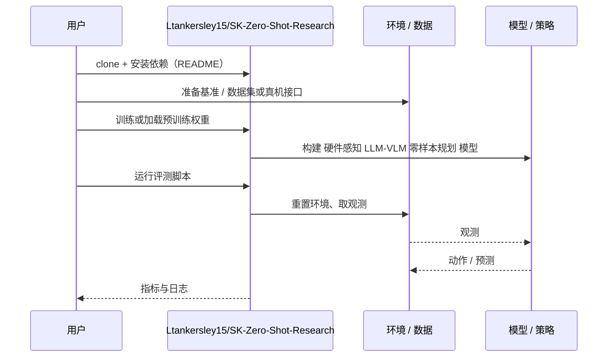

# 硬件感知 LLM-VLM 零样本规划（arXiv:2610.14106）

**硬件感知 LLM-VLM 零样本规划**（*Embodied Zero-Shot Task Planning via Hardware-Aware LLM-VLM Integration for Grounded Robotic Manipulation*，[arXiv:2610.14106](https://arxiv.org/abs/2610.14106)，[代码](https://github.com/Ltankersley15/SK-Zero-Shot-Research)）来自 [具身智能小站 2026-10-14 盘点](../../sources/blogs/wechat_embodied_station_41_papers_streamingwam_2026-10-14.md)，属「操作与柔顺控制」组。

## 一句话定义

**LLM 输出符号任务，VLM 确认语义，确定性模块处理坐标、抓取、碰撞与可达性；在 Isaac Sim FR3 数字孪生验证。**

## 英文缩写速查

| 缩写 | 英文全称 | 简要说明 |
|------|----------|----------|
| LLM | Large Language Model | 大语言模型 |
| VLM | Vision-Language Model | 视觉语言模型 |
| FR3 | Franka Research 3 | 机械臂 |

## 为什么重要

- 语言规划与几何执行分工明确，才能减少幻觉落地错误。
- 开源结论：**已开源**（步骤 2.5，2026-10-14）。仓库可达。
- 同期同组工作见 [流式动作块与世界模型记忆：具身智能小站 10-14 期 41 篇阅读坐标](../overview/embodied-station-2026-10-14-41-papers-technology-map.md)。

## 核心机制

| 项 | 内容 |
|----|------|
| **arXiv** | [2610.14106](https://arxiv.org/abs/2610.14106) |
| **开源** | **已开源** |
| **要点** | 仿真操作方案。 |
| **文内指标** | 以原文为准。 |

## 源码运行时序图

以下为按仓库入口（`Ltankersley15/SK-Zero-Shot-Research`）推断的通用运行链路；入库日仅核实仓库可达，未逐文件阅读，具体脚本名以 README 为准。

## 实验与评测

- 以原文为准。
- **读法：** 本页为索引级摘要，依据公众号转述的官方摘要与仓库信息整理；逐项数字与 baseline 以原文 PDF 为准。

## 与其他工作对比

- 横向索引见 [流式动作块与世界模型记忆：具身智能小站 10-14 期 41 篇阅读坐标](../overview/embodied-station-2026-10-14-41-papers-technology-map.md)；同 arXiv 不重复造页。

## 结论

**LLM 只做符号层，几何可行性交给确定性模块。**

1. 开源边界：**已开源** — 仓库可达。
2. 核心机制：仿真操作方案。
3. 复现与选型前核对任务协议、硬件与基准口径，勿直接横比公众号摘录数字。

## 关联页面

- [saycan](../methods/saycan.md)
- [llm-robotics-control-interfaces](../concepts/llm-robotics-control-interfaces.md)
- [manipulation](../tasks/manipulation.md)
- [embodied-station-2026-10-14-41-papers-technology-map](../overview/embodied-station-2026-10-14-41-papers-technology-map.md)

## 参考来源

- [hardware_aware_llm_vlm_zero_shot_task_planning_arxiv_2610_14106.md](../../sources/papers/hardware_aware_llm_vlm_zero_shot_task_planning_arxiv_2610_14106.md)
- [wechat_embodied_station_41_papers_streamingwam_2026-10-14.md](../../sources/blogs/wechat_embodied_station_41_papers_streamingwam_2026-10-14.md)
- [arXiv:2610.14106](https://arxiv.org/abs/2610.14106)

## 推荐继续阅读

- [arXiv PDF](https://arxiv.org/pdf/2610.14106)
- [https://github.com/Ltankersley15/SK-Zero-Shot-Research](https://github.com/Ltankersley15/SK-Zero-Shot-Research)
