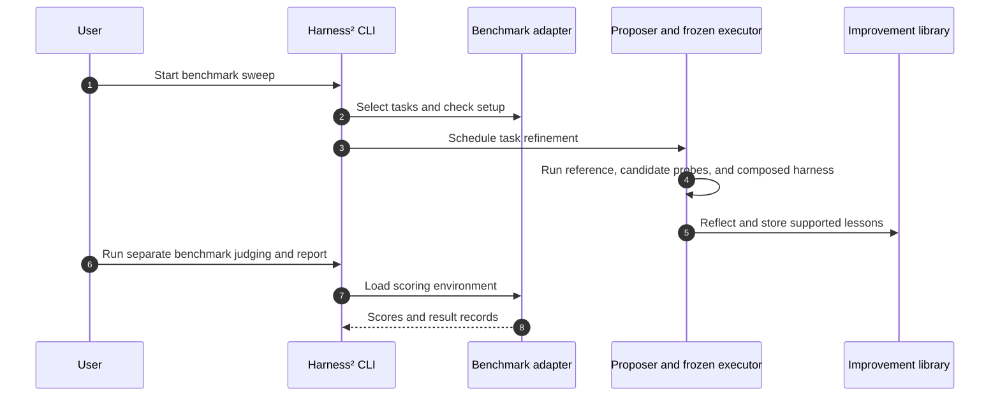

# Harness²：递归式 Agent Harness 改进

## 一句话定义

**Harness² 是一个冻结底座模型、递归优化 agent 外层 harness 的框架：单任务通过 Propose–Probe–Compose 按执行证据改文件，跨任务把有依据的经验沉淀到改进库。**

## 英文缩写速查

| 缩写 | 英文全称 | 简要说明 |
|------|----------|----------|
| RSI | Recursive Self-Improvement | 通过持久改进影响后续任务与改进过程；本文优化 harness |
| LLM | Large Language Model | 作为 agent 执行任务的冻结模型 |
| P–P–C | Propose–Probe–Compose | 提出 harness 候选、运行探测、组合有证据支持的改动 |
| LAB | Legal Agent Benchmark | 法律工作 benchmark；论文报告 Partial 条目通过率 |
| WBB | WorkBuddy-Bench | 覆盖 Code、Web、Office 的职业任务基准 |

## 核心信息

| 项 | 内容 |
|----|------|
| 机构 | 谷歌云 AI 研究（Google Cloud AI Research）、西北大学（Northwestern University） |
| 论文 | [Harness²: Recursive Agent Harnessing for an Open World（arXiv:2610.14224）](https://arxiv.org/abs/2610.14224)，2026-10-09 提交 |
| 官方页 / 代码 | [项目页](https://harness2.github.io/) · [GitHub](https://github.com/google-research/harness2) |
| 仓库许可 | Apache-2.0；benchmark 与第三方内容遵循上游许可 |
| 模型训练 | 论文评测中的 executor 权重冻结；修改外层 harness 文件，不以微调权重作为收益来源 |

## 为什么重要

- **把自我改进的对象限定清楚：** Harness² 优化 agent 周边的运行文件，不等同于训练模型或自动设计下一代模型。
- **让轨迹参与筛选：** 参考运行暴露行为，候选运行提供对照，Compose 再决定保留、修改或丢弃哪些变化；它不要求预先知道标准答案。
- **改进方法本身也积累经验：** improvement library 同时保存被采用 harness 与相应 EXPERIENCE.md，供后续提案、探测和组合参考。
- 这属于[递归自改进](../concepts/recursive-self-improvement.md)中的 agent harness 层方法。对机器人研究而言，可借鉴“失败轨迹 → 候选流程调整 → 同条件复测”的工程思路；论文基准是办公、职业与法律任务，**未验证机器人或真机迁移**。

## 核心机制

### 八类可编辑 harness 组件

1. **System prompt：** agent 的顶层角色与执行规程。
2. **Guardrails：** 约束 agent 行为的规则。
3. **Memory：** 任务相关背景与记忆。
4. **Tool guidance：** 工具使用说明。
5. **Subagents：** 子 agent 与委派配置。
6. **Skills：** 可复用的任务流程与领域知识。
7. **Scripts：** 工具接口与执行脚本。
8. **Plugins：** 工具循环中的 middleware 控制。

### 任务级：Propose–Probe–Compose

1. **Propose：** 一个候选针对跨任务常见问题（如规划、工具调用、上下文管理），另一个针对当前领域知识、流程与限制。
2. **Probe：** 在相同任务和匹配配置下运行候选，观察执行轨迹和交付物的变化。
3. **Compose：** 对照 reference 与候选运行，把有行为证据支持的编辑组合成后继 harness；可以拒绝全部改动。
4. **复跑：** 执行后继 harness，记录选择与证据。

这里对照的是**行为变化**，不是对标准答案的自动判分。论文指出执行随机性与共享模型偏见会削弱这些证据的可靠性。

### 跨任务：改进 Harness 的 Harness

当前任务结束后，反思完整的候选、探测、组合与最终选择记录，提取“什么修改在什么情形下有效”的经验。经验库存下采用的 harness 和 EXPERIENCE.md；后续任务仍从公共 H₀ 开始，改进过程按需检索、适配经验，并不直接继承前一任务的专用执行 harness。

### 递归模式

| 模式 | 过程 | 适用理解 |
|------|------|----------|
| Parallel | 同时探测多组候选，并基于共享证据独立合成后继 harness | 加宽候选探索 |
| Sequential | 把本步 harness 与累计执行证据带入下一步 | 加深连续修订 |

论文中的 k 控制任务级探索预算：parallel 下是每类候选与合成的宽度；sequential 下是连续改进步数。

## 源码运行时序图

官方 CLI 由 `harness2` 启动 sweep；`harness2-judge` 在改进 sweep 之后独立评分，`harness2-report` 汇总结果。具体入口与安装信息见[官方仓库归档](../../sources/repos/google-research-harness2.md)。

## 实验与评测

论文主表报告三次运行的均值与标准差，评测覆盖 WorkBuddy-Bench、JobBench、Harvey 的 LAB，组合 Gemini 3.5 Flash / GLM-5 与 OpenCode / Codex 四种执行配置。

| 结果 | 论文报告 |
|------|----------|
| WorkBuddy-Bench，GLM-5 + OpenCode | Base 64.2 → Harness² 75.7，+11.5 分 |
| WorkBuddy-Bench，Gemini 3.5 Flash + OpenCode | Base 72.4 → Harness² 77.5，+5.1 分 |
| 最大单步增益 | WorkBuddy-Bench +11.5 分；JobBench +4.5 分；LAB Partial +11.8 个百分点 |
| 额外递归 | parallel k=5 在单步基础上继续提升，但不同模型与基准增益不同 |

GLM-5 + Harness² 的 75.7 高于 Gemini 3.5 Flash + base harness 的 72.4。该比较跨模型与 harness 配置，只能说明某个较弱模型在该基准上的新配置超过另一较强模型的旧配置，不能归因于单独的 harness 因果效应。

## 与其他工作对比

论文 Table 1 在 WorkBuddy-Bench 上与三类 harness 改进基线同表比较（三域宏平均，三次运行均值）：

| 方法 | 做法 | Gemini 3.5 Flash + OpenCode | Gemini 3.5 Flash + Codex |
|------|----------|-----------------------------|--------------------------|
| Base harness | — | 72.4 | 74.5 |
| ReasoningBank | harness 固定，从过往轨迹提炼策略并检索回上下文 | 73.4 | 72.5 |
| Meta-Harness † | 在训练划分上离线搜索 harness 代码，部署最优者 | 76.4 | 73.3 |
| Harness Scaling | 每个实例用额外推理预算改写 harness，不跨实例保留状态 | 75.3 | 73.8 |
| **Harness²（k=1）** | 同任务行为对照 + 跨任务改进库 | **77.5** | **77.5** |

† 论文标注 Meta-Harness 为离线方法，在单独训练任务上优化，与 Harness² 的在线、无标准答案设置不同。论文称 Harness² 在四种配置下的 WorkBuddy-Bench Avg. 与 JobBench Score 均超过上述基线；LAB Partial 上 Gemini 3.5 Flash + Codex 配置由 Meta-Harness 领先。

| 相关路线 | 与 Harness² 的差异 |
|----------|--------------------|
| STOP、Darwin Gödel Machine、Hyperagents 等 RSI 系统 | 论文归纳为依赖效用、benchmark 或验证信号指导改进；Harness² 不依赖 ground truth，也不回访已完成任务 |
| [MetaRSI-v1](./paper-metarsi-v1.md) | 从多种 RSI 算子角度讨论 Harness-RSI；Harness² 是其中 harness 层的一个具体实现与评测 |
| [HexaShell](./paper-hexashell.md) | 同属轻量 agent harness 研究，但面向机器人操控接口；两者评测任务与指标不同，不可直接比较 |

作为 agent 评测样本，其结果属于办公 / 职业 / 法律任务，在[具身大模型评测基准选型闭环](../queries/embodied-eval-benchmark-selection-loop.md)中不能替代 ③ 策略任务成功率层的机器人评测。

## 结论

**Harness² 展示了不改底座模型权重、而通过执行证据递归改进 agent harness 的可行路径。**

- 对模型服务/API 使用场景，评估重点可从“是否训练模型”转到可编辑文件、执行器和改进器成本，以及可复现评测。
- 任务级改动由同任务行为对照支撑；没有 ground-truth verifier 不代表已证明交付物正确。
- 跨任务库保存经验和 harness，但每个新任务从公共初始 harness 出发，避免把任务专用变化自动带入所有任务。
- 大幅 benchmark 增益应与 API 调用量、运行步数、三次运行的离散程度一起看。
- 目前证据来自办公、职业和法律 benchmark，不足以推断机器人、物理操作或安全关键部署上的收益。

## 工程实践

- 官方仓库提供 Apache-2.0 的 Python 包、CLI、benchmark 安装脚本和确定性 demo；本地 demo 不需模型凭证。
- 模型驱动实验会产生模型调用成本。先用 `--dry-run` 与单域、单任务试跑，再扩大预算。
- 执行器可通过网络访问公开 rubric 或答案材料。官方建议在评测前限制网络出口；Codex executor 的 sandbox 关闭。
- 参照[递归自改进概念页](../concepts/recursive-self-improvement.md)，这是一种 harness 层的持久改进案例，不是模型权重级 RSI。

## 局限与风险

- **行为差异不是正确性证明：** 轨迹和交付物差异帮助判断改动是否缓解目标缺陷，但共享模型偏差与随机性仍可能误导。
- **运行开销：** 参考、候选探测、合成与最终执行都会消耗模型调用；增加 k 会继续增加推理预算。
- **评测泄漏风险：** benchmark rubric 可能公开可访问，应报告网络限制设置。
- **迁移范围：** 三个职业 benchmark 不能替代机器人任务或真实部署的独立验证。
- **工具环境差异：** 论文结果基于指定 executor、initial harness 与评测配置；结果不自动代表其他 agent/runtime。

## 关联页面

- [递归自改进](../concepts/recursive-self-improvement.md) — RSI 范围、层级与证据边界
- [MetaRSI-v1](./paper-metarsi-v1.md) — 从多个 RSI 算子角度讨论 Harness-RSI
- [具身大模型评测基准选型闭环](../queries/embodied-eval-benchmark-selection-loop.md) — 评测层级与指标取舍枢纽

## 参考来源

- [Harness² 论文来源归档](../../sources/papers/harness2_arxiv_2610_14224.md)
- [Harness² 官方项目页归档](../../sources/sites/harness2.md)
- [Harness² 官方仓库归档](../../sources/repos/google-research-harness2.md)

## 推荐继续阅读

- [论文 HTML](https://arxiv.org/html/2610.14224v1)
- [项目页与交互演示](https://harness2.github.io/)
- [官方仓库与实验文档](https://github.com/google-research/harness2)
