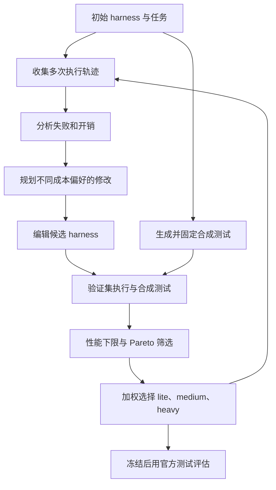
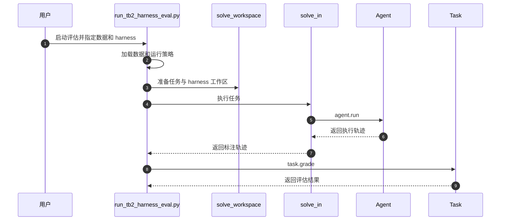

# HarnessPro：递归优化智能体运行框架的性能与成本

## 一句话定义

HarnessPro 通过多智能体分析运行轨迹并修改 harness，用固定的合成测试和 Pareto 筛选保留不同成本偏好的候选。

## 英文缩写速查

| 缩写 | 英文全称 | 简要说明 |
|------|----------|----------|
| LLM | Large Language Model | 生成测试、诊断轨迹、规划并实现 harness 修改的模型 |
| RSI | Recursive Self-Improvement | 利用执行反馈递归改进 harness 的范式，本文的研究对象 |
| RHO | Retrospective Harness Optimization | 论文最主要的对比基线，用 LLM 自我偏好选择候选 |
| DPP | Determinantal Point Process | 用于从训练候选任务中选出 10 个兼顾难度与多样性的 coreset |
| CoP | Cost-of-Pass | 总执行成本除以成功任务数，用于消融比较 |

## 为什么重要

智能体的 harness（指令、工具、技能、上下文与记忆、hooks、验证规则）直接决定任务成功率与 token 花费。已有 RSI 方法（如 RHO、AHE）常通过更广的探索和更强的验证换取通过率，但代价是更高的 token 消耗与延迟。论文的问题是：递归 harness 改进能否在**不增加甚至降低执行成本**的前提下提升性能。对部署方而言，同一套 harness 往往要在不同预算下使用，因此一组 Pareto 候选比单个"最强"harness 更实用。

## 核心原理

**输入：** 初始可执行 harness $h_0$；按 DPP 从训练集选出的 10 个任务的 coreset $D_{train}$；验证集 $D_{val}$；由测试合成智能体对每个任务生成的固定测试集 $S(x)$（只生成一次）。

**关键机制：**

1. **轨迹诊断（Trajectory Analyzer）。** 对每个候选 harness 在 coreset 上跑 $G=3$ 次独立 rollout，联合分析轨迹与指标，输出问题、对性能和成本的影响、以及证据位置。
2. **规划与编辑（Planner、Editor）。** 规划器对每个候选用三种指令生成三个计划：$I_1$ 侧重降本、$I_2$ 兼顾性能与成本、$I_3$ 侧重性能。规划器还能比较同代候选之间的代码差异（Diff）。编辑器在独立工作区中实现计划，并提交到 Git 以便追溯和回滚。
3. **固定测试评估（Test Synthesizer）。** 论文认为 LLM 直接判断轨迹容易过于乐观，因此用 LLM 从任务描述和初始轨迹生成可执行测试，并在整个演化过程中保持不变。
4. **过滤与选择。** 先丢弃验证通过率低于初始 harness（$PR_{val}(h_0)$）或被 Pareto 支配的候选，再对每种模式 $m\in\{\text{lite},\text{medium},\text{heavy}\}$ 用归一化加权平方距离选出一个代表：

$$
J_m(h)=\alpha_m\, d_{\text{perf}}(h)^2+\beta_m\, d_{\text{cost}}(h)^2
$$

其中 $d_{\text{perf}}$、$d_{\text{cost}}$ 分别是候选相对于当前集合最高通过率与最低成本的归一化偏差，权重 $(\alpha_m,\beta_m)$ 分别取 $(1,2)$、$(1,1)$、$(2,1)$。

**输出：** 三个模式各一个 harness，作为下一轮的候选集（最多保留 3 个）。测试集只在全部演化结束、harness 冻结之后才使用。

**演化流程。** 下图为论文一个 epoch 的数据流，演化过程只使用训练与验证数据。

演化过程中不使用标准答案或官方测试；官方测试用于最终留出集评估。选择目标为性能与成本，延迟作为另报指标。

## 工程实践

**复现与改造的步骤（对应论文 Algorithm 1）：**

1. 用 DPP 选出 10 个训练任务作为 coreset（论文取 $\epsilon=0.1$、$\theta=0.7$，沿用 RHO 设置）。
2. 对训练与验证任务生成一次合成测试 $S(x)$，并在验证集上测得初始 harness 的通过率作为性能下限。
3. 每个 epoch：对每个候选做 $G=3$ 次 rollout，诊断、规划（三种指令）、编辑，再在验证集上用固定测试评估。
4. 过滤并按三种权重选出 lite、medium、heavy；保留至多 3 个进入下一 epoch。
5. 演化结束后冻结三个 harness，在测试集上一次性评估。

**关键参数（论文设置）：**

| 参数 | 取值 | 说明 |
|------|------|------|
| 训练 coreset 规模 | 10 个任务 | 论文未报告规模或 epoch 数的敏感性分析（未核实） |
| 每个候选的 rollout 数 $G$ | 3 | 诊断时联合分析同一任务的多次轨迹 |
| 演化 epoch 数 | TB2、SWE-Bench Pro 为 3；ProgramBench 为 4 | 每个 epoch 最多保留 3 个 harness |
| 选择权重 $(\alpha_m,\beta_m)$ | lite $(1,2)$；medium $(1,1)$；heavy $(2,1)$ | 固定不随 epoch 变化 |
| 基础推理强度 | GPT-5.5 默认 high；GLM-5.2 在 TB2、SWE-Bench Pro 上为 max | 以 Codex 0.147.0 与 Claude Code 2.1.231 运行 |
| 工具调用阈值（medium 的 standard 档） | 经济阶段 14、收敛阶段 26、结束 44 次 | 由运行时 hook 注入提醒并在超限后拒绝调用，属于 harness 内的策略配置 |

**调试与监控指标：**

- 每个 epoch 的验证通过率、平均单任务成本、以及 Pareto 前沿的变化；论文在第 3 epoch 才同时改善两项的 medium SWE-Bench Pro 说明，单看一个 epoch 可能误判。
- 测试质量：论文用合成测试的失败召回率（对照官方结果）检验测试器，预实验中从 41.7% 提升到 83.3%。
- 成本核算：按 token 价格折算，GPT-5.5（<272K 上下文）未缓存输入 $5.00/M、缓存输入 $0.50/M、输出 $30.00/M；GLM-5.2 为 $1.40/M、$0.26/M、$4.40/M（论文表 4）。
- 延迟仅作辅助指标，论文明确未将其作为优化目标。

**源码运行时序图**

以下仅对应固定提交的 Terminal-Bench 2 **评估路径**（仓库版本 `6fd2d4d`），并非声称开源了论文完整演化流水线。节点与函数名已对照仓库源码核查。

关键复现路径：`scripts/run_tb2_harness_eval.py` 加载留出清单与 harness 目录后，在 `src/rho/orchestrators/solve.py` 的 `solve_workspace` 中准备工作区，再由 `solve_in` 调用 `agent.run`；评分在脚本中通过 `task.grade` 完成。

**开源状态（步骤 2.5 核查结论）：** 项目页（<https://pzs19.github.io/HarnessPro/>）链接到 GitHub 仓库 `pzs19/HarnessPro`（MIT 许可）。判定为 **部分开源**：

- **已发布：** 九个 harness（三个基准各 lite / medium / heavy）、三个基准的评估脚本与辅助模块、测试集划分清单、部分评估器源码，以及评估文档。
- **未发布：** 基准数据、任务与评分镜像、模型服务与凭据、论文的 GLM-5.2 演化快照。
- **未发布（据仓库检索未见）：** 论文中的演化主循环（轨迹分析器、规划器、编辑器、测试合成器与选择逻辑）在仓库中未找到对应实现（检索 Pareto、coreset、test synth 等关键词，仅 README 命中）。

## 实验与评测

论文表 2 报告 GPT-5.5 与 Codex 下 Terminal-Bench 2 的 Heavy 为 80.8% ± 1.0%，平均 $0.72/任务；RHO 为 76.3%、$1.09/任务。SWE-Bench Pro 的 Medium 为 79.0%、$1.26，RHO 为 80.0%、$2.68。Terminal-Bench 2 与 SWE-Bench Pro 的 HarnessPro 结果是三次运行的均值；ProgramBench 为两次，其通过率按每任务测试通过比例做宏平均，不能直接等同前两项的全测试通过率。

- **与 Vanilla 对比：** 三个基准上 RHO 通过率均高于 Vanilla，但成本上升（SWE-Bench Pro 由 $1.88 升至 $2.68）。
- **Lite 模式：** 三个基准通过率均高于 Vanilla，成本低 17.7%–57.4%。
- **消融（表 3）：** 去掉测试合成器的影响大于去掉规划器：去掉测试合成器后，各基准、各模式的通过率下降 3.4–10.0 个百分点。把 RHO 的动态推理强度或预算 hook 单独加入，会降低成本但也降低通过率，三个 RHO 变体均被 HarnessPro 的某个模式 Pareto 支配。
- **GLM-5.2 与 Claude Code：** Heavy 在三个基准上均高于 RHO 且成本更低；但 ProgramBench 上 Heavy 成本为 $14.95，高于 Vanilla 的 $11.34，只低于 RHO 的 $17.00。

## 与其他工作对比

| 方法 | 优化目标 | 优化范围 | 反馈 | 迭代 | 输出 |
|---|---|---|---|---|---|
| **HarnessPro（本页）** | 通过率 + 成本 | 整个 harness | 无标签 | 递归 | Pareto 集 |
| RHO | 通过率 | 技能 + 工具 | 无标签 | 单轮 | 单个 |
| AHE | 通过率 | harness | 标准答案 | 递归 | 单个 |
| SkillMOO | 通过率 + 成本 | 技能 | 标准答案 | 递归 | Pareto 集 |
| AFlow | 通过率 | 工作流 | 标准答案 | 递归 | 单个 |

表格按论文表 1 整理。

- **与 RHO：** RHO 用 LLM 比较执行轨迹、以自我偏好选候选，只追求通过率。论文表 2 报告 GPT-5.5 × Codex 下 RHO 在三个基准上都比 Vanilla 更好，但成本也上升（SWE-Bench Pro 由 $1.88 升至 $2.68）；HarnessPro-Heavy 在三个基准上通过率最高，且成本低于 RHO。
- **区分"成本指令"和"递归迭代"的贡献：** 论文另设两个 RHO 变体，Balance 只把优化指令改为兼顾成本，RHO+Iteration 再以同样轮数迭代。论文报告 Terminal-Bench 2 上 Medium 与 RHO+Iteration 同为 76.3%，成本低 31.7%；ProgramBench 上 Heavy 通过率高 1.3 个百分点，成本低 5.8%。
- **与记忆或策略复用方法：** Dynamic Cheatsheet、ReasoningBank、Sleep-time Compute 只优化记忆或策略组件，HarnessPro 则演化指令、技能、工具、hooks 和验证规则。表 2 中这三者在 Terminal-Bench 2 上为 72.9–74.6%、$0.99–1.06/任务，通过率均低于、成本均高于 Heavy 的 80.8%、$0.72。

## 结论

**一句话总判：** 在论文所测条件下，把成本纳入递归 harness 改进的目标，并保留 Pareto 集而非单一 harness，能同时获得更高通过率和更低成本；但增益幅度有限，且主要依赖可靠的合成测试。

1. **同时记录通过率和每任务成本。** 论文的选择规则依赖验证集上两者的归一化距离，只看通过率会误选高成本候选。
2. **保留性能下限及非支配候选，再按预算选模式。** lite、medium、heavy 的权重只改变选择，不改变候选生成过程。
3. **合成测试不能替代官方测试。** 预实验中失败召回为 83.3%，仍有漏检；最终仍需独立官方测试验证。
4. **发布包不含论文 GLM-5.2 演化快照。** 复现时应核对模型版本、基准数据和评估环境，尤其是 Codex 与 Claude Code 版本。

## 局限与风险

论文正文未设独立的局限小节；以下由正文与实验表归纳。

- **合成测试的误差。** 测试由 LLM 从任务描述和初始轨迹生成，与官方测试并非同一标准。失败召回为 83.3%，意味着仍有部分错误候选会通过筛选；论文未报告测试误报率对最终选择的影响（未核实）。
- **增益幅度小且统计不确定性有限。** 三个基准上 Heavy 相对 RHO 的平均通过率增益为 2.0 个百分点。SWE-Bench Pro 的 Heavy 为 80.7% ± 0.6%，仅比 RHO 的 80.0% 高 0.7 个百分点；测试集规模为 59、100、100 个任务，ProgramBench 仅两次运行。
- **成本并非在所有设置下都降低。** GLM-5.2 的 ProgramBench 上，Heavy 成本高于 Vanilla；延迟在 GLM-5.2 的 ProgramBench 上也明显高于 Vanilla（5925 秒对 3847 秒），论文将延迟定为辅助指标。
- **依赖模型与价格。** 结果依赖 GPT-5.5、GLM-5.2、特定 Codex 与 Claude Code 版本和 token 价格（表 4）；价格或模型变化后，成本排序可能改变。
- **演化代码未随仓库发布。** 仓库仅含评估路径与最终 harness，复现论文的演化过程需自行实现（参见上文"开源状态"）。
- **Harness 机制本身的风险。** 论文自述的风险包括：输出压缩和输出上限可能隐藏关键诊断，除非求解器按日志路径回溯；预算 hook 在工具调用超限后直接拒绝调用，可能在未完成验证时结束任务。论文未评估这些机制在其他任务分布上的稳健性（未核实）。
- **未报告的变量。** 论文未报告 coreset 规模、epoch 数、测试数量的敏感性分析，也未报告不同训练集划分下的结果（未核实）。
- **状态。** 论文为 under review 的 v2 预印本（2026-10-20），结论可能随正式版本变化。

## 关联页面

- [Spatial Memory by Agents](paper-spatial-memory-by-agents.md)
- [LLM 机器人控制接口](../concepts/llm-robotics-control-interfaces.md)
- [AI Agent 评测](../concepts/ai-agent-evaluation.md)

## 参考来源

- [论文归档](../../sources/papers/harnesspro_arxiv_2610_26770.md)
- [源码归档](../../sources/repos/harnesspro.md)
- [项目页归档](../../sources/sites/harnesspro.md)
- 原文：arXiv:2610.26770v2（2026-10-20），全文 41 页，已通读正文、算法、实验、附录 A–D。

## 推荐继续阅读

- [论文 v2（arXiv HTML）](https://arxiv.org/html/2610.26770v2)
- [评估与复现说明（仓库固定提交 `6fd2d4d`）](https://github.com/pzs19/HarnessPro/blob/6fd2d4dbc3b73881b2b48833764fcd803aacb7b8/docs/evaluation.md)
- [RHO：Evolving agents in the dark（arXiv:2606.05922）](https://arxiv.org/abs/2606.05922)
