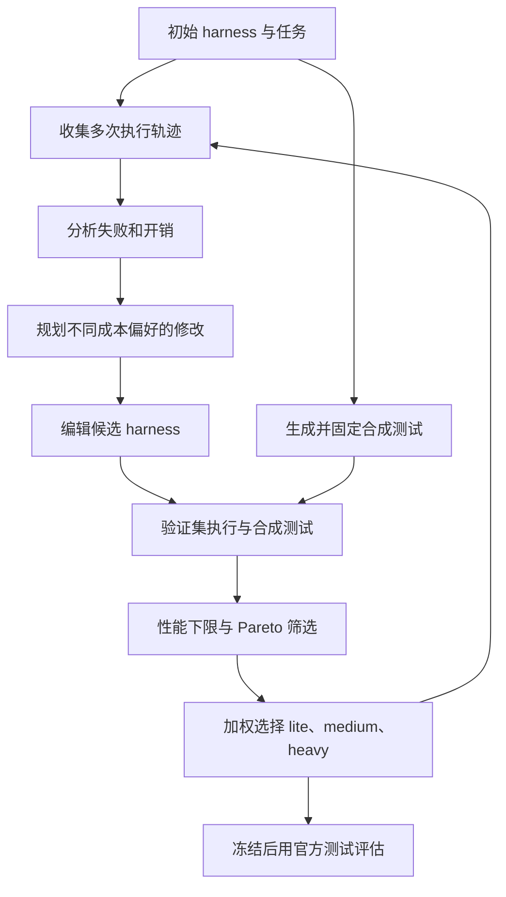
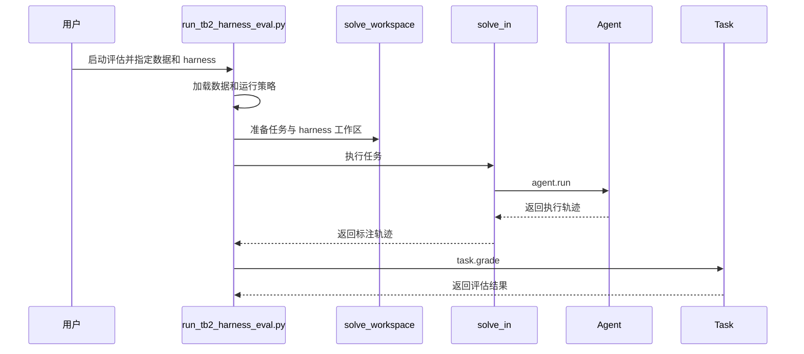

# HarnessPro：递归优化智能体运行框架的性能与成本

## 一句话定义

HarnessPro 通过多智能体分析运行轨迹并修改 harness，用固定的合成测试和 Pareto 筛选保留不同成本偏好的候选。

## 英文缩写速查

| 缩写 | 英文全称 | 简要说明 |
|------|----------|----------|
| LLM | Large Language Model | 生成测试并参与轨迹分析的模型 |
| RSI | Recursive Self-Improvement | 利用执行反馈递归改进 |
| RHO | Retrospective Harness Optimization | 论文比较基线 |

## 流程总览

演化过程中不使用标准答案或官方测试；官方测试用于最终留出集评估。选择目标为性能与成本，延迟作为另报指标。

## 源码运行时序图

以下仅对应固定提交的 Terminal-Bench 2 **评估路径**，并非声称开源了论文完整演化流水线。

入口和调用以 [仓库归档](../../sources/repos/harnesspro.md) 所载固定提交为准。

## 实验与评测

论文表 2 报告 GPT-5.5 与 Codex 下 Terminal-Bench 2 的 Heavy 为 80.8% ± 1.0%，平均 $0.72/任务；RHO 为 76.3%、$1.09/任务。SWE-Bench Pro 的 Medium 为 79.0%、$1.26，RHO 为 80.0%、$2.68。Terminal-Bench 2 与 SWE-Bench Pro 的 HarnessPro 结果是三次运行的均值；ProgramBench 为两次，其通过率按每任务测试通过比例做宏平均，不能直接等同前两项的全测试通过率。

## 结论

该方法在论文所测条件下提供性能与推理成本的多种权衡。

1. 根据任务要求同时记录通过率和每任务成本。
2. 保留性能下限及非支配候选，再按预算选择模式。
3. 合成测试可能不能覆盖全部错误，最终应使用独立官方测试验证。
4. 发布包不含论文 GLM-5.2 演化快照，复现时应核对模型、基准数据和环境。

## 复现边界与待办

仓库包含九个评估 harness、三种基准的评估脚本和部分评估器；基准数据、服务、凭据及镜像需另备。评估说明指出 GLM-5.2 演化快照未随包发布。当前已阅读论文算法与实验表、官方 README、评估说明及 Terminal-Bench 2 相关入口；**论文其余正文和附录尚待通读，其他源码路径及本仓库 CI 尚待验证**。

## 关联页面

- [Spatial Memory by Agents](paper-spatial-memory-by-agents.md)
- [LLM 机器人控制接口](../concepts/llm-robotics-control-interfaces.md)

## 参考来源

- [论文归档](../../sources/papers/harnesspro_arxiv_2610_26770.md)
- [源码归档](../../sources/repos/harnesspro.md)
- [项目页归档](../../sources/sites/harnesspro.md)

## 推荐继续阅读

- [论文 v2](https://arxiv.org/html/2610.26770v2)
- [评估与复现说明](https://github.com/pzs19/HarnessPro/blob/6fd2d4dbc3b73881b2b48833764fcd803aacb7b8/docs/evaluation.md)
