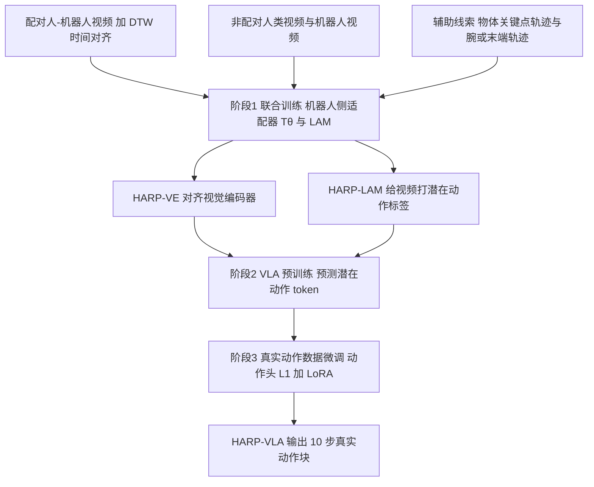

# HARP-VLA（arXiv:2605.31234）

**HARP-VLA**（*HARP-VLA: Human-Robot Aligned Representation Learning for Vision-Language-Action Model*，[arXiv:2605.31234](https://arxiv.org/abs/2605.31234)，清华大学交叉信息研究院 / 上海期智研究院）是 CoRL 2026 Glen Berseth 阅读清单中「Learning from Human Video」一组的 P1 论文。本页依据 arXiv v1 全文（含附录）写成，核对记录见 [来源归档](../../sources/papers/harp-vla_arxiv_2605_31234.md)。

## 一句话定义

**在人类视频上做 VLA 预训练时，先用配对的人-机器人示范把机器人视觉特征拉向人类特征空间并同时学潜在动作，使人类与机器人视频给出一致的潜在动作标签，再用这些标签预训练 VLA（论文第 3 节）。**

## 英文缩写速查

| 缩写 | 英文全称 | 简要说明 |
|------|----------|----------|
| HARP | Human-Robot Aligned Representation (learning) | 本文框架名 |
| VLA | Vision-Language-Action | 视觉-语言-动作策略 |
| LAM | Latent Action Model | 从相邻帧推断离散潜在动作的逆/正向动力学模型 |
| HARP-LAM / HARP-VE | HARP 训练出的 LAM / 对齐视觉编码器 | 阶段 1 的两个产物 |
| SR | Source-Relative | 适配后的机器人特征须比冻结机器人特征更靠近配对人类特征 |
| PD | Pair-Discriminative | 保持配对相对批内非匹配对的区分度 |
| SRPD | SR + PD | 本文的对齐损失 |
| DTW | Dynamic Time Warping | 用腕/末端轨迹对齐配对视频的时间线 |
| VQ | Vector Quantization | 潜在动作的离散化瓶颈 |
| R@1 | Recall@1 | 跨具身检索第一名命中率 |

## 为什么重要

- 作者的论点（第 1 节）：LAM 只缓解动作执行差距，潜在动作仍基于视觉特征，人/机器人特征不对齐会让潜在动作带域依赖，妨碍与人类视频共训。这是「人类视频 → VLA」路线里一个具体的、可单独验证的环节。
- 本文把视觉对齐与潜在动作学习放进同一阶段训练（跨预测使一方的潜在动作须解释另一方的未来），与 [UniVLA](../entities/paper-rcl-2505-06111-univla-learning-to-act-anywhere-with-task-centri.md)、[LAPA](../entities/paper-shenlan-wm-03-lapa.md) 一类只学潜在动作的做法形成对照（相关工作与 A.3 称 LAM 结构沿用 UniVLA）。

## 核心原理与流程总览

三阶段（第 3 节，图 1–3）：

要点（均出自论文第 3 节与附录 A.1–A.3）：

- **人类侧锚定，机器人侧适配：** 人类视频走冻结的原始视觉编码器 F，机器人视频走 F 加「仅机器人」适配器 Tθ（DINOv2 与 SigLIP 每个注意力和 FFN 块后加 2 层 MLP 残差，第二层零初始化）。
- **自预测与跨预测：** 非配对视频用自身当前表示预测未来；配对视频用源端转移推断潜在动作，解码器以目标端当前表示为条件预测目标端未来。每个转移 Nq=4 个离散 token，码本 K=16（表 A2）。
- **辅助线索：** 物体 2D 关键点与腕/末端 2D 轨迹以 Huber 损失监督（掩码处理遮挡）。
- **SRPD 对齐损失：** L_SR 要求适配后的机器人特征比冻结机器人特征更靠近配对人类特征，避免把所有配对压到绝对距离目标；L_PD 以批内非匹配对为负例保持判别性。
- **阶段 2 与 3：** 把适配器权重拷到 VLA 的视觉编码器并在预训练中冻结；阶段 3 用从零训练的动作头（L1）加 LoRA 微调骨干。

## 工程实践

- **数据（表 A1）：** 配对 RH20T（选子集）8.16M 帧、Human2Robot 9.9M 帧、自采 Human-DexHand 5.7M 帧；非配对 HOI4D 8.9M、OpenEgo 36.4M、Bridge-V2 8.6M、自采灵巧手 3.6M 帧；真实动作仅 CALVIN 1.1M 帧与自采真机 0.5M 帧。阶段 1、2 只用视频。
- **预处理链较重（A.1）：** Qwen3-VL-8B 描述物体、GroundingDINO 定位、TAPIR 跟踪、WiLoR 估计人手腕；机器人腕位置由相机外参与记录的腕位姿投影得到；配对视频以机器人时间线为参考做 DTW 重采样人类视频。
- **骨干（A.3）：** Prismatic-7B（DINOv2 + SigLIP，LLaMA-2），VLA 沿用 OpenVLA-OFT 结构。
- **真机（A.6）：** Xarm7 + Robotera XHand 共 18 自由度，第三视角与腕部相机，4 个任务各 60 次试验。
- **代码：** 摘要给出匿名仓库 `anonymity35/HARP-VLA`；入库日本环境访问返回 403，未核实其内容与完整度，复现前须自行确认。

## 与清单说法的核对

清单一句话摘要（作者称由 LLM 据摘要起草）：「Aligns human and robot visual representations using a few paired demonstrations so latent actions from human video transfer to VLAs.」逐项核对：

| 清单说法 | 论文实际 | 判断 |
|----------|----------|------|
| 对齐人与机器人的视觉表示 | 属实：机器人侧适配器拉向冻结的人类侧特征（第 3.2 节），并用 UMAP、配对余弦距离、检索评估（第 4.1 节） | 属实 |
| 「a few paired demonstrations」 | 论文强调「limited paired」（第 1 节）并配合大量非配对视频，但表 A1 的配对数据为 RH20T 8.16M、Human2Robot 9.9M、自采 5.7M 帧，合计约 23.8M 帧，约为非配对帧数（57.5M）的四成；正文未给出配对示范条数，仅评估集为 93 对（A.4） | 「a few」在论文中无量化依据，且帧数并不小（我的判断：相对非配对数据是少，绝对量不小） |
| 潜在动作从人类视频迁移到 VLA | 属实：LAM 给人类与机器人视频打标签，VLA 预训练预测潜在动作，微调时再接真实动作头（第 3.3–3.4 节） | 属实 |
| 清单未提的限定 | 真机仅一个平台（Xarm7 + XHand）4 个任务；仿真为 CALVIN ABC→D 与 RLBench 冻结编码器评估；对比基线在 CALVIN 上 π0、π0.5、OpenVLA-OFT 为作者自行微调，OpenVLA、UniVLA 取公开数据（A.6） | 清单摘要未体现 |

## 局限

作者自述（局限节）：

- 性能可能依赖桥接数据的多样性与时间对齐、共享线索的鲁棒性。
- 评估限于桌面操作、单一机器人平台、有限的人类视频来源；未来再验证更多具身、长时程与双臂操作。

我读全文后看到的未验证之处（判断，非作者所述）：

- 表 2、3、4 未给出多随机种子、置信区间或方差；真机每任务 60 次试验，差距如 76.3% 对 73.3%（冻结与否）是否显著，论文未检验。
- 配对示范的数量与采集成本未给出，「少量配对」的说法缺少与配对数据量的消融曲线。
- 基线条件不完全一致：CALVIN 上 OpenVLA、UniVLA 引用公开数据，其余自行微调（A.6）；HARP-VLA 预训练用了大量视频，而 π0、π0.5 等基线的预训练数据不同，增益中有多少来自数据而非对齐，论文的消融只比较了 L2 与 SRPD、冻结与否。
- 表 3 里 OpenVLA 为 10.4%，且 OpenVLA 在真机只用一帧动作输出，与其他基线设置不同（A.6），不宜当作强基线。
- 阶段 2 预测的是 LAM 标签；论文没有给出 LAM 标签本身对人类视频是否真的跨域一致的直接评估，只在 UMAP 做定性展示（图 4，第 4.1 节）。
- 代码仓库为匿名账号且本次访问不可达；开源状态待核实。

## 关键结果（便于对照）

- 表示对齐（表 1，93 对留出示范）：平均 R@1 未适配 43.55，HR-Align 原方法（HR）45.16，HARP-HR 53.23，HARP-L2 61.83，HARP-SR 74.74，HARP-SRPD 78.50（附表 A3 另给 MRR）。
- RLBench（表 2）：冻结编码器 18 任务，未适配 37.56，HARP-L2 40.78，HARP-SR 43.41，HARP-SRPD 46.59。
- CALVIN ABC→D（表 4）：HARP-VLA 平均长度 4.481，不冻结编码器 4.250，L2 对齐 4.044，OpenVLA-OFT 3.917。
- 真机（表 3）：HARP-VLA 76.3%，π0.5 69.2%，π0 56.3%，OpenVLA-OFT 60.9%，UniVLA 38.4%，OpenVLA 10.4%；摘要中的「7.1%」是对 π0.5 的差值（76.3 减 69.2）。

## 关联页面

- [VLA（Vision-Language-Action）](../methods/vla.md)
- [模仿学习](../methods/imitation-learning.md)
- [策略的视觉表示](../concepts/visual-representation-for-policy.md)
- [UniVLA：任务中心潜在动作](../entities/paper-rcl-2505-06111-univla-learning-to-act-anywhere-with-task-centri.md)
- [LAPA：潜在动作预训练](../entities/paper-shenlan-wm-03-lapa.md)
- [EgoMimic](../entities/paper-ego-03-egomimic.md)
- [OpenVLA](../entities/paper-openvla.md)
- [π0.5](../entities/paper-pi05-open-world-vla.md)
- [CALVIN 基准](../entities/calvin-benchmark.md)

## 参考来源

- [HARP-VLA 来源归档](../../sources/papers/harp-vla_arxiv_2605_31234.md)
- [arXiv:2605.31234](https://arxiv.org/abs/2605.31234)

## 继续阅读

- [arXiv PDF（v1）](https://arxiv.org/pdf/2605.31234v1)
- [UniVLA 页](../entities/paper-rcl-2505-06111-univla-learning-to-act-anywhere-with-task-centri.md)（HARP 的 LAM 结构来源）
- [EgoMimic 页](../entities/paper-ego-03-egomimic.md)（论文所引的人类数据共训工作）
