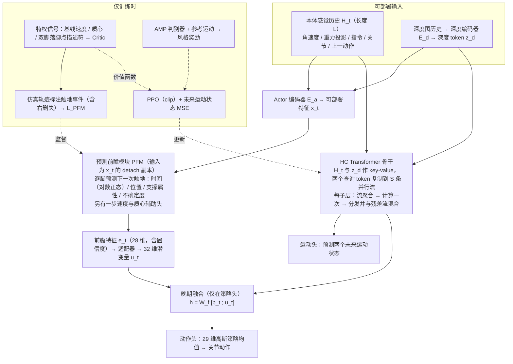

# HC2Robot：基于超连接 Transformer 与预测前瞻的人形多地形跑酷

**HC2Robot**（*HC2Robot: Hyper-Connection Transformers with Predicted Foresight for Multi-Terrain Humanoid Parkour*，[arXiv:2610.36825](https://arxiv.org/abs/2610.36825)）收录于 senlanke「具身运控lab」10-26–10-30 前沿论文动态（人形/四足）。本页依据**周报条目 + arXiv 摘要页**整理，未逐页核对正文 PDF；指标与结论以论文为准。

## 一句话定义

**HC2Robot：基于超连接 Transformer 与预测前瞻的人形多地形跑酷——前瞻模块从可部署观测预测下一次落脚的时间、位置和支撑质量，将特权监督转化为部署 latent；超连接 Transformer 使用多流路由增强时间推理，在楼梯、沟隙、高台和斜坡上平均成功率达到 97.6%。**

## 英文缩写速查

| 缩写 | 英文全称 | 简要说明 |
|------|----------|----------|
| RL | Reinforcement Learning | 强化学习 |
| WBC | Whole-Body Control | 全身控制 |

## 为什么重要

- 周报所述待解决的问题：非对称 Actor–Critic 中，Critic 能够看到特权接触和地形信息，但部署 Actor 只能使用机载观测，导致复杂地形落脚决策存在信息差。

## 流程总览

图依据：论文 §III-A–D / Fig. 2、式 (2)–(16)。

## 核心机制

| 项 | 内容 |
|----|------|
| **arXiv** | [2610.36825](https://arxiv.org/abs/2610.36825) · [PDF](https://arxiv.org/pdf/2610.36825) |
| **作者（arXiv）** | Xu, Wenhao, Mai, Yanheng, Fu, Yifei, Zheng, Nan, Zhou, Yanbo, Huang, Zirui, Ling, Mingsheng, Wang, Xinjue et al. |
| **机构（周报所述，未逐条核实）** | 香港科技大学（广州）、CL-TECH、华南农业大学、南方科技大学 |
| **arXiv 评论栏** | （无） |
| **开源** | arXiv 摘要页与评论未见代码或项目页链接（仅核对 arXiv 摘要页，不代表未发布）（2026-11-02） |
| **周报所述创新点** | 前瞻模块从可部署观测预测下一次落脚的时间、位置和支撑质量，将特权监督转化为部署 latent；超连接 Transformer 使用多流路由增强时间推理，在楼梯、沟隙、高台和斜坡上平均成功率达到 97.6%。 |

### arXiv 摘要节选（英文原文）

> Humanoid parkour requires robots to reason about future footholds and whole-body motions over highly discontinuous terrain. We revisit the information asymmetry in asymmetric actor-critic learning for perceptive humanoid locomotion: the critic exploits privileged simulator signals during training, whereas the deployable actor operates solely from onboard perception.

## 源码运行时序图

**不适用**：arXiv 摘要页与评论未见代码或项目页链接（仅核对 arXiv 摘要页，不代表未发布），无可对齐的官方代码流程。

## 实验与评测

- 周报与摘要给出的数字/场景已写入上表「创新点」与摘要节选；其余实验细节、基线与成功率定义请回到论文正文。
- 读法：先对齐任务设定、传感器与成功定义（仿真/真机），再解读 headline 数字，勿跨论文直接比较。

## 与其他工作对比

| 维度 | 读法 |
|------|------|
| **同周对照** | 见 [人形/四足周报技术地图](../overview/senlanke-weekly-2026-10-26-30-humanoid-quadruped-technology-map.md)，按方向浏览同期论文 |
| **开源状态** | arXiv 摘要页与评论未见代码或项目页链接（仅核对 arXiv 摘要页，不代表未发布） |

## 结论

**HC2Robot：基于超连接 Transformer 与预测前瞻的人形多地形跑酷。**

1. 本页是入库级摘要，复现前请核对论文正文、附录与代码仓库。
2. 指标须连同实验条件解读。
3. 关注 arXiv 版本更新与代码发布。

## 关联页面

- [senlanke-weekly-2026-10-26-30-humanoid-quadruped-technology-map](../overview/senlanke-weekly-2026-10-26-30-humanoid-quadruped-technology-map.md)
- [humanoid-locomotion](../tasks/humanoid-locomotion.md)
- [reinforcement-learning](../methods/reinforcement-learning.md)

## 参考来源

- [hc2robot-humanoid-parkour_arxiv_2610_36825.md](../../sources/papers/hc2robot-humanoid-parkour_arxiv_2610_36825.md)
- [wechat_senlanke_weekly_humanoid_quadruped_2026-10-26_30.md](../../sources/blogs/wechat_senlanke_weekly_humanoid_quadruped_2026-10-26_30.md)
- [arXiv:2610.36825](https://arxiv.org/abs/2610.36825)
- [arXiv PDF](https://arxiv.org/pdf/2610.36825)：已通读全文：方法 §III-A–D（观测与特权信号、HC-Transformer、PFM 与晚期融合、训练与部署）与 §IV 实验协议

## 推荐继续阅读

- [arXiv PDF](https://arxiv.org/pdf/2610.36825)
