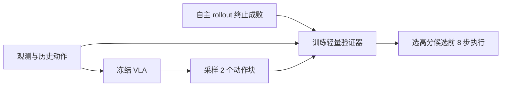
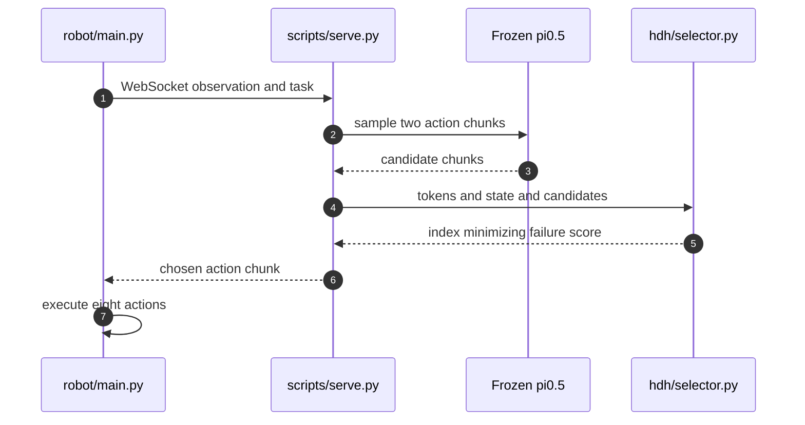

# HDH：冻结 VLA 的低延迟动作验证

## 一句话定义

**从冻结 VLA 的自主执行成败训练紧凑验证器，以近期观测与动作历史给候选动作块评分，选择更可能成功的动作。**

## 英文缩写速查

| 缩写 | 英文全称 | 简要说明 |
|------|----------|----------|
| VLA | Vision-Language-Action | 视觉语言动作策略 |
| HDH | Hindsight Decision Model with History | 基于历史与结果监督的动作验证 |
| LIBERO | Language-Instructed Benchmark for Robot Manipulation | 机器人操作评测 |

## 为什么重要

冻结 VLA 的双候选动作验证，关注现有控制、数据或机器人学习方法在复杂任务中的失效点。这里单独建论文实体，避免与其他论文共用详情页；已通读原始论文 HTML 的可用正文和附录；源码执行效果仍需复现。

## 核心机制

冻结 π0.5 收集自主 rollouts，按回合终止成败标注当前观测与执行动作前缀；训练带历史条件的轻量 verifier；推理时采样两个候选块，按成功分数选择，并执行获选块的前 8 步。

## 方法流程

该流程依据原文方法描述，不等价于源码调用时序。

## 源码运行时序图

依据官方仓库 README 与实际执行入口静态核查，尚未部署运行：

## 实验与评测

四个 LIBERO-10 任务平均成功率 82.3%；Franka Panda 三项真机任务的平均成功率由 44.7% 升至 67.3%（每方法每任务 50 次）。5.4% 额外延迟为仿真统计，真机延迟需要独立测量。

## 局限与工程实践

- 验证器依赖任务自身的 rollout 成败标签；候选只来自原冻结策略，无法保证发现策略从未采样的动作。
- **源码状态：** 已公开 Franka 真机代码；另外有 hdh_sim 仿真仓库。
- **原文状态：** 已通读 arXiv HTML 的可用正文和附录；具体复现及跑通情况尚未独立验证。

## 结论

**HDH 的收益来自冻结策略之外的候选选择，而非修改主模型；必须对照同一候选集的随机选择。**

1. 使用与论文一致的任务、硬件和评测协议复验，不跨实验口径比较数据。
2. 把方法改善的指标与额外的数据、计算或控制成本分开记录。
3. 对未经独立核查的复现入口，暂不声称完成验证。

## 与相关方法对比

| 对照方法 | 关键区别 | 局限或适用条件 |
|---|---|---|
| 冻结 VLA 直接执行 | 仅执行采样得到的动作 | HDH 在 K=2 候选中按预测成功概率选块 |
| 随机候选选择 | 不使用回合终止标签训练验证器 | HDH 需要任务专属 rollout 数据及验证器 |

不同基准和硬件的结果不能直接排序。

## 关联页面

- [CarryOn：具备记忆、安全与失败恢复的双循环机器人 Harness](./paper-carryon-dual-loop.md)
- [MOSS：从初始噪声选定 Flow Matching 动作模式](./paper-moss-mode-source-shaping.md)

## 参考来源

- [论文归档](../../sources/papers/hdh-action-verifier_arxiv_2611_14834.md)
- [官方项目页归档](../../sources/sites/hdh-action-verifier.md)
- [官方仓库归档](../../sources/repos/hdh-action-verifier.md)

## 推荐继续阅读

- [arXiv 原文](https://arxiv.org/abs/2611.14834)
- [官方项目页](https://wen-hanhsieh.github.io/hdh/)
- [公开仓库](https://github.com/Wen-HanHsieh/hdh_real)
