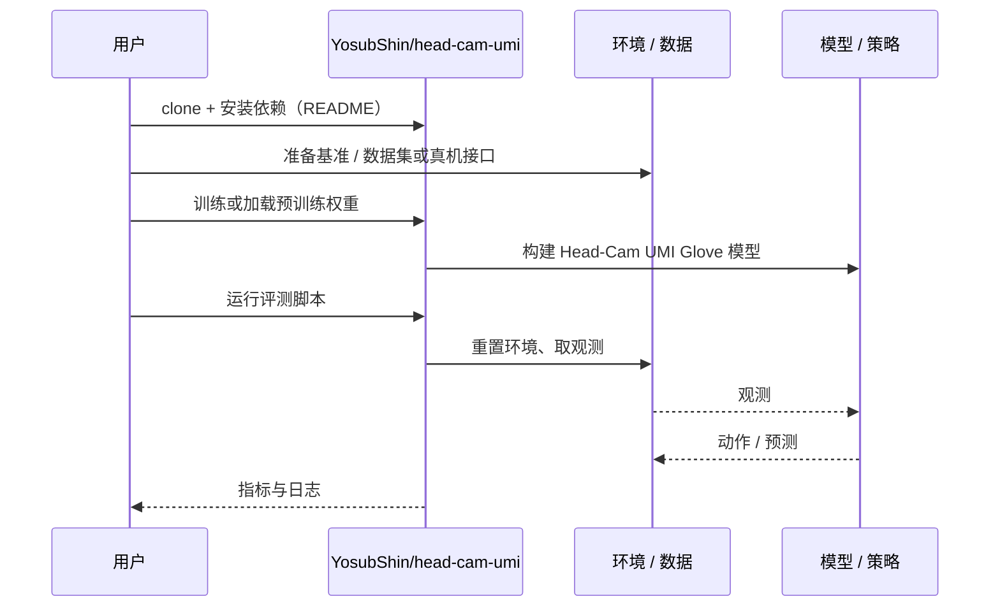

# Head-Cam UMI Glove（arXiv:2610.27622）

**Head-Cam UMI Glove**（*A Head Camera Is (Almost) All You Need: An Electronics-Free UMI Glove Labelled and Observed by One Moving Camera*，[arXiv:2610.27622](https://arxiv.org/abs/2610.27622)，[代码](https://github.com/YosubShin/head-cam-umi)）来自 [具身智能小站 2026-10-31 盘点](../../sources/blogs/wechat_embodied_station_50_papers_scenerig_photo_to_sim_2026-10-31.md)，属「数据采集与示范迁移」组。

## 一句话定义

**头戴相机同时读取手套标记与工作区定位标记，减少采集硬件及同步链路；单任务真机对照呈现潜力，但小样本差异尚未达到常用显著性阈值。**

## 英文缩写速查

| 缩写 | 英文全称 | 简要说明 |
|------|----------|----------|
| Head-Cam UMI Glove | A Head Camera Is (Almost) All You Need: An Electronics-Free UMI Glove Labelled and Observed by One Moving Camera | 本文方法 / 基准的简称 |
| UMI | Universal Manipulation Interface | 手持通用操作采集接口 |

## 为什么重要

- 一台头戴相机兼做观测和动作标注。
- 开源结论：**已开源**（步骤 2.5，2026-10-31）。仓库可达（git ls-remote）。
- 同期同组工作见 [单图重建仿真、VLA 适配评测与跨形态世界模型：具身智能小站 10-31 期 50 篇阅读坐标](../overview/embodied-station-2026-10-31-50-papers-technology-map.md)。

## 核心机制

| 项 | 内容 |
|----|------|
| **arXiv** | [2610.27622](https://arxiv.org/abs/2610.27622) |
| **开源** | **已开源** |
| **要点** | 头戴相机同时读取手套标记与工作区定位标记，减少采集硬件及同步链路；单任务真机对照呈现潜力，但小样本差异尚未达到常用显著性阈值。 |
| **文内指标** | 公众号未给具体数字，本页不引用。 |

## 源码运行时序图

以下为按仓库入口（`YosubShin/head-cam-umi`）推断的通用运行链路；入库日仅核实仓库可达，未逐文件阅读，具体脚本名以 README 为准。

## 实验与评测

- 公众号未给具体数字，本页不引用。
- **读法：** 本页为索引级摘要，依据公众号转述的官方摘要与仓库信息整理；逐项数字与 baseline 以原文 PDF 为准。

## 与其他工作对比

- 横向索引见 [单图重建仿真、VLA 适配评测与跨形态世界模型：具身智能小站 10-31 期 50 篇阅读坐标](../overview/embodied-station-2026-10-31-50-papers-technology-map.md)；同 arXiv 不重复造页。

## 结论

**一台头戴相机兼做观测和动作标注：头戴相机同时读取手套标记与工作区定位标记，减少采集硬件及同步链路；单任务真机对照呈现潜力，但小样本差异尚未达到常用显著性阈值。**

1. 开源边界：**已开源** — 仓库可达（git ls-remote）。
2. 核心机制：头戴相机同时读取手套标记与工作区定位标记，减少采集硬件及同步链路；单任务真机对照呈现潜力，但小样本差异尚未达到常用显著性阈值。
3. 复现与选型前核对任务协议、硬件与基准口径，勿直接横比公众号摘录数字。

## 关联页面

- [embodied-data-collection-four-layers-taxonomy](../concepts/embodied-data-collection-four-layers-taxonomy.md)
- [teleoperation](../tasks/teleoperation.md)
- [imitation-learning](../methods/imitation-learning.md)
- [dexterous-kinematics](../concepts/dexterous-kinematics.md)
- [embodied-station-2026-10-31-50-papers-technology-map](../overview/embodied-station-2026-10-31-50-papers-technology-map.md)

## 参考来源

- [head_cam_umi_glove_arxiv_2610_27622.md](../../sources/papers/head_cam_umi_glove_arxiv_2610_27622.md)
- [wechat_embodied_station_50_papers_scenerig_photo_to_sim_2026-10-31.md](../../sources/blogs/wechat_embodied_station_50_papers_scenerig_photo_to_sim_2026-10-31.md)
- [arXiv:2610.27622](https://arxiv.org/abs/2610.27622)

## 推荐继续阅读

- [arXiv PDF](https://arxiv.org/pdf/2610.27622)
- [https://github.com/YosubShin/head-cam-umi](https://github.com/YosubShin/head-cam-umi)
