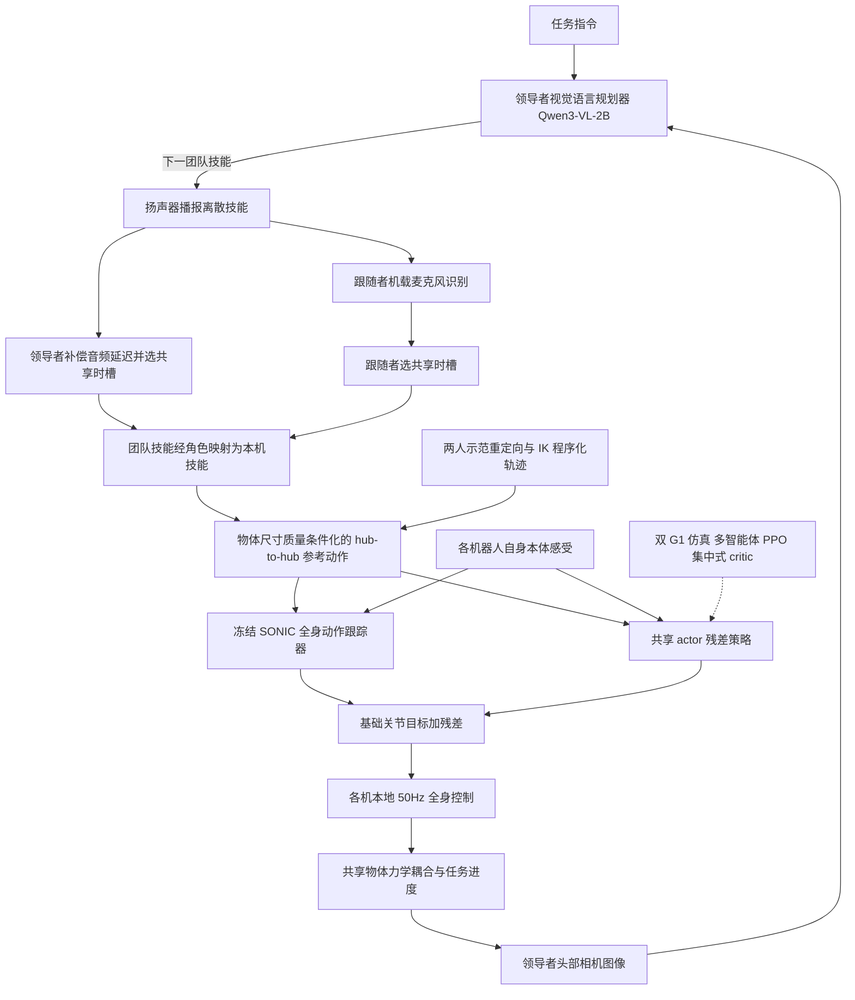

# Heave-Ho：以语音同步的分散式长时程多人形协作 / Decentralized Long-Horizon Multi-Humanoid Collaboration

**论文身份：** Ting-Hsuan Chen 等，南加州大学（University of Southern California）与 VinMotion，arXiv:2611.22275 **v2（2026-11-18）**。一手资料见[论文通读归档](../../sources/papers/heave-ho-arxiv-2611-22275.md)。

## 一句话定义

**Heave-Ho** 是多台人形机器人协同搬运的分层系统：领导者从本机相机图像选择团队技能并**说出指令**，队友用本机麦克风识别并按共享时间格同步启动；每台机器通过冻结全身跟踪基座加多智能体残差策略只凭本地观测执行，不需机器人间网络数据包。

## 英文缩写速查

| 缩写 | 英文全称 | 简要说明 |
|---|---|---|
| HH-Bench | Heave-Ho Benchmark | 12 项物理耦合的人形协作评测 |
| VLM | Vision-Language Model | 领导者根据相机和任务指令选离散团队技能 |
| MAPPO | Multi-Agent Proximal Policy Optimization | 集中训练、分散执行的多智能体策略优化 |
| CTDE | Centralized Training, Decentralized Execution | 训练可用全员信息，部署每机只读本地信息 |
| IK | Inverse Kinematics | 为物体与技能生成可跟踪参考动作 |
| LoRA | Low-Rank Adaptation | 对 Qwen3-VL-2B 视觉语言模型做参数高效微调 |

## 为什么重要

| 字段 | 信息 |
|---|---|
| 机构 | 南加州大学（University of Southern California）；VinMotion |
| 论文身份 | arXiv:2611.22275v2，2026-11-18 |

- 多机共同抬箱并非多个独立行走任务：物体受力会耦合各机器人的平衡，技能指令一旦错时启动就可能拉倒队友（§1）。
- 集中式联合策略依赖队伍人数及聚合观测；Heave-Ho 把策略共享在机器人本机、把跨机协调收敛成**语音离散技能 + 时间同步**，可扩展至多人/多机混合队伍（§3）。
- 这不是“完全没有通信”：**没有机器人间网络通信**，但团队仍通过空气中的声音传递技能指令，物体接触力提供被动耦合（§3.3）。

## 核心原理

### 方法流程总览（原文 Fig. 2、§3.1–3.3）

该图按论文机制绘制，不代表当前仓库的可运行函数调用。每台机器人的底层 actor 只接收本地本体状态、短期参考窗口与物体规格 `(L,W,H,m)`，不读取其他机器人的状态（§3.1）。

### 技能组合、动作控制与训练

| 模块 | 原文机制 | 工程含义 |
|---|---|---|
| 团队技能空间 | lift、put down、前后左右步、原地转向、hold/done；S0 空手站立和 S1 持物站立共享端点（§3.2） | 让长时任务组合为可复用的离散技能序列 |
| 角色映射 | `ρ_i` 将团队相对移动方向映射为各机器人自身体坐标方向（§3.1） | 对面抬箱的两台机器人可能一台前进、一台后退 |
| 本地跟踪 | `a_i = π_base(o_i) + π_θ(o_i, π_base(o_i))`，冻结 SONIC，训练共享的关节目标残差（§3.2） | 预训练平衡步态保留，残差学习物体负载与伙伴作用力 |
| CTDE 训练 | 同一 actor 参数；集中式 critic 对每个机器人估值；共享失败终止，训练长随机技能链（§3.2） | 学习时看全局、部署时无需队友状态或网络 |
| 视觉规划 | 微调 Qwen3-VL-2B-Instruct，按每个技能结束时的头部相机图像选下一技能（§3.3、App. D.1） | VLM 负责低频任务组织，动作层维持 50 Hz |
| 语音同步 | 领导者说技能、跟随者本地识别；共享粗时间格安排技能开始，领导者补偿预计声学延迟（§3.3） | 不传机器人间网络消息，但需可靠麦克风与音频环境 |

**训练链路（App. D.2）：** Isaac Lab 中两台 G1、4,096 个并行团队，先训练可用特权状态的 teacher，再将动作蒸馏到 student 并训练适配模块，随后 student 用 MAPPO 继续闭环优化。仿真步长 5 ms、控制周期 20 ms（50 Hz）；论文报告单位阶段上限 `10^9` team steps，不能据此推断实际机器人的算力或训练时长。

## 实验与评测

| 测项 | 作者报告 | 对照或解释 |
|---|---|---|
| HH-Bench 12 项低层仿真 | **94.41%** 平均成功率，3 seeds × 512 teams/任务（Table 2） | Multi-HDMI 28.56%、无 SONIC 16.78%、独立 actor 22.05%、只用 SONIC 0.22% |
| 高层 VLM 规划（5 任务×10 次） | **43/50（86%）**（Table 1） | 零样本 GPT-6 (Astra) 21/50、CHORUS 6/50、人工操作者 49/50；比较不是等训练预算 |
| 高层每次决策 | **52.5 ms**，RTX 4090、显存 5.3 GiB（§5.3/App. D） | CHORUS 78 ms；GPT-6 API 平均 6.46 s，跨设备/部署形态，不代表同一硬件吞吐对比 |
| 真机 10 组任务 | **92/100 次**成功（§5.2 / App. C） | G1 双机窄门 9/10、L 形走廊 10/10、交接箱 10/10；G1+人抬楼梯 7/10 |
| 训练两个、部署更多 | 同一 G1 策略在仿真支持 **4、8、10 台**抬桌，未再训练；现实抬桌 4 组 **37/40**（§5.5） | PM01 用相同训练方法单独训练自身策略，不是 G1 参数直接跨平台零样本复用 |

**HH-Bench 任务：** L 形通道、窄门、抬桌、L 形沙发、楼梯搬运、精确放置、箱体交接、抬轿、搬钢筋、拖消防水带、推箱、推磨盘（Appendix B）。

## 结论

**值得复用的是“共享全身跟踪先验 + 负载交互残差 + 离散团队技能 + 语音时间格”四层分工；论文验证了低层物理耦合和非网络同步的可行性，但尚未证明嘈杂现场、任意新任务或开源复现的可靠性。**

1. **训练与执行严格区分：** 集中式 critic 只在训练时查看团队观测，现场每机独立运行；复现时检查是否意外读取队友状态或外部 MoCap。
2. **底层优先从先验残差开始：** 仅 SONIC 0.22%，加入交互后 94.41%（同一仿真评测）；负载接触与技能时序不能只靠动作跟踪自动解决。
3. **同步是独立的系统能力：** CHORUS 在五项团队任务只成功 6/50；语音识别延迟、漏识别、多人声音干扰应作为单独压力测试，而非隐含在成功率中。
4. **量化评估要分口径：** 12 项低层仿真 94.41%、五项规划 86%、十组真机 92% 分别来自不同任务与采样难度，不应混成统一“成功率”。
5. **扩容须识别本体边界：** G1 两机器人策略可扩容 G1 队伍；异构 PM01 要另训相同接口的本体控制器，不能宣称一套关节策略通吃。
6. **暂不宣称复现：** 官方仓库截至 2026-11-19 尚无可运行训练/推理代码，仅论文、视频与 README；后续开源须核查许可证、依赖与真机执行接口。

## 工程实践

| 项目 | 可用信息 / 复现边界 |
|---|---|
| 平台 | Unitree G1、EngineAI PM01；两 G1 在 Isaac Lab 中训练（§5.1） |
| 接口 | 50 Hz 本地控制，机器人输入本体感受 + 未来运动参考窗口 + 物体长宽高质量（§3.1） |
| 规划器 | Qwen3-VL-2B-Instruct + LoRA，24 真机或 1,000 仿真 episodes/任务；RTX 4090 单次决策 52.5 ms（§3.3/App. D） |
| 声学协调 | 对语音漏听、背景噪声、发言者位置与识别时延做鲁棒性验证；原文没有证明在嘈杂工业现场可稳定工作 |
| 发布状态 | [项目页](https://heaveho-humanoid.github.io/)展示演示；[GitHub](https://github.com/heaveho-humanoid/Heave-Ho)仅 README 和图片，承诺 2026-12 月底开源，当前**待发布** |
| 源码运行时序图 | **不适用**：无可辨认的训练/推理/部署代码与入口；不能用论文架构伪装源码运行调用 |

## 源码运行时序图

**不适用（截至 2026-11-19）**：官方仓库只有 README 与 assets，未发布可运行算法、脚本或模型，故不能核对真实训练/部署函数时序。待代码发布后根据 README 运行入口补图；见 [官方仓库归档](../../sources/repos/heave-ho.md)。

## 与其他工作对比

- [SONIC](./nvidia-sonic.md)：作为冻结的全身运动追踪基座，不解决伙伴共同持物时的负载交互；Heave-Ho 加共享残差补物理耦合。
- [ResMimic](./paper-resmimic.md)：同属“全身先验 + 任务残差”路线，但 Heave-Ho 聚焦多人共享物体与无网络协作。
- CHORUS（原文引用 arXiv:2606.12352）：可独立执行的多本体 VLA 路线；在本文重新微调为技能选择接口的对比中，缺乏同步启动机制，本文 5 项任务总成功 6/50（§5.3），不代表 CHORUS 原任务的通用效果。

## 局限与风险

- **语音通道并非万能：** 论文 §6 明确需要相对安静环境及可靠拾音；无网络包≠不需要跨机信息传递，漏听/混响/机械噪音下未证明稳定性。
- **规划数据成本：** 新任务规划器需要人工遥操作示范，论文承认耗时；它并非无需人工数据就能完全自适应。
- **实验条件差异：** 真机任务从标称配置小扰动出发，仿真初始条件采样更广，跨设置成功率不能直接排名。
- **基线公平性：** 自身是微调 2B 模型，GPT-6 (Astra) 是零样本 API；52.5 ms vs 6.46 s 的推理条件不同。
- **开源尚未完成：** 仓库目前无算法代码/权重，未独立复现实验；2026-12 月底是作者计划而非保证。

## 关联页面

- [Loco-Manipulation 任务](../tasks/loco-manipulation.md)
- [强化学习方法](../methods/reinforcement-learning.md)：作为 CTDE / MAPPO 后训练的基础方法入口。
- [全身控制](../concepts/whole-body-control.md)
- [SONIC 全身跟踪基座](./nvidia-sonic.md)
- [ResMimic 残差控制](./paper-resmimic.md)
- [Unitree G1](./unitree-g1.md)
- [Loco-Manipulation 纵深路线](../../roadmap/depth-loco-manipulation.md)
- [双/多机器人协作纵深路线](../../roadmap/depth-multi-robot-collaboration.md)
- [协同物体搬运](../concepts/collaborative-object-transport.md)

## 参考来源

- [arXiv v2 全文通读与表格核对](../../sources/papers/heave-ho-arxiv-2611-22275.md)
- [作者项目主页核对](../../sources/sites/heave-ho.md)
- [官方 GitHub 开源状态核对](../../sources/repos/heave-ho.md)

## 推荐继续阅读

- [原论文 HTML v2](https://arxiv.org/html/2611.22275v2)
- [项目主页与真机演示](https://heaveho-humanoid.github.io/)
- [官方代码发布入口（目前占位）](https://github.com/heaveho-humanoid/Heave-Ho)
