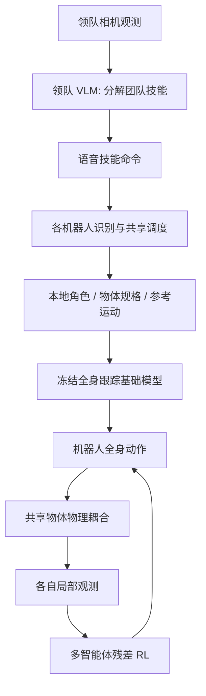

# Heave-Ho: Decentralized Long-Horizon Multi-Humanoid Collaboration｜去中心化长程多人形协作

## 一句话定义

Heave-Ho 把多智能体后训练的身体耦合控制与基于语音的领队—跟随者视觉语言技能规划结合，实现不依赖机器人间网络消息的长时程协作。

## 英文缩写速查

| 缩写 | 英文全称 | 简要说明 |
|---|---|---|
| VLM | Vision-Language Model | 领队的视觉语言规划器 |
| RL | Reinforcement Learning | 多智能体低层残差训练 |
| HH-Bench | Heave-Ho Benchmark | 12 项多人形协作任务 |

## 为什么重要

搬运大型物体时，多台机器人受到共同物体的力学耦合；仅靠每台机器人各自的单体步行策略无法保证同步。

## 核心原理

1. 低层：从冻结的人形全身跟踪基础模型出发，使用多智能体残差后训练处理协作任务中的共享物体反作用力；各机器人以局部观测独立执行策略。
2. 高层：领队 VLM 从视觉选择团队技能并用语音广播；跟随机器人识别语音，将技能映射为角色与参考动作，通过共享技能调度时隙同步。
3. 训练只使用两台同构人形，论文在仿真展示最多十台及异构团队；HH-Bench 提供 12 类协作任务。

## 流程总览

## 源码运行时序图

**不适用：**官方仅发布 README/展示资产；计划于 2026 年 12 月底前发布实现，暂无可核实运行入口。不能把论文示意图伪装为已公开源码的调用链。

## 工程实践

- 官方入口：官方仅发布 README/展示资产；计划于 2026 年 12 月底前发布实现，暂无可核实运行入口。
- 源码核对：官方仓库 README 写明“Code release: we plan to release the code by the end of December 2026”；目前无可核实的训练、推理、评测入口，代码许可证未确认。
- 复现前检查输入格式、动作坐标系、依赖、评测种子以及硬件和 API 资源；作者报告数字不可当作本仓实测。

## 实验与评测

- HH-Bench 总计 12 项任务，队伍为 2–10 台机器人，包含异构组合。
- 论文/项目展示两台相同人形训练并扩展至最多 10 台，以及真实机器人的协同实验；这些是作者报告。

## 结论

**Heave-Ho 把多智能体后训练的身体耦合控制与基于语音的领队—跟随者视觉语言技能规划结合，实现不依赖机器人间网络消息的长时程协作。**

1. 先以论文明确的输入输出、数据拆分和评测协议定位方法适用范围。
2. 区分定量实验、官方开源可复现入口与本次未执行的实验步骤。
3. 重点跟进部署时的误差、计算开销以及任务/机器人构型迁移边界。

## 局限与风险

- “无网络通信”仅表示不用机器人间消息网络；系统仍依赖语音这个信息通道和感知/时序条件。
- 2026-11-19 官方 GitHub README 明言代码计划 2026 年 12 月底前发布，目前仓库主要是 README 和资产，没有可运行源码，未见明确 LICENSE。
- 仿真规模扩展和实机协作成功不能等同于任意复杂任务上的零样本泛化。

## 关联页面

- [loco-manipulation ](../tasks/loco-manipulation.md)
- [reinforcement-learning ](../methods/reinforcement-learning.md)
- [humanoid-locomotion ](../tasks/humanoid-locomotion.md)
- [相关纵深路线](../../roadmap/depth-loco-manipulation.md)

## 参考来源

- [论文原文与技术核对归档](../../sources/papers/heave-ho-arxiv-2611-22275.md)
- [官方项目页归档](../../sources/sites/heave-ho.md)
- [官方代码及开放状态归档](../../sources/repos/heave-ho.md)

## 推荐继续阅读

- [arXiv:2611.22275 全文](https://arxiv.org/html/2611.22275v1)
- [项目主页](https://heaveho-humanoid.github.io/)
- [官方源码](https://github.com/heaveho-humanoid/Heave-Ho)
