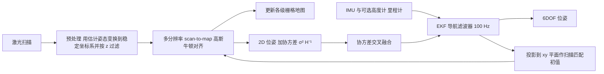

# Hector-SLAM（A Flexible and Scalable SLAM System with Full 3D Motion Estimation）

**Hector-SLAM**（Kohlbrecher、von Stryk、Meyer、Klingauf，TU Darmstadt；[IEEE SSRR 2011](https://doi.org/10.1109/SSRR.2011.6106777)，pp. 155-160）是面向城市搜救（USAR）机器人的 2D 激光栅格 SLAM 系统，并配有基于 IMU 的完整 3D 导航滤波。本页依据论文全文（见 [来源归档](../../sources/papers/hector-slam_doi_10_1109_ssrr_2011_6106777.md)）。该论文无 arXiv 版本。

## 一句话定义

**2D 激光 SLAM 前端：用栅格地图的双线性插值梯度做高斯-牛顿 scan-to-map 对齐，多分辨率栅格缓解局部极小，再与 IMU 的 6DOF EKF 松耦合；不做位姿图优化与回环（Sec. I、II、IV）。**

## 英文缩写速查

| 缩写 | 英文全称 | 简要说明 |
|------|----------|----------|
| SLAM | Simultaneous Localization and Mapping | 同步定位与建图 |
| USAR | Urban Search and Rescue | 城市搜救，论文的目标场景（RoboCup Rescue） |
| LIDAR | Light Detection and Ranging | 激光雷达；本文用的是平面 2D 激光（Hokuyo UTM-30LX） |
| IMU | Inertial Measurement Unit | 惯性测量单元，提供角速度与加速度 |
| EKF | Extended Kalman Filter | 扩展卡尔曼滤波；论文的 6D 导航滤波器 |
| CI | Covariance Intersection | 协方差交叉；把 SLAM 位姿融入 EKF 时避免过度自信 |
| UGV / USV | Unmanned Ground / Surface Vehicle | 无人地面车 / 无人水面艇 |
| 6DOF | Six Degrees of Freedom | 完整 3D 位置加姿态 |
| ROS | Robot Operating System | 论文使用的中间件，并提供开源包 |

## 为什么重要

- **作者自述：** 在不依赖里程计、计算资源很低的条件下利用激光的高更新率做在线建图，且在 6DOF 运动平台（崎岖地形车辆、水面艇、手持）上仍可用（Abstract、Sec. I）。
- **作者自述的地位：** 据作者所知，「高更新率机载 2D 建图 + 6DOF 位姿 + 低功耗平台」的组合此前无开源实现（Sec. VII）；论文对标 Gmapping 一类依赖里程计且假设平面运动的方法（Sec. II）。
- **我的判断：** 它是后来大量 ROS 小车 2D 建图的常用基线之一，也是「无回环的纯前端」设计取舍的清晰样例；与 [Cartographer](./cartographer.md)（子图加位姿图）形成对照。

## 核心机制

### 流程总览

### 要点（均出自论文）

| 模块 | 内容 | 出处 |
|------|------|------|
| 系统结构 | 2D SLAM 子系统与 3D 导航子系统松耦合，各自更新；SLAM 软实时，导航解硬实时 | Sec. I、III、图 1 |
| 地图访问 | 双线性插值得到亚栅格占据值与梯度 | Sec. IV-A，式 4-6 |
| 扫描匹配 | 最小化 Σ[1 − M(S_i(ξ))]²，ξ = (p_x, p_y, ψ)；一阶展开得高斯-牛顿步 Δξ = H⁻¹ Σ(…)；无数据关联、无穷举搜索；与地图对齐即隐含与所有先前扫描匹配 | Sec. IV-B，式 7-14 |
| 匹配协方差 | R = σ²·H⁻¹，σ 依赖激光器特性；也可采样估计 | Sec. IV-B，式 15 |
| 多分辨率 | 可选多张栅格图，每级分辨率减半（图 3：20/10/5 cm），同时由位姿更新而非降采样；从最粗级开始逐级细化 | Sec. IV-C |
| 3D 估计 | EKF，状态含欧拉角、位置、速度与陀螺/加速度计偏置；100 Hz 定频，异步接收扫描匹配位姿；完整 3D 需额外高度传感器 | Sec. III、V-A |
| 双向耦合 | EKF 位姿投影到 xy 平面作匹配初值；SLAM 位姿用协方差交叉融回 EKF | Sec. V-B，式 16-20 |
| 激光姿态补偿 | 用估计姿态与关节值把扫描变换到局部稳定坐标系，仅保留 z 在扫描平面阈值内的端点 | Sec. IV |

## 实验与结果（均为定性）

- **USAR：** Hector UGV（激光绕 roll/pitch 稳定）在 RoboCup 2010 / 2011 场景中学得「高精度且一致」的地图（Sec. VI-A，图 5a、6a）。
- **浅水 USV：** Claytor Lake 无 GPS 日志，无运动模型，30 分钟内完成装机；论文称地图对 GPS 失效时的导航足够准确（Sec. VI-B）。
- **手持嵌入式：** UTM-30LX + Intel Atom Z530 + 低成本 MEMS IMU；Dagstuhl 新楼含大回环，论文称无需显式回环即可闭合（Sec. VI-C，图 6b）；日志可在 Atom Z530 上 **3 倍实时**回放而不降地图质量，SLAM 占该系统不到一半算力。
- 论文**没有**给出轨迹误差、地图精度等定量指标或与其他算法的对比表，也不使用标准数据集（作者称其缺少 6DOF 与高激光更新率，Sec. VI）。

## 与其他工作对比

| 工作 | 关注点 | 与本文的区别 |
|------|--------|--------------|
| [GMapping](./paper-gmapping.md) | 栅格 RBPF-SLAM，扫描匹配 + 里程计构造提议分布 | 依赖里程计、假设平面运动，回环靠粒子多假设；Hector-SLAM 不需要里程计，单一高斯-牛顿 scan-to-map 估计，配 IMU 给 6DOF（Sec. II）。论文未做数值对比 |
| [Cartographer](./cartographer.md) | 子图扫描匹配 + 位姿图优化与回环 | 有后端与显式回环；Hector-SLAM 是纯前端，图优化列为未来工作（Sec. II、VI-B） |
| [slam_toolbox](./slam-toolbox.md) | Karto 后端的 2D 图优化 SLAM | 同样面向 ROS 2D 栅格建图，但带位姿图与回环，适合更大场景 |

## 结论

**Hector-SLAM 用双线性插值梯度上的高斯-牛顿 scan-to-map 对齐加多分辨率栅格，在无里程计、低算力条件下利用高更新率激光完成小尺度在线 2D 建图，并与 IMU 的 EKF 耦合给出 6DOF 位姿。**

1. 扫描匹配无数据关联与穷举搜索，与地图对齐即隐含与全部历史扫描对齐（Sec. IV-B）。
2. 多分辨率栅格缓解局部极小，粗图还可直接用于路径规划（Sec. IV-C）。
3. 在 Atom Z530 上 3 倍实时回放且 SLAM 占不到一半算力（Sec. VI-C），与「计算量大需低速」的说法相反。
4. 局限：无位姿图与回环、不保证收敛、只有定性实验，大场景与长时间运行的漂移没有证据。

## 工程实践

- **输入条件：** 里程计非必需（Sec. IV-B；轮式里程计只是 EKF 的可选速度量测，Sec. III、V）；要做完整 3D 位姿需 IMU 加高度传感器（Sec. V-A）。
- **接口：** 遵循 ROS 导航栈 API，可与其他 ROS SLAM 互换（Sec. I）；官方代码为 ROS 包 hector_slam（ROS Wiki 列出 hector_mapping、hector_geotiff、hector_trajectory_server 等子包）。仓库 README 与源码本次**未核实**。
- **适用场景（作者自述）：** 小尺度、无需闭合大回环、可利用高更新率激光的场景（Sec. I）。
- **实现细节的提示：** 多分辨率各级地图要同时维护，粗地图可直接给路径规划（Sec. IV-C）。

## 局限

**论文自己承认的：**

- 梯度是非光滑线性近似，**不保证局部二次收敛**（Sec. IV-B）；梯度类方法有陷入局部极小的风险，只靠多分辨率「缓解」而非消除（Sec. IV-C）。
- 只是 SLAM 前端，不提供位姿图优化；GPS 重获后的图优化列为未来工作（Sec. II、VI-B）。适用范围明确限定于小尺度、无需闭合大回环的场景（Sec. I）。
- 完整 3D 估计需额外高度传感器（Sec. V-A）；其他传感器融合「不在本文范围」（Sec. V）。

**我看到的未验证之处（推测，非论文结论）：**

- 无定量精度评估，也无与 Gmapping、ICP 类方法的对比；「无需回环」的结论只基于几段定性地图，对更大场景、重复结构或长时间运行没有证据。
- 无回环意味着累积漂移不会被修正，一旦匹配出错难以自愈（推测；论文只说小场景下足够准确，没有讨论失败案例）。
- 论文设定为 2D 平面激光加姿态补偿，并非 3D 激光 SLAM：「full 3D motion estimation」指 6DOF 位姿，地图仍是 2D 栅格图。

## 与综述说法的核对

对照综述《激光雷达 SLAM 算法最新综述》（刘铭哲等，2026-11-11 转载）对 Hector-SLAM 的描述：

| 综述说法 | 核对结果 |
|----------|----------|
| 不需要里程计信息 | 基本一致：扫描匹配本身不依赖里程计（Sec. IV-B）；但系统用 IMU 做姿态补偿与匹配初值（Sec. IV、V-B），综述未提 |
| 高斯牛顿法直接做 scan-to-map 优化，构建栅格地图 | 一致（Sec. IV-B，式 7-14）；综述未提双线性插值梯度与多分辨率栅格（Sec. IV-C） |
| 缺回环检测，对地图无修正能力 | 事实一致：论文自称纯前端、无位姿图（Sec. II）；但论文把它当作小场景下的设计取舍并称无需显式回环，「一旦地图出错将影响后续」不是论文的结论，属综述的推断 |
| scan-to-map 计算量大，需要机器人低速移动 | **与论文相反**：论文强调低计算资源、可跑在低功耗处理器上（Abstract、Sec. I），Atom Z530 上 3 倍实时回放且占不到一半算力（Sec. VI-C），并称系统适用于相对地面机器人移动更快的敏捷飞行器（Sec. I）；论文中「只能低速移动」是批评**其他**两阶段方案的（Sec. II）。论文未给出速度上限，也没有关于它需要低速移动的实验 |
| （综述未提）3D 运动估计、IMU 融合 | 论文题目与 Sec. III、V 的核心之一：EKF 6DOF 估计加协方差交叉双向耦合 |
| 时间、机构 | 综述未给；论文为 2011 年，TU Darmstadt |

## 关联页面

- [激光 SLAM / LIO / VIO 选型比较](../comparisons/lidar-slam-lio-vio-selection.md)
- [Cartographer](./cartographer.md)：同为 2D/3D 激光 SLAM，但有子图与位姿图优化
- [slam_toolbox](./slam-toolbox.md)
- [hdl_graph_slam](./hdl-graph-slam.md)
- [LeGO-LOAM](./lego-loam.md)、[LIO-SAM](./lio-sam.md)、[FAST-LIO](./fast-lio.md)、[LVI-SAM](./paper-lvi-sam.md)
- [状态估计](../concepts/state-estimation.md)、[传感器融合](../concepts/sensor-fusion.md)、[激光雷达感知](../concepts/lidar-sensing.md)
- [Gauss-Newton 方法](../methods/gauss-newton.md)

## 参考来源

- [来源归档：Hector-SLAM（SSRR 2011）](../../sources/papers/hector-slam_doi_10_1109_ssrr_2011_6106777.md)
- S. Kohlbrecher, O. von Stryk, J. Meyer, U. Klingauf, *A Flexible and Scalable SLAM System with Full 3D Motion Estimation*, IEEE SSRR 2011, [DOI 10.1109/SSRR.2011.6106777](https://doi.org/10.1109/SSRR.2011.6106777)
- [hector_slam（ROS Wiki）](https://wiki.ros.org/hector_slam)

## 继续阅读

- [Cartographer](./cartographer.md)：看子图加回环如何补上本文缺的后端
- [激光 SLAM / LIO / VIO 选型比较](../comparisons/lidar-slam-lio-vio-selection.md)
- [Gauss-Newton 方法](../methods/gauss-newton.md)
- 论文引用的相关扫描匹配：Real-Time Correlative Scan Matching（Olson, ICRA 2009）、NDT（Biber & Straßer, 2003）
