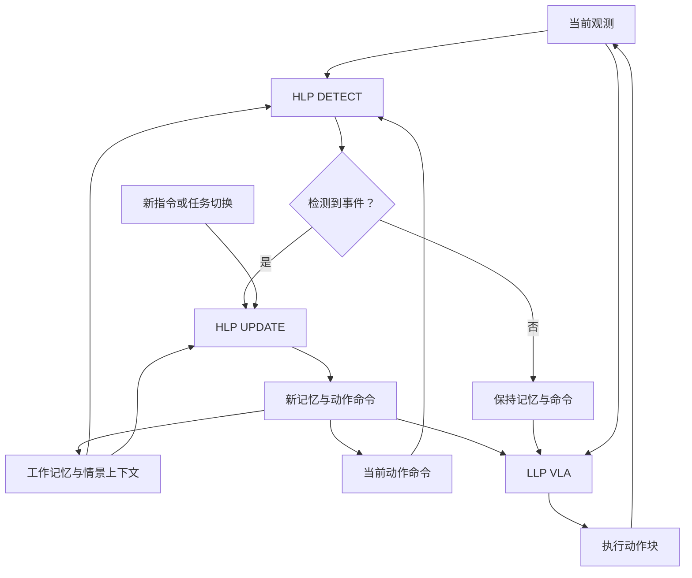
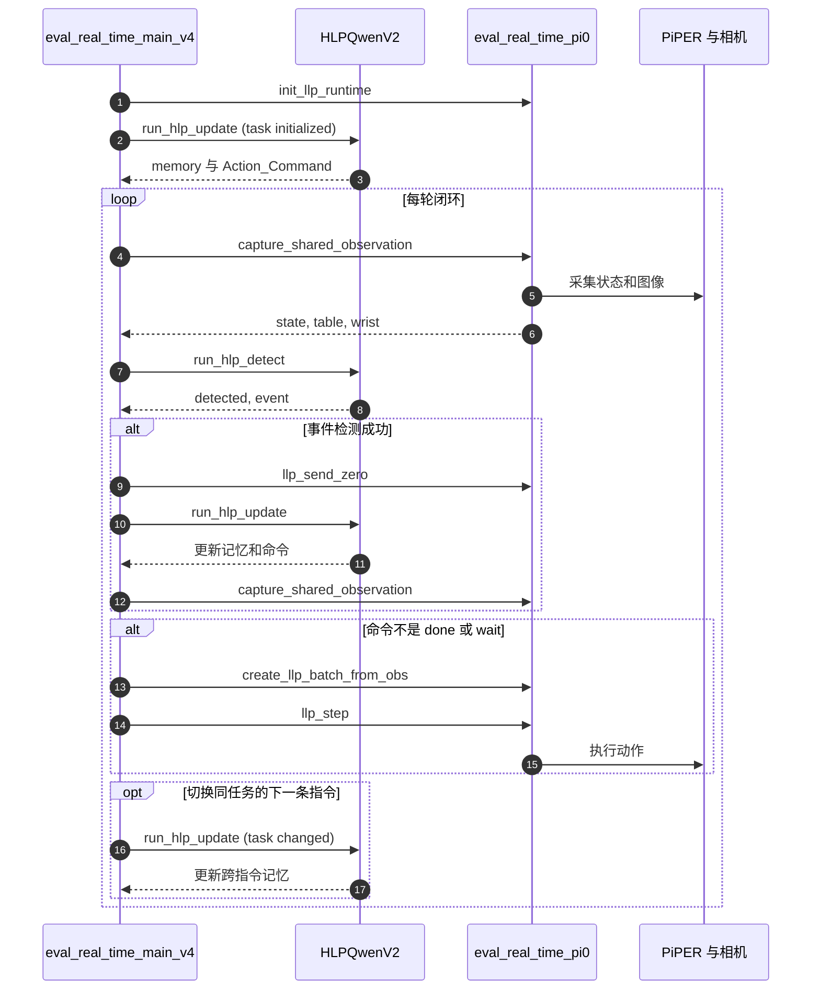

# HeLM：面向非马尔可夫操作的分层显式语言记忆
*HeLM: Hierarchical Explicit Language Memory for Non-Markovian Manipulation*

## 一句话定义

HeLM 将任务历史维护为可检查的语言状态，让高层模型决定下一项子技能，由低层动作策略完成实际操作。

## 英文缩写速查

| 缩写 | 英文全称 | 简要说明 |
|---|---|---|
| HeLM | Hierarchical Explicit Language Memory | 分层显式语言记忆 |
| HLP | High-Level Policy | 高层事件检测与记忆管理 |
| LLP | Low-Level Policy | 低层动作执行 |
| VLM | Vision-Language Model | 视觉语言模型 |
| VLA | Vision-Language-Action | 视觉语言动作模型 |
| QLoRA | Quantized Low-Rank Adaptation | 量化低秩适配 |

## 为什么重要

按完红色按钮后，按钮回弹；相同的 RGB 观察无法指明红色按钮是否已经按过。给定红→绿→蓝指令，机器人必须区分当前感知与已完成历史。这里的非马尔可夫性针对当前观察作为状态的不足，而非否定完整环境状态的马尔可夫描述。

## 核心信息

| 维度 | 信息 |
|---|---|
| 论文 | [arXiv:2611.02660v1](https://arxiv.org/html/2611.02660v1)，2026-11-02 |
| 机构 | 首尔大学（SNU） |
| 作者 | Gyeonghun Kim、Donghoon Kim、Minsoo Choi、Suyun Lee |
| 项目页 | [HeLM](https://kimspacehuni.github.io/HeLM/) |
| 代码 | [官方 GitHub](https://github.com/kimspacehuni/HeLM) |
| 真机 | AgileX PiPER，工作区与腕部 RGB 相机 |

## 核心原理

- 工作记忆记录当前指令进度；情景上下文在指令变更时继承相关摘要，工作记忆随新任务重置。
- 高层 Qwen2.5-VL-7B 共享参数、切换两套提示词：DETECT 从观察与记忆判断事件，UPDATE 仅在事件或指令改变时改写记忆与下一动作命令。
- 低层 π0 由当前观察与动作命令生成动作；真机每 10 个 LLP 步同步调用 HLP。
- TaskSpec 规定事件/动作词表与训练状态转移；短子任务视频可与不同语言记忆组合得到监督样本。约 13 万训练帧，QLoRA rank 16。推理使用任务词表，但不直接读取真实转移答案。

### 流程总览

### 按键示例

指令红→绿→蓝：检测红键事件后，将进度记为红，命令切换至绿；再检测绿键事件后切换至蓝。若检测返回 none，继续执行当前命令而不凭动作指令本身增加计数。跨任务累计按键时，上一指令的次数保留到情景上下文，以计算还需按几次。

## 源码运行时序图

入口为 `evaluate/eval_HLP_LLP/eval_real_time_main.py`；实际源码先处理键盘事件，再取共享观察、检测、按需更新、执行。UPDATE 输出会校验 Action_Command 是否位于允许列表。上图为接口级静态阅读，未执行设备验证。

## 实验与评测

| 指标 | HeLM | 对照 |
|---|---:|---:|
| 真机任务内子任务成功率 | 85.7% | Keyframe-HLP 72.9% |
| 真机任务内严格成功率 | 81.3% | Keyframe-HLP 29.3% |
| 跨指令子任务成功率 | 89.2% | Keyframe-HLP 16.6% |
| 未见子任务组合成功率（子任务） | 78% | Keyframe-HLP 65.7% |
| LIBERO-Mem 平均成功率 | 58.5% | π0.5 36.5% |

10 项真机任务共 56 种变体，每种 5 次试验。严格成功同时要求顺序与终止正确；跨指令实验排除了会重置内部状态的两个 π0 基线。真实实验两阶段推理相对单阶段 85.7% vs 67.7%。同一高层 backbone 的长程比较报告 8 事件峰值 VRAM 小于 6 GB vs 28 GB，长程推理最快约 2.5 倍；并非所有任务均获得该加速。

## 结论

**显式语义记忆有利于离散事件驱动的长程操作，重点是任务状态的可靠更新，而非单纯扩大视觉历史缓存。**

1. 对计数、顺序和跨任务召回，分别测试历史状态的可用性。
2. 评估严格成功率和终止条件，不以部分进度代替任务完成。
3. 事件误报会污染记忆；将检测、动作执行和记忆更新分别记录。
4. 对延迟、显存及基线使用同等硬件与观察协议比较。

## 与其他工作对比

| 工作 | 记忆机制 | 取舍 |
|---|---|---|
| HeLM | 事件驱动语言状态 | 可检查；依赖预定义事件及检测准确性 |
| [STVLA](./paper-stvla-spatial-temporal-memory.md) | 几何增强的有界视觉时序记忆 | 保留空间证据，需检索历史 |
| [EventVLA](./paper-eventvla-visual-evidence-memory.md) | 稀疏视觉证据 | 对照显式文字与视觉记忆的接口差别 |

## 工程实践

- 开源边界：官方 README 提供训练、数据处理与真机代码，51 个 TaskSpec 配置（论文评测 56 个变体）；完整评测轨迹不在仓库内，权重未核实。
- 复现：先用 TaskSpec 和 HLP 验证脚本检查事件与 YAML 更新，再连接 π0 checkpoint 与真机；具体入口见[源码归档](../../sources/repos/helm.md)。
- 部署建议（非论文结果）：记录事件误报/漏报、更新前后状态、命令有效性和停止条件；独立验证急停、碰撞与接触约束。

## 局限与风险

预定义事件不能覆盖任意开放任务；离散文本难以表示连续量或精确几何历史。同步块边界检测可能错过瞬态事件；误更新缺少自纠正机制。论文尚未独立验证双记忆字段相较单一持久语言记忆的收益。失败中检测占 64.1%、低层执行占 31.2%（为失败类型占比，不是任务失败率）。

## 关联页面

- [VLA](../methods/vla.md)
- [STVLA](./paper-stvla-spatial-temporal-memory.md)
- [EventVLA](./paper-eventvla-visual-evidence-memory.md)
- [VLA 纵深路线 Stage 4](../../roadmap/depth-vla.md)

## 参考来源

- [论文归档](../../sources/papers/helm-arxiv-2611-02660.md)
- [项目页归档](../../sources/sites/helm.md)
- [源码归档](../../sources/repos/helm.md)
- [原文 HTML v1](https://arxiv.org/html/2611.02660v1)

## 推荐继续阅读

- [论文 PDF](https://arxiv.org/pdf/2611.02660v1)
- [官方代码与 README](https://github.com/kimspacehuni/HeLM)
