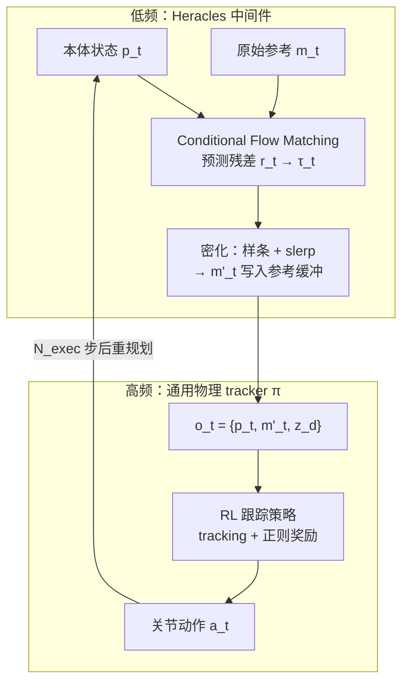

# Heracles：跟踪精度与生成式恢复的扩散中间件

**Heracles**（*Bridging Precise Tracking and Generative Synthesis for General Humanoid Control*，[arXiv:2603.27756](https://arxiv.org/abs/2603.27756)，[项目页](https://heracles-humanoid-control.github.io/)）由 **X-Humanoid Heracles Project Team** 提出：不把通用控制压成单一 rigid tracker，也不依赖显式 **tracking ↔ recovery** 状态机，而在两者之间加入 **状态条件生成中间件**，把控制从「刚性跟踪范式」推向 **开环生成 + 闭环物理执行** 的统一架构。

## 一句话定义

在高层参考轨迹与底层通用物理跟踪器之间插入一个条件 Flow-Matching **残差生成中间件**：正常跟踪区近似输出零残差（近恒等透传以保精度），当本体发生剧烈扰动或跌倒偏差时自动切换为类人恢复轨迹生成器并滚动重规划。

## 英文缩写速查

| 缩写 | 英文全称 | 简要说明 |
|------|----------|----------|
| OOD | Out-of-Distribution | 分布外样本/未见场景，泛化评测关注点 |
| MoCap | Motion Capture | 动作捕捉，参考动作与演示数据的主要来源 |
| BFM | Behavior Foundation Model | 大规模行为数据预训练的可复用全身行为先验 |
| WBC | Whole-Body Control | 协调全身关节满足多任务/约束的控制基础设施 |
| AMP | Adversarial Motion Prior | 用对抗判别约束状态转移接近专家运动分布的先验 |
| RL | Reinforcement Learning | 通过与环境交互最大化长期回报来学习策略的范式 |
| DoF | Degrees of Freedom | 自由度，人形通常 20–50+ 关节 |
| MDP | Markov Decision Process | 状态–动作–奖励–转移的标准序贯决策建模框架 |
| Sim2Real | Simulation to Real | 把仿真中学到的策略迁移落地真机的工程主线 |

## 为什么重要

- **直击 tracking 的 OOD 脆弱性：** [SONIC](./nvidia-sonic.md)、[BeyondMimic](../methods/beyondmimic.md) 等在大规模 MoCap 上极强，但严重扰动时盲目最小化即时 kinematic 误差易产生**非类人、不可恢复**的扭矩模式——Heracles 用生成先验**改写**即将执行的参考缓冲，而非仅加重 tracking 权重。
- **与 BFM 路线正交：** [BFM](./paper-behavior-foundation-model-humanoid.md) 等 **无参考** 生成式 WBC 擅自然行为但难保精确时空跟踪；Heracles **保留专用 tracker**，生成层只在偏差大时介入。
- **与 SD-AMP 对照：** [SD-AMP](./paper-unified-walk-run-recovery-sdamp.md) 在 **单策略 RL** 内用双 AMP 判别器；Heracles 是 **分层系统**（middleware + tracker），更接近「规划改参考 + 高频跟踪执行」。
- **隐式模式切换：** 条件于 $(\mathbf{p}_t,\mathbf{m}_t)$ 的 flow 模型在名义区近似 **identity map**，OOD 区变为 **generative synthesizer**——无需手调切换阈值（与 SD-AMP 的训练期 $|g_z+1|$ 门控形成方法论对比）。

## Survey 坐标（策展索引）

### 在 42 篇 RL 运动控制身体系统栈中

| 字段 | 内容 |
|------|------|
| 编号 | 40/42 |
| 系统栈层 | 05 接触 · 柔顺 · 安全恢复 |
| 索引来源 | [具身智能研究室 · 42 篇 humanoid RL 运动控制长文](https://mp.weixin.qq.com/s/hz9JXtJeUPRfUGzfD-pZuA) |

## 流程总览

## 核心机制（归纳）

### 1）残差轨迹与「恒等 / 生成」统一

基线锚定在现状态 $\bm{\beta}_{t,k}=\mathbf{p}_t$，只预测残差 $\mathbf{r}_t$，$\bm{\tau}_t=\bm{\beta}_t+\mathbf{r}_t$。当 $\mathbf{p}_t\approx\mathbf{m}_t$ 时，最优残差接近 0，中间件近似透传参考；大偏差时残差编码**多步协调恢复**，目标命令 $\mathbf{m}_t$ 仅通过条件向量进入，避免绝对坐标预测浪费容量在 identity 上。

### 2）Flow matching + 推理技巧

- 训练：线性概率路径 + 速度场 MSE（连续 flow matching）。
- **网络与规模**：`22.9M` 参数 6 层 4 头 512 维 **AdaLN-Transformer**（在 `25 Hz` / $N_{\mathrm{exec}}=2$ 步规划 $\Delta t=0.2\text{ s}$ 内 $K=8$ 关键帧残差）；首 token inpainting 保证与 $\mathbf{p}_t$ 运动学连续。
- **推理加速**：**directional warm start**——以 $\mathbf{p}_t\to\mathbf{m}_t$ 线性插值构造 $\mathbf{r}^{\mathrm{init}}$，从 $t_{\mathrm{start}}=0.9$ 加噪后仅需 **5 步 Euler ODE** 积分即可完成重规划；叠加非对称起始状态噪声增强与近似 $J^\top J$ 雅可比权重。

### 3）闭环 receding-horizon

固定规划窗 $\Delta t=0.2\text{ s}$ 与执行间隔 $N_{\mathrm{exec}}=2$；长程恢复靠** successive replan** 涌现，不要求单次预测整条跌倒–站起轨迹。底层 tracker 观测、奖励形式与训练时一致，仅将 $\mathbf{m}_t$ 换为 middleware 输出的 $\mathbf{m}'_t$（支持 38D 全状态与无全局位置 35D 纯本体部署）。

### 4）底层 tracker 与 token 设计

论文 §3.3 采用 **50 Hz RL 策略 → 200 Hz PD** 跟踪 10 帧本体历史与三次样条/slerp 密化参考，引入 **iFSQ**（$f(x)=2.0\sigma(1.6x)-1$ 奇数级量化含精确零点）编码运动 token $\mathbf{z}_d$，在单张 A100 上 16,384 并行环境以非对称 PPO 训练；细节以 [PDF](https://arxiv.org/pdf/2603.27756) 为准。

## 工程实践

| 项 | 核查与工程边界（2026-11-20 复核） |
|----|----------------------------------|
| **开源状态** | **未开源** — 官方项目页（[heracles-humanoid-control.github.io](https://heracles-humanoid-control.github.io/)）`Code (Coming Soon)` 仍未释放仓库或模型权重 |
| **推理加速手段** | 采用 directional warm start（从 `t_start < 1` 线性插值构造初始残差）配合 AdaLN-Transformer + 首 token inpainting，缩减 ODE 采样步数以匹配低频重规划节拍 |
| **底层接口兼容性** | 底层 RL tracker（29 DoF + FSQ 运动 token）仍吃统一参考接口，只是把原始 `m_t` 替换为中间件输出的密化参考 `m'_t` |
| **源码运行时序图** | **不适用**（见下一节） |

## 源码运行时序图

**不适用：截至 2026-11-20 复核，项目页与 `arXiv:2603.27756v2` 均未公开可运行代码仓库或策略权重。** 因此不构想源码调用图；中间件与高频跟踪环耦合结构见上方「流程总览」。

## 局限与风险

1. **Heracles 取代 tracker（误区）：** 中间件**不直接输出扭矩**；物理可行性仍由 RL tracker 保证。
2. **等于开环 MDM（误区）：** 运动扩散模型（如 HY-Motion）缺接触与扭矩约束；Heracles 输出进 **closed-loop MDP**。
3. **等于 BeyondMimic 测试时 guidance（误区）：** BeyondMimic 在跟踪 formulation 内加 classifier guidance；Heracles 是**独立 middleware + 状态条件 flow**，按 $\mathbf{p}_t$ 实时改参考缓冲。
4. **未开源复现障碍：** 截至 2026-11-20 `Code (Coming Soon)` 仍占位，AdaLN-Transformer 与底层 29-DoF tracker 尚无官方复现代码与权重。

## 实验与评测

基于 29-DoF Unitree G1 的 MuJoCo 101 条未见序列评测（`arXiv:2603.27756v2` Table 4–6）及真机部署：

- **通用跟踪（Table 4）：** 完成率 **CR = `90.6%`**，优于独立 VQ-VAE（`86.0%`）、MLP（`84.8%`）、SONIC（`79.3%`）与无中间件 iFSQ（`87.2%`）；相对独立 iFSQ 根朝向误差下降 **24.5%**（`0.3614 -> 0.2728 rad`）、高度误差下降 **20.0%**（`0.0955 -> 0.0764 m`）。
- **跌倒恢复子集（Table 5）：** 完成率 **CR = `90.0%`**，显著领先 VQ-VAE（`69.8%`）、iFSQ+H（`52.7%`）、iFSQ（`48.2%`）、MLP（`44.0%`）与 SONIC（`42.8%`），关节位置误差压低至 `1.4114 rad`。
- **消融与真机验证（Table 6 / Fig. 4 & 7）：** 去掉非对称噪声增强 CR 跌至 **`78.6%`**（`-13.2%`），去掉雅可比权重跌至 **`82.1%`**（`-9.4%`），去掉 directional warm start 跌至 **`87.2%`**（`-3.8%`）；G1 真机完成走跑、踢腿、360° 旋踢及仰卧/侧卧/俯卧全向起身。

## 结论

**真正重要的是「状态条件改参考」分层：名义区近恒等保跟踪，OOD 区生成恢复；次要的是是否手调 tracking↔recovery 状态机。**

1. **中间件不取代 tracker** — 只改写参考缓冲 \(\mathbf{m}'_t\)，物理可行性仍由底层 RL tracker 保证；不要当成直接出扭矩的 MDM。
2. **残差轨迹统一恒等/生成** — \(\mathbf{p}_t\approx\mathbf{m}_t\) 时残差近 0（透传）；大偏差时残差编码多步协调恢复，避免把容量浪费在绝对坐标 identity 上。
3. **闭环靠 successive replan** — 固定规划窗 + \(N_{\mathrm{exec}}\) 执行间隔；不要求单次预测整条跌倒–站起轨迹。
4. **选型坐标** — 相对 [BFM](./paper-behavior-foundation-model-humanoid.md) 保留专用 tracker；相对 [SD-AMP](./paper-unified-walk-run-recovery-sdamp.md) 是 middleware+tracker 分层，而非单策略双判别器门控。
5. **量化/消融读原文** — 本页评测节未抄表；仿真与真机数字以 PDF / 项目页为准。

## 与其他工作对比

- 正文已给出与相邻路线 / baseline 的 **定性对照**；定量表格与 ablation 见原文（[参考来源](#参考来源)）。

## 参考来源

- [Heracles 论文归档（arXiv:2603.27756）](../../sources/papers/heracles_humanoid_diffusion_arxiv_2603_27756.md)
- [Heracles 项目页](../../sources/sites/heracles-humanoid-control.md)
- [humanoid_rl_stack_40_heracles_bridging_precise_tracking_and_generativ.md](../../sources/papers/humanoid_rl_stack_40_heracles_bridging_precise_tracking_and_generativ.md) — 42 篇栈策展摘录
- [humanoid_rl_stack_42_catalog.md](../../sources/papers/humanoid_rl_stack_42_catalog.md) — 42 篇总表
- [wechat_embodied_ai_lab_humanoid_rl_motion_survey.md](../../sources/blogs/wechat_embodied_ai_lab_humanoid_rl_motion_survey.md) — 微信公众号编译导读

## 关联页面

- [人形 RL 身体系统栈](../overview/humanoid-rl-motion-control-body-system-stack.md) — 42 篇栈总框架（本文 #40/42）
- [AMP 运动先验专题](../overview/humanoid-amp-motion-prior-survey.md) — 姊妹篇总览
- [人形运动跟踪方法选型](../queries/humanoid-motion-tracking-method-selection.md)
- [SONIC](./nvidia-sonic.md)、[BeyondMimic](../methods/beyondmimic.md)、[扩散运动生成](../methods/diffusion-motion-generation.md)
- [BFM 人形基础模型](./paper-behavior-foundation-model-humanoid.md)、[SD-AMP](./paper-unified-walk-run-recovery-sdamp.md)
- [ETH G1 扩散全身 locomotion](./paper-hrl-stack-27-learning-whole-body-humanoid-locomot.md) — 同为「生成参考 + RL 跟踪」分层，侧重 **地形感知 loco** 而非 recovery 中间件
- [Balance Recovery](../tasks/balance-recovery.md)
- [真机安全 RL 微调](../concepts/safe-real-world-rl-fine-tuning.md) — 生成式兜底作为真机微调三路径之一
- [X-Humanoid（北京人形机器人创新中心）](./x-humanoid.md) — 机构与开源入口 hub

## 推荐继续阅读

- [机器人论文阅读笔记：Heracles](https://imchong.github.io/Robot_Learning_Paper_Notebooks/papers/04_Loco-Manipulation_and_WBC/Heracles__Bridging_Precise_Tracking_and_Generative_Synthesis_for_General_Humanoid_Control/Heracles__Bridging_Precise_Tracking_and_Generative_Synthesis_for_General_Humanoid_Control.html)
- [Heracles 项目页](https://heracles-humanoid-control.github.io/) — 演示视频与 BibTeX
- [arXiv:2603.27756](https://arxiv.org/abs/2603.27756) — 完整方法与 tracker 细节
- Lipman et al., *Flow Matching for Generative Modeling* — 中间件训练目标背景
