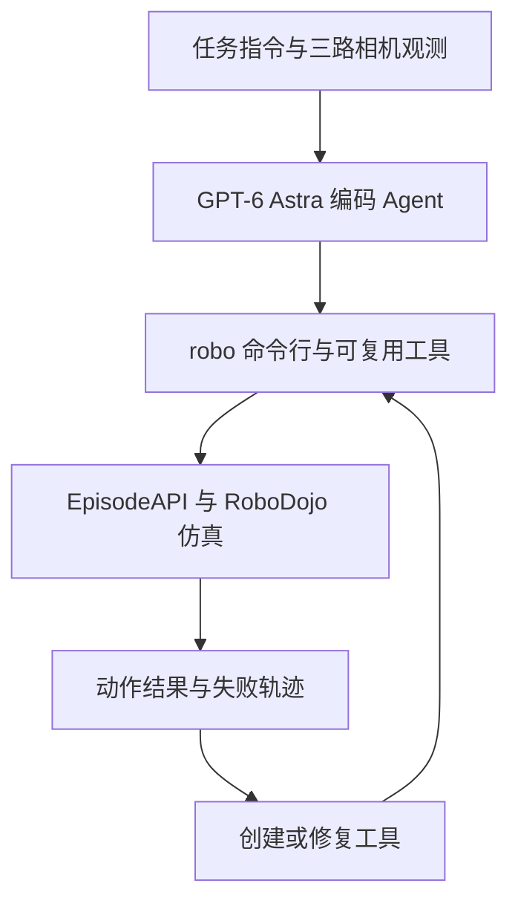
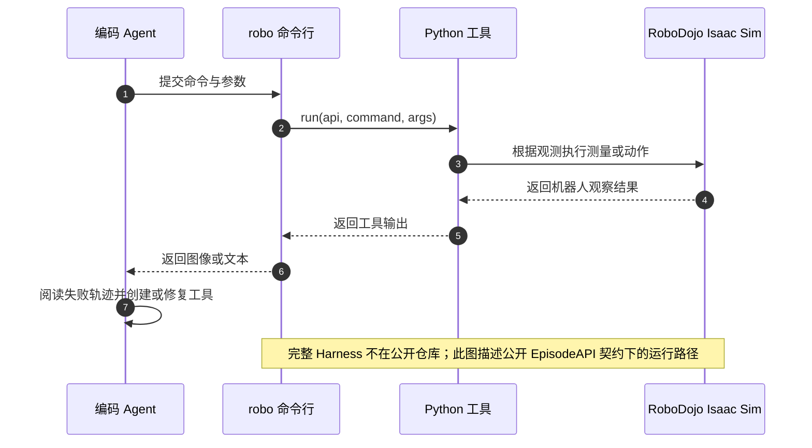

# HexaShell（VLM 机器人编码 Agent Harness）

**HexaShell** 是一套面向 RoboDojo 双臂操纵任务的轻量 Harness：视觉语言模型（VLM）编码 Agent 通过一个机器人命令行观察环境、调用 Python 工具并执行动作；失败轨迹可用于编写或修复工具，再把工具复用于后续任务。

## 英文缩写速查

| 缩写 | 英文全称 | 简要说明 |
|------|----------|----------|
| VLM | Vision-Language Model | 根据视觉与文字指令进行推理的模型；此处由编码 Agent 驱动 |
| CLI | Command-Line Interface | Agent 调用机器人动作和工具的统一命令行入口 |
| RGB | Red-Green-Blue | 三路已标定相机提供的彩色图像观测 |
| API | Application Programming Interface | EpisodeAPI 定义工具如何请求观测和发出动作 |

## 为什么重要

HexaShell 把“机器人会做什么”从一次性提示词输出，转为可以持续编辑、测试、复用的工具代码。它让编码 Agent 能在具身任务中利用执行反馈逐轮改进，还把系统边界压到一个命令行、相机图像和短手册。

它也展示了一个重要工程取舍：薄 Harness 减少了任务专用胶水，但系统能力仍受几何观测、工具实现质量和接触动作精度限制。RoboDojo 结果不能直接外推到真实机器人。

## 方法栈

1. **提供观察与接口：** Agent 接收任务指令、任务 recipe、简短工具说明，以及三路 RGB 相机图像和标定信息。
2. **执行工具命令：** Agent 通过 `robo` 命令行请求测量、移动或抓取；工具只能依据机器人可观察的信息运行。
3. **把失败转成代码改进：** 操作失败后，同一模型的修复 Agent 阅读执行轨迹，创建或修复小型 Python 工具；工具与单元测试一起迭代。
4. **冻结并评测：** 论文先在每任务一个 seed 的 10 个布局上开发，再冻结工具，在同一 seed 的另 10 个布局上测试。系统驱动 RoboDojo 的双臂 ARX X5 仿真任务。

### 流程总览

## 实验与评测

| 评测口径 | 设置 | 成功率 | 进度分 |
|----------|------|------:|------:|
| RoboDojo 官方评测 | 隐藏 seed；42 项任务每项 50 episodes；README 报官方评测榜首 | **46.9%**（截图为 46.85%） | **53.2** |
| 论文新布局复测 | 作者机器；开发集之外的 10 个布局，覆盖 42 项任务 | **39.7%** | **48.0** |

官方 README 还报告了能力分布差异：Memory 任务成功率 81.0%，Precision 任务 32.0%；在包含额外桌面物体的 cluttered 条件下，整体成功率从 38.0% 降至 31.0%。这说明高总分不代表精细接触任务已解决。

## 与其他工作对比

- **相对学习策略：** HexaShell 用 VLM 编码 Agent 及其逐步编写的工具控制机器人；它不是通过强化学习或模仿学习训练出的固定策略。官方分数与学习策略的比较须确认模型、场景、接口和排行榜评测协议相同。
- **相对 RoboDawn：** [RoboDawn](./paper-robodawn.md) 也用冻结视觉模型在 RoboDojo 上执行任务，但采用预定义工具 / 一次性任务处理路线；HexaShell 的重点是失败后修改并积累可复用的代码工具。比较成功率前应对齐 Agent、布局和评测批次。
- **分数口径：** 论文新布局复测的 39.7% 与项目 README 所述官方评测 46.9% 不是同一组布局和运行流程，不应直接视为复现偏差或性能涨幅。

## 结论

**一句话总判：** HexaShell 的关键贡献是让机器人 Agent 把失败转成可复用的工具代码；榜单高分证明了仿真中编码 Agent 的潜力，不代表它已具备通用真机操作能力。

1. **区分评测结果** — 论文 39.7% / 48.0 是新布局复测；README 的 46.9% / 53.2 是官方评测，两者要分开引用。
2. **工具可复用但并非零工程** — Agent 仍需开发观测几何、动作命令、接口契约和工具测试。
3. **接触精度是短板** — Memory 任务达到 81%，Precision 仅 32%；插入等高精度操作仍需要单独改进。
4. **代码发布不等于开箱复现** — 仓库公开工具与 EpisodeAPI，但完整 Harness、Agent 容器和工具进化循环未公开。

## 源码运行时序图

公开代码包括已冻结工具、Open 任务共享配置和 EpisodeAPI 接口；完整服务器、执行器、Agent 容器与进化循环不在仓库内。复现需要 RoboDojo Isaac Sim 运行环境及兼容 Harness。

## 局限与风险

- **评测以仿真为主：** 当前公开结果来自 RoboDojo / Isaac Sim，不能据此声称已在真实双臂机器人上达到同等表现。
- **部分开源：** 工具实现与接口开放，但系统 Harness 和 Agent 自动进化运行时不在代码仓库。
- **依赖模型与任务配置：** 论文报告使用 Codex + GPT-6-Astra；换模型、prompt 或工具版本会改变结果。
- **非精密接触专家：** 官方任务分布中 Precision 明显弱于 Memory；桌面杂物也会降低成功率。
- **Homepage 可访问性：** 仓库 README 链出的 HexaFuture 首页本次未能读取；具体技术与复现信息以仓库 README、代码和 arXiv 论文为准。

## 关联页面

- [RoboDojo](./robodojo.md) — 42 项仿真任务与官方评测口径。
- [RoboDawn](./paper-robodawn.md) — 冻结视觉模型 Agent 的 RoboDojo 参照路线。
- [COAP：具身图灵机与代码策略](./paper-coap-embodied-turing-machines.md) — 另一种用代码构成机器人策略的 RoboDojo 方法。
- [VLA](../methods/vla.md) — 视觉语言动作模型与机器人策略背景。
- [具身大模型评测基准选型闭环](../queries/embodied-eval-benchmark-selection-loop.md) — 评测基准在选型闭环中的定位与取舍

## 参考来源

- [HexaShell 论文摘录](../../sources/papers/hexashell_arxiv_2610_23479.md)
- [HexaShell 仓库归档](../../sources/repos/hexashell.md)
- [RoboDojo](./robodojo.md)

## 推荐继续阅读

- [HexaShell arXiv 论文](https://arxiv.org/abs/2610.23479)
- [HexaShell 官方代码仓库](https://github.com/HexaFuture/HexaShell)
- [RoboDojo 官方评测仓库](https://github.com/RoboDojo-Benchmark/RoboDojo)
