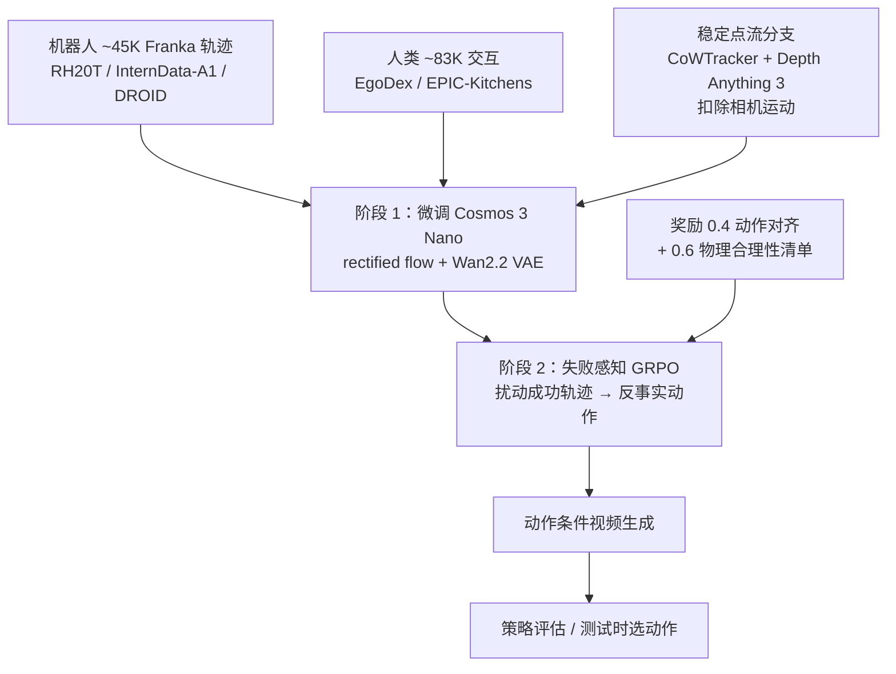

# HF-WM：向人类交互学习并建模失败动力学的世界模型

**HF-WM**（论文 *Beyond Successful Robot Demonstrations: Learning from Human Interactions and Modeling Failure Dynamics*，[arXiv:2610.13522](https://arxiv.org/abs/2610.13522)，[项目页](https://peiyantu.github.io/HF-WM/)）由 Zhejiang University、Beijing Zhongguancun Academy、USTC、Eastern Institute of Technology 与中科院自动化所的 Tu、Wang、Zhu、Jin、Chen 提出。它是一个动作条件视频世界模型，目标是两件事：吸收人类第一视角视频，以及学会“动作做错会怎样”。

## 一句话定义

**在 Cosmos 3 Nano 上，用人机共享的、已扣除相机运动的点流作辅助监督吸收人类视频，再用扰动成功示范得到的反事实动作做 GRPO 后训练，让世界模型能生成合理的失败。**

## 英文缩写速查

| 缩写 | 英文全称 | 简要说明 |
|------|----------|----------|
| HF-WM | （方法简称；全称未核对） | 本文世界模型 |
| GRPO | Group Relative Policy Optimization | 后训练算法，见 [GRPO](../methods/grpo.md) |
| FVD | Fréchet Video Distance | 视频分布距离，越低越好 |
| MMRV | Mean Maximum Rank Violation | 按真实成功率差加权的排名违例，越低越好 |
| VAE | Variational Autoencoder | 使用 Wan2.2 VAE |
| RoboArena | （真机策略评测平台） | 6 个策略的真实成功率用作参照 |

## 为什么重要

- **成功偏置：** 数据以成功示范为主，世界模型往往“倾向于想象成功”，评估策略时会高估。
- **人类视频可用化：** 人手与机械臂不同、相机还在动；稳定点流把这些差异压成共享运动表示。
- **评估用途：** 用世界模型代替真机跑策略评估，论文给出了与真实排名的对比。

## 方法栈 / 流程总览

## 方法

- **骨干与训练：** 微调 Cosmos 3 Nano（Mixture-of-Transformers 全模态模型，见 [Cosmos 3](./cosmos-3.md)），Wan2.2 VAE，rectified-flow 目标，两阶段，8 张 A100。
- **动作统一：** 动作映射到共享 2D 骨架空间（沿用 OSCAR 做法），文本提示固定。
- **点流分支：** 读取视频特征第 4/6/8/10 层的轻量分支，仅训练使用，推理无额外开销。稳定点流用 CoWTracker 跟踪、Depth Anything 3 估深度，再用数据集相机参数减去相机引起的运动；网格 24×42，81 帧片段下采样到 20 个监督步。
- **失败感知 GRPO：** 扰动夹爪状态/时机或末端位姿生成反事实动作；每样本 4 个 rollout，256×256，12 步去噪，40 帧；奖励 0.4 对齐 + 0.6 物理合理性。对齐奖励为带全局/末端裁剪两路和时间 Transformer 的成对打分器；合理性为 VLM（论文指明 Gemini 3.7 Flash）生成的 8 项清单，Tier-1 任一失败即淘汰。

## 实验与评测

- **视频生成**（100 条 DROID 保留轨迹 + 100 条真实失败轨迹；对比 Cosmos-Predict2.5、TesserAct、Ctrl-World、Cosmos 3、OSCAR、Kinema4D）：PSNR 26.077（OSCAR 23.357），SSIM 0.889（0.840），LPIPS 0.082（0.142），FVD 14.449（Kinema4D 30.511），FID 14.291（OSCAR 28.241）。
- **消融：** 仅具身 → +人类 → +稳定点流：PSNR 21.448 → 24.997 → 25.828，FVD 23.650 → 15.229 → 14.993；GRPO 奖励只用对齐 25.826 / 只用合理性 25.574 / 完整 26.077。
- **策略评估：** 6 个 RoboArena 策略 × 90 个匹配会话（540 次），GPT-5 判成败；成功率 Pearson r≈0.983、平均偏差≈2.41 个百分点、MMRV 0.002（来自一次预测并列）、Spearman ρ≈0.956、Kendall τb≈0.929。
- **测试时扩展（LIBERO-90）：** π0.5 每步 4 个动作块，HF-WM 预测未来、RoboMeter 打分选优；闭环成功率 27.8%→30.0%，回合长度 349.39→344.64 步。

## 源码运行时序图

不适用：论文与[项目页](../../sources/sites/hf_wm_project_page.md)都没有代码、权重或数据链接，截至 2026-10-12 无可对齐的仓库入口。

## 工程实践

- 复现需 Cosmos 3 Nano 权重、人机数据集（RH20T、InternData-A1、DROID、EgoDex、EPIC-Kitchens）、CoWTracker 与 Depth Anything 3 预处理。
- 点流分支只在训练中存在，部署推理成本与基础模型相同。
- 生成质量（FVD/PSNR）与策略评估是两种证据，需分别核对。
- 评估链路依赖外部 VLM/GPT-5 判官，换判官要重新验证排名一致性。

## 结论

**HF-WM 的主张是：人类视频 + 相机运动补偿点流提升生成质量，失败感知 GRPO 让世界模型能表达失败，二者合起来使其可用于策略排名。**

1. 去除相机运动的点流是人机共享的关键，人类数据与点流把 FVD 从 23.650 降到 14.993。
2. GRPO 完整奖励（0.4 对齐 + 0.6 合理性）PSNR 最高，单项奖励都略低。
3. 与真实排名的相关性很高，但只覆盖 6 个策略。
4. 测试时选动作的收益较小（27.8%→30.0%）。
5. 无代码，评估依赖 GPT-5 / Gemini 作判官。

## 局限与风险

- **开源：** 无公开代码、权重或数据（论文、项目页均未链接）。
- GRPO 降低了分辨率与去噪步数，rollout 保真度受影响（作者自述）；论文页无专门局限小节。
- 评估规模：6 个策略、DROID 与 RoboArena 场景；外推到其他机器人、长时程任务未验证。
- 失败只来自对成功轨迹的扰动，非真实失败分布；真实失败轨迹仅作评测（100 条）。

## 与其他工作对比

| 对照 | 读法 |
|------|------|
| [Cosmos 3](./cosmos-3.md) | HF-WM 的基座；表中也作为基线 |
| [世界-动作模型](../concepts/world-action-models.md) | WAM 关注用未来预测生成动作；HF-WM 偏评估与生成 |
| [生成式世界模型](../methods/generative-world-models.md) | 方法族 |
| [π0.5](./paper-pi05-open-world-vla.md) | 测试时扩展中被评估/选动作的策略 |
| OSCAR / Kinema4D / Ctrl-World | 视频生成表中的强基线 |

## 关联页面

- [34 篇空间落地技术图谱（汇总页）](../overview/embodied-station-34-papers-spatial-grounding-technology-map.md)
- [操作任务总览](../tasks/manipulation.md)
- [生成式世界模型](../methods/generative-world-models.md)
- [世界-动作模型](../concepts/world-action-models.md)
- [Cosmos 3](./cosmos-3.md)
- [GRPO](../methods/grpo.md)

## 参考来源

- [公众号盘点：具身智能小站 34 篇](../../sources/blogs/wechat_embodied_station_34_papers_spatial_grounding_2026-10-12.md)
- [hf_wm_arxiv_2610_13522.md](../../sources/papers/hf_wm_arxiv_2610_13522.md)
- [hf_wm_project_page.md](../../sources/sites/hf_wm_project_page.md)
- [arXiv:2610.13522](https://arxiv.org/abs/2610.13522)

## 推荐继续阅读

- [HF-WM 项目页](https://peiyantu.github.io/HF-WM/)
- [arXiv HTML 全文](https://arxiv.org/html/2610.13522v1)
