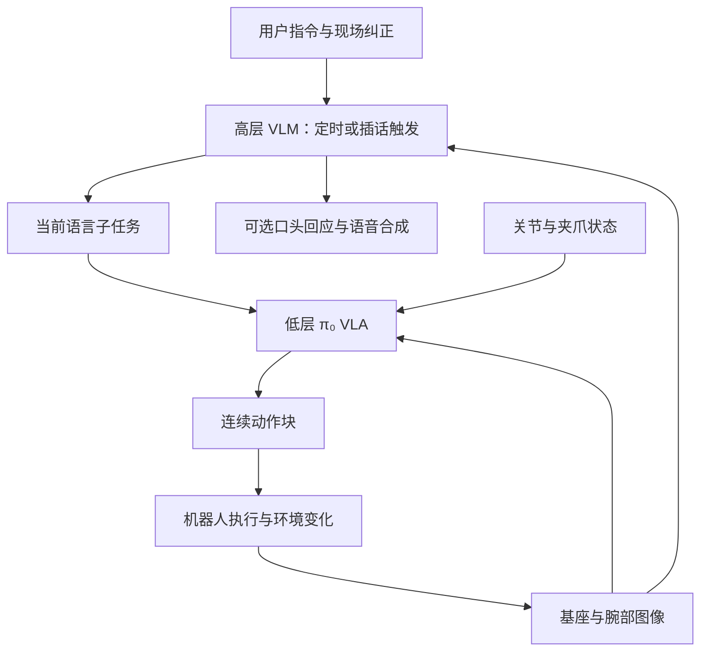

# Hi Robot: Open-Ended Instruction Following with Hierarchical Vision-Language-Action Models / 分层视觉语言动作模型的开放式指令遵循

**Hi Robot**（*Hi Robot: Open-Ended Instruction Following with Hierarchical Vision-Language-Action Models*，[arXiv:2502.19417](https://arxiv.org/abs/2502.19417)，[项目页](https://www.pi.website/research/hirobot)）由 **物理智能（Physical Intelligence）**、**斯坦福大学（Stanford）**、**加州大学伯克利分校（UC Berkeley）** 提出。高层策略与 π₀ 分别从同类 PaliGemma-3B 骨干初始化；其中高层负责把复杂提示和用户插话变成低层已经会做的短语言命令。

首发：2025-02-26；正式发表于 [ICML 2025，PMLR 267](https://proceedings.mlr.press/v267/shi25d.html)。本次通读版本为 arXiv v1（含附录 A/B）。

## 一句话定义

> **先用语言把任务说成下一步，再让 π₀ 动手；现场纠正改的是这句话，不是直接改关节。**

## 英文缩写速查

| 缩写 | 英文全称 | 简要说明 |
|------|----------|----------|
| VLM | Vision-Language Model | 高层「System 2」，输出下一步语言 |
| VLA | Vision-Language-Action | 低层 π₀，把短指令变成动作 |
| IL | Imitation Learning | 低层技能仍来自演示，不是本页新算法 |
| IA | Instruction Accuracy | 指令与意图、观测的一致性 |
| TP | Task Progress | 目标物体配置的完成比例 |

## 为什么重要

扁平 VLA 擅长练过的原子技能，遇到「素食三明治」或「那个不是垃圾」时，缺少把开放语句拆成已知技能的接口。Hi Robot 把网页预训练擅长的「看图回答下一步」留在语言空间，避免让连续动作头同时承担语义推理。π₀.₇ 后来用多模态提示调度行为；本页是更早的「高层语言、低层动作」分法。

## 核心原理

高层每秒或新插话到达时重新生成子任务；口头回应由高层输出，经语音合成播放，并在传给低层前移除。用户的语音先转录为文本。图为论文 §4 的系统数据流，不是已核验源码调用图。

训练：遥操作演示切分并标注短技能；生成用 VLM 根据图像、技能标签和已有步骤合成用户提示与回应。高层用交叉熵学习语言输出，低层沿 π₀ 用 flow matching 学动作。两级分别训练。

## 工程实践

| 项目 | 原文配置或复现边界 |
|---|---|
| 高层更新 | 1 秒周期，或用户新插话立即触发；未采用技能完成检测器 |
| 计算与语音 | 1–2 张 RTX 4090；Whisper large-v2 转录，外部 API 合成语音 |
| 机器人 | UR5e 单臂、ARX 双臂、Mobile ALOHA 基础的移动 ARX 双臂 |
| 训练组织 | 附录 A 明确本次按任务分别生成数据并训练高层；统一多任务高层是可扩展方向 |
| 开放状态 | 2026-11-07 官方页未列 Hi Robot 专属代码、权重、数据下载；openpi 不覆盖完整系统 |

## 评测

论文 §5.2：每任务每方法 20 次试验，由不知道当前方法的评估者打分。**IA** 衡量指令和用户意图、视觉状态的一致性；**TP** 衡量目标物体放置/配置的完成程度，两者均不同于整段任务成功率。

[官方图表归档](../../sources/sites/hirobot.md)保留三任务全部读数。Average 行：Hi Robot 为 **IA 76%、TP 81%**，GPT-4o 高层为 **30%、64%**，扁平 VLA 为 **36%、44%**。按展示整数计算，IA 分别高 **46、40 个百分点**；应区分百分点与相对比例。人类高层对照仍调用同一低层策略，并非独立机器人系统。

消融同时检查“去掉合成数据”与“扁平 VLA 使用相同合成数据”，支持数据和分层结构均有作用；这些作者自设任务不能直接当作公共基准排名。

## 结论

**开放指令和中途纠正适合先落成语言步骤；不要把这篇的准确率当成可复现的公共操作榜。**

- 低层仍是练过的 π₀ 技能，高层只改「下一步说什么」
- 合成提示是为了补多轮交互，不是额外的真机成功证明
- 与 [π₀.₇](../methods/pi07-policy.md) 的提示条件不同：这里高层在线生成语言，π₀.₇ 把多种提示写进同一个通才
- 复现需要合成数据方案和两级权重，openpi 只覆盖低层家族

## 与其他工作对比

| 对照 | 差异读法 |
|------|----------|
| 扁平 VLA（π₀ 直接吃完整提示） | 同一低层技能，但没有显式语言中间层；本页三任务平均指令跟随 36 vs Hi Robot 76 |
| GPT-4o 作高层 | 两级结构相同，高层换成未经机器人数据适配的 API VLM；三任务均低于 Hi Robot；官方 Average 行 IA 为 30% 对 76% |
| [π₀.₅](./paper-pi05-open-world-vla.md) | 同一模型内先出语义子任务、再高频出动作块，两层共享表示；Hi Robot 的高层单独推理，并专门处理用户插话与纠正 |
| [π₀.₇](../methods/pi07-policy.md) | 多模态提示写进同一个通才；Hi Robot 在线生成下一步语言 |
| [TacitVLA](./paper-tacitvla.md) | 同样解耦推理和动作等待，但 TacitVLA 在单个共享主干 + 动作专家中屏蔽当前推理 token；仅长程记忆任务异步写 ledger |

## 源码运行时序图

**不适用**。截至 2026-11-07，官方项目页未列 Hi Robot 训练、合成标注或推理实现入口。 [openpi](https://github.com/Physical-Intelligence/openpi) 可跑 π₀ 低层，不能代替本页的高层策略。

## 局限与风险

- 数字来自作者三类操作，换本体或换提示分布不能直接外推。
- §6 指出两级分开训练，对彼此能力的了解依赖训练样本，未显式耦合低层执行成功反馈。
- 合成交互依赖提示工程；按任务训练的高层不能当作一个已验证的统一通才。
- 截至核对日项目页未列专属实现、权重和数据下载。不要把 GPT-4o 高层对照读成「任意 API VLM 都差 40 个点」。

## 关联页面

- [π₀ 策略](../methods/π0-policy.md)
- [π₀.₇](../methods/pi07-policy.md)
- [VLA](../methods/vla.md)
- [TacitVLA](./paper-tacitvla.md) — 推理监督与动作等待解耦
- [操作任务](../tasks/manipulation.md)

## 参考来源

- [hirobot_arxiv_2502_19417](../../sources/papers/hirobot_arxiv_2502_19417.md)
- [Hi Robot 官方项目页与指标核查](../../sources/sites/hirobot.md)
- [PI 官网技术文章索引](../../sources/sites/pi-website-technical-articles.md)

## 推荐继续阅读

- [arXiv:2502.19417](https://arxiv.org/abs/2502.19417)
- [项目页](https://www.pi.website/research/hirobot)
