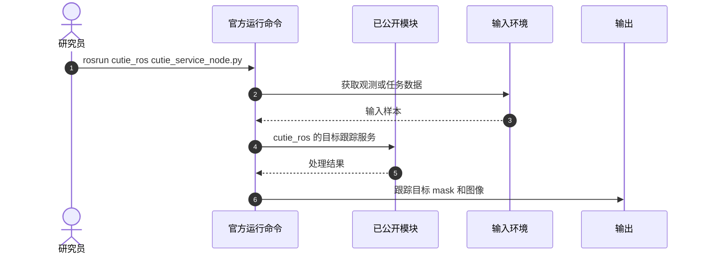

# Hibikino-Musashi@Home 2026 Team Description Paper｜Hibikino-Musashi@Home 2026 服务机器人整机报告

## 一句话定义

**Hibikino-Musashi@Home 2026 服务机器人整机报告**：以家庭服务机器人任务为线索，整合目标识别、语义地图、语言规划和低功耗动作识别。

## 英文缩写速查

| 缩写 | 英文全称 | 简要说明 |
|---|---|---|
| HSR | Human Support Robot | 丰田家用服务机器人 |
| FPGA | Field-Programmable Gate Array | 可编程逻辑器件 |
| ROS2 | Robot Operating System 2 | ROS 2 |

## 为什么重要

以家庭服务机器人任务为线索，整合目标识别、语义地图、语言规划和低功耗动作识别。 需要结合任务边界、数据/算力条件及作者真实实现来判断，而不是只看展示视频。

## 核心信息

| 证据项 | 官方信息 |
|---|---|
| 论文 | [arXiv:2611.16297v1](https://arxiv.org/abs/2611.16297) |
| 源码 | [作者仓库](https://github.com/Hibikino-Musashi-Home/cutie-ros)；仅限已发布模块 |

## 核心原理

HSR 服务机器人以 YOLO 或 Grounding DINO/NanoSAM 识别目标，Cutie 跟踪目标，RoomPlan 生成语义场景地图，LLM 规划任务；研究团队还在 FPGA 上用 reservoir computing 做动作识别。

### 流程总览

该图为研究问题与方法/控制流，实际软件调用须看源码时序图及开放边界。

## 源码运行时序图

官方源仓仅静态核验如下已发布模块运行入口；未执行硬件和训练复现。

**重要：** 图中仅表示论文引用的 Cutie 跟踪子模块，不代表完整服务机器人系统。

## 工程实践

1. 检查输入观察、动作/轨迹表示、数据来源和实验任务的部署条件是否一致。
2. 从[源码核查记录](../../sources/repos/hibikino-home-2026-2611-16297.md)确认公开模块的真实入口、依赖与输出。
3. 将仿真指标、真机成功率、推理延迟与安全/碰撞检查分开汇报。

## 实验与评测

原文给出团队硬件与软件描述及比赛结果，是整体工程系统说明而非新的统一训练算法定量对照。

## 结论

**以家庭服务机器人任务为线索，整合目标识别、语义地图、语言规划和低功耗动作识别。**

1. 先复核指标口径与论文约束，再比较其他策略或系统。
2. 将作者验证的模块和尚未发布/未复现的模块分开记录。
3. 把误差、失败模式与传感器/真实场景分布偏移作为后续验收依据。

## 局限与风险

可见 cutie-ros 代码对应 ROS Noetic 的目标跟踪子模块，不是整机 HSR 规划导航软件的可直接运行发布；不同 ROS 版本接入须另行验证。

## 关联页面

- [机器人视觉感知栈选型闭环](../queries/robot-perception-stack-selection-loop.md) — 对照目标检测、跟踪、语义建图和下游任务接口，区分已公开的 Cutie 跟踪模块与整机系统。
- [29 篇具身论文研究地图](../overview/embodied-frontier-29-papers-2026-11-16.md)
- [ManiLadder 操作任务难度分层](./paper-maniladder-manipulation-benchmark.md)

## 参考来源

- [论文原文归档](../../sources/papers/hibikino-home-2026-2611-16297.md)
- [官方源码核对](../../sources/repos/hibikino-home-2026-2611-16297.md)

## 推荐继续阅读

- [原始论文 HTML](https://arxiv.org/html/2611.16297v1)
- [代码仓库](https://github.com/Hibikino-Musashi-Home/cutie-ros)
