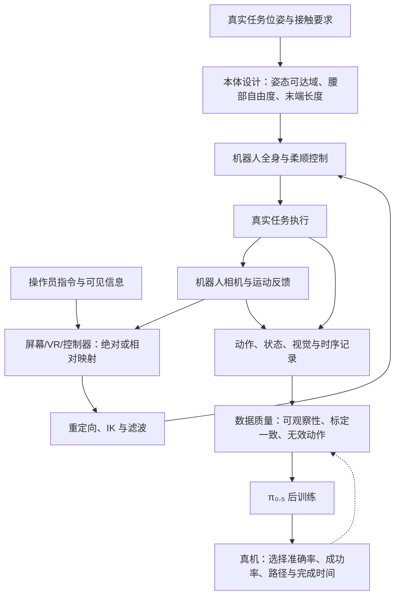

# 真机数据质量背后的隐藏变量 / Hidden Variables Behind Real-Robot Data Quality: Lessons from Hundreds of Thousands of Hours

**论文身份：** Maniformer Real-World Manipulation Team（智元机器人 AgiBot 觅蜂团队），arXiv:2611.22388v1（2026-11-17，Technical report）。[全文通读归档](../../sources/papers/hidden-variables-real-robot-data-quality-arxiv-2611-22388.md)。

## 一句话定义

本论文研究**采集系统如何决定真机示教是否可学**：本体可操作空间、遥操作控制接口、感知/标定/轨迹质量都可能把额外纠偏或不可观测的动作因果关系写入训练集，即便采集任务最终成功。

## 英文缩写速查

| 缩写 | 英文全称 | 简要说明 |
|---|---|---|
| IK | Inverse Kinematics | 在离散任务位姿上检验末端方向可行性与关节余量 |
| TCP | Tool Center Point | 末端工具实际操作点；延长距离会改变可达域和限位代价 |
| WBC | Whole-Body Control | 协调底盘、腰、头、双臂及末端的全身控制 |
| LOS / BLOS | Line-of-Sight / Beyond-Line-of-Sight | 现场直接观察与仅经机器人视角操作；影响决策证据是否入录像 |
| VLA | Vision-Language-Action | 在视觉、状态与指令条件下生成机器人动作的策略 |
| WAM | World-Action Model | 世界预测与动作联合建模的模型方向，受数据一致性影响 |
| DoF | Degrees of Freedom | 自由度，腰部 pitch/yaw 关系到任务姿态覆盖 |
| URDF | Unified Robot Description Format | 运动学分析使用的机器人结构模型 |

## 为什么重要

| 字段 | 一手信息 |
|---|---|
| 机构 | 智元机器人（AgiBot）Maniformer Real-World Manipulation Team |
| 论文/项目 | [arXiv v1](https://arxiv.org/html/2611.22388v1) / [AgiBot Teleoperation](https://teleop.agibot.com/) |
| 数据规模口径 | 作者 §3.3 台账约 **207,030 小时、20,253 项任务记录**；并非本次公开下载数据 |
| 研究设计 | **25** 款双臂机器人运动学；遥操作对照；**π₀.₅** 微调和真机评测 |

如果示教员可看到机器人相机没有录下的目标，模型只能猜为何选左臂/右臂；如果操作员为绕开时延和工作空间限制不断纠偏，策略也可能复制这些无效路径。因此，单看成功率和小时数不足以检验数据质量。

## 核心原理

### 方法流程总览（原文 Fig.1、§2–4）

图中是**论文实验因果结构的归纳**，不是公开源码的函数调用。三个质量门对应 §4.1–4.3：观察是否支持决策、状态/动作是否与部署标定对齐、轨迹是否含系统诱导的无效纠偏。

### 三类影响因素

| 环节 | 原文发现 | 工程读法 |
|---|---|---|
| 本体 | 位置可达不等于给定末端方向可达；肩部 15 cm 平移将特定截面放大 **3.4–5.5 倍**（§2） | 先验收任务方向覆盖与关节余量，再决策腰部/工具长度 |
| 遥操作 | 多身体部位并行可在测试任务中节省 **43%–53%** 中位完成时间（Table 2） | 减少操作模式切换，记录实际端到端时延与操作者负担 |
| 接触 | 开门峰值接触力 **120.5→34.6 N**（位置 vs 力控制，Table 3） | 对约束/连续接触优先验证柔顺与力峰，不把全任务等价成位置跟踪 |
| 可观察性 | 主动搜索示教的选臂准确率 **100%**，缺关键观察时为 **50%/53%**（Table 6） | 保留观察→决策→动作，不让遥操作员的额外视角成为隐性标签 |
| 标定 | 含 25% 与部署对齐的样本 + 75% 零位偏置样本，在测试精细阶段 **66.7%**；缺对齐样本对应 **26.7%**，部署端零位偏置测试 **0/30**（§4.2） | 批次记录零点、部署前姿态对表；不能用“平均偏置为零”替代一致性 |
| 冗余轨迹 | 80% 绕路污染时，策略保留约 **90%** 新增路径长度，执行时间 **25.3→32.6 s**（Table 7） | 加入路径效率、停顿、反向次数与 chunk 边界速度不连续质检 |

### 为何使用增量关节动作（附录 A）

假设第 i 台机器人记录关节角为 q_obs=q_true+b_i，且在同一条轨迹中 b_i 恒定，则相邻帧增量 **Δq_obs=q_obs(t+1)−q_obs(t)=Δq_true**。常数零位偏置在动作标签中相消，**但仍留在观测状态**；这不意味着部署机器人可不校准，也不保证绝对动作模型等价。

## 实验与评测

| 对照任务与口径 | 作者报告 | 正确解读 |
|---|---|---|
| 25 款双臂、10,075 位置、64 个方向离散 IK | 三类本体方向覆盖差异；工具长度 14.31→24.31 cm 时可达点 **2761→3851**（+39.5%） | 几何仿真，不是统一真机成功率排名 |
| 取地面物体到背后桌面/擦两块区域（各 30 次/配置） | **35.7→16.7 s / 27.0→15.3 s**（中位数） | 三组控制接口逐步增加自动化与并行 |
| 开门/擦白板/双手持箱（各 30 次/模式） | 力控制 **100%/100%/100%**；位置控制 **83.3%/80%/86.7%** | 四个指定任务，一名熟练操作者 |
| 遮挡目标的近臂选择（各 30 次） | **LOS-known 50%、BLOS-known 53%、BLOS-search 100%**；取放成功 **33%/40%/60%** | 决策前必须有实际观察，不只是让相机视角一致 |
| 试管交接插入（100 演示/混合组、30 次/测试） | Clean **63.3%**；25% Clean + 偏置 **66.7%**；无 Clean 偏置 **26.7%** | 单任务、特定偏置/动作表示；不是“标定错误无害” |
| 双臂搬方块（每组 100 演示） | 80% 绕路污染：策略多走 **0.194m**，末次释放时间 **32.6s**（干净 **25.3s**） | π₀.₅ 会部分平滑 jerk，但几乎复制额外路程 |

## 结论

**采数系统设计、示教质量和策略行为是一条因果链：应先做小规模下游真机验收再扩大采集，而非把成功轨迹全部视为高质量数据。**

1. **先查可执行性：** 以目标位置+工具方向+关节余量评估本体，不只统计末端能否摸到。
2. **优先减少系统诱发的纠偏：** 并行控制、柔顺控制和完整端到端延迟比单独追求毫秒级算法调用耗时更有意义。
3. **让策略看到行动依据：** 遮挡或盲区任务采集要包含主动观察和必要图像历史。
4. **保证部署零位对齐：** 混合历史数据可用性依赖训练表示、校准组合和与部署一致的基准样本；不能盲信零均值抵消。
5. **同时验收轨迹效率：** 检查冗余路程、chunk 交界速度偏差、反向次数和完成时间，不能只看 jerk 是否变平滑。
6. **看清外推边界：** 对照任务、操作员、π₀.₅ 及注入偏置设定有限；不把作者报告推广成全本体的定量规律。

## 工程实践

- **采前设计：** 用目标工位的末端位置/方向覆盖率和关节限位代价做形态选型；必要时优先增加腰部可动性，而不是无限加长工具。
- **采中监控：** 每条 episode 留相机视角、动作与状态时间戳、控制接口/映射模式、零位标定版本；监测操作员完成时间及重复纠偏。
- **采后质检：** 区分**任务必要**的主动探查/避障与**系统缺陷**带来的停顿和绕路；检查是否存在 action chunk 接缝及状态–动作错位。
- **上线验收：** 用小样本 π₀.₅ 或自有目标策略在真机分别测选臂正确率、接触峰力、轨迹长度、任务时长与错误恢复；不要仅用采集小时数验收。
- **开放状态：** 2026-11-19 查验[官方项目页](https://teleop.agibot.com/)及[论文 v1](https://arxiv.org/html/2611.22388v1)，**未发现本研究训练/推理代码或实验数据集下载入口**；项目页链接的其他研发方向不等于本论文复现资源。

## 源码运行时序图

**不适用（截至 2026-11-19）**：论文与官方网站未列出可核验的本论文可运行训练/推理/部署代码仓库，因此不能将上面的概念流程图冒充源码时序；若后续发布，请核对 README 入口与真实模块再补 sequenceDiagram。

## 与其他工作对比

- [Embodied Data Cleaning](../concepts/embodied-data-cleaning.md)关注采后时序对齐、过滤、分段；本论文进一步指出**采集系统造成的错误应尽量在数据产生前消除**。
- [Motion Data Quality](../concepts/motion-data-quality.md)聚焦物理可行性/接触/形态差距；本论文补足决策可观测性、关节零点一致性、操作延迟与动作冗余的下游策略证据。
- [Teleoperation](../tasks/teleoperation.md)覆盖遥操作接口、硬件与方法谱系；本论文把选型指标连接到**可学性和真机策略表现**。

## 局限与风险

- 25 款本体比较基于 URDF 和离散 IK，未穷尽碰撞、动力学和真实硬件限制；各形态的“最优桌高”并非统一工位。
- 控制与外设测试的操作者、任务和设备配置有限，VR 不适时长实验还排除了指定异常值；不是人因学普适定量结论。
- 数据质量结果聚焦 **π₀.₅、delta joint action、部分单次训练与注入的零位偏置**；不同策略、绝对动作接口、视觉不足的接触任务可能呈现其他结果。
- 零位偏置训练混合可容忍的个案不能消除实际设备逐关节标定要求；30/30 失败仅指论文中那组部署错位试验。
- 官网 200k+ 小时与论文 207,030 小时为各自披露口径，**未验证这些数据已公开**，不能当作可下载数据集。

## 关联页面

- [遥操作任务](../tasks/teleoperation.md)
- [具身数据清洗](../concepts/embodied-data-cleaning.md)
- [动作数据质量](../concepts/motion-data-quality.md)
- [行为克隆](../methods/behavior-cloning.md)
- [具身数据纵深 Stage 2](../../roadmap/depth-embodied-data.md)
- [遥操作纵深 Stage 2](../../roadmap/depth-teleoperation.md)

## 参考来源

- [原论文 HTML v1、表格与附录通读归档](../../sources/papers/hidden-variables-real-robot-data-quality-arxiv-2611-22388.md)
- [官方遥操作项目页面与代码/数据开放核查](../../sources/sites/agibot-teleop-data-quality.md)

## 推荐继续阅读

- [原论文 HTML v1](https://arxiv.org/html/2611.22388v1)
- [AgiBot Teleoperation 官方网站](https://teleop.agibot.com/)
- [论文 PDF](https://arxiv.org/pdf/2611.22388)
