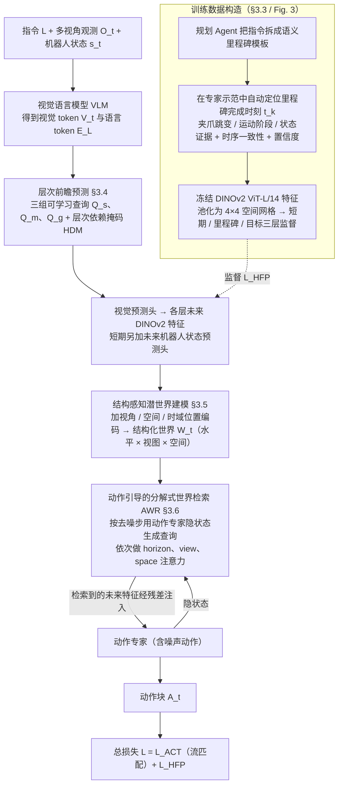

# HiFOR：面向视觉语言动作模型的分层未来预测与动作引导世界信息关联

**HiFOR**（*HiFOR: Hierarchical Foresight with Action-Guided World Grounding for Vision-Language-Action Model*，[arXiv:2610.40373](https://arxiv.org/abs/2610.40373)）收录于 senlanke「具身运控lab」10-26–10-30 前沿论文动态（Manipulation）。本页依据**周报条目 + arXiv 摘要页**整理，未逐页核对正文 PDF；指标与结论以论文为准。

## 一句话定义

**HiFOR：面向视觉语言动作模型的分层未来预测与动作引导世界信息关联——提出分层未来预测框架，同时预测短期状态、语义里程碑和最终目标。通过结构化潜在世界表示组织不同时间尺度的信息，再由动作生成过程动态检索相关未来特征，减少无关预测信息对动作决策的干扰。**

## 英文缩写速查

| 缩写 | 英文全称 | 简要说明 |
|------|----------|----------|
| VLA | Vision-Language-Action | 视觉–语言–动作模型 |
| IL | Imitation Learning | 模仿学习 |

## 为什么重要

- 周报所述待解决的问题：VLA 引入未来状态预测后，短期动作变化与长期任务目标通常分别建模。预测得到的大量未来信息也不一定与当前动作有关。

## 流程总览

图依据：论文 §3.1–3.6、式 (12) / Fig. 2、Fig. 3。

## 核心机制

| 项 | 内容 |
|----|------|
| **arXiv** | [2610.40373](https://arxiv.org/abs/2610.40373) · [PDF](https://arxiv.org/pdf/2610.40373) |
| **作者（arXiv）** | Ding, Rongxing, Qu, Hongyu, Wu, Kehong, Wang, Xudong, Zhang, Fan, Xiang, Xinguang, Shu, Xiangbo |
| **机构（周报所述，未逐条核实）** | 南京理工大学、新加坡国立大学等。 |
| **arXiv 评论栏** | （无） |
| **开源** | arXiv 摘要页与评论未见代码或项目页链接（仅核对 arXiv 摘要页，不代表未发布）（2026-11-02） |
| **周报所述创新点** | 提出分层未来预测框架，同时预测短期状态、语义里程碑和最终目标。通过结构化潜在世界表示组织不同时间尺度的信息，再由动作生成过程动态检索相关未来特征，减少无关预测信息对动作决策的干扰。 |

### arXiv 摘要节选（英文原文）

> Vision-Language-Action (VLA) models have demonstrated promising capabilities in robotic manipulation by integrating visual perception, language understanding, and action generation. Recent advances have further incorporated future prediction to enhance the understanding of environmental dynamics and task progression.

## 源码运行时序图

**不适用**：arXiv 摘要页与评论未见代码或项目页链接（仅核对 arXiv 摘要页，不代表未发布），无可对齐的官方代码流程。

## 实验与评测

- 周报与摘要给出的数字/场景已写入上表「创新点」与摘要节选；其余实验细节、基线与成功率定义请回到论文正文。
- 读法：先对齐任务设定、传感器与成功定义（仿真/真机），再解读 headline 数字，勿跨论文直接比较。

## 与其他工作对比

| 维度 | 读法 |
|------|------|
| **同周对照** | 见 [Manipulation周报技术地图](../overview/senlanke-weekly-2026-10-26-30-manipulation-technology-map.md)，按方向浏览同期论文 |
| **开源状态** | arXiv 摘要页与评论未见代码或项目页链接（仅核对 arXiv 摘要页，不代表未发布） |

## 结论

**HiFOR：面向视觉语言动作模型的分层未来预测与动作引导世界信息关联。**

1. 本页是入库级摘要，复现前请核对论文正文、附录与代码仓库。
2. 指标须连同实验条件解读。
3. 关注 arXiv 版本更新与代码发布。

## 关联页面

- [senlanke-weekly-2026-10-26-30-manipulation-technology-map](../overview/senlanke-weekly-2026-10-26-30-manipulation-technology-map.md)
- [manipulation](../tasks/manipulation.md)
- [vla](../methods/vla.md)

## 参考来源

- [hifor-hierarchical-foresight-vla_arxiv_2610_40373.md](../../sources/papers/hifor-hierarchical-foresight-vla_arxiv_2610_40373.md)
- [wechat_senlanke_weekly_manipulation_2026-10-26_30.md](../../sources/blogs/wechat_senlanke_weekly_manipulation_2026-10-26_30.md)
- [arXiv:2610.40373](https://arxiv.org/abs/2610.40373)
- [arXiv PDF](https://arxiv.org/pdf/2610.40373)：已通读全文：方法 §3.1–3.6（里程碑数据构造、层次前瞻预测、结构化潜世界、AWR）、训练目标 (12) 与 §4 实验设定

## 推荐继续阅读

- [arXiv PDF](https://arxiv.org/pdf/2610.40373)
