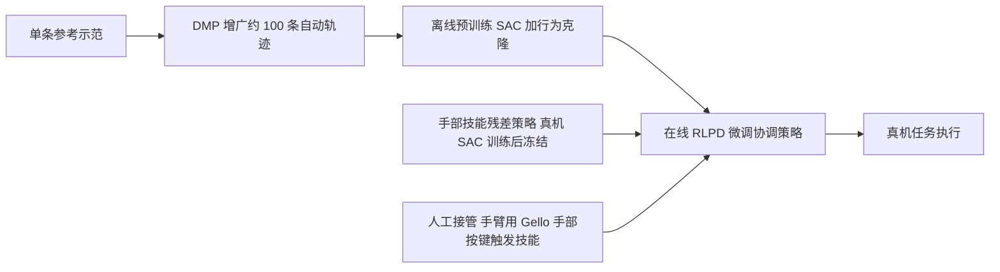

# HiFun：功能性灵巧操作的分层学习框架

**HiFun 把灵巧手操作拆成两层：先在真机上学习精确接触的手部技能，再学习手臂运动与何时触发该技能，并用人工接管与运动基元增广提高真机学习效率。**

## 英文缩写速查

| 缩写 | 英文全称 | 简要说明 |
|------|----------|----------|
| DMP | Dynamic Movement Primitives | 动态运动基元，用少量示范拟合可泛化的轨迹模板 |
| HIL | Human-in-the-Loop | 人在回路，允许操作员在学习过程中实时纠正策略 |
| RLPD | RL with Prior Data | 用先验离线数据加速在线 RL 的方法，协调策略在线训练时使用 |
| IAW | Intervention Advantage Weighting | 接管优势加权，按 critic 估计的优势缩放每次纠正的模仿损失 |

## 为什么重要

功能性灵巧操作（如握持电钻、取回细长工具、移液）需要精确接触、臂手协同与错误恢复。接触动力学很难在仿真中准确复现，因此学习需要在真机上进行；但完整的臂手示范采集代价高、噪声大，微小偏差就会导致打滑或过早施力。HiFun 的设计目标是把学习负担拆开，让真机学习在约一小时内见效。

## 核心信息

| 项目 | 内容 |
|------|------|
| arXiv | [2610.19518](https://arxiv.org/abs/2610.19518)（cs.RO） |
| 作者 | Linyi Huang, Guowei Huai, Weibin Liu, Shulong Jiang, Ping Tan, Weixuan Zhang, Hui Zhang, Jie Song |
| 机构 | 未核实（arXiv 摘要页未列作者单位） |
| 数据/平台 | 真机：两种灵巧手——Sharpa 手与 XHand；6 个任务（Sharpa：Power-Drill Actuation、Angle-Spreader Retrieval、Thin-Handle Retrieval、Power-Drill Bit Removal；XHand：Pipette Dispensing、Thin-Shaft Tool Retrieval） |
| 开源状态 | **待发布**（2026-10-15 核查：项目页标注代码 "Coming soon"；仓库 Hly-123/HiFun-code 目前只含 assets 与 README，无 LICENSE，无训练或运行脚本；项目页未列数据集或权重） |
| 会议 | 项目页标注 Accepted to CoRL 2026 |
| 项目页 | <https://hly-123.github.io/HiFun/> |

## 核心原理

系统由两个策略组成，并由人工接管与示范增广补充。

- **功能手部技能：** 从运动学参考手势出发，残差策略输出有界的手指位姿修正，利用指尖力反馈调整接触；真机 SAC 训练后冻结。
- **臂手协调策略：** 输出 6 维手臂末端增量与技能激活值 α∈[0,1]，决定手臂往哪走、何时调用手部技能。训练时使用多头 critic，导航 Q 头与调制 Q 头分别用各自的 TD 目标。
- **人工接管：** 手臂纠正通过 Gello 的相对位姿映射完成；手部纠正只需按键触发冻结的手部技能，避免逐指遥操作。
- **DMP 增广：** 用一条参考示范拟合笛卡尔空间 DMP，随机化初始位姿、固定目标，自动生成约 100 条 rollout，为协调策略提供热启动。

## 工程实践

- **复现入口：** 代码尚未发布，目前只能依据论文描述搭建两层结构与接管流程。
- **训练时间（平均）：** DMP rollout 收集约 18.8 分钟；在线人在回路微调约 46.2 分钟，上限 1 小时；BC/DP 的遥操作示范采集约 95.0 分钟。
- **调试指标：** 按任务记录成功率、接触恢复次数与接管频率；论文以每任务 50 次试验计算成功率。
- **源码运行时序图：** **不适用**（官方仓库只有占位内容，代码标注 "Coming soon"，无可运行入口）。

## 实验与评测

每任务成功率（%），HiFun 为最终成功率；HIL-SERL 变体与 BC、DP 为对照。

| 任务 | HiFun | HIL-SERL（Glove+Gello） | HIL-SERL（Ours Interv.） | BC | DP |
|------|-------|-------------------------|--------------------------|----|----|
| Power-Drill Actuation | 100 | 15 | 30 | 15 | 30 |
| Angle-Spreader Retrieval | 100 | – | 0 | 30 | 60 |
| Thin-Handle Retrieval | 100 | – | 0 | 35 | 40 |
| Power-Drill Bit Removal | 100 | – | 20 | 30 | 36 |
| Pipette Dispensing | 90 | 12 | 32 | 12 | 26 |
| Thin-Shaft Tool Retrieval | 100 | – | 0 | 20 | 58 |
| **平均** | **98.3** | **4.5** | **13.7** | **23.7** | **41.7** |

HIL-SERL 变体与 HiFun 共享 RLPD 骨干与离线 DMP 缓冲，但使用扁平的全自由度策略。BC 与 DP 每任务使用 200 条成功遥操作示范。

## 结论

**一句话总判：分层与人工接管的组合，把真机灵巧操作的学习时间压到约一小时，但其优势依赖于可复用的手部技能与示范增广。**

1. **拆分学习负担是关键** — 手部技能负责接触，协调策略只学手臂与触发时机，使真机在线学习变得可行。
2. **人工接管要尽量低成本** — 手部纠正只需按键触发冻结技能，比逐指遥操作更可持续。
3. **DMP 增广可替代大量人工示范** — 一条参考示范即可生成约 100 条 rollout，为在线学习提供热启动。
4. **对比基线需要分开看** — 扁平的 HIL-SERL 变体平均只有 4.5% 到 13.7%，而 BC 与 DP 依赖 200 条遥操作示范，数据条件并不一致。
5. **结果来自真机小样本** — 每任务 50 次试验，任务和硬件都有限，外推到其他灵巧手需要验证。

## 与其他工作对比

| 方法 | 思路 | 与 HiFun 的差异 |
|------|------|-----------------|
| [HIL 混合模仿学习](../methods/hil-hybrid-imitation-learning.md) | 人在回路的模仿与学习混合 | HiFun 在此基础上分层，并把手部技能冻结复用 |
| [BC](../methods/behavior-cloning.md) / [扩散策略](../methods/diffusion-policy.md) | 纯示范学习 | 依赖大量遥操作示范，本文示范量少，但需要真机在线学习 |
| 扁平 HIL-SERL 变体 | 全自由度单策略 | 论文中作为对照，平均成功率明显更低 |

## 局限与风险

- 代码与数据未发布，目前无法复现或与他人结果直接比较。
- 结果仅覆盖两种灵巧手与 6 个任务，每任务 50 次试验，统计把握有限。
- 手部技能在训练后冻结，若任务需要新的接触模式，需要重新训练该技能。
- 在线学习依赖实时人工接管，部署时的人力成本与安全监督需要单独评估。
- 论文未在仿真中验证，接触模型差异对迁移的影响未知（推测）。

## 关联页面

- [HIL 混合模仿学习](../methods/hil-hybrid-imitation-learning.md)
- [DMP](../methods/dmp.md)
- [分层强化学习](../methods/hierarchical-reinforcement-learning.md)
- [接触丰富操作](../concepts/contact-rich-manipulation.md)
- [操作任务](../tasks/manipulation.md)

## 参考来源

- [HiFun 来源归档](../../sources/papers/hifun_arxiv_2610_19518.md)
- [公众号综述摘录（31 篇论文）](../../sources/raw/wechat_embodied_station_robot_31_papers_2026-10-15.md)

## 推荐继续阅读

- [arXiv:2610.19518 — HiFun](https://arxiv.org/abs/2610.19518)
- [HiFun 项目页](https://hly-123.github.io/HiFun/)
