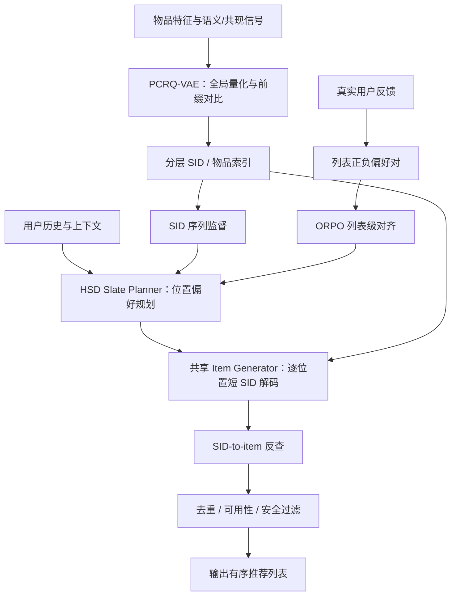

# HiGR：工业级分层生成式列表推荐（CIKM 2026）

## 一句话定义

HiGR（*Industrial-Scale Hierarchical Generative Slate Recommendation Framework in Tencent*）将列表推荐改写为**先规划整张列表、再逐项解码物品**的生成任务，用结构化语义 ID 和列表级偏好对齐平衡推荐质量、推理耗时和多样性；它不是机器人运动控制算法。

## 英文缩写速查

| 缩写 | 英文全称 | 简要说明 |
|---|---|---|
| HiGR | Hierarchical Generative Recommendation | 腾讯分层生成式列表推荐框架短名 |
| SID | Semantic ID | 向量量化得到的分层离散物品代码 |
| PCRQ-VAE | Prefix-Contrastive Residual Quantized Variational Autoencoder | 带前缀对比约束的分层 SID tokenizer |
| HSD | Hierarchical Slate Decoder | 先规划位置偏好、再解码具体物品 |
| ORPO | Odds Ratio Preference Optimization | 用正负列表偏好对后训练，不需参考策略 |
| ILD | Intra-List Diversity | 列表内物品多样性 |

## 为什么重要

独立推荐与重排无法直接优化列表中物品间的顺序、互补性及重复度；全 token 自回归虽然能表达联合列表，却对长序列产生延迟。HiGR 把语义离散化、全局规划、局部生成与列表级反馈组合，提供可讨论的**生成模型结构分层与目标对齐**案例。

## 核心信息

| 项 | 说明 |
|---|---|
| 论文 | Pang、Liu、Li 等，arXiv:2512.24787 **v5**（2026-06-11） |
| 机构 | 腾讯平台与内容事业群（Tencent PCG）、中山大学（Sun Yat-sen University） |
| 会议 | [CIKM 2026 官方日程](https://cikm2026.diag.uniroma1.it/cikm-program/CIKM2026_program.html) 列于 Applied Research |
| 归属关系 | [TGR 技术体系](./paper-tgr-tencent-generative-recommendation.md) 的 **GenRec/HiGR 分支**；TGR 技术报告为另一篇论文 |
| 项目/代码 | 未见论文官方可运行训练/推理仓库；TRS 为产品站点，不是 GitHub 源码 |

## 核心原理

1. **PCRQ-VAE**：编码物品 embedding 后用残差量化生成 D 层 SID；全局量化损失保持跨层残差信息，只在前 D−1 层做前缀级对比学习；末层保留具体物品身份，不为相似前缀牺牲区分度。
2. **HSD 两段式**：Slate Planner 结合历史交互，为 M 个列表位置依次生成 coarse preference embedding；共享 Item Generator 按每一位置 preference embedding，使用短 SID 序列解码物品。长距离跨物品规划在偏好级进行，beam 搜索仅用于局部 SID。
3. **列表级 ORPO**：从真实用户反馈构造偏好列表；乱序、负反馈替换、首位锚定+相似内容重复分别作为三类负样本，优化排序一致性、兴趣与多样性。
4. **服务端约束**：SID-to-item 映射后仍经过去重、可用性和安全等业务过滤；数据回流更新模型。

### 流程总览

## 源码运行时序图

**不适用**：截至 2026-11-18，论文及相关官方入口未提供可核验的 HiGR 算法训练、推理或部署源代码与运行命令。上方是**论文模块级方法图**，不是臆造的代码调用时序。

## 工程实践

| 项 | 原文设置或工程含义 |
|---|---|
| 离散编码 | SID 深度 3、每层 1024 codes；前两层 prefix contrastive，末层保留身份 |
| 模型规模 | hidden=512、FFN=2048；Planner 14 层 / Item Generator 2 层 |
| 数据与训练 | 工业数据预训练 10 亿样本；约 3% 样本后训练；ORPO 系数 0.1 |
| 列表目标 | 不只监控 Hit@5 / Recall@5，还需 NDCG@5、ILD 与线上用户消费行为 |
| 上线耗时 | 论文报告同吞吐 P99 <50ms、GPU 需求较 OneRec 减约 60%；未公开代码不能独立复测 |
| 跨领域借鉴 | 机器人可参考“高层计划–低层具体输出”分工；**SID 不是连续动作，列表指标不等于控制成功率** |

## 实验与评测

- **离线基线**：工业数据 Effective View Hit@5，OneRec-25M 为 **0.1603**、HiGR-25M 为 **0.1945**；HiGR-100M 为 **0.2145**。论文亦报告 KuaiRec 优势；比较 25M 与 100M 时需保留参数规模标签。
- **前缀消融**：仅约束前 D−1 层时 collision 为 **0.0237**，连末层一并约束后为 **0.0873**，展示语义聚类与 ID 区分的取舍。
- **效率对照**：相对 OneRec-Beam 论文报告 **5× 以上推理提速**；必须注明同模型设置与作者测试环境。
- **线上 A/B**：在腾讯披露场景中，平均观看时长 **+1.22%**、视频播放次数 **+1.73%**；不可解释为公开数据集上的泛化保证。

## 结论

**HiGR 的主要贡献是“把列表规划与物品解码解耦”，而不只是换一个推荐 Transformer。**

1. **先设计层次化 SID**：只有高层前缀可承载有意义的规划，低层仍要保留物品身份。
2. **把延迟预算从完整 SID 序列转移到 coarse preference 规划**：短局部 beam 比整张列表逐 token beam 更可控。
3. **用列表级反馈训练列表级目标**：ORPO 的负例分别覆盖乱序、低兴趣与同质重复。
4. **数字属于工业推荐场景**：5× 是给定解码对照，+1.22% / +1.73% 是腾讯商业 A/B；不对应机器人实时控制性能。
5. **无法直接复现工业系统**：商业数据与训练/推理源码未公开，保留论文机制与实验边界。

## 与其他工作对比

| 方法 | 不同点 |
|---|---|
| OneRec | 直接按 SID 序列生成；HiGR 将全局列表规划上提到 preference embedding |
| RQ-VAE / TIGER | HiGR 对量化高层前缀施加显式语义/共现对比信号 |
| DPO 对齐 | HiGR 采用不依赖参考策略的 ORPO，负例按整张列表业务指标构建 |
| [TGR](./paper-tgr-tencent-generative-recommendation.md) | TGR 是覆盖 CCFormer、BARGE、HiGR、Reason 的技术体系；**并非 HiGR 的另一版本** |

## 局限与风险

- 工业数据、真实在线 A/B 和生产 serving 栈不能仅用公开论文复现。
- SID 只表达物品离散身份与偏好结构，不能直接满足连续机器人运动中的约束、时延及安全闭环。
- 线上数据分布与业务规则会影响 ORPO 多目标权重适用性；不同用户/场景权重的自适应尚未在本文证明。
- 未见官方代码，不能编造实际 train.py、serve.py 或序列图。

## 关联页面

- [TGR：生成式推荐技术栈](./paper-tgr-tencent-generative-recommendation.md)
- [Transformer](../concepts/transformer.md) — 长序列建模与分层计算结构
- [统一多模态 Token](../methods/unified-multimodal-tokens.md) — 离散接口的跨域对照；不等同机器人动作 token
- [Policy Optimization](../methods/policy-optimization.md) — 目标对齐范式对照；不是同一训练任务

## 参考来源

- [HiGR v5 原文与核对归档](../../sources/papers/higr_arxiv_2512_24787_v5.md)
- [CIKM 2026 官方日程核验](../../sources/sites/cikm-2026-higr-program.md)
- [TGR 原文背景报告](../../sources/papers/tgr_arxiv_2609_00986.md)
- [TRS 站点入口与访问限制](../../sources/sites/tencent-trs-recommendation-platform.md)

## 推荐继续阅读

- [HiGR arXiv v5 HTML 全文](https://arxiv.org/html/2512.24787v5)
- [CIKM 2026 官方论文日程](https://cikm2026.diag.uniroma1.it/cikm-program/CIKM2026_program.html)
- [TGR 技术报告](https://arxiv.org/html/2609.00986v1)
