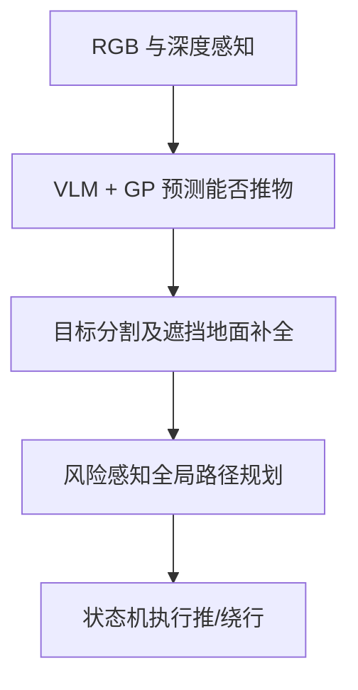

# 具身视觉语言模型驱动的崎岖地形交互导航（HINT-VLM: Humanoid Interactive Navigation over Rough Terrain with Embodiment-Grounded Vision-Language Model）

**机构：** 佐治亚理工学院、VinMotion、南加州大学  
**论文：** [arXiv:2611.11665](https://arxiv.org/abs/2611.11665)
**项目：** https://yzwfromk.github.io/HINT_VLM/  

## 一句话定义

**VLM 提供物体可移动性先验，交互数据训练 Gaussian Process 残差校正该机体的推物成功率；Grounding DINO/SAM2 掩码和深度投影至 BEV，LaMa 补全被挡地面；结合 STATE-NAV 通行估计与交互成功/失败代价，选择推、绕行或放弃。**

## 英文缩写速查

| 缩写 | 英文全称 | 简要说明 |
|---|---|---|
| VLM | Vision-Language Model | 物体语义与可移动性先验 |
| GP | Gaussian Process | 机体交互结果残差 |
| BEV | Bird's-Eye View | 俯视地形地图 |
| NAMO | Navigation Among Movable Obstacles | 可移动障碍导航 |

## 为什么重要

物体可以移动，不代表机器人一定能推动，更不代表物体下面被遮挡的地面可安全通过。

## 核心原理

VLM 提供物体可移动性先验，交互数据训练 Gaussian Process 残差校正该机体的推物成功率；Grounding DINO/SAM2 掩码和深度投影至 BEV，LaMa 补全被挡地面；结合 STATE-NAV 通行估计与交互成功/失败代价，选择推、绕行或放弃。

### 流程总览

以下根据论文方法整理，箭头表示控制/数据流向。

## 实验与评测

三场景 Garden、Construction、Park 的仿真导航成功率 95.5%、97.7%、100%；Park 移除遮挡地形重建后为 86.4%。官方项目页展示室内推车和户外花园定性真机视频，但 Code 标为 Coming Soon。

## 与其他工作对比

VLM 提供物体可移动性先验，交互数据训练 Gaussian Process 残差校正该机体的推物成功率；Grounding DINO/SAM2 掩码和深度投影至 BEV，LaMa 补全被挡地面；结合 STATE-NAV 通行估计与交互成功/失败代价，选择推、绕行或放弃。 与传统同方向方法的主要区别见以上控制接口及研究动机；跨论文统计结果不具有相同测试协议。

## 结论

**具身视觉语言模型驱动的崎岖地形交互导航 的实际价值在于明确研究对象与实验边界，而非脱离原文场景比较单个成功率。**

1. 关键是让可推动概率与特定机器人能力相关。
2. 推物后必须判断隐藏地面是否可通行。
3. 当前开源状态不可当成可直接复现。

## 工程实践

实际验证时先检查任务接口与坐标系，再按论文试验复现主指标；记录 VLM / GP / BEV 相关状态、控制采样与异常回退路径，不能以论文中的概念图代替可执行模块证明。

**源码开放状态：** 截至 2026-11-16 官方项目页显示 Code Coming Soon。

## 源码运行时序图

**不适用**：尚无可确认的官方完整算法运行入口；以上主干流程是论文方法图，不是虚构源码调用。

## 局限与风险

隐藏地形来自补全估计而非真实观测；真机视频不能替代三场景仿真统计。项目页截至 2026-11-16 暂无可运行代码。

## 关联页面

- [humanoid locomotion](../tasks/humanoid-locomotion.md)
- [sim2real](../concepts/sim2real.md)
- [navigation](../../roadmap/depth-navigation.md)
- [11.09–11.13 29 篇总览](../overview/humanoid-quadruped-2026-11-09-13-29-papers.md)

- [视觉表征学习](../methods/visual-representation-learning.md)：对照图像特征与下游视觉任务。

## 参考来源

- [arXiv v1 原文核对归档](../../sources/papers/hint-vlm-rough-terrain_arxiv_2611_11665.md)
- [arXiv v1 HTML 全文](https://arxiv.org/html/2611.11665v1)
- [官方项目主页](https://yzwfromk.github.io/HINT_VLM/)

## 推荐继续阅读

- [论文 PDF](https://arxiv.org/pdf/2611.11665v1)
