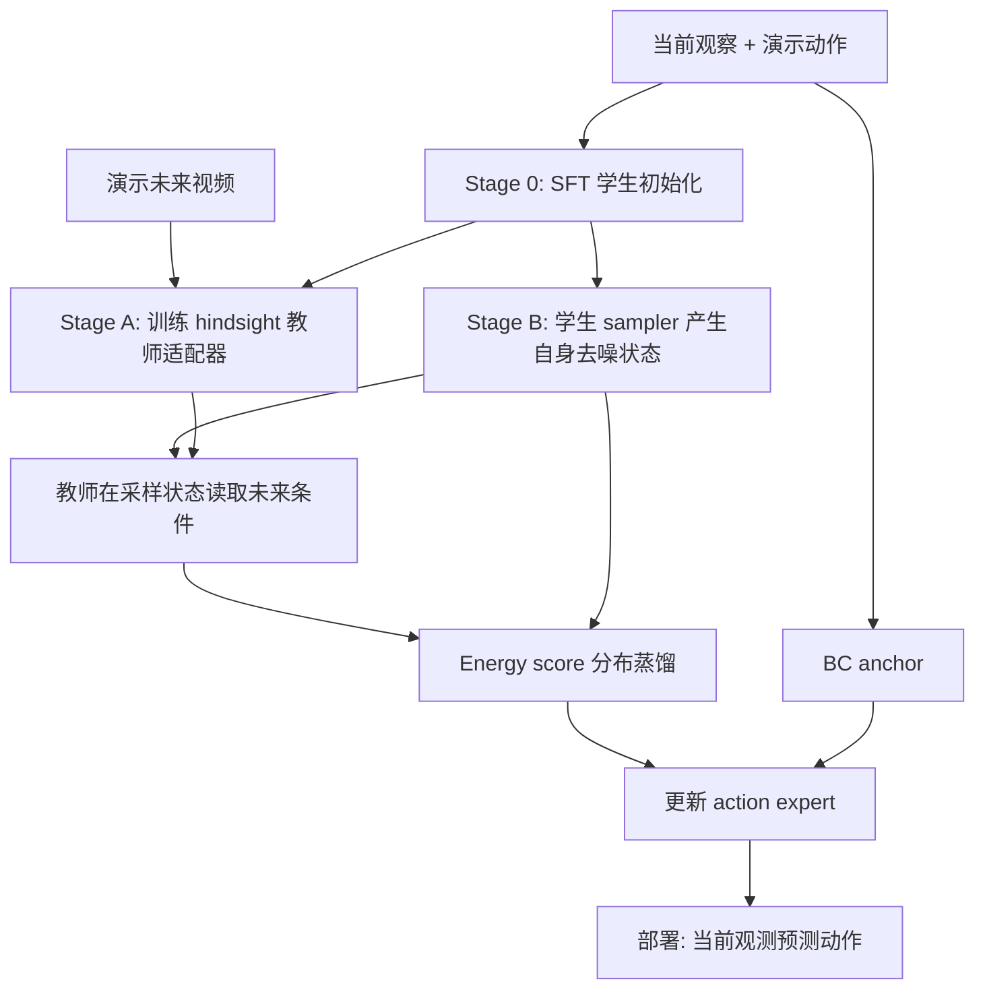
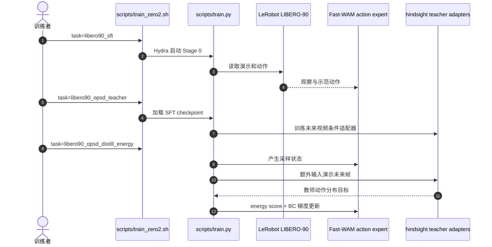

# HINT-WAM：利用示范未来视频后训练世界动作模型（HINT-WAM: Hindsight-Informed Training for World Action Models）

## 一句话定义

用示范未来视频训练只在教师端可见的 hindsight adapter，再沿学生自己采样的动作去噪轨迹做分布蒸馏，部署时只需当前观测。

## 英文缩写速查

| 缩写 | 英文全称 | 简要说明 |
|---|---|---|
| WAM | World Action Model | 世界–动作联合建模 |
| SFT | Supervised Fine-Tuning | 演示监督微调 |
| BC | Behavior Cloning | 演示模仿锚定 |
| OPSD | On-Policy Self-Distillation | 学生自身采样路径蒸馏 |

## 为什么重要

WAM 的 flow-matching 动作专家训练时见的是加噪演示动作，推理时见的却是自采样状态。作者用示范视频中天然可获得的未来帧作训练期教师条件，避免新采集环境 rollout 与奖励标注。

## 核心原理

**Stage 0 SFT**：动作专家在 LIBERO-90 示范上微调；**Stage A**：冻结基模型，只训练读取未来演示视频的 hindsight encoder/gated adapter；**Stage B**：学生从自己的 sampler 获取中间状态，教师在相同状态额外读取未来视频，目标用 energy score 匹配生成动作分布，同时用 BC anchor 保持演示约束。未来视频和教师都**不会在部署时出现**。

### 流程总览

## 源码运行时序图

依据官方 README 的真实入口及其代码目录绘制**运行路径示意**；未在本环境实际训练或部署。

## 实验与评测（作者报告，未独立复现）

| 对照 | LIBERO-90 成功率 |
|---|---:|
| Fast-WAM 原 checkpoint | 15.56% |
| SFT | 78.88% |
| Full SFT | 81.24% |
| **HINT-WAM** | **85.18%** |

基于作者在固定初态上每任务 50 次的同设定测试。**遗忘仍存在**：无 replay 的原四套件均值 HINT-WAM 44.05%、SFT 37.45%；有 replay 为 95.10% 与 91.55%。

## 与其他工作对比

- 普通 SFT 在干净演示状态做回归；本方法显式沿学生**自身采样中间状态**蒸馏。
- Reward-based RL 需要环境反馈与奖励；这里未来帧是教师的密集条件，不需要调用仿真环境产生 rollout。
- 与 [Doppel](./paper-doppel.md) 的**训练/预测世界**不同，HINT-WAM 的核心是**改善动作专家后训练**。

## 工程实践

1. 官方训练流程：Fast-WAM checkpoint + LeRobot 数据 → `libero90_sft` → `libero90_opsd_teacher` → `libero90_opsd_distill_energy`。
2. 日志核对 `phi_gate` 应从 0 上升，Stage B 必须看到 `teacher loaded from...`。
3. 复现前配齐 Wan2.2、Fast-WAM 的统计文件。评测要转到 Fast-WAM LIBERO/RoboTwin evaluator，**此仓不包含闭环评测实现**。

## 局限与风险

论文主要以仿真 LIBERO 与 RoboTwin 验证，成功率不可外推真机；作者称减少灾难性遗忘，但不等于遗忘消失。后训练显存、时长明显高于只做 BC；已对照 arXiv v1 HTML 正文与附录 A–L 通读，尚未独立执行训练或环境评测。

## 结论

**适用于可取到演示未来视频、但不希望依赖环境奖励的 WAM 后训练。**

1. 先确认 teacher 真正利用 future video（`phi_gate`），否则相当于错误蒸馏。
2. 结合 energy score 与 BC anchor；仅加一项不一定提高成功率。
3. 对新任务成功率、原任务遗忘与训练 GPU-hours 应三项同时比较。

## 关联页面

- [paper-doppel ](./paper-doppel.md)
- [paper-bicat ](./paper-bicat.md)
- [imitation-learning ](../methods/imitation-learning.md)
- [diffusion-policy ](../methods/diffusion-policy.md)
- [manipulation ](../tasks/manipulation.md)

## 参考来源

- [论文原文摘录与验证范围](../../sources/papers/hint_wam_arxiv_2611_24789.md)
- [源码与运行入口](../../sources/repos/hintwam_code.md)
- [官方项目页归档](../../sources/sites/hint-wam.md)

## 推荐继续阅读

- [论文 HTML](https://arxiv.org/html/2611.24789)
- [官方项目主页](https://tuandattt.github.io/hintwam/)
- [官方源码](https://github.com/tuandattt/hintwam_code)
