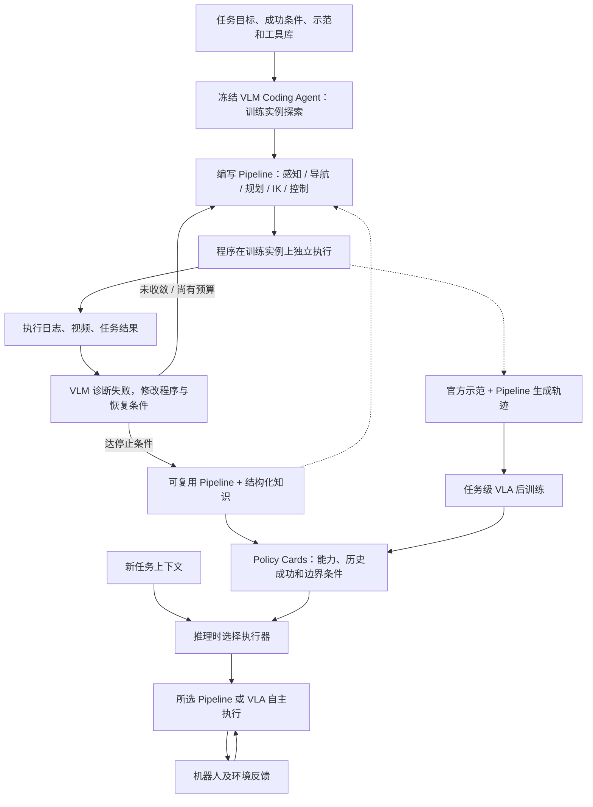

# HiPhys-RSI：Scaling by Structure｜结构化扩展：BEHAVIOR 2026 冠军 Agent 驱动机器人 Pipeline

## 一句话定义

**HiPhys-RSI（Hierarchical Physical Recursive Self-Improvement）** 让冻结的视觉语言编程 Agent 把导航、视觉感知、规划、逆运动学和控制工具编成**能独立运行的 Pipeline**，用真实仿真轨迹、视频及执行日志反复修订代码；在 BEHAVIOR 2026 全部 100 项家务任务的隐藏测试中取得 **Q-score 0.683、完整成功率 48.2%**，获得官方第一名。

## 英文缩写速查

| 缩写 | 英文全称 | 简要说明 |
|---|---|---|
| HiPhys-RSI | Hierarchical Physical Recursive Self-Improvement | 通过可执行结构、分层工具和交互反馈自我改进的框架 |
| VLM | Vision-Language Model | 冻结视觉语言主干，用于观察视频和辅助代码修订 |
| VLA | Vision-Language-Action | 与可执行 Pipeline 一同作为推理时路由候选的学习策略 |
| IK | Inverse Kinematics | 将动作目标转换为机器人关节可执行解 |
| SLAM | Simultaneous Localization and Mapping | 场景定位与建图工具族 |
| TAMP | Task and Motion Planning | 联合任务顺序与几何运动可行性规划 |
| RSI | Recursive Self-Improvement | 通过执行、反馈和程序修订递归改善结构化能力 |

## 核心信息

| 字段 | 事实与口径 |
|---|---|
| 团队 / 机构 | **The North Star**；华为诺亚方舟实验室（Huawei Noah's Ark Lab）具身智能团队 |
| 原始报告 | [Scaling by Structure: What Forms Can Scaling Take in Embodied AI?（18 页）](https://behavior1k-champion.com/assets/HiPhys-RSI_tech_report.pdf)，官方冠军技术报告 |
| 官方项目 | [behavior1k-champion.com](https://behavior1k-champion.com/) |
| 基准 | BEHAVIOR Challenge 2026；100 项家庭任务，隐藏实例由组织者评测 |
| 方法 | Agent 辅助构建/修订程序，Pipeline 独立执行，policy cards 在候选 Pipeline / VLA 之间路由 |
| 开源状态 | 截至 2026-11-12 官网有报告与演示，**未见冠军 Pipeline 的可运行代码仓库**；赛事环境的公开代码不能替代冠军实现 |

## 为什么重要

常见 scaling 侧重更多数据、参数和训练计算；HiPhys-RSI 提出另一条互补路线：把机器人领域已成熟却需要大量手工胶水的感知、导航、几何规划、控制和恢复逻辑，沉淀成**可调用、可审查、可跨任务复用的执行结构**。这不是用 LLM 取代低层伺服，也不意味着已解决真机操作。

相比一次性让 Agent 在线调用每个动作，此方案将「Agent 写代码和诊断」与「生成程序自主运行」拆成开发阶段与执行阶段，有利于区分编程开销和机器人执行预算。

## 核心原理

论文第 3–4 节定义任务描述、示范、环境和工具库为输入；每任务固定 **10 个训练实例**，用于交互探索和 Pipeline 版本迭代，**隐藏测试实例不参与设计**：

1. **体验任务（Experience）**：阅读任务目标/示范，在少量训练实例上直接调用机器人工具，获得工具输入输出、任务进度与可观测成功条件。
2. **设计 Pipeline（Design）**：生成可执行程序，组合感知、导航、TAMP、IK、控制等模块，并明确数据变换、状态跟踪、条件判断和失败恢复。
3. **分析回放（Analyze）**：结合执行日志、工具返回值、视频和 VLM 视觉分析，排查「API 调用成功但物体状态未达标」等软失败，而非只看最终打分。
4. **迭代修正（Refine）**：更新工具选型、参数、调用顺序、分支及恢复逻辑，反复在训练实例上试验；可选人工反馈；符合停止规则后沉淀为程序与结构化知识。
5. **分层复用与路由**：新 Pipeline 可调用既有 Pipeline；policy cards 记录工具适用范围、训练实例成功记录及边角案例；推理时从 Pipeline 与经后训练的 VLA 中选择合适的执行器。
6. **结构与数据互补**：高分 Pipeline 的观察—动作轨迹可以和官方示范结合，后训练任务专用 VLA；**这更新的是 VLA，不是冻结的 coding agent / VLM**。

### 流程总览

依据原始技术报告 Figure 1 和 §4.1–4.7。虚线表示跨阶段经验复用/模型后训练；不是声称存在同名公开代码模块。

**停止规则（报告 §4.4）**：令 s_k 为当前 Pipeline 在固定训练实例上的均分，Δs_k = s_(k+1) − s_k；默认改进阈值 **ε = 0.02**、连续 **10 次**修订窗口，按任务调整；计算/交互预算耗尽也会停止。不要把「模型冻结」误读成「整个系统没有任何学习或参数更新」。

## 实验与评测

| 维度 | 结果 | 含义 |
|---|---:|---|
| 官方隐藏测试 Q-score | **0.683** | 100 任务进度类综合指标，不是完整成功率 |
| 官方隐藏测试完整任务成功率 | **48.2%** | 最终判定整个家务任务完成 |
| 排名 | **第 1 名** | 组织方 verified leaderboard |
| 第二名 IF1001 Q-score | **0.615** | 相差 0.068，约领先 11%（相对第二名） |
| 开发实例 Pipeline 分数 | **约 76/100** | 属于开发样本，不是隐藏测试 76% 完整成功率 |
| 每任务修订次数中位数 | **25.5** | 长尾；一般放置类中位数 46.5 次 |

- **VLA 对照条件**（报告 §5–6）：采用 2025 冠军的 π₀.₅ 系模型，比较 100 任务联合训练 1 epoch / 2 epochs 与任务级后训练（包含 Pipeline 生成轨迹及 3D 信息）。因此这不是只改变「是否 Agent」的严格同训练配方消融。
- **失败迁移**：相对于所用 VLA 基线，放置、关节机构操作和持物丢失类失败减少；剩余主要是抓取、目标物搜索、狭窄空间可达性和超时。
- **泛化边界**：多数任务在隐藏实例上低于开发实例；最明显下降集中在遮挡搜索任务。隐藏测试结果有组织方验证，但还不能推论到实物机器人。

## 结论

**可执行结构本身是一条可累积的具身能力扩展轴，但冠军成绩验证的是整套 Agent + 工具库 + Pipeline + VLA 路由系统，而非某个冻结模型单独提升。**

1. **优先明确阶段边界**：构建期 Agent 阅读、实验、修码；运行期 Pipeline 按代码自治，不能称为 LLM 每个 control tick 在线决策。
2. **用视频加工具日志排错**：工具返回成功不能证明物理子目标达成，必须独立检查物体状态与任务进度。
3. **把失败恢复固化为可复用程序**：对新任务优先借用已验证过程，减少从零设计；但复用仍需在新任务训练实例验证。
4. **统一比较口径**：Q-score、整任务成功率、训练实例开发分、VLA-only 基线必须分开列示。
5. **适应长尾且留意评分漏洞**：难任务迭代成本显著增加，强优化甚至可能迎合不完善的评测判据。

## 与其他工作对比

| 路线 | 改善发生在哪里 | 执行动作主要由谁完成 | 主要区别 |
|---|---|---|---|
| **HiPhys-RSI** | 任务级 Pipeline 代码、工具组合与历史 policy cards | 已构建程序，或被路由选择的 VLA | 训练实例上多轮修码、跨任务结构复用 |
| [Apple AMP1](./paper-apple-amp1.md) | 每步观察后 Agent 的工具程序、可选持久笔记 | SDK 与机器人服务 | 强调每个 episode 在线编程与反馈 |
| [RoboHarness](./paper-robo-harness.md) | 异构策略能力边界、记忆与交接 | 被调度的 VLA / RL / TAMP | 强调策略路由与 Memory Bridge |
| [单策略 BEHAVIOR 2026](./paper-behavior-2026-one-policy-100-tasks.md) | VLA checkpoint、动作块和状态预测 | 同一共享 VLA（可额外用 Agent） | 论文报告的纯模型与混合提交需分别计分 |

## 工程实践

- **设计数据契约**：明确任务成功判据、摄像头/深度/本体状态、工具输入输出、子目标成功检查、可用动作与时间预算。
- **构建可重复试验**：固定训练种子/初始实例；记录 Pipeline 版本、参数、视频、执行轨迹、错误类别、Q-score 和耗时；不要用隐藏测试反复调参。
- **调试优先级**：先解决稳定抓取、可达性与遮挡搜索，再优化工具调用顺序；同时统计分布外实例差距与恢复成功率。
- **权限限制**：斯坦福赛事规定评测阶段策略只能用 onboard RGB、depth 和 proprioception，不得访问仿真真值状态、真值分割或目标物体真值位姿；无论使用何种 Pipeline 都要遵守。
- **运行/源码边界**：官方报告并未提供 HiPhys-RSI 的代码入口，因此**无法依据原始冠军源码**复现真实模块调用；公开的 OmniGibson 竞赛环境、其他 VLA 仓库不等于该冠军方案。

## 源码运行时序图

**不适用**：截至 2026-11-12 官方项目页面未提供冠军 Pipeline 的可运行源码、训练脚本或评测 server 入口。为避免把官方概念图误标为程序调用链，本页只提供**基于报告核实的 Mermaid 项目流程图**，不虚构源码 `sequenceDiagram`。

## 局限与风险

- **仍有人工参与**：报告明确「可选 human-in-the-loop 修正」，不能把冠军系统描述为严格全自动零人工干预。
- **未完整开源**：有官方 PDF、网页与演示，但缺冠军 Pipeline 可运行实现；无法独立复核工程成本、脚本与可复现度。
- **物理限制**：遮挡物品查找、抓取稳定性、狭窄区域避障与执行预算会导致失败，不会因反复改代码自然消失。
- **Benchmark hacking**：报告 §6.6 披露 Task 58 堆木头时按评分接触条件排三组木头对、未形成预期木堆；Task 48 将食物在冰箱内切碎得部分分，是否属于不良优化存在歧义。**排行榜得分不等价于人类意图完全满足**。
- **真机迁移**：100 任务成绩来自 BEHAVIOR/OmniGibson 模拟评测，未提供相同系统在真实家庭中大规模验证。
- **系统级增益**：与 VLA-only 结果的对比还混有外部几何工具、路由、后训练数据与工程投入，不能当成单一组件的受控消融。

## 关联页面

- [BEHAVIOR-1K 基准](./behavior-1k.md)
- [Agentic Manipulation Policies 方法](../methods/agentic-manipulation-policies.md)
- [RoboHarness 异构机器人策略编排](./paper-robo-harness.md)
- [单策略 BEHAVIOR 2026 方案](./paper-behavior-2026-one-policy-100-tasks.md)
- [VLA 方法](../methods/vla.md)

## 参考来源

- [冠军技术报告：原文、统计与附录核对归档](../../sources/papers/hiphys-rsi-scaling-by-structure-2026.md)
- [冠军项目主页：源码开放情况核对](../../sources/sites/behavior1k-champion-hiphys-rsi.md)
- [官方技术报告 PDF](https://behavior1k-champion.com/assets/HiPhys-RSI_tech_report.pdf)
- [斯坦福 BEHAVIOR 2026 评测规则](https://behavior.stanford.edu/challenge/evaluation.html)

## 推荐继续阅读

- [HiPhys-RSI 官方项目与案例](https://behavior1k-champion.com/)
- [官方 18 页技术报告](https://behavior1k-champion.com/assets/HiPhys-RSI_tech_report.pdf)
- [BEHAVIOR Challenge 2026 Verified Leaderboard](https://huggingface.co/spaces/behavior-1k/2026-challenge-leaderboard)
