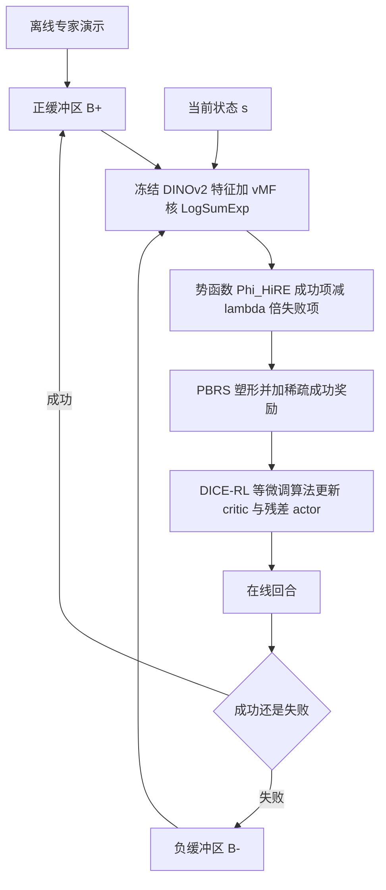

# HiRE（arXiv:2609.27068）

**HiRE**（*HiRE: Hindsight Reward Editing for Policy Finetuning*，Niu、Han 等，UC Berkeley 与香港中文大学，CoRL 2026，[arXiv:2609.27068](https://arxiv.org/abs/2609.27068)，[项目页](https://hire-project.github.io/)，[代码](https://github.com/HiRE-Project/HiRE)）。线索来自 [具身智能小站 2026-10-18 盘点](../../sources/blogs/wechat_embodied_station_26_papers_embodiedswe_2026-10-18.md)，并在 Glen Berseth 的 CoRL 2026 阅读清单中列为 P2。本页依据论文 v1 全文通读（归档见 [来源归档](../../sources/papers/hire_hindsight_reward_editing_arxiv_2609_27068.md)）。同名但不同的论文见 [paper-hire-moma](./paper-hire-moma.md)（HiRE-MoMa，人在环残差 RL，与本文无关）。

## 一句话定义

**HiRE 是不训练任何奖励模型的「事后奖励编辑」：用微调过程中收集的成功 / 失败回合，对冻结的基础视觉表征（主实现为 DINOv2）的目标相似度做对比修正，得到一个势函数，再以势函数塑形并入稀疏成功奖励，供任意 RL 微调算法使用（第 4 节）。**

## 英文缩写速查

| 缩写 | 英文全称 | 简要说明 |
|------|----------|----------|
| HiRE | Hindsight Reward Editing | 事后奖励编辑，本文方法 |
| RL | Reinforcement Learning | 强化学习 |
| PBRS | Potential-Based Reward Shaping | 势函数式奖励塑形（Ng 等 1999），论文称其保持最优策略不变 |
| KDE | Kernel Density Estimation | 核密度估计，用来非参数地估计成功 / 失败状态分布 |
| vMF | von Mises-Fisher | 球面方向数据的核，适配 L2 归一化后的表征 |
| DICE-RL | Distribution Contractive RL finetuning | 论文主实验的微调底座（冻结基础策略加残差 actor），见 [paper-dice-rl](./paper-dice-rl.md) |
| BC | Behavior Cloning | 行为克隆，用于得到基础策略 |
| FIFO | First-In-First-Out | 先进先出缓冲区 |
| OOD | Out-Of-Distribution | 分布外 |

## 为什么重要

- 基础视觉表征的目标相似度奖励覆盖面广，但「不具控制感知」：作者举例，机器人把物体掉落后仍朝放置区移动，相似度奖励依旧很高（第 1 节）。HiRE 用微调中自己产生的成功 / 失败结果去修正这一偏差，不需要额外人工标注或奖励模型训练（作者自述，第 1、2.1 节）。
- 它只改奖励，与策略微调方法正交：论文把它接在 DICE-RL 上，并声称可兼容 PPO、TD3、SAC 等（第 4.2 节，仅为方法抽象，实验只做了 DICE-RL）。
- 与基于进度的奖励模型路线对照阅读：[progress-reward-modeling](../concepts/progress-reward-modeling.md)、[paper-topreward](./paper-topreward.md)、[paper-roboreward](./paper-roboreward.md)；奖励设计总览见 [reward-design](../concepts/reward-design.md)。
- 同期同组工作见 [编程智能体造数据与 VLA 闭环评测：具身智能小站 10-18 期 26 篇阅读坐标](../overview/embodied-station-2026-10-18-26-papers-technology-map.md)。

## 核心原理与流程总览

**推导链（第 4 节）。** 理想奖励取成功状态分布 p+ 与失败状态分布 p− 的对数比（式 1，借用最大熵逆 RL 里判别器的对数几率）。作者不训练判别器，而在表征空间用 vMF 核估计两个密度（式 2 到 4），得到势函数

Φ_HiRE(s) = L^{κ+}_{B+}( sim(s, g+) ) − λ · L^{κ−}_{B−}( sim(s, g−) )，λ = κ−/κ+（式 5）

其中 L 是以 κ 为逆温度的 LogSumExp，B+ 与 B− 是正、负缓冲区，sim 是冻结编码器特征的余弦相似度。再用势函数塑形并入稀疏奖励：R = R_sparse + w(γΦ(s′) − Φ(s))（式 6）。λ < 1 的理由是成功流形窄而集中、失败流形宽而分散（第 4.1 节）。作者还把势函数场分成三个区域做直觉解释：成功主导区补偿「视觉上远但动作正确」的低估，失败主导区压低「视觉上像目标但已失败」的陷阱状态，两者抵消的区域退化为稀疏奖励（第 4.1 节，这是作者的解释，不是实验证实的机制）。

**缓冲区与权重细节（第 4.2 节，附录 A.3）。** 正缓冲区 = 专家演示（帧步长 5）加成功回合的终止帧在线 FIFO（容量 128，采样时与离线按 0.5 混合）；负缓冲区只存失败回合的终止帧（仿真容量 128）。塑形项除以动作块长度 Ta = 8，并乘 w_dense = 1 − 近期成功率，使塑形随成功率上升而衰减（式 10）；回放的专家演示只保留稀疏奖励。

## 工程实践

- **编码器：** 冻结 DINOv2 ViT-S/14，图像缩放到 224×224，ImageNet 归一化，patch 平均余弦相似度，在 wrist 与 base 两个相机上取平均（附录 A.3，式 9）。换成 SigLIP（ViT-B/16）也能工作，但 DINOv2 在四个仿真任务上一致更好（附录 C.1，图 8）。
- **底座与策略：** DICE-RL；基础策略为 ResNet-18 加空间 softmax 与 1D UNet 动作头，MimicGen 任务用扩散策略（50 步 DDPM），Tool_Hang 用流匹配策略（附录 A.1，表 1）。残差 actor 为 3 层 MLP，critic 为 10 个的集成（表 3）。
- **仿真成败判定：** 环境没有失败检测，超时未成功才算失败，只存终止帧；作者说整条失败轨迹入负缓冲区会误罚也出现在成功轨迹里的正常中间状态（附录 A.1）。
- **真机配置（附录 A.2）：** I2RT YAM 6 自由度臂，两个 RealSense 相机；示教 Bottle 117 条、Hanoi 50 条；20 个热身回合后，每 1000 步训练采 10 个新回合，批大小 256；正缓冲区 4096、负缓冲区 320，取失败回合最后 16 帧，κ+ = 10，κ− = 1，λ = 0.1；成败由人工标注；单张 RTX 5090。
- **超参敏感度（附录 C.1，图 9）：** 多阶段任务对 λ 不敏感；Threading 对减小 λ 或放大负缓冲区（512）更敏感；Tool_Hang 上 λ = 0.9 无法持续提升，故 λ 取小。
- 代码仓库本次未读，复现细节以论文附录与仓库 README 为准。

## 评测证据与清单说法的对比核对

清单（Glen Berseth《My CoRL 2026 Reading List》第 094 条，P2，分组 Rewards & Progress Models）对本文的一句话摘要（作者说由 LLM 据摘要起草）：「Training-free reward editing that calibrates foundation-model rewards by contrasting successful and failed trajectories in hindsight.」

- **training-free：成立，但需限定。** 论文称不训练奖励模型、不引入辅助网络，也不用人工稠密标注（第 2.1 节）；奖励由缓冲区里的特征做核密度计算得到。但它仍要成败二值标签（真机由人工逐回合标注，附录 A.2），且依赖 RL 微调与 DICE-RL 底座，并非无需训练的整个流程。
- **calibrates foundation-model rewards：基本成立，指的是表征相似度而非 VLM 奖励。** 被修正的是冻结 DINOv2 特征的目标相似度势函数（式 5，附录 A.3）。论文里的 VLM 奖励（TOPReward、RoboMeter）是被比较的基线，不是被修正对象。
- **contrasting successful and failed trajectories：成立，但对比的是帧而非完整轨迹。** 负样本只用失败回合的终止帧（仿真）或最后 16 帧（真机），正样本含专家演示与成功回合终止帧（附录 A.1、A.2、A.3）。论文明说整条失败轨迹入缓冲会误罚正常中间状态。
- **清单摘要未提到的结果限定：** 仿真 4 个任务（RoboMimic 的 Tool_Hang，MimicGen 的 Threading、Stack_Three、Three_Piece_Assembly）加真机 2 个任务；所有主结果叠在 DICE-RL 上；真机基线只比稀疏与 RoboMeter，TOPReward 与 GCR 只在仿真比（第 5 节）。
- **摘要里的「至少 3 倍」只有真机有明确数字：** 67% 与 73.3% 对基础 20%（第 5.3 节）；仿真里 Stack_Three 终值约 50%（基础 18.0%）。

## 结论

HiRE 用在线成败轨迹修正视觉势函数，减少了奖励模型训练，但仍需要可靠的成败判定与任务级调参。

- 先验证成败标签与正负缓冲区构造，尤其检查重试和恢复片段如何影响密度比。
- 比较奖励方法时固定缩放与回放配置，再评价奖励编辑的独立贡献。
- 按任务报告真机重复次数和人工标注成本，不能把少量检查点提升外推为算法普适性。

## 局限

**论文自述（第 6 节）：** 成功 / 失败信号忽略中间的控制相关信息；未来可引入人类引导；可设计更精细的缓冲区构造，处理成功轨迹中的重试与恢复片段。

**阅读时看到的未验证之处（本页判断）：**

- 依赖二值成败信号：仿真靠超时判失败，真机靠人工标注；对没有可靠成败检测的任务如何用，论文未讨论。
- 真机评估次数小（每个检查点 30 或 15 次，Hanoi 的 73.3% 对应 11/15），论文未报告真机种子数与置信区间；仿真为 3 个种子（图 1）。
- 真机基线只有稀疏与 RoboMeter；TOPReward 与 GCR 的真机表现未知。GCR 由作者自行复现（附录 A.3 称无官方实现可用），结果受复现质量影响。
- 消融中奖励组合对比（图 10）各组奖励缩放与回放设置不同，作者自己注明不是单变量消融；「价值函数坍缩」「奖励被利用」的归因（图 4、第 5.3 节）为作者推断，措辞带 probably，没有专门实验证实。
- 方法超参（κ+、κ−、λ、缓冲区大小）按任务调过的迹象：附录 C.1 显示高精度任务较敏感；跨任务是否无需调参未验证。
- 兼容 PPO、TD3、SAC 等算法的说法是方法抽象，实验未做；代码仓库未读。

## 关联页面

- [reinforcement-learning](../methods/reinforcement-learning.md)
- [reward-design](../concepts/reward-design.md)
- [progress-reward-modeling](../concepts/progress-reward-modeling.md)
- [manipulation](../tasks/manipulation.md)
- [paper-dice-rl](./paper-dice-rl.md)
- [paper-topreward](./paper-topreward.md)
- [paper-roboreward](./paper-roboreward.md)
- [paper-dinov2](./paper-dinov2.md)
- [mimicgen](./mimicgen.md)
- [robomimic](./robomimic.md)
- [paper-hire-moma](./paper-hire-moma.md)（同名不同文）
- [embodied-station-2026-10-18-26-papers-technology-map](../overview/embodied-station-2026-10-18-26-papers-technology-map.md)

## 参考来源

- [hire_hindsight_reward_editing_arxiv_2609_27068.md](../../sources/papers/hire_hindsight_reward_editing_arxiv_2609_27068.md)
- [hire_hindsight_reward_editing.md（仓库）](../../sources/repos/hire_hindsight_reward_editing.md)
- [hire-hindsight-reward-editing.md（项目页）](../../sources/sites/hire-hindsight-reward-editing.md)
- [wechat_embodied_station_26_papers_embodiedswe_2026-10-18.md](../../sources/blogs/wechat_embodied_station_26_papers_embodiedswe_2026-10-18.md)
- [arXiv:2609.27068](https://arxiv.org/abs/2609.27068)

## 继续阅读

- [arXiv PDF](https://arxiv.org/pdf/2609.27068)
- [项目页](https://hire-project.github.io/)
- [https://github.com/HiRE-Project/HiRE](https://github.com/HiRE-Project/HiRE)
