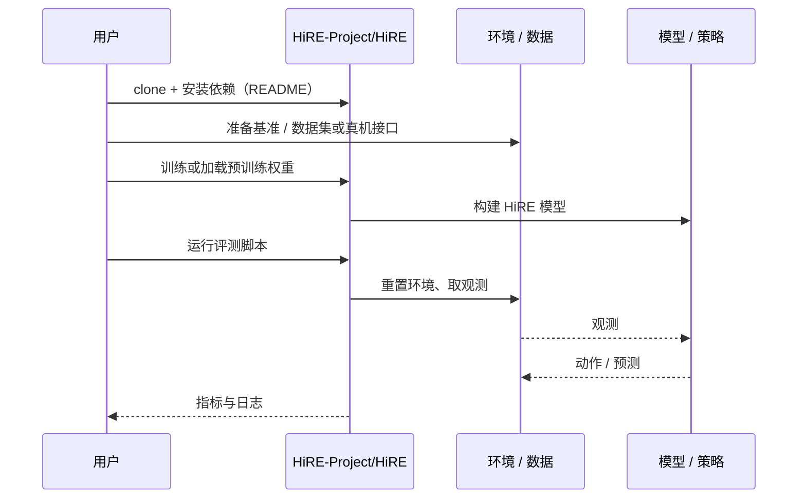

# HiRE（arXiv:2609.27068）

**HiRE**（*HiRE: Hindsight Reward Editing for Policy Finetuning*，[arXiv:2609.27068](https://arxiv.org/abs/2609.27068)，[项目页](https://hire-project.github.io/)，[代码](https://github.com/HiRE-Project/HiRE)）来自 [具身智能小站 2026-10-18 盘点](../../sources/blogs/wechat_embodied_station_26_papers_embodiedswe_2026-10-18.md)，属「策略与规划」组。

## 一句话定义

**用成功与失败轨迹对照，压低“看似接近目标却会失败”的状态奖励，给策略微调补上控制相关反馈。**

## 英文缩写速查

| 缩写 | 英文全称 | 简要说明 |
|------|----------|----------|
| HiRE | Hindsight Reward Editing | 事后奖励编辑 |
| RL | Reinforcement Learning | 强化学习 |

## 为什么重要

- 视觉相似不等于任务做对；基于视觉相似度的奖励会把接近但会失败的状态打高分，误导微调。
- 开源结论：**已开源**（步骤 2.5，2026-10-18）。仓库与项目页均可达，项目页链接 GitHub 仓库。
- 同期同组工作见 [编程智能体造数据与 VLA 闭环评测：具身智能小站 10-18 期 26 篇阅读坐标](../overview/embodied-station-2026-10-18-26-papers-technology-map.md)。

## 核心机制

| 项 | 内容 |
|----|------|
| **arXiv** | [2609.27068](https://arxiv.org/abs/2609.27068) |
| **开源** | **已开源** |
| **要点** | 事后（hindsight）对照成功与失败轨迹，编辑视觉奖励：压低失败轨迹中高相似度状态的奖励，使奖励与控制相关。 |
| **文内指标** | 公众号称在仿真和真机上比较；未给具体数字，本页不引用。 |

## 源码运行时序图

以下为按仓库入口（`HiRE-Project/HiRE`）推断的通用运行链路；入库日仅核实仓库可达，未逐文件阅读，具体脚本名以 README 为准。

## 实验与评测

- 公众号称在仿真和真机上比较；未给具体数字，本页不引用。
- **读法：** 本页为索引级摘要，依据公众号转述的官方摘要与仓库信息整理；逐项数字与 baseline 以原文 PDF 为准。

## 与其他工作对比

- 横向索引见 [编程智能体造数据与 VLA 闭环评测：具身智能小站 10-18 期 26 篇阅读坐标](../overview/embodied-station-2026-10-18-26-papers-technology-map.md)；同 arXiv 不重复造页。

## 结论

**视觉奖励需要用结果标签事后校正：成功/失败对照是低成本给奖励补控制相关性的办法。**

1. 开源边界：**已开源** — 仓库与项目页均可达，项目页链接 GitHub 仓库。
2. 核心机制：事后（hindsight）对照成功与失败轨迹，编辑视觉奖励：压低失败轨迹中高相似度状态的奖励，使奖励与控制相关。
3. 复现与选型前核对任务协议、硬件与基准口径，勿直接横比公众号摘录数字。

## 关联页面

- [reinforcement-learning](../methods/reinforcement-learning.md)
- [manipulation](../tasks/manipulation.md)
- [paper-hire-moma](./paper-hire-moma.md)
- [embodied-station-2026-10-18-26-papers-technology-map](../overview/embodied-station-2026-10-18-26-papers-technology-map.md)

## 参考来源

- [hire_hindsight_reward_editing_arxiv_2609_27068.md](../../sources/papers/hire_hindsight_reward_editing_arxiv_2609_27068.md)
- [wechat_embodied_station_26_papers_embodiedswe_2026-10-18.md](../../sources/blogs/wechat_embodied_station_26_papers_embodiedswe_2026-10-18.md)
- [arXiv:2609.27068](https://arxiv.org/abs/2609.27068)

## 推荐继续阅读

- [arXiv PDF](https://arxiv.org/pdf/2609.27068)
- [项目页](https://hire-project.github.io/)
- [https://github.com/HiRE-Project/HiRE](https://github.com/HiRE-Project/HiRE)
