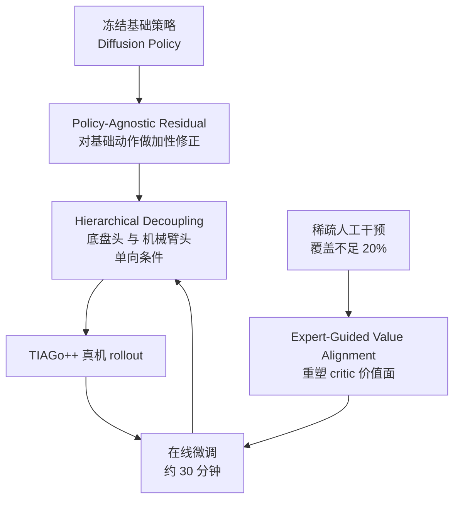

# HiRe-MoMa：稀疏人工引导下的移动操作分层残差微调

**HiRe-MoMa**（*Hierarchical Residual Mobile Manipulation*；论文 *Hierarchical Residual Policy Learning for Real-World Mobile Manipulation with Sparse Human Guidance*，[arXiv:2610.20607](https://arxiv.org/abs/2610.20607)，[项目页](https://hire-moma.github.io/)）针对移动操作机器人在真机上难以微调的问题：冻结已有的基础策略，用分层残差学习加性修正，并用少量人工干预引导价值函数，在 TIAGo++ 上约 30 分钟在线交互即可提升任务成功率。

## 英文缩写速查

| 缩写 | 英文全称 | 简要说明 |
|------|----------|----------|
| MoMa | Mobile Manipulation | 底盘与机械臂耦合的移动操作，本文的任务对象 |
| HiRe-MoMa | Hierarchical Residual Mobile Manipulation | 本文框架：分层残差 + 专家引导价值对齐 |
| DP | Diffusion Policy | 文中被冻结的基础策略（真机任务上的初始成功率来源） |
| HIL-SERL | Human-in-the-Loop Sample-Efficient RL | 文中 Flat Residual 基线等价的真机人在环 RL 方法 |
| DAgger | Dataset Aggregation | 文中 HG-DAgger 基线所属的交互式模仿学习范式 |

## 为什么重要

- **真机微调是移动操作的瓶颈：** 动作空间高维，底盘与机械臂耦合，直接端到端 RL 样本效率低、梯度相互干扰。
- **残差适配可复用：** 与基础策略架构无关，可以套在不同的 DP 类策略上做在线校正，而不必重训整个策略。
- **人工成本可控：** 只用低于 20% 训练覆盖的稀疏干预，即可改善 critic 对价值的估计，适合真实场景中数据昂贵的情况。

## 核心信息

| 项 | 内容 |
|----|------|
| **机构** | 东北大学（美国 Northeastern University）；加州大学河滨分校（UC Riverside）；佐治亚理工学院（Georgia Tech）；论文标注 CoRL 2026 |
| **平台** | TIAGo++ 移动机械臂（真机）；任务为 Place Only、Sweep Litter、Pick Place |
| **数据 / 训练** | 基础策略为预训练 DP；在线微调约 30 分钟，人工干预覆盖不足 20% |
| **开源** | **未开源**（截至 2026-10-15，项目页与 arXiv 页均未列代码或权重链接；论文未见开源承诺） |

## 核心原理

### 流程总览

- **输入：** 基础策略输出的动作、机器人观测；人工干预只在少数步骤提供修正信号。
- **关键机制：** 残差按平台物理层级拆成底盘与机械臂两路，两头之间采用单向条件（具体方向以论文 §4.1 为准），减轻梯度干扰；价值对齐让 critic 在专家经过的区域形成更可靠的价值梯度。
- **输出：** 修正后的动作，直接驱动底盘与机械臂。

### 为什么底座和机械臂要分层修正？

移动操作中，底座先决定机器人相对目标的位置；这个位置偏差会改变机械臂的坐标关系与可达姿态，最后放大成末端夹爪误差。HiRe-MoMa 因此先计算底座残差，再把它作为机械臂残差头的条件输入：机械臂据此调整伸手动作，而底座修正不反过来依赖机械臂修正。

分层有两层作用：把底座与手臂动作拆到独立残差头，减少一个联合动作头里异质动作相互牵制；再用单向条件保留“底座定位 → 手臂到达”的依赖关系。它不是两个彼此隔离的控制器，手臂仍能看到底座正在如何修正。论文消融显示，拆分动作头带来主要收益，单向条件在此基础上继续改善协调；不应把全部增益都归因于条件方向。

## 工程实践

| 项 | 建议 |
|----|------|
| 基础策略 | 选择已能完成任务大部分步骤的冻结策略（论文的成功率从 DP 基线的 22.5% 至 50.0% 起步） |
| 残差设计 | 先做 Flat Residual 对照，再加底盘 / 机械臂解耦，逐步观察成功率与 episode 长度 |
| 人工干预 | 只在基础策略明显偏离时介入，保持覆盖比例低，避免 HG-DAgger 式过拟合稀疏修正 |
| 评测 | 每任务 20 次试验，报告成功率、episode 长度与训练时长，按任务分开看 |
| 源码运行时序图 | **不适用**（截至 2026-10-15 无官方代码发布，无法给出运行入口） |

## 实验与评测

- **真机三任务（表 1，成功率，每任务 20 次）：** Place Only 50.0% 到 95.0%；Sweep Litter 45.0% 到 90.0%；Pick Place 22.5% 到 40.0%。
- **对比基线：** 冻结 DP、+HG-DAgger（在稀疏修正上过拟合）、+Flat Residual（等价 HIL-SERL 残差，受单一动作空间梯度干扰）。
- **项目页摘要：** 平均成功率 39% 到 75%，执行速度 1.29×，训练约 30 分钟。
- **消融（表 2）：** 按 Flat Residual、+Hierarchical Decoupling、+Alignment 逐步叠加，检验两项设计各自的增益。

## 结论

**真机移动操作的微调效率，主要来自"只改需要改的那部分"和"按物理层级拆分修正"，而不是更大的策略。**

1. **冻结基础策略再加残差，是低成本的起点** — 不需要重训整个 DP，即可在约 30 分钟真机交互内显著提升成功率。
2. **分层解耦值得保留** — 底盘与机械臂的单向条件减少了 Flat Residual 的梯度干扰，并缩短了执行时长。
3. **稀疏干预要配合价值对齐才有效** — 只用干预做行为克隆式覆盖（如 HG-DAgger）会过拟合；让 critic 吸收专家先验更稳。
4. **读数字时注意任务差异** — Pick Place 的绝对成功率仍然较低，增益不能外推到所有移动操作任务。
5. **复现门槛在数据与硬件** — 论文未发布代码，目前只能按方法描述复现，需要 TIAGo++ 或等价平台。

## 与其他工作对比

| 维度 | HiRe-MoMa | 扁平残差 RL（HIL-SERL 类） | 人在环模仿（HG-DAgger 类） |
|------|-----------|----------------------------|----------------------------|
| 修正结构 | 底盘 / 臂双头，单向条件 | 单一联合动作残差 | 直接覆盖动作 |
| 人工信号 | 稀疏干预 + 价值对齐 | 通常在线奖励或干预 | 稀疏干预作为监督 |
| 基础策略要求 | 任意策略（Policy-Agnostic） | 通常需要可训练的 actor | 任意，但依赖干预数据量 |
| 真机表现（本文表 1） | Place Only 95%，Pick Place 40% | Place Only 60%，Pick Place 27.5% | Place Only 10%，Pick Place 5% |

与 [残差策略学习](../methods/residual-policy-learning.md) 的通用框架一致，本文的新意在移动操作的分层结构与人工引导的价值对齐。

## 局限与风险

- **样本规模与任务数有限：** 真机只有三个任务，每个任务 20 次试验；泛化到更多家具、光照与物体的能力未验证。
- **依赖冻结 DP 的质量：** 若基础策略在关键阶段完全失败，残差难以修正。
- **人工干预的一致性：** 论文的价值对齐依赖专家先验，示教者风格不一致可能引入偏差。
- **安全边界：** 在线探索仍在真机上进行，需配合 [真机安全微调](../concepts/safe-real-world-rl-fine-tuning.md) 中的约束与急停机制。
- **代码未开源：** 复现需要自行实现分层残差与价值对齐，结果对超参数可能敏感。

## 关联页面

- [残差策略学习](../methods/residual-policy-learning.md) — 残差修正的通用框架
- [扩散策略](../methods/diffusion-policy.md) — 文中被冻结的基础策略
- [真机安全微调](../concepts/safe-real-world-rl-fine-tuning.md) — 在线探索的安全与样本效率问题
- [Loco-manipulation](../tasks/loco-manipulation.md) — 移动底盘与机械臂协同任务的上位概念
- [残差策略学习（论文）](./paper-residual-policy-learning.md) — 同一方法族的论文页
- [SimVLA 零样本移动操作](./paper-simvla-zero-shot-mobile-manipulation.md) — 另一条移动操作路线

## 参考来源

- [HiRe-MoMa 论文归档](../../sources/papers/hire_moma_arxiv_2610_20607.md) — arXiv 摘要、项目页与论文 HTML 的摘录与开源核查
- [微信图文：31 篇具身论文速览（2026-10-15）](../../sources/raw/wechat_embodied_station_robot_31_papers_2026-10-15.md) — 文章中的一句话转述与项目页链接

## 推荐继续阅读

- [HiRe-MoMa 项目页](https://hire-moma.github.io/) — 视频、真机对比与摘要数字
- [arXiv:2610.20607](https://arxiv.org/abs/2610.20607) — 完整论文与附录（任务协议、实现细节）
