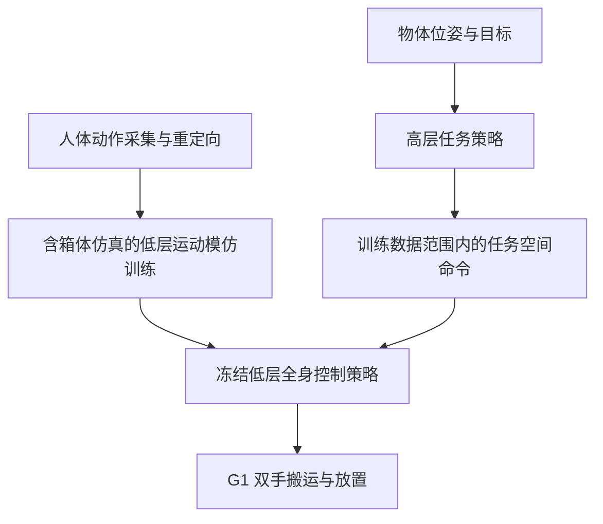

# HLO-AMP: Hierarchical Loco-Manipulation from Object-Aware Motion Priors（基于物体感知运动先验的分层移动操作）

## 一句话定义

HLO-AMP 使用包含被操作物体的运动模仿训练低层控制器，再由高层策略组织完整的箱体搬运任务。

## 英文缩写速查

| 缩写 | 英文全称 | 简要说明 |
|------|----------|----------|
| HLO-AMP | Hierarchical Loco-Manipulation from Object-Aware Motion Priors | 本论文方法 |
| MoCap | Motion Capture | 人体动作采集与重定向参考 |
| WBC | Whole-Body Control | 全身控制 |
| PPO | Proximal Policy Optimization | 策略训练算法 |

## 核心信息

| 项 | 内容 |
|----|------|
| 机构 | Robotics and AI Institute |
| 论文 | [arXiv:2611.05113v1](https://arxiv.org/html/2611.05113v1)，CoRL 2026 |
| 平台 | Unitree G1；双手搬运箱体 |
| 代码 | 论文未列官方代码入口；开放状态待进一步核实 |

## 流程总览

## 核心机制

- 低层用行走、持箱行走、拾取及放置等参考动作训练，箱体真实参与仿真接触；输入是基座高度、姿态、平面速度与双末端位置等 12 维命令，输出关节目标。
- 高层依据本体、箱体面中心和目标产生低层命令；将命令限制在低层训练数据范围内。训练采用阶段奖励和重置，部署策略不依赖阶段标签。
- 低层命令训练加入噪声，并逐步移除对参考关节位置残差基准的依赖，以适配高层调用。

## 源码运行时序图

不适用：目前未核实到可运行的官方实现，不能据此绘制源码时序。

## 实验与评测

- 20 秒仿真评测：整体成功率 80.7%，重箱 70.5%；无物体 WBC 基线分别为 50.3% 和 19.7%。这些数字只适用于论文的任务与评测设置。
- 消融中去掉命令范围限制后，20 秒成功率降至 15.5%；去掉观测噪声后降至 3.0%。
- 真机展示不同箱体与掉落后恢复；7–8 kg 试验接近执行器极限，持续运行可能热停机。

## 结论

物体参与低层训练与高层命令约束共同服务于负载下的长时程双手操作。

1. 评估接触丰富控制时，应考虑真实物体对多点接触力的影响。
2. 层级组合要检验上层命令是否超出下层训练分布。
3. 真机物体位姿来自外部动捕，尚未验证完整机载感知闭环。

## 局限与待核查

- 向其他任务迁移需要新示范、阶段图和奖励；自然度指标不是用户研究。
- 原文部分附录尚待逐项核对，代码开放状态也待确认；本节点暂为草稿。

## 关联页面

- [ReflexArc：全身触觉反射](./paper-reflexarc.md)
- [机器人运动](../tasks/locomotion.md)

## 参考来源

- [论文来源归档](../../sources/papers/hlo_amp_arxiv_2611_05113.md)
- [HLO-AMP 原文 v1](https://arxiv.org/html/2611.05113v1)

## 推荐继续阅读

- [作者视频](https://youtu.be/viR_ULnRDQQ)
