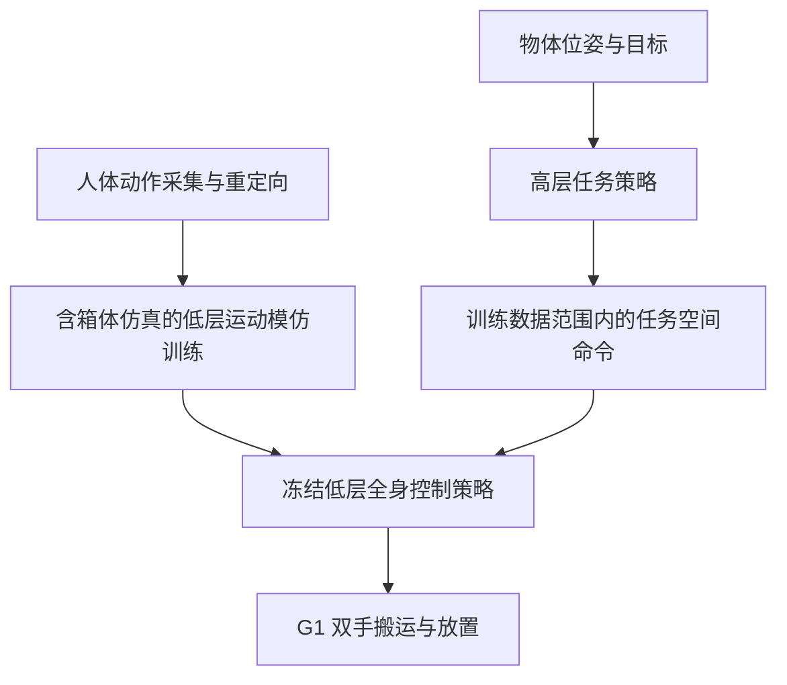

# HLO-AMP: Hierarchical Loco-Manipulation from Object-Aware Motion Priors（基于物体感知运动先验的分层移动操作）

## 一句话定义

HLO-AMP 使用包含被操作物体的运动模仿训练低层控制器，再由高层策略组织完整的箱体搬运任务。

## 英文缩写速查

| 缩写 | 英文全称 | 简要说明 |
|------|----------|----------|
| HLO-AMP | Hierarchical Loco-Manipulation from Object-Aware Motion Priors | 本论文方法名；其中 AMP 指「运动先验（motion priors）」，正文方法未使用对抗式判别器 |
| LL | Low-Level | 低层全身控制策略 $\pi^{LL}$，由运动模仿训练后冻结 |
| HL | High-Level | 高层任务策略 $\pi^{HL}$，部署时不依赖参考动作，输出低层命令 |
| WBC | Whole-Body Control | 全身控制器；本文的对照基线中为命令跟踪型控制器 |
| MoCap | Motion Capture | 人体动作采集；用于生成参考动作，部署时箱体位姿也来自外部动捕 |
| PPO | Proximal Policy Optimization | 低层与高层两阶段训练共用的策略优化算法 |
| RSI | Reference State Initialization | 参考状态初始化：reset 时从示范状态开始训练（本文用于低层与高层） |
| E2E | End-to-End | 端到端单体策略，本文对照基线之一 |
| N&S | Naturalness-and-Smoothness | 自然度与平滑度指数，为六项相对本文的比值均值，越高越差 |
| EE | End-Effector | 末端执行器，本文指双手 |

## 核心信息

| 项 | 内容 |
|----|------|
| 机构 | Robotics and AI Institute |
| 论文 | [arXiv:2611.05113v1](https://arxiv.org/html/2611.05113v1)，CoRL 2026 |
| 平台 | Unitree G1；双手搬运箱体 |
| 代码 | 截至入库日，arXiv 摘要页与论文正文均未列官方代码仓库或项目页（仅列作者视频）；未核实到可运行实现 |

## 为什么重要

- 分层人形搬运常见做法是「与任务无关的命令跟踪 WBC + 上层任务策略」。但这类 WBC 多靠手工奖励塑形训练，动作呈明显机器感，且训练时场景中没有被操作物体。
- 物体动力学常用随机末端力扰动近似，无法复现手臂与躯干承受的分布式多接触负载；论文指出在接近平台负载上限时，这一差距会变得关键。
- 端到端的模仿跟踪策略则受限于参考动作分布。本文的取舍是：让运动先验本身在含物体的仿真中训练，再用受约束的高层策略把先验组合到长时程任务中。

## 流程总览

## 核心原理

### 输入、机制与输出

- **低层 LL**：输入本体观测 $o^{LL}_t$ 与任务空间命令 $c^{LL}_t$，输出各关节的目标。命令为 12 维（论文记为 $c^{LL}_t\in\mathbb{R}^{12}$），包含基座高度、基座横滚/俯仰、平面基座速度，以及左右末端位置（躯干系）；平面速度的具体分量数论文未逐一写明（未核实）。箱体在仿真中物理存在，但箱体位姿不被 LL 观测。
- **高层 HL**：输入与 LL 相同的本体信号，外加上一时刻的 HL 动作、箱体六个面中心在躯干系下的相对位置，以及用户给定的目标 $g=(x^\star,y^\star,z^\star)$；输出 $a^{HL}_t$，经限幅映射为 LL 命令。
- **训练顺序**：先训练 LL 并冻结，再在冻结的 LL 之上训练 HL。部署时 HL 不接收阶段标签，也不依赖参考动作。

### 关键机制

- **含物体的运动模仿**：低层用行走、持箱行走、拾取及放置等参考动作训练，箱体真实参与仿真接触；箱体位姿不进入 LL 观测，只在跟踪奖励与提前终止条件中出现。
- **残差基准课程**：低层关节目标由参考关节位置、测得关节位置和策略残差组成，基准从参考逐步过渡到机器人自身测量值：

$$
q^{cmd}_t = (1-\beta_t)\,\hat q_t + \beta_t\, q_t + \sum a^{LL}_t,\qquad \beta_t:0\to 1
$$

  其中 $\hat q_t$ 为参考关节位置，$q_t$ 为测得关节位置。

- **命令限幅保持分布内**：HL 动作先映射为标称命令附近的命令，再按数据集经验包络逐维裁剪：

$$
c^{LL}_t=\phi(a^{HL}_t)=\mathrm{clip}\!\left(c^{nom}+\sigma\,a^{HL}_t,\;c^{min},\;c^{max}\right)
$$

  其中 $c^{nom}$ 为 LL 数据中的标称站立命令，$\sigma$ 控制探索范围，$[c^{min},c^{max}]$ 为数据集的逐维经验包络。
- **命令噪声**：LL 训练时对命令加入有界均匀噪声（约 ±0.10 m 基座高度、±0.15 rad 基座姿态、±0.25 m/s 平面速度、±0.05 m 末端位置），以适配由随机 HL 生成的命令。
- **阶段奖励（仅训练时）**：确定性调度器按五个阶段推进（0 WALK-TO-BOX、1 LIFT-BOX、2 CARRY-TO-GOAL、3 PLACE-BOX、4 IDLE），转移由位置、朝向、双手接触与箱高等物理谓词触发；携箱阶段若掉箱可回到阶段 0。调度器只用于奖励选择与 critic 的特权信息，部署策略不观测阶段。
- **HL 观测与目标裁剪**：箱体面中心与目标向量逐轴硬裁剪，超出范围的距离饱和到同一值；箱体六个面中心在每个 episode reset 时随机排列，以消除 MoCap 轴标签的任意性。
- **HL 的 RSI**：以一定概率把机器人与箱体联合重置到拾取示范的中途构型（论文给出的概率为 0.75），否则从远离箱体处开始并自行发现接触构型。

## 源码运行时序图

**不适用**（截至入库日未核实到官方可运行实现；论文与 arXiv 摘要页均未列代码仓库，因此不据此绘制源码时序）。

## 工程实践

### 训练配置（论文附录 G–H）

| 项 | 取值 |
|----|------|
| 仿真平台 | IsaacLab，8192 个并行环境（实验评测使用 10,000 环境） |
| 控制频率 | 50 Hz |
| 算法 | PPO：γ=0.99，GAE λ=0.95，clip 0.2，学习率 1e-3（自适应），target KL 0.01，最大 30,000 次迭代 |
| 网络 | actor MLP [512, 256, 128]，critic MLP [512, 512, 256]，ELU 激活；采用非对称 actor–critic |
| 箱体几何 | 训练使用小（0.32³ m）、中（0.46×0.32×0.32 m）、大（0.54×0.39×0.42 m）三种；质量 0.5–8.0 kg |
| 域随机化 | 机器人与物体质量、摩擦、恢复系数、PD 增益等；物体质量尺度 [0.5, 5.0]；HL 另随机箱体起终点与支撑桌高（目标桌以 0.5 概率出现，高度至 0.75 m） |

### 运动数据准备（附录 A）

- 用单名受试者的 MoCap 采集 carry、pick、place 三类箱体示范，行走类直接复用 ZEST 的重定向片段。
- 重定向采用 interaction-mesh 方法，并针对 G1 与人体的比例差异做分段缩放、骨链重建、按支撑脚重新接地及抓握接触保持修正。
- 每个操作行为生成 10 个箱体几何变体，共 30 条示范。

### 部署与调试

- **部署观测**：HL 使用机载本体（IMU、编码器）与外部动捕提供的箱体位姿、用户给定的目标；不需要参考动作。
- **调试指标**：各阶段完成率（如 Table 12 的「拾取 → 抬起 → 到达 → 放置」漏斗）、掉箱率、OOD 命令频率（HL 预裁剪命令超出 LL 包络的步数比例）、N&S 指数。消融中去掉包络裁剪时 OOD 频率从 0.15 升至 1.00。
- **工程上不可省略的组件**（表 3 消融）：观测噪声、包络裁剪、LL 训练中的物体、HL 的定向 RSI。去掉任一项，成功率都降至 3–16%。
- **硬件负载**：Unitree G1 上 0.5 kg 与 2 kg 箱体稳定完成；5 kg 与 7 kg 可完成（7 kg 为 2/3 成功）；8 kg 为 0/3，出现热停机或紧急停止。

## 实验与评测

- 20 秒仿真评测：整体成功率 80.7%，重箱 70.5%；无物体 WBC 基线分别为 50.3% 和 19.7%。这些数字只适用于论文的任务与评测设置。
- 评测预算变化（表 1）：30 s 为 87.5%，40 s 为 87.9%；将初始位姿与目标范围放大一倍后，40 s 成功率为 82.1%。
- 消融中去掉命令范围限制后，20 秒成功率降至 15.5%；去掉观测噪声后降至 3.0%。
- 真机展示不同箱体与掉落后恢复；每个条件尝试 3 次，除 7 kg 与 8 kg 外全部成功。7–8 kg 试验接近执行器极限，持续运行可能热停机。
- 真机 OOD 测试：约 60 cm 轻质立方体（超过训练最大箱体）可完成抓取与放置。
- 多目标与多箱体连续运行：四段目标每次放置误差均在 30 cm 以内；跨 75 cm 高桌的串联任务中，碰撞后可通过提高携带高度重试完成。

## 与其他工作对比

- **实验内基线（表 2，20 秒）**：三种对照共用本文的域随机化、PPO 配置、算力与任务。单体端到端策略成功率 3.6%（91.6% 能走到抬起阶段，但学不会双手抓取）；无物体 WBC 为 50.3%（轻箱 65.7%、重箱 19.7%）；加末端力扰动替代的 WBC 为 77.1%，但掉箱率 78.0%。本文 80.7%，掉箱率 26.8%，N&S 指数 1.00（基线 1.29 / 1.16，越高越差）（§4.2）。
- **用随机力扰动代替物体的全身控制**：[FALCON](./paper-loco-manip-161-109-falcon.md) 用末端随机力课程训练上下肢双智能体，[HOMIE](./paper-loco-manip-161-040-homie.md)、[OmniH2O](./paper-hrl-stack-08-omnih2o.md) 等训练时不建模被操作物体（§2）。本文让箱体真实进入低层训练；消融中改用力替代后成功率只有 6.7%（表 3）。
- **冻结 WBC + 高层策略**：[VIRAL](./paper-viral-humanoid-visual-sim2real.md)、[DoorMan](./paper-doorman-opening-sim2real-door.md) 在预训练 WBC 上蒸馏高层策略，[DemoHLM](./paper-loco-manip-161-136-demohlm.md) 用示范条件的行为克隆；论文称这类方案会继承低层不感知物体的局限（§2）。
- **保留运动先验的桥接方法**：[VisualMimic](./paper-notebook-visualmimic.md) 同样限制下发给跟踪器的命令，最接近本文，但用两阶段蒸馏的关键点跟踪器；[PhysHSI](./paper-amp-survey-15-physhsi.md) 部署时也不需参考动作，但论文称其结果限于轻箱、未含大扰动恢复；[Pro-HOI](./paper-loco-manip-161-074-pro-hoi.md) 依赖运动学规划器提供根轨迹（§2「Positioning of our work」）。
- **奖励塑形路线**：[WoCoCo](./paper-loco-manip-161-116-wococo.md) 把长程任务拆成顺序接触阶段，需要细致的奖励工程（§2）。以上相关工作的数字均未在同一设置下复现，不能与本文表 2 横比。

## 结论

**一句话总判：让低层先验直接在含箱体的仿真中学会负载耦合，比用力扰动近似或奖励塑形更能支撑重物搬运；但高层的命令包络约束与真机感知边界同样是成败的关键。**

1. **负载要进入低层训练** — 消融中以末端力替代箱体只得 6.7%，说明接触负载的建模位置是本文最关键的设计。
2. **高层命令必须限定在低层包络内** — 去掉包络裁剪后 OOD 命令频率从 0.15 升至 1.00，成功率降至 15.5%。
3. **观测噪声不可省** — 去掉后成功率仅 3.0%，LL 需在带噪命令下训练才能被高层可靠驱动。
4. **读数字时要看负载与预算** — 20 秒成功率 80.7%，40 秒为 87.9%；重箱（≥4 kg）明显低于轻箱，应按负载分段看结果。
5. **接近执行器极限会成为硬约束** — 7 kg 试验出现三个关节超过力矩上限，8 kg 为 0/3 并出现热停机。
6. **真机感知仍是外挂** — 箱体位姿来自外部动捕，机载感知闭环尚未验证。

## 局限与风险

- **感知**：部署依赖外部动捕提供箱体 6 自由度位姿；论文未验证完整机载感知闭环，并提出未来可将 HL 蒸馏为基于深度的学生策略（§5）。
- **运动库覆盖**：LL 先验只基于四类基本动作（自由行走、持箱行走、拾取、放置）。桌到桌超出示范抬起范围、不同初始抓取、推动或翻滚等非抓取交互，都需要新的重定向示范；HL 本身无法外推到这些行为。
- **迁移成本**：向开门等其他接触丰富任务迁移，需要新示范、阶段图与阶段奖励；论文称其余 LL/HL 形式可直接沿用，但这一判断未在其他任务上验证。
- **负载边界**：7 kg 试验（2/3 成功）时三个关节超过力矩上限，8 kg 为 0/3；持续高负载运行可能热停机。论文称主要失败模式是抓取丢失而非携带失稳。
- **几何敏感度**：按论文的三轴压力测试，箱体尺寸对成功率的影响最大（尺寸 ±30% 时成功率降至 0.65–0.75 倍基准），质量增至三倍时降至 0.50 倍；外部推力影响最小（推力达 3 倍训练幅度时仍保持 0.98 倍，主要增加掉箱率）。
- **自然度度量**：N&S 指数是代理指标，论文未做用户研究，「更自然」的结论应谨慎对待。
- **未观测障碍**：HL 不观测支撑箱与目标桌，二者的碰撞被当作外部扰动处理，其恢复能力依赖训练中的扰动分布。
- **可比性**：基线对比在论文统一设置下进行，与其他工作的已发表数字不能直接横比。

## 关联页面

- [ReflexArc：全身触觉反射](./paper-reflexarc.md)
- [机器人运动](../tasks/locomotion.md)
- [VisualMimic](./paper-notebook-visualmimic.md)：同样限制命令范围的最接近对照工作
- [分层强化学习](../methods/hierarchical-reinforcement-learning.md)

## 参考来源

- [论文来源归档](../../sources/papers/hlo_amp_arxiv_2611_05113.md)
- [HLO-AMP 原文 v1](https://arxiv.org/html/2611.05113v1)

## 推荐继续阅读

- [作者视频](https://youtu.be/viR_ULnRDQQ)
- [ZEST: Zero-shot embodied skill transfer for athletic robot control（低层 LL 训练所依据的方法，DOI）](https://doi.org/10.1126/scirobotics.aec7695)
