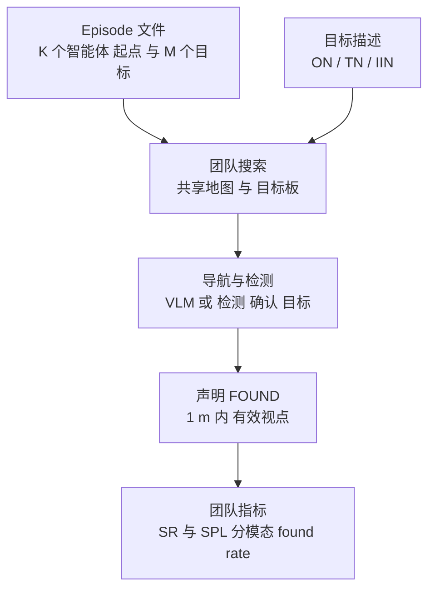
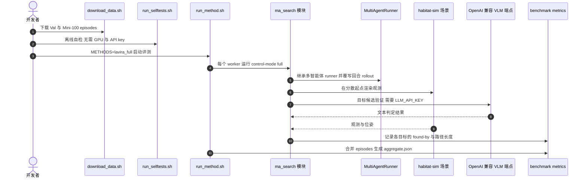

# HM3D-M3：多智能体、多模态、多目标目标导航基准

**HM3D-M3**（论文 *HM3D-M3: A Benchmark for Multi-Agent, Multi-Modal, Multi-Object Goal Navigation*，[arXiv:2610.20121](https://arxiv.org/abs/2610.20121)，[项目页](https://robo-lavira.github.io/hm3d-m3/)）在同一个回合中同时考察多机器人协作、目标的多种描述形式（类别、实例文本、实例图像）与多目标搜索，填补了三者分别研究的基准空白。

## 英文缩写速查

| 缩写 | 英文全称 | 简要说明 |
|------|----------|----------|
| ON | Object Category Navigation | 目标以开放词汇类别名给出 |
| TN | Text-described Navigation | 目标以一个实例的文字描述给出 |
| IIN | Instance Image Navigation | 目标以一个实例的参考图像给出 |
| SR | Success Rate | 目标级成功率：回合内被找到目标的平均比例 |
| SPL | Success weighted by Path Length | 本文为 makespan 归一化的团队版本，衡量团队路径效率 |
| LaViRA-M3 | （论文命名，未展开） | 文中训练免费的 VLM 团队基线，本文提出 |

## 为什么重要

- **团队与多目标是真实需求：** 服务机器人常同时收到多个请求，且请求形式多样。
- **单一维度的基准已有：** 已有工作分别研究多智能体、多模态或多目标，但缺少三者同时存在的评测。
- **可直接用于比较：** 统一的指标与 episode 文件使不同协作范式可以在同一设定下对比。

## 核心信息

| 项 | 内容 |
|----|------|
| **机构** | 南京大学（NJU）；南京师范大学（Nanjing Normal University）；中国科学院大学（UCAS） |
| **平台 / 数据** | Habitat 仿真，HM3D 照片级室内场景（Val 36 个场景）；验证 1,000 episodes、3,926 目标、379 类别；训练 16,000 episodes（145 个场景）与 100K 观测-分配样本 |
| **开源** | **已开源**：代码 [NJU-R-L-Group-Embodied-Lab/hm3d-m3-code](https://github.com/NJU-R-L-Group-Embodied-Lab/hm3d-m3-code)（代码 CC BY-NC-SA 4.0）；数据经 GitHub Release 与 Hugging Face 发布（CC BY-NC 4.0 加 HM3D 条款）；**HM3D 场景与模型权重需自行获取** |

## 核心原理

### 流程总览

- **输入：** 场景、K 个智能体的分散起点、M 个无序目标及其模态。
- **关键机制：** 目标被团队中任一智能体找到即计入；每个方法自行决定何时声明目标；基准以是否在正确实例 1 m 内的有效视点为准。
- **输出：** 每回合的目标级 SR、SPL 与分模态 found rate。

## 工程实践

| 项 | 建议 |
|----|------|
| 环境 | Habitat 仿真需 GPU 与 EGL；代码提供 Docker 配方，但仓库未发布预构建镜像 |
| 数据 | 通过仓库的数据下载脚本获取 Val 与 Mini-100；HM3D 场景需自行向 HM3D 申请 |
| 快速验证 | 先跑 Mini-100 子集（100 episodes）检查流程，再跑完整 Val |
| 大模型依赖 | LaViRA-M3 与部分基线需要 OpenAI 兼容 VLM 端点与 API key；论文使用的托管模型与成本需自行评估 |
| 对照 | 同一 episode 文件上比较 VLFM、EGO-Swarm、Co-NavGPT2、DM3-Nav 与 LaViRA-M3，保持统一设定 |
| 源码运行时序图 | 见下节 |

## 源码运行时序图

官方仓库 [NJU-R-L-Group-Embodied-Lab/hm3d-m3-code](https://github.com/NJU-R-L-Group-Embodied-Lab/hm3d-m3-code) 的 `sim-code/` 目录提供离线自检、Mini-100 与 Val 评测入口。最短复现路径为：下载 episodes，运行自检，再以 `lavira_full` 方法启动评测，各 worker 合并后生成 `aggregate.json`。

- **关键复现路径：** `sim-code/` 下先跑 `scripts/run_selftests.sh`，再跑 `scripts/mini100/lavira.sh`；`run_method.sh` 将 `METHODS` 切换为其它基线即可对照。
- **真机代码：** `real-world-code/` 与仿真代码独立，依赖不同的 Python 环境（ROS 1 / ROS 2）。

## 实验与评测

- **Val 1,000 episodes（项目页 Results）：** LaViRA-M3 SR 41.0%、SPL 20.3；HiGA SR 37.9%；DM3-Nav SR 26.6%；Co-NavGPT2 SR 24.5%；EGO-Swarm SR 23.7%；VLFM SR 16.1%。
- **分模态：** LaViRA-M3 的 ON / TN / IIN found rate 为 38.6 / 40.9 / 41.4；HiGA 为 53.0 / 40.2 / 18.8。两者在不同模态上各有优势。
- **失败归因：** LaViRA-M3 漏检 59.0%，主要在声明位姿阶段；HiGA 漏检 62.1%，主要在感知阶段。
- **真机：** 办公室内三台异构机器人（Agilex Cobot Magic、Unitree Go1、Unitree Go2）协作演示。

## 结论

**HM3D-M3 的价值是把多智能体、多模态与多目标放进同一个可复现的评测设定，并暴露出不同协作范式的互补失败模式。**

1. **适配方法只能找到 16–27% 的目标** — 单机方法与零样本方法直接迁移到多目标团队时表现明显不足。
2. **两条路线各有强项** — 学习的目标分配在类别目标上占优，共享目标板与进度分析在实例目标与效率上占优。
3. **读 SR 时要看模态拆分** — 总 SR 掩盖了 IIN 与 ON 之间的差距，应同时报告分模态 found rate。
4. **SPL 数值不能孤立比较** — 论文中 HiGA 的 SPL 远低于其 SR，效率与成功率需要一起解释。
5. **复现依赖外部资源** — HM3D 授权、VLM 端点与 GPU 环境缺一不可，需要提前规划成本与许可。

## 与其他工作对比

| 维度 | HM3D-M3 | 单智能体 ObjectNav / VLN 基准 | 已有多智能体基准 |
|------|---------|-------------------------------|------------------|
| 智能体数 | 多个（K ∈ {2,3,4}） | 单个 | 多个 |
| 目标模态 | ON、TN、IIN 同时存在 | 通常单一模态 | 通常单一模态 |
| 目标数 | 多目标无序（M ∈ {3,4,5}） | 通常单目标或有序指令 | 视任务而定 |

与 [视觉语言导航](../tasks/vision-language-navigation.md) 与 [零样本目标导航](../tasks/zero-shot-object-navigation.md) 相邻；与 [HM3D-OVON](./paper-hm3d-ovon.md) 共享 HM3D 场景资源；LaViRA 系列的前序工作见 [Uni-LaViRA](./paper-uni-lavira.md)。

## 局限与风险

- **仿真到真机的差距：** 基准在 Habitat 与 HM3D 场景中评测，真机演示仅为定性展示，规模与场景数有限。
- **强依赖外部 VLM：** LaViRA-M3 的表现受所用 VLM 影响；更换模型后结论需要重新评估。
- **授权限制：** 代码 CC BY-NC-SA 4.0，数据 CC BY-NC 4.0 加 HM3D 条款，商业用途受限。
- **团队规模小：** K 最多为 4，更大规模团队的通信与分配问题未覆盖。

## 关联页面

- [视觉语言导航](../tasks/vision-language-navigation.md) — 相邻的语言引导导航任务
- [零样本目标导航](../tasks/zero-shot-object-navigation.md) — 单目标 ObjectNav 的零样本路线
- [Uni-LaViRA](./paper-uni-lavira.md) — 本文 LaViRA-M3 基线的前序工作
- [HM3D-OVON](./paper-hm3d-ovon.md) — 同一 HM3D 场景资源的开放词汇导航基准
- [Habitat 仿真](./habitat-sim.md) — 论文所用的仿真平台
- [具身大模型评测基准选型闭环](../queries/embodied-eval-benchmark-selection-loop.md) — 本页归入其 ③ 策略任务成功率评测层：多智能体、多目标导航任务的成功率与效率评测
- [多机器人协作（人形）](../concepts/humanoid-multi-robot-coordination.md) — 多机器人协作的通用问题背景

## 参考来源

- [HM3D-M3 论文归档](../../sources/papers/hm3d_m3_arxiv_2610_20121.md) — 摘要、项目页结果表与代码仓库核查记录
- [微信图文：31 篇具身论文速览（2026-10-15）](../../sources/raw/wechat_embodied_station_robot_31_papers_2026-10-15.md) — 文章中的一句话转述

## 推荐继续阅读

- [HM3D-M3 项目页](https://robo-lavira.github.io/hm3d-m3/) — 结果表、基线与真机演示
- [arXiv:2610.20121](https://arxiv.org/abs/2610.20121) — 完整论文与指标定义
