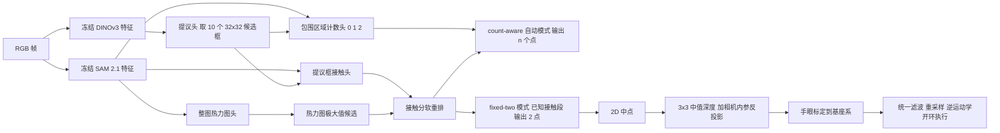

# HOC2R：手物接触轨迹用于人到机器人运动迁移（arXiv:2611.08920）

**HOC2R**（*Hand-Object Contact Trajectories for Human-to-Robot Motion Transfer*，[arXiv:2611.08920](https://arxiv.org/abs/2611.08920)，ACRA 2026，UNSW Sydney）。一手资料归档见 [sources/papers/hoc2r_arxiv_2611_08920.md](../../sources/papers/hoc2r_arxiv_2611_08920.md)。

## 一句话定义

在冻结的 DINOv3 与 SAM 2.1 特征上训练四个轻量头，对人类演示的每一帧预测 0/1/2 个可见手物接触点，并把两点中点经 RGB-D 提升到机器人基座坐标，作为接触后运动线索；**它是感知 / 伪标注模块，不训练机器人策略，也不涉及强化学习**（第 1、7 节）。

## 英文缩写速查

| 缩写 | 英文全称 | 简要说明 |
|------|----------|----------|
| HOC2R | Hand-Object Contact trajectory extractor for Robot motion | 本文方法名 |
| DINOv3 | self-distillation vision foundation model v3 | 冻结的视觉特征骨干（ViT-S/16），用于提议头 |
| SAM 2.1 | Segment Anything Model 2.1 | 冻结的 Hiera-S 特征，用于接触、计数、热力图三个头 |
| VRB | Vision-Robotics Bridge（Affordances from human videos） | 最接近的对比对象；VRB2 是作者的两点改造 |
| EgoHOS | Egocentric Hand-Object Segmentation | 手、交互物体与接触边界分割；EgoHOS-Point 是作者的两点改造 |
| 100-DOH | 100 Days of Hands | 手与接触状态检测器，VRB2 用它 |
| F1@10 | F1 at 10 pixels | 预测点与标注点一对一匹配，10 像素内算对 |
| RGB-D | RGB plus Depth | 彩色加对齐深度，用于 2D 到 3D 提升 |
| IK | Inverse Kinematics | 逆运动学，开环执行轨迹 |

## 为什么重要

- 人类视频里有大量抓取与操作示范，但框与掩码给不出生成夹爪轨迹所需的接触位置（第 1 节，作者自述）。
- 只需少量点标注（210 帧）即可训练，不需要配对的机器人动作（第 2、4 节）。
- 作者强调的主要优势是多手歧义下的手物关联，以及蓝手到自然肤色的手色迁移（第 6 节，作者自述）。
- 判断（本 wiki）：它更像是「人视频到接触点」的小型伪标注工具，证据规模有限，宜当作线索，不是通用方案。

## 核心机制

### 流程总览

### 要点（均出自论文）

- **接触表示**：每帧无序点集，数量 0/1/2；1 表示两个接触之一被遮挡（第 3.1 节，式 1）。
- **四个头**：DINOv3 提议头（前 10 个 32x32 框，覆盖 95.7% 留出标注）；SAM 特征上的提议框接触头、包围区域计数头、整图热力图头（第 3.1、5.1 节）。
- **软重排**：s(p)=logit h(p)+0.5·max(0, logit q(p))，0.5 在验证折选定；触摸项被截断为不小于 0，只抬高不惩罚（式 2）。
- **两种模式**：count-aware 自动检测并计数，处理未裁剪视频；fixed-two 假定已知活跃接触段，始终输出两点（第 3.2 节）。作者称这是有意区分的：count-aware 在域内最强，fixed-two 在域移位后更可靠（第 1 节）。
- **机器人侧**：2D 中点 → 3x3 邻域有效深度中值 → RealSense 内参反投影 → 手眼标定到 Kinova 基座 → 统一滤波（缺深度、工作空间、几何跳变）→ 重采样到间距不超过 0.02 m（第 3.3 节，附录 C）。

## 实验与评测

| 项 | 论文设置与结果（出处） |
|----|------------------------|
| 域内基准 | Human2Robot 的 30 个任务共 210 张蓝手帧（87 无接触 / 39 单接触 / 84 双接触，共 207 点），五折任务级划分，18/6/6 任务（第 4 节） |
| 域内主结果 | count-aware：数量准确率 71.4% 对 VRB2 58.1%；F1@10 62.0% 对 25.8%；平均距离 10.46 px 对 19.81 px（第 5.1 节，表 1）。EgoHOS-Point 在蓝手帧上无输出 |
| 消融 | 热力图-only 59.5、硬过滤 59.3、触摸重排 61.8、完整 62.0（F1@10，表 2） |
| 训练任务数 | 域内 count-aware F1@10 40.0 到 56.0（5 到 20 任务）；外部 fixed-two 32.8 到 24.8，5 任务最好（表 3）。作者声明单种子、子集构成不同，不能说明数据少更好 |
| 外部 7 条 rollout | 30 任务 count-aware 漏掉 129 个正帧中的 63 个，F1@10 仅 0.9%；fixed-two 避开该失败；5 任务 fixed-two 聚合最佳（第 5.3 节，图 4） |
| 多手 | 双手铅笔 rollout：指派误差 VRB2 156.11 px、EgoHOS-Point 126.00 px、HOC2R 17.81 px（图 5）；30 任务提议框覆盖 77 个铅笔接触中的 68 个 |
| 真机 | 6 条序列（2 抓放 / 2 推 / 2 双手笔），30 任务检查点：4 条可行、3 条成功；VRB2 与 EgoHOS-Point 各 2 可行 1 成功；5 任务检查点 2 条可行并均成功（第 5.4 节，表 4、表 9） |
| 无效帧（表 4、7） | VRB2 72（34.3%）、EgoHOS-Point 70（33.3%）、5 任务 42（20.0%）、30 任务 30（14.3%），共 210 输入帧 |

读法提醒：

- 真机每方法只有 6 条序列，3/6 对 1/6 的差距是个位数试验，没有置信区间（论文给了 2D 指标的任务级 bootstrap 区间，机器人结果没有）。
- 被拒轨迹计为失败，30 任务检查点 6 条里只有 4 条真正执行（表 9）。
- 5 任务检查点在 2D 外部指标最优，但机器人侧只成功 2/6，作者因此说 2D 聚合定位并不能完全预测深度有效性与轨迹可行性（第 5.4 节）。

## 结论

**HOC2R 在多手关联与手色迁移上给出了清楚的 2D 证据，但机器人侧只有 6 条开环序列，应当作「人视频到接触点」的小型伪标注工具，而非可直接部署的迁移方案。**

1. **真正要看的指标**是机器人侧「可行轨迹数 / 成功数」与无效帧比例（表 4、9），而不是 2D F1@10：5 任务检查点 2D 外部指标最优，机器人侧却只成功 2/6（第 5.4 节）。
2. **按场景选模式**：已知接触段、跨域部署用 fixed-two（30 任务 count-aware 在外部漏掉 129 个正帧中的 63 个，第 5.3 节）；未裁剪的域内视频才用 count-aware。
3. **多手场景收益最明确**：双手铅笔 rollout 指派误差 17.81 px 对 VRB2 156.11 px（图 5）；单手场景作者自述只是「具竞争力但并非处处更优」。
4. **次要成本在 3D 提升链路**：深度噪声、手眼标定误差和中点落错表面都会让轨迹被拒，被拒即记失败（第 6 节、表 9）。
5. **对比不对等**：基线未在作者标签上重训（第 4 节），条件平均距离只在有预测的正帧上算，需与漏检数一起读。

## 与其他工作对比

| 对照 | 差异读法（基于论文第 4 节基线设置与本页实验） |
|------|------|
| [VRB](./paper-aff-2304-08488-affordances-from-human-videos-as-a-versatile-representat.md)（改造为 VRB2） | VRB2 用 100-DOH 检测加手色分割、加权高斯混合取两中心，依赖手色先验，在多手时会关联到静止的手；HOC2R 用冻结基础模型特征加少量点标注训练的轻量头，域内 F1@10 62.0% 对 25.8%（表 1） |
| EgoHOS（改造为 EgoHOS-Point） | 由接触边界分割转两点，蓝手帧上无任何输出，反映手色域差；外部与机器人侧与 VRB2 相近（各 2 可行 1 成功） |
| [运动重定向](../concepts/motion-retargeting.md) | 重定向迁移的是人体 / 手部关节动作；HOC2R 只输出接触点轨迹，交给逆运动学开环执行，不含抓取前阶段 |

## 工程实践

- **默认检查点**：已知接触段时，作者推荐发布的 30 任务 fixed-two 检查点（第 6 节）；新环境建议用「在手、物体、视角、动作上有多样性」的少量任务做后训练，作者明说这只是有前景的适配策略，不是通用的 5 任务配方。
- **开源**：README 列出 5 任务与 30 任务头、单帧示例、基线推理与机器人测试代码（静态读取，未运行，**未核实可复现**）。
- **硬件**：RealSense 彩色相机，Kinova 机械臂（附录 C，具体型号叫法以论文为准，此处仅作关联）；手眼标定 10 个 ChArUco 位姿加 5 个检验位姿。
- **与 RL 的关系**：论文没有任何强化学习实验；作为强化学习综述的被引文献，它最多可作为「从人类视频抽取接触线索」的相邻工作，不能当作 RL 的结果引用。

## 局限

论文自述（第 6 节）：

- 基准仅 210 帧 / 30 任务；外部评测只有一套相机与 7 条 rollout。
- 仅两指交互；逐帧独立预测，无时序建模。
- RGB-D 提升会受深度噪声、标定误差与中点落在错误表面影响。
- 机器人只有 6 条序列，从已建立的夹爪接触开始，开环逆运动学；基线是点输出改造而非其原目标。
- 结论只覆盖接触定位与接触后运动线索，不含自主抓取或端到端模仿学习。

本 wiki 看到的未验证之处：

- 基线 VRB2 与 EgoHOS-Point 未在作者标签上重训（第 4 节），与在标注数据上训练的 HOC2R 并非同等条件；域内比较尤其如此，EgoHOS-Point 在蓝手帧上完全无输出，这反映手色域差，不等于方法本身弱。
- 条件平均定位距离只在「正帧同时有标注与预测」时计算（第 4 节），不同方法的覆盖不同，10.46 对 19.81 px 不是同一批点的比较，需与漏检数一起看。
- 摘要中 67.67 px 只在摘要出现，正文表 3 只给出 27.02；该汇总值我未在正文中找到对应表，推测来自 VRB2 的外部汇总（推测，未核实）。
- 单随机种子，训练任务数曲线不可当作规律（作者也承认）。
- 开源仓库未运行，复现情况未核实。

## 关联页面

- [模仿学习](../methods/imitation-learning.md)：HOC2R 输出的是接触线索，尚未接入任何策略学习。
- [VRB：Affordances from Human Videos](./paper-aff-2304-08488-affordances-from-human-videos-as-a-versatile-representat.md)：论文最接近的基线来源（VRB2 为其接触提取阶段的改造）。
- [DINOv3](./paper-rcl-2508-10104-dinov3.md)：冻结骨干之一。
- [SAM 2](./paper-sam2.md)：SAM 2.1 特征的上游。
- [手眼标定](../concepts/hand-eye-calibration.md)：相机到机器人基座的变换估计。
- [运动重定向](../concepts/motion-retargeting.md)：另一条人到机器人迁移路线，HOC2R 输出的是接触点而非全身关节动作。
- [Kinova Gen3](./kinova-gen3.md)、[Intel RealSense](./intel-realsense.md)：硬件页（论文用 Kinova 机械臂与 RealSense 相机，具体型号以论文为准）。

## 参考来源

- 论文：<https://arxiv.org/abs/2611.08920>（PDF v1 全文，核对范围见归档）
- [sources/papers/hoc2r_arxiv_2611_08920.md](../../sources/papers/hoc2r_arxiv_2611_08920.md)
- 代码：<https://github.com/liszzzzt/HOC2R>；标注数据：<https://github.com/liszzzzt/HOC2R-Dataset>
- 线索：具身智能小站 2026-11-09 更新（一句话说法已回论文核对）

## 继续阅读

- 论文引用的相关工作：VRB（Bahl 等 CVPR 2023）、MimicPlay（Wang 等 CoRL 2023）、Human2Robot（arXiv:2502.16587）、EgoHOS（Zhang 等 ECCV 2022）、100-DOH（Shan 等 CVPR 2020）。
- 同方向的接触轨迹工作（论文第 2 节引用，本 wiki 未读）：HOWTransfer（arXiv:2606.10743）、ContactFlow（arXiv:2607.26579）。
