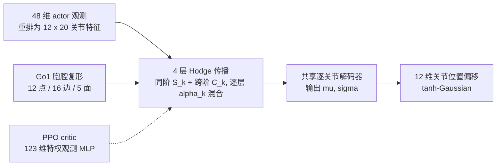

# 高阶形态先验：Go1 执行器退化下的 Hodge 消息传递策略

**论文：** *Higher-Order Morphology Priors for Quadruped Reinforcement Learning Under Actuator Degradation*（[arXiv:2610.10934](https://arxiv.org/abs/2610.10934)，cs.RO/cs.LG，2026-10-07，IROS 2026 Workshop BLPC）。作者 You、Shamsi、Wang、Allen-Blanchette；周报标注为普林斯顿大学及两所中学（arXiv 页面未列机构）。

## 一句话定义

**把 Unitree Go1 的关节、连杆与肢体表示成胞腔复形（节点、边、面），让策略网络按 Hodge 拉普拉斯在节点/边/面三个阶之间传递消息，从而显式编码“肢体级、身体级”的高阶机械关系，用于执行器力矩上限下降时的跨肢体补偿。**

## 英文缩写速查

| 缩写 | 英文全称 | 简要说明 |
|------|----------|----------|
| Hodge-F / Hodge-L | Hodge (Full / Lower) actor | 节点-边-面（rank 0–2）/ 节点-边（rank 0–1）版本 |
| GCN | Graph Convolutional Network | 仅节点-边成对连接的图基线 |
| MLP-C / MLP-D | Centralized / Decentralized MLP | 集中式 MLP / 逐关节共享权重、无消息传递 |
| ρ | torque scale | τ_max = ρ·τ_nom，1 为健康、0 为完全失效 |
| H / D | Healthy / Degraded | 训练或测试时是否含退化，如 D→D |
| RMSNorm | Root Mean Square Normalization | 消息更新后的归一化 |

## 为什么重要

- **退化补偿是协调问题：** 少数关节力矩下降后，剩余关节需要跨腿重新分配负载；成对图连接看不到“一条腿的整体”或“四髋构成的机身面”。
- **结构先验的受控检验：** 基线参数量匹配，包含无消息传递（MLP-D）、仅成对（GCN、Hodge-L），可粗略看出“加面”的作用。
- **边界诚实：** 论文数据也显示 Hodge 优势依赖退化课程训练，零样本从健康到退化并不领先。

## 核心信息

| 项 | 内容 |
|----|------|
| **机构** | 周报标注 Princeton 及两所中学；arXiv 页面未列 |
| **平台** | MuJoCo Playground 的 Go1JoystickFlatTerrain（仅仿真） |
| **规模** | 每策略 4 亿环境步、3 个种子（11、12、13） |
| **开源** | **未发布**：arXiv 页面无代码/项目页（截至 2026-10-12） |

## 方法栈与流程总览

## 方法

- **复形构造：** 0-cell 为 12 个驱动关节；1-cell 为 16 条边（8 条腿内运动学边、4 条髋环边、4 条髋-小腿闭合边）；2-cell 为 5 个面（每条腿 1 个肢体面 + 由四个共面髋构成的 1 个机身面）。B₁∈ℝ^{12×16}、B₂∈ℝ^{16×5}。
- **消息传递：** L_k = B_kᵀB_k + B_{k+1}B_{k+1}ᵀ；同阶 S_k = L_k H_k；跨阶 C_k = B_kᵀH_{k−1} + B_{k+1}H_{k+1}；M_k = α_k S_k + (1−α_k) C_k，α_k 逐层逐阶可学习；H_k ← H_k + RMSNorm(g_k(M_k))；面特征用 B₂ᵀH₁ 加静态面信息初始化。
- **策略与训练：** 4 层传播后接共享两层解码器，输出因子化 tanh-Gaussian；critic 为 MuJoCo Playground 标准 MLP（所有 actor 共用）。PPO 使用任务自带的行走奖励。
- **退化模型：** 每次 2 个执行器，共 66 个无序对（44 训练 / 22 留出）；训练每回合 30% 健康、50% 弱化（ρ~LogUniform(0.05,0.20)）、20% 失效（ρ=0）；评测在 22 个留出对与 ρ∈{0,0.025,…,0.50} 共 9 档上平均。

## 实验与评测

基线：MLP-C、MLP-D、GCN（2 层）、Hodge-L、Hodge-F，参数量匹配；每项为 3 种子均值。

| Actor | H→H 回报 | D→D 回报 | D→D 生存率 | D→D 速度 RMSE |
|---|---|---|---|---|
| MLP-C | **33.88** | 19.98 | 0.88 | 0.324 |
| MLP-D | 31.17 | 18.15 | 0.83 | 0.320 |
| GCN | 24.52 | 15.35 | 0.73 | 0.339 |
| Hodge-L | 32.30 | 18.61 | 0.83 | 0.325 |
| Hodge-F | 32.58 | **22.40** | **0.94** | **0.252** |

- **D→H（退化训练的策略测健康）：** Hodge-F 回报 27.17±1.73、RMSE 0.220±0.060，优于 MLP-C 的 24.85 / 0.306。
- **H→D（健康训练，零样本测退化）：** MLP-C 最好（16.89，生存 0.69）；Hodge-F 15.59 / 0.60；Hodge-L 15.32 / 0.63，RMSE 0.195 最低。
- **H→H：** MLP-C 最强，Hodge-F 低约 1.3 回报，GCN 速度 RMSE 高达 0.302。
- 部分标准差较大（Hodge-F D→D RMSE 0.252±0.036），仅 3 个种子。

## 源码运行时序图

**不适用**：论文无官方代码或项目页（截至 2026-10-12）。仿真环境 [MuJoCo Playground](./mujoco-playground.md) 与 PPO 流程为公开工具，但 Hodge actor 的实现未发布。

## 工程实践

| 项 | 建议 |
|----|------|
| 先验接入 | 关节特征按“12×20”排布，面特征用 B₂ᵀ 聚合边特征初始化，再做 α_k 混合 |
| 训练分布 | 必须用含退化的课程（30/50/20），否则 H→D 零样本不占优 |
| 公平对比 | 各 actor 参数量匹配，critic 共用 |
| 评测 | 留出退化关节对（22 对）和多档 ρ，报告回报、生存率与速度 RMSE |

## 结论

**高阶结构先验在“带退化训练后”的补偿上有可测收益，但还不能说明它是通用的容错机制。**

1. **Hodge-F 在 D→D 上最好** — 回报 22.40、生存率 0.94、RMSE 0.252，对 MLP-C 的 19.98 / 0.88 / 0.324。
2. **收益来自“退化训练 + 面结构”的组合** — H→D 零样本时集中式 MLP 反而更好。
3. **只加边不加面收益有限** — Hodge-L（18.61）与 MLP-D（18.15）接近。
4. **健康场景无损但不领先** — H→H 比 MLP-C 低约 1.3。
5. **证据范围窄** — 单机型、平地、仿真、双关节退化、3 种子，因果归因需更多消融。

## 与其他工作对比

| 对照 | 差异读法 |
|------|----------|
| [GNN 概念页](../concepts/graph-neural-network.md) | 本文把成对图推广到胞腔复形（含面） |
| [容错运动](./paper-fault-tolerant-locomotion.md) | 关注关节故障下的运动恢复；本文用结构先验而非显式故障检测（推测，需对照原文细节） |
| 集中式 MLP | 在 H→H 与零样本 H→D 更强，说明结构先验不是免费午餐 |

## 局限与风险

- **开源状态：** 无代码、无权重、无真机。
- **范围：** 仅 Go1 平地摇杆任务，仅两个执行器同时退化。
- **统计：** 3 种子，标准差大；留出集仅 22 对。
- **归因：** 各 actor 差异不只在“是否有面”；图注“virtual 边”与正文描述不一致。

## 关联页面

- [人形/四足前沿周报（2026-10-05~10-09）](../overview/frontier-humanoid-quadruped-2026-10-05-10-09.md)
- [运动控制任务页](../tasks/locomotion.md)
- [图神经网络](../concepts/graph-neural-network.md)
- [容错运动](./paper-fault-tolerant-locomotion.md)
- [MuJoCo Playground](./mujoco-playground.md)

## 参考来源

- [hodge_morphology_arxiv_2610_10934.md](../../sources/papers/hodge_morphology_arxiv_2610_10934.md) — 论文摘录与开源核查
- [周报来源归档](../../sources/blogs/frontier_humanoid_quadruped_2026_10_05_10_09.md)
- [arXiv:2610.10934](https://arxiv.org/abs/2610.10934) — 原文

## 推荐继续阅读

- [arXiv HTML 全文](https://arxiv.org/html/2610.10934v1)
- [MuJoCo Playground](https://playground.mujoco.org/)
