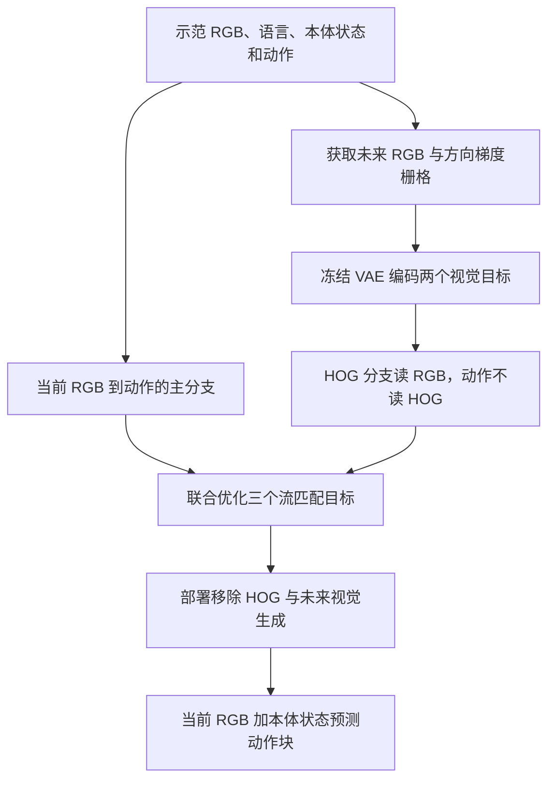
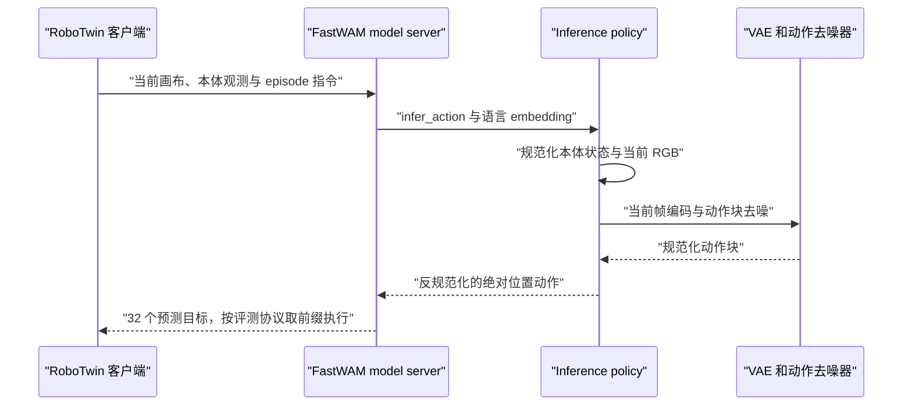

# HOG-WAM：用未来梯度预测增强视觉鲁棒性 | HOG-WAM: Improving Visual Robustness through Future Gradient Prediction

## 一句话定义

HOG-WAM 从示范视频自动计算未来帧的方向梯度直方图，在 RGB 和动作联合训练中补入结构监督；部署仍从当前 RGB 和本体状态生成动作，不计算 HOG。

## 英文缩写速查

| 缩写 | 英文全称 | 简要说明 |
| --- | --- | --- |
| HOG | Histogram of Oriented Gradients | 汇总局部边缘方向的确定性描述 |
| WAM | World Action Model | 联合学习未来观测和机器人的动作 |
| DiT | Diffusion Transformer | 用 Transformer 实现的生成模块 |
| VAE | Variational Autoencoder | 在视觉画布与压缩潜变量之间编码 |

## 为什么重要

**机构：** 北京大学、新加坡国立大学。

相同的抓取或插入任务可能换照明、相机或传感器噪声。预测原始 RGB 会把边界结构和颜色、纹理一起拟合；HOG 提供额外的结构约束，又不强迫控制策略丢弃颜色。

## 核心机制

1. 将示范未来帧转换成三通道 HOG 栅格（9 个方向桶压缩为强度与两个方向矩），经冻结的视觉 VAE 编码；和原 RGB latent、动作一起做流匹配。
2. HOG 查询可读自身与 RGB 流，使辅助损失能训练 RGB 表征；RGB 和动作查询都看不到 HOG。动作只能读当前观测帧以及同一动作副本内的 token。
3. 部署去掉 HOG 分支与未来视觉 token。当前 RGB 表征计算一次、缓存键和值用于动作去噪，再以滚动窗口执行。直接将输入替换成 HOG 是另一项消融，不是主方法。

## 实验与评测

作者报告，和训练设置对齐的 FastWAM 比较：

| 评测 | FastWAM | HOG-WAM | 条件 |
| --- | ---: | ---: | --- |
| RoboTwin 2.0 干净场景 | 92.08% | 91.88% | 每条件 50 项任务、每项 100 回合 |
| RoboTwin-Plus 四种污染平均 | 87.02% | 88.58% | 混合噪声、暖色、欠曝、低对比度 |
| RoboTwin-Plus 混合噪声 | 78.86% | 82.86% | 仅改输入图像，不改任务或成功判据 |
| LIBERO Plus 总体 | 74.49% | 75.26% | 10,030 个变体各跑一次 |
| LIBERO Plus 传感器噪声 | 74.14% | 78.89% | 背景和照明类反而下降 |
| Franka，干净／噪声 | 40%／17% | 59%／24% | 四项任务，每任务、模型、条件 25 次 |

## 工程实践

公开 JAX/Flax 代码建立在 FastWAM-JAX 上，仓库包含训练、导出和仿真评估入口，不直接附训练完成的策略权重、训练集或仿真资源。本页核对源码，未重训、未跑模拟器或真机。典型 RoboTwin 路径中，配置预测 32 个动作，执行前 24 个位置目标后重新规划；不能把同一执行长度照搬到 LIBERO（执行前 8 个）。

### 源码运行时序图

`eval/scripts/fastwam_model_server.py` 调用 `src/fastwam_tpu/inference/policy.py` 的 `infer_action`；`models/mot.py` 中的 `build_hog_mot_attention_mask` 是训练分支与部署分离的实现依据。

## 局限与风险

- 真机只覆盖一套 Franka、四项任务，以及按条件比较的单个训练检查点和一类合成噪声；没有跨训练种子的方差，噪声条件下圆柱插入两者均为 0/25。
- LIBERO Plus 的总体收益不能外推为所有干扰都提升；背景、照明和语言扰动类别没有改善。
- 主方法部署参数结构与基线相同不等于已证明每种设备上运行时间一致；训练增加额外分支与目标预处理成本。

## 结论

把梯度特征用作未来预测监督，而不是作为 RGB 的替代，能在保留原推理结构的前提下改善部分感知扰动下的控制表现。

## 关联页面

- [世界–动作模型纵深路线](../../roadmap/depth-wam.md)

- [世界动作模型](../concepts/world-action-models.md)：训练目标如何向动作条件传递信息。
- [分布外泛化](../concepts/out-of-distribution-generalization.md)：区分可控视觉扰动与机器人、任务动力学的变化。
- [机器人操作](../tasks/manipulation.md)：抓取、堆叠和插入的闭环验证。

## 参考来源

- [论文全文归档](../../sources/papers/hog-wam-arxiv-2611-34811.md)
- [官方源码归档](../../sources/repos/hog-wam.md)

## 推荐继续阅读

- [Fast-WAM](./paper-fast-wam.md)：对照预测性训练和低延迟部署的原始设计。
- [LIBERO Plus](./paper-rcl-2510-13626-libero-plus-in-depth-robustness-analysis-of-visi.md)：了解跨扰动类别评测与平均值的含义。
