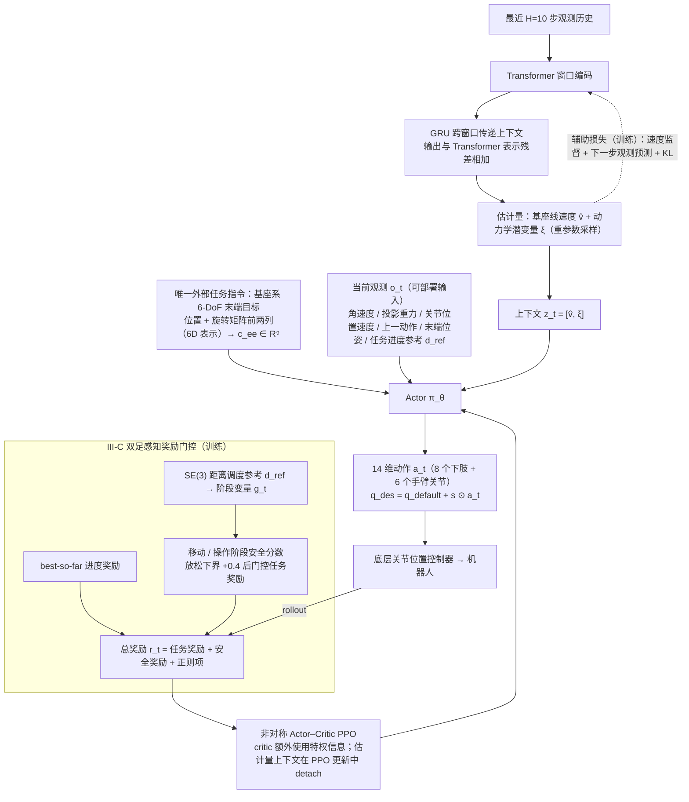

# 双足整体 loco-manip（arXiv:2609.18930）

**双足整体 loco-manip**（*Learning Holistic Whole-Body Loco-Manipulation with a Bipedal Mobile Manipulator*，[arXiv:2609.18930](https://arxiv.org/abs/2609.18930)）来自 [senlanke 具身运控lab 周更盘点](../../sources/blogs/wechat_senlanke_weekly_manipulation_2026-09-14_18.md)（2026-09-14–18）。

## 一句话定义

**统一 WBC 仅输入 6-DoF 末端目标；reward gating 平衡跟踪/移动/平衡；Transformer+GRU+dynamics aux；真机可接 VR/Diffusion/scripted 末端命令。**

## 英文缩写速查

| 缩写 | 英文全称 | 简要说明 |
|------|----------|----------|
| WBC | Whole-Body Control | 全身控制 |
| EE | End-Effector | 末端执行器 |
| RL | Reinforcement Learning | 强化学习 |

## 为什么重要

- 双足移动操作常分离 base 与 arm 命令；整体策略简化上层接口。

## 流程总览

图依据：论文 §III（A 训练流程 / B 时间上下文估计 / C 奖励门控）与 Fig. 2、式 (1)–(14)

## 核心机制

| 项 | 内容 |
|----|------|
| **arXiv** | [2609.18930](https://arxiv.org/abs/2609.18930) |
| **开源** | **待发布**（步骤 2.5，2026-09-20） |
| **方法摘要** | Single RL whole-body policy from EE target only; reward gating; history encoder with dynamics prediction. |

## 源码运行时序图

**不适用**（截至 2026-09-20 未发布可运行官方代码或待核实）。

## 实验与评测

- Real bipedal mobile manipulator; multi high-level command sources（以 PDF 为准）。
- 读法：先对齐任务设定、传感器与成功定义，再解读 headline 数字。

## 与其他工作对比

| 维度 | 读法 |
|------|------|
| **同周对照** | 见对应 [周更盘点](../../sources/blogs/wechat_senlanke_weekly_manipulation_2026-09-14_18.md) 映射表，勿跨任务直接比 SR |
| **开源状态** | **待发布** — 部署前以项目页/arXiv 为准 |

## 结论

**本文展示双足移动操作可由单一低层 WBC 消化多样上层末端指令。**

1. 开源：**待发布**；勿凭公众号摘要臆断可复现性。
2. 指标须连同实验条件解读（仿真/真机、平台、成功阈值）。
3. 关注 arXiv 版本更新与代码发布。

## 关联页面

- [loco-manipulation](../tasks/loco-manipulation.md)
- [reinforcement-learning](../methods/reinforcement-learning.md)
- [diffusion-policy](../methods/diffusion-policy.md)

## 参考来源

- [holistic-biped-loco-manip_arxiv_2609_18930.md](../../sources/papers/holistic-biped-loco-manip_arxiv_2609_18930.md)
- [wechat_senlanke_weekly_manipulation_2026-09-14_18.md](../../sources/blogs/wechat_senlanke_weekly_manipulation_2026-09-14_18.md)
- [arXiv:2609.18930](https://arxiv.org/abs/2609.18930)
- [arXiv PDF](https://arxiv.org/pdf/2609.18930)：已通读方法部分（实验与附录以略读为准）：摘要、§I 引言、§III 方法 A–C（实验与真机部分以略读为准）

## 推荐继续阅读

- [arXiv PDF](https://arxiv.org/pdf/2609.18930)
