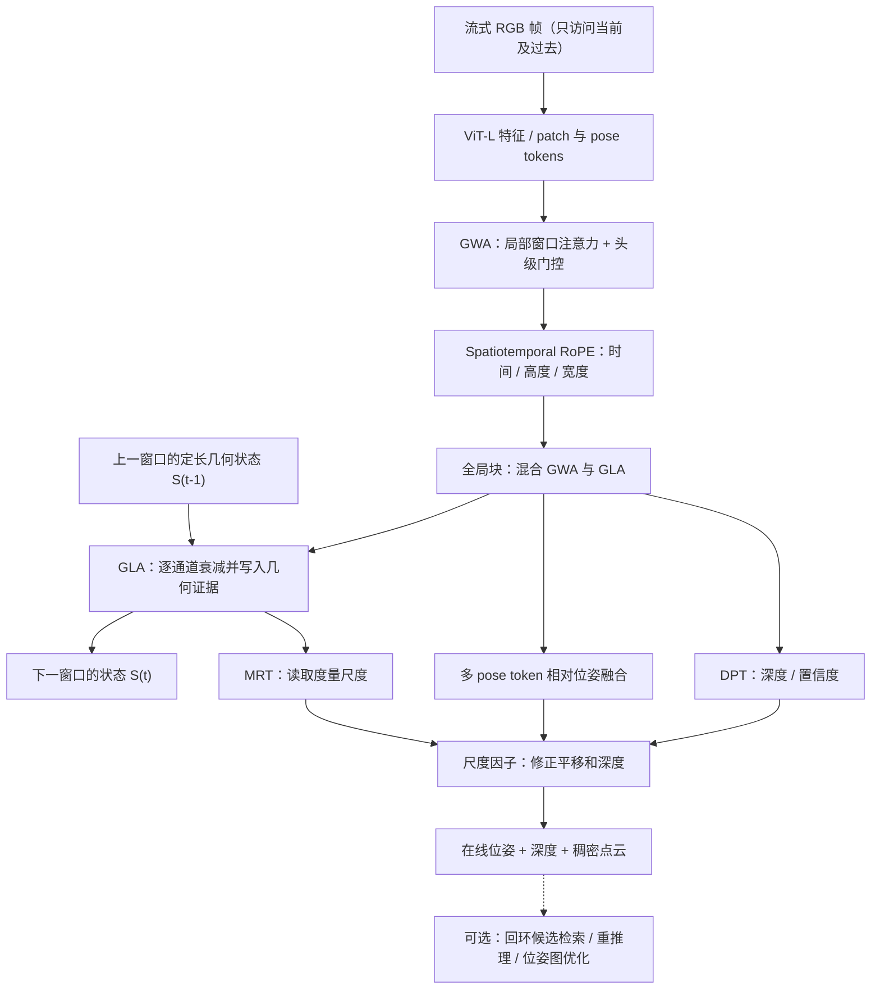

# HorizonStream：用于流式三维重建的长时域注意力
**HorizonStream: Long-Horizon Attention for Streaming 3D Reconstruction**

## 一句话定义

**HorizonStream** 是一个因果、定长状态的单目 RGB 流式 3D 重建网络：用 **GLA（长期几何证据）+ GWA（局部可靠匹配）+ MRT（尺度读出）** 分担不同寿命的几何信息，在每帧输出相机位姿与稠密深度，不必随时间线性增长 Transformer KV 缓存。

## 英文缩写速查

| 缩写 | 英文全称 | 简要说明 |
|---|---|---|
| GLA | Geometric Linear Attention | 通道级遗忘的线性注意力，维护跨窗口的定长几何状态 |
| GWA | Gated Window Attention | 局部窗内头级可靠性门控，配合三轴空间时间 RoPE |
| MRT | Metric Readout Token | 读取跨时刻尺度信息、修正平移与深度 |
| RoPE | Rotary Position Embedding | 时间/高度/宽度的相对位置旋转编码 |
| ATE | Absolute Trajectory Error | 位姿轨迹与真值的绝对误差（m，越低越好） |
| DPT | Dense Prediction Transformer | 用多尺度 token 特征解码深度 |
| LC | Loop Closure | 可选回环检索和位姿图优化 |
| KV | Key-Value Cache | 注意力的键值缓存；局部 KV 与跨窗 GLA 状态不同 |

## 核心信息

| 项目 | 核实内容 |
|---|---|
| 论文 | [arXiv:2605.23889v2](https://arxiv.org/html/2605.23889v2)，2026-10-24 更新 |
| 会议 | **NeurIPS 2026**（论文 arXiv 页面标注 Accepted） |
| 作者 | Chong Cheng、Peilin Tao、Nanjie Yao、Guanzhi Ding、Xianda Chen、Yuansen Du、Xiaoyang Guo、Wei Yin、Weiqiang Ren、Qian Zhang、Zhengqing Chen、Hao Wang |
| 机构 | 香港科技大学（广州）（HKUST(GZ)）、地平线机器人（Horizon Robotics）、中国科学院自动化研究所（CASIA）、中南大学（CSU） |
| 项目/源码 | [作者项目页](https://3dagentworld.github.io/horizonstream/) / [官方实现](https://github.com/3DAgentWorld/HorizonStream) |
| 权重与演示 | [Hugging Face 权重](https://huggingface.co/NicolasCC/HorizonStream) / [在线 Demo](https://huggingface.co/spaces/NicolasCC/HorizonStream_Demo) |
| 输入/输出 | 单目 RGB 视频流 → 相机位姿 SE(3)、稠密深度/置信度、点云（输出保存依配置） |
| 开源与授权 | **推理/评估/回环/权重已公开；训练代码未开放；仓库 CC BY-NC-SA 4.0** |

## 为什么重要

长视频流的几何证据存在寿命冲突：局部匹配随相机移动迅速过期，但全局比例尺和场景结构需要长期保留。固定滑动窗口会遗忘有用旧证据；无门控递归可能积累错误；因果 softmax 长缓存易出现注意力汇聚到早期无关 token。HorizonStream 不单纯扩大上下文，而是让**不同几何通道学会以不同速率遗忘**，使长期状态占用与序列长度脱钩。

## 流程总览（依据原文 §3、Figure 3）



图中 GLA 负责**跨窗**持久信息，GWA 负责**窗内**匹配；回环优化是可选的额外路径，不能把它当成始终在线状态递归的一部分。

## 核心原理

### 1. 证据影响核与不同生命周期

原文 Eq.(1) 将历史第 `i` 帧对时刻 `t` 的作用分解为：

```math
K(t,i)=K_{\mathrm{spatial}}(t,i)\,K_{\mathrm{time}}(t,i)
```

空间项从局部图像内容与 3D 相对位置选择可靠对应；时间项决定历史几何证据保留多少，MRT 再从状态恢复度量尺度。**这是权重影响的形式化分解**，不能把它误读成两个互不通信的独立网络。

### 2. GLA：固定状态、按通道选择遗忘速度

```math
\mathbf S_t=\operatorname{diag}(\boldsymbol\gamma_t)\mathbf S_{t-1}
+\phi(\mathbf k_t)\tilde{\mathbf v}_t^\top,\qquad
\tau^{(c)}=-\frac{1}{\log\bar\gamma^{(c)}}
```

各通道 γ 由网络学习，短寿命信息衰减快，长期几何尺度衰减慢。论文 Appendix B 的状态有界证明要求 **γ 存在小于 1 的统一上界、输入有界**，而非无条件宣称任何场景的轨迹都不会漂移。

### 3. GWA、三轴 RoPE 与度量读出

- **GWA：** 每个 attention head 使用 `sigmoid` 可靠性 gate，减少无关对应与 sink 的影响；RoPE 用时间/空间相对偏移提升窗口内 3D 匹配。
- **MRT：** 帧级 metric token 经 GLA 传播后预测 `s=exp(g(z))`，共同缩放深度与相机平移；pose tokens 聚合出局部共识位姿，DPT 解码深度及置信度。
- **训练目标：** pose/depth/scale 多任务监督，度量尺度 loss 仅作用于具备尺度标签的样本；初始化依赖 VGGT/DINOv2 的视觉先验。

## 实验与评测（论文 §4、Tables 1–6）

| 论文报告的指标 | HorizonStream | 对照与说明 |
|---|---:|---|
| KITTI 平均 ATE（无 LC） | **19.75 m** | LongStream 51.90 m；Lingbot-map 25.29 m |
| Oxford Spires 平均 ATE（无 LC） | **9.38 m** | Lingbot-map 15.46 m |
| VBR 7 条长序列平均 ATE（无 LC / 有 LC） | **25.30 / 18.84 m** | VBR 测试序列包括 10k–18k+ 帧 |
| KITTI 深度 Abs Rel / δ<1.25 | **0.057 / 94.8%** | 不能说每项领先：VGGT 的 δ<1.25 为 97.0% |
| 推理 FPS（无 LC / 有 LC） | **13.20 / 10.45** | 对应论文的指定实验条件，不是部署承诺 |
| vKITTI2 400f ATE 消融 | **完整 1.20** | 去 GLA 5.38；去 GWA 7.46；去 MRT 3.34 |

- 训练阶段仅取 48 帧 clips（分 21 帧计算 chunks、W=10），Stage 1 使用 64×A800 / 60k iterations；Stage 2 使用 64×H20 / 40k iterations。训练集覆盖 24 个来源，包含内部数据。
- vKITTI2 和部分 7Scenes 属于训练重叠评测；Waymo 评测片段明确 held out。不能把所有数据集统称为严格 OOD。
- **常数内存指的是跨窗模型状态规模**；官方 README `--sliding-size 1` 的约 8.5GB 峰值 GPU 内存是特定配置，论文统计不含可选 loop closure，输出保存和点云拼接仍需要增长的存储。

## 结论

**HorizonStream 的主要创新不是增加历史缓存，而是把局部匹配、可学习的跨窗证据保留与度量尺度恢复拆开，使短训练序列能支持更长的因果几何推理。**

1. 需要处理连续机载视频时，优先比较**无 LC** 的长期位姿抖动、尺度漂移、峰值显存及单帧时延。
2. 把训练 48 帧与 10k+ 推理区分为「长度泛化」结论，不等于所有长场景都能保持精确重定位。
3. 对长回访、低纹理、动态前景，需另加回环/几何验证与失败监控。
4. 复现实验时固定滑窗大小、`sliding-size`、相机预处理、数据集切分与 LC 开关。
5. 代码开放不等于训练可复现或商业可直接部署：训练管线未开源且许可限制商业使用。

## 源码运行时序图（依据官方仓库实际入口）

```mermaid
sequenceDiagram
  autonumber
  actor User as 操作者 / CLI
  participant CLI as infer.py:main
  participant Core as core.infer.run_inference_cfg
  participant Data as HorizonStreamDataLoader
  participant Model as HorizonStreamModel
  participant Net as HorizonStream.forward_chunk
  participant Agg as HorizonStreamAggregator / GLA
  participant Cache as GLACache
  participant Out as MotionAveraging / IO
  participant Loop as run_online_loop_reinfer
  User->>CLI: --config --video-path --checkpoint
  CLI->>CLI: load config / prepare_video_input_if_needed
  CLI->>Core: run_inference_cfg(cfg)
  Core->>Model: load checkpoint and set eval()
  Core->>Data: construct loader and iterate sequences
  Data-->>Core: image frames
  Core->>Model: build_sequence_state()
  loop for each _chunk_schedule window
    Core->>Model: forward_chunk(images, window_size, chunk_idx, state)
    Model->>Net: forward_chunk(..., caches)
    Net->>Agg: forward(images, frame/global KV, gla_cache)
    Agg->>Cache: read state_ori / write state_new
    Agg-->>Net: patch features / pose tokens
    Net-->>Model: camera maps + metric scale + DPT depth/conf
    Model-->>Core: chunk_cam_map / depth / depth_conf
    Core->>Model: advance_sequence_state(state, is_last_chunk)
    Model->>Cache: advance: state_new -> state_ori
  end
  Core->>Out: compute_motion_averaged_camera_maps and save poses/depth/points
  Out-->>CLI: output-root sequence artifacts
  opt enabled loop closure and required assets ready
    CLI->>Loop: run_loop_closure_cfg -> run_online_loop_reinfer
    Loop-->>CLI: loop pose / refined pointcloud
  end
  CLI-->>User: output files
```

对应的真实函数、缓存对象、输出文件及默认 loop 行为见 [官方源码核验](../../sources/repos/horizonstream-official.md)。图描述主要调用顺序，不等同于逐行函数栈，也不包含未公开的训练流程。

## 工程实践

1. 按官方 README 准备 Python 3.11、PyTorch 2.8 / CUDA 12.8 对应环境，执行 `python scripts/download_weights.py` 下载公开 checkpoint。
2. 单视频：`python infer.py --config configs/horizonstream_infer.yaml --video-path input.mp4 --checkpoint checkpoints/HorizonStream.pt --output-root outputs_horizonstream/run --no-loop`；**显式 `--no-loop` 是为了对照纯在线结果**。
3. 对论文推理设置使用 `--sliding-size 21`；低显存可以改 `--sliding-size 1` 并用 `--offload-outputs-to-cpu`，但吞吐、内存与预测路径不应未经实测视作相同。
4. 检查 `poses/abs_pose.txt`、`depth/dpt`、`depth/conf`、`points/full.ply`，有 GT 时再用官方 `scripts/evaluate_trajectory.py` 报告 ATE；点云质量还应检查过滤与尺度。
5. 已公开 `run_pipeline.py`、Viser 和 Gradio；回环模块单独评估，并记录是否用 loop 权重。未经真实机器人/算力条件验证，不可把论文 FPS 直接写为机器人端部署指标。

## 局限与风险

- 论文展示的 10k+ 是指定数据集实测；密集重访、外观混淆、低纹理与动态前景可能带来漂移/重定位失效，固定几何状态无法记住所有细节。
- 可选回环涉及历史检索与位姿图优化，不保证严格意义的端到端常数**总内存**；模型状态规模与整条 IO/点云管线需区分。
- 大量训练算力和混合训练数据（含内部数据）；**官方只发布推理、评估、权重，训练代码未开放**，无法无条件从零复现。
- 官方仓库采用 **CC BY-NC-SA 4.0**；非商业授权限制须在产品化前检查，第三方依赖许可另算。
- 论文是视觉重建研究而非定位安全认证；机器人导航/避障使用时仍需多传感器验证、失效恢复与安全策略。

## 关联页面

- [视觉感知与三维重建研究地图](../overview/vision-3d-perception-reconstruction.md)
- [LingBot-Map：几何上下文 Transformer](./paper-lingbot-map.md)
- [ABot-Recon：固定局部上下文](./paper-abot-recon.md)
- [R³：相对回归三维重建](./paper-r3-relative-regression.md)

## 参考来源

- [arXiv v2 全文及附录通读归档](../../sources/papers/horizonstream_arxiv_2605_23889.md)
- [作者项目主页、开源链接核验](../../sources/sites/horizonstream-project.md)
- [官方仓库运行入口 / 缓存与解码调用分析](../../sources/repos/horizonstream-official.md)

## 推荐继续阅读

- [论文 arXiv HTML v2](https://arxiv.org/html/2605.23889v2)
- [作者项目主页](https://3dagentworld.github.io/horizonstream/)
- [官方 GitHub 与 README](https://github.com/3DAgentWorld/HorizonStream)
